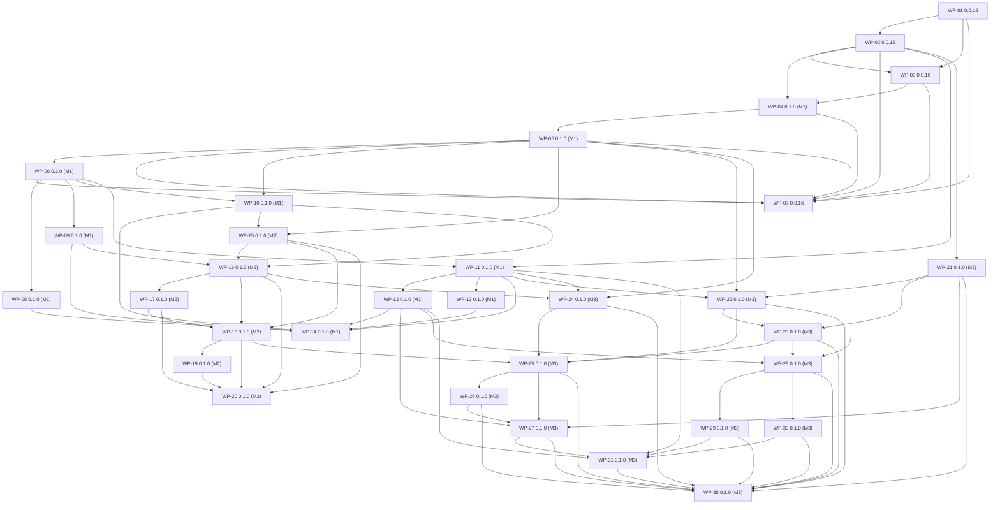

# Large lists: work packages
> Status: plan (spec only, no production code). Spec set: large_lists (see large_lists_README.md).
> Points: 1 to 9. Owner area: delivery. Work packages: WP-01 to WP-32. Decisions: UD-01 to UD-39.

## Purpose

This document cuts the plan into 32 small, reversible work packages (one pull request each), grouped into two releases: the patch release 0.0.16 and the single feature release 0.1.0 with milestones M1, M2 and M3 (UD-01). Every work package must leave the plugin specs green on Redmine 5.1, 6.0, 6.1 and 7.0 and must pass the gates of [`large_lists_quality_protocol.md`](large_lists_quality_protocol.md) before merge. The detailed designs live in the area documents; this document says what goes into which pull request, in which order, and how each one is accepted and rolled back.

## Contents

1. Overview
2. Dependency graph
3. Releases and CHANGELOG lines
4. Work packages
5. Consolidation amendments

## 1. Overview

| WP | Release | Size | Points | Depends on | Title |
|---|---|---|---|---|---|
| WP-01 | 0.0.16 | M | - | - | Local and CI tooling: .codex scripts, RuboCop ratchet, JS toolchain, manual workflows |
| WP-02 | 0.0.16 | M | - | WP-01 | Test hygiene, shared test infrastructure and repository cleanup |
| WP-03 | 0.0.16 | S | 1, 2 | WP-01, WP-02 | Hotfixes in the legacy code: MemCacheStore save crash and bulk-edit data loss |
| WP-04 | 0.1.0 (M1) | M | 1, 2, 3, 5, 6, 7, 9 | WP-02, WP-03 | Characterization specs (Ruby and jsdom) and DB-backed validation specs |
| WP-05 | 0.1.0 (M1) | M | 6, 5 | WP-04 | Central rules module DependencyRules and the single topology helper FieldIndex |
| WP-06 | 0.1.0 (M1) | M | 6 | WP-05 | Shared DependingFormatMethods module for both depending formats; dead code removed |
| WP-07 | 0.0.16 | S | - | WP-01, WP-02, WP-03 | Release 0.0.16 |
| WP-08 | 0.1.0 (M1) | S | 6 | WP-06 | Key/Value list (depending): edit options without duplicates and a single error |
| WP-09 | 0.1.0 (M1) | M | 2, 6 | WP-06 | D1 per-value leniency and issue copies (server) |
| WP-10 | 0.1.0 (M1) | M | 5 | WP-05, WP-06 | Effective parent, server cycle validation, parent select and cycle warning (point 5 server) |
| WP-11 | 0.1.0 (M1) | M | - | WP-02, WP-06 | MySQL TEXT 64 KB safety: storage size validation with a clear i18n error |
| WP-12 | 0.1.0 (M1) | M | 9 | WP-11 | Service error mapping, flash escaping and the audit value cap |
| WP-13 | 0.1.0 (M1) | M | - | WP-11 | Opt-in rake tasks report_sizes and widen_core_columns, MySQL documentation |
| WP-14 | 0.1.0 (M1) | S | - | WP-08, WP-09, WP-10, WP-11, WP-12, WP-13 | Release 0.1.0 (M1) |
| WP-15 | 0.1.0 (M2) | M | 1 | WP-05, WP-10 | Context menu without cache: selection graph, fail-closed wizard roots, named save route (D4) |
| WP-16 | 0.1.0 (M2) | L | 1, 4 | WP-09, WP-10, WP-15 | Issue-form data contract emitted per field (additive, legacy JS untouched) |
| WP-17 | 0.1.0 (M2) | L | 2, 3, 4, 5 | WP-16 | New issue-form runtime (single UMD file) shipped behind the legacy script |
| WP-18 | 0.1.0 (M2) | L | 1, 2, 3, 4, 5 | WP-15, WP-16, WP-17 | Switch: per-field attributes and meta tag replace the inline script; Rails.cache removed (point 1) |
| WP-19 | 0.1.0 (M2) | M | 2 | WP-18 | Radio blank sentinel and required '(none)' in bulk edit and the wizard |
| WP-20 | 0.1.0 (M2) | S | 1, 2, 3, 4, 5 | WP-15, WP-16, WP-17, WP-18, WP-19 | Release 0.1.0 (M2) |
| WP-21 | 0.1.0 (M3) | M | 7, 9 | WP-02 | DependencyPayload: one strict parser for both entry points |
| WP-22 | 0.1.0 (M3) | M | 7 | WP-05, WP-11, WP-21 | Admin JSON transport: virtual attribute dependencies_json (absent = unchanged, '{}' = clear) |
| WP-23 | 0.1.0 (M3) | M | 7 | WP-21, WP-22 | Editor model (pure JS) and cross-layer payload contract |
| WP-24 | 0.1.0 (M3) | M | 7, 9 | WP-05, WP-11, WP-16 | Values endpoint, compact value wire format, editor presenter and shared partial |
| WP-25 | 0.1.0 (M3) | L | 7 | WP-18, WP-22, WP-23, WP-24 | Admin dependency editor UI replaces the matrix (point 7) |
| WP-26 | 0.1.0 (M3) | L | 8 | WP-25 | CSV import and export of the mapping, add missing child values (point 8) |
| WP-27 | 0.1.0 (M3) | L | 9 | WP-12, WP-21, WP-25, WP-26 | Project dependency page on the shared editor with JSON transport and compact audit delta (point 9) |
| WP-28 | 0.1.0 (M3) | L | 9 | WP-05, WP-12, WP-23 | Project values page: server-side search and pagination (point 9) |
| WP-29 | 0.1.0 (M3) | M | 9 | WP-28 | Sort A-Z / Z-A as an audited service (point 9) |
| WP-30 | 0.1.0 (M3) | M | 9 | WP-28 | Page-scoped batch save for Key/Value list values (point 9) |
| WP-31 | 0.1.0 (M3) | M | 9 | WP-11, WP-12, WP-27, WP-29, WP-30 | Large-list safety on project pages: storage ceiling setting and value length cap |
| WP-32 | 0.1.0 (M3) | S | 7, 8, 9 | WP-21, WP-22, WP-23, WP-24, WP-25, WP-26, WP-27, WP-28, WP-29, WP-30, WP-31 | Release 0.1.0 (M3) |

**Release structure (UD-01, resolved by the owner): two releases.** 0.0.16 is a patch release with WP-01, WP-02, WP-03 and WP-07 (tooling, test hygiene, the two hotfixes). Everything else ships together in one release, 0.1.0, built in three milestones: M1 (WP-04 to WP-06 and WP-08 to WP-14: characterization, rules and format modules, server rules, storage safety), M2 (WP-15 to WP-20: issue-form runtime) and M3 (WP-21 to WP-32: editor, import/export, project pages). WP-14 and WP-20 are milestone checkpoints: full evidence run on one SHA, no version bump, no tag. Every work package stays one small pull request. Wherever a document says '0.1.0 (M1)', '0.1.0 (M2)' or '0.1.0 (M3)', the change ships in release 0.1.0 and lands on the main branch during that milestone.

SD-01 (security, wizard save) is not a work package of this plan. Per UD-03 (resolved) it is its own pull request, merged before 0.0.16 is tagged.

## 2. Dependency graph

## 3. Releases and CHANGELOG lines

### 0.0.16

Patch release (UD-01, UD-02, UD-03 resolved): WP-01 tooling (.codex scripts, RuboCop ratchet, JS toolchain, manual 6.1 and JS workflows), WP-02 test hygiene, shared generator and locale parity, WP-03 hotfixes (MemCacheStore save crash, bulk-edit data loss in the legacy JS), WP-07 release, plus the separate SD-01 security pull request. No other behaviour change.

CHANGELOG:

- Fixed: Saving a depending field no longer fails with an internal error on MemCacheStore or other cache stores without delete_matched.
- Fixed: Bulk edit of issues and time entries no longer clears untouched multi-value dependent fields.
- Fixed: The admin custom field form shows 'Default value' instead of a missing translation.
- Removed: the unused and broken test/spec suite.
- Security: The context-menu wizard writes only fields the user may edit (SD-01, own pull request merged before this tag, UD-03).
- Development: local test scripts in .codex mirroring CI, RuboCop ratchet (Ruby 2.7 syntax gate), JavaScript tests with node --test and jsdom, manual workflows for Redmine 6.1 and JavaScript.
- Upgrade notes: Ruby 2.7 or newer is required. Redmine 5.0 remains declared but is not tested; 5.1, 6.0, 6.1 and 7.0 are tested.

### 0.1.0 (one release, built in milestones M1, M2 and M3)

UD-01 (resolved by the owner): everything after the patch release ships in one release. The milestones below are internal checkpoints (WP-14, WP-20) with a full evidence run each; only WP-32 bumps the version and tags 0.1.0. The CHANGELOG 0.1.0 section is the union of the three milestone lists, grouped by Added, Changed, Fixed, Deprecated, Removed, Security, API and Upgrade notes.

#### Milestone M1: server rules and storage safety (WP-04 to WP-06, WP-08 to WP-14)

Server rules and storage safety: WP-08 enumeration options and single error, WP-09 D1 per-value leniency incl. copies, WP-10 effective parent + cycle validation + parent select + cycle warning, WP-11 MySQL TEXT size validation with usage hint, WP-12 service error mapping + flash escaping + audit cap, WP-13 rake tasks report_sizes/widen_core_columns + README MySQL section (+ optional manual MariaDB workflow), WP-14 release. Storage safety ships here (ahead of the 'large-list safety' slot of the ordering) because the editor transport depends on it and it fixes HTTP 500s and silent truncation today.

CHANGELOG:

- Removed: QueryCustomFieldColumnPatch (it had no effect on any supported Redmine version).
- Added: Choosing the field itself or one of its dependent fields as 'Depends on' is refused (form error, HTTP 422 in the APIs).
- Added: The admin form warns about fields that are part of an existing circular dependency; such fields are treated as independent until the cycle is fixed.
- Added: Size validation against MySQL/MariaDB TEXT limits for List, Key/Value list and both depending formats; nothing is truncated anymore.
- Added: Rake tasks redmine:depending_custom_fields:report_sizes and redmine:depending_custom_fields:widen_core_columns (opt-in, dry run by default, CONFIRM=1 to apply).
- Added: A database storage usage line on the custom field form and project pages at 90 percent of the column limit.
- Changed: Stored values that no longer fit the parent are accepted on save until the parent changes; other values of a multi-value field can still be added or removed. In 0.1.0 (M1) this applies to the REST API, email, bulk edit, the wizard and copies; the issue form keeps such values from 0.1.0 (M2) on.
- Changed: Issue copies (single copy, bulk copy, project copy) keep such values when copied unchanged; project copy no longer skips those issues.
- Changed: On issues and projects, a parent field change is now refused while a dependent field that you cannot edit (read-only by workflow or hidden for your role) holds a value the new parent value does not allow (HTTP 422 in the REST API). A dependent field you can see reports is invalid; for one you cannot see, the error is shown on the parent field without naming it (or as a general error when you cannot see the parent field either or its value did not change). Time entries and other objects already refused such changes.
- Changed: The 'Depends on' select no longer offers the field's own dependent fields.
- Changed: Audit before/after values above 16 KB are stored shrunk with payload_truncated, payload_bytes and payload_sha256 of the full value.
- Fixed: Key/Value list (depending): a disallowed new value gives one error instead of two, and the edit form no longer shows the stored value twice.
- Fixed: On MySQL/MariaDB, a value list or dependency mapping that is too large gives a clear validation error (HTTP 422 in the APIs, audited error in project settings) instead of an internal error or silent truncation.
- Fixed: A large mapping save on widened MySQL columns no longer rolls back because its audit row overflowed.
- Fixed: Error messages in project settings no longer interpret HTML in field names.
- API: The response shape is unchanged. New HTTP 422 reasons: circular parent and MySQL oversize; on core issue and project updates, a parent change blocked by a dependent field you cannot edit (WP-09b).
- Upgrade notes: On issues and projects a parent change is now refused while a dependent field you cannot edit holds a value the new parent value does not allow; this also applies to bulk edit, the context-menu wizard, email and REST updates. A new issue, a new project or a copy gets the default value of a dependent field you cannot edit, and so does an issue moved to a tracker or project where that field was not available; the save is refused when the parent value does not allow that default, and a project copy skips such an issue. Until 0.1.0 (M2) the issue form clears an editable dependent field whose stored value its parent does not allow, so the save is refused when a field you cannot edit depends on it. Ask someone who may edit that field to change or clear it first, or an administrator to fix a default value the parent value does not allow.
- Upgrade notes: On MySQL servers running without strict mode, saves that used to be truncated silently are now refused. Core List and Key/Value list fields are checked too. The plugin never alters core tables; widening is an explicit rake task and running Redmine processes keep the old limit until restarted. Run report_sizes once after upgrading: fields reported CORRUPT or SUSPECT were truncated earlier and need their values restored from a backup.

#### Milestone M2: issue-form runtime without inline script (WP-15 to WP-20)

Issue-form runtime without inline script (points 1 to 5): WP-15 context menu without cache, WP-16 per-field data contract (additive), WP-17 new UMD runtime behind the legacy script, WP-18 switch (meta tag + runtime, inline script/globals/Rails.cache/MappingBuilder removed, wizard rework), WP-19 radio sentinel and required '(none)', WP-20 release. Must not be tagged before SD-01 (wizard save security) is merged.

CHANGELOG:

- Changed: Dependent fields are never disabled. Disallowed options are hidden and disabled, and a hint under the field names the parent field.
- Changed: In bulk edit and the context-menu wizard, choosing a parent value keeps '(No change)' available on dependent fields; a per-parent default is preselected with a visible hint; a dependent field is cleared automatically only when the parent is '(none)' or its value allows nothing. Setting the parent back to '(No change)' restores the previous choice.
- Changed: The context-menu wizard opens every field on '(No change)'; saving without choosing changes nothing (it used to write the root field's default).
- Changed: Per-parent defaults are filled in on new records and when the parent changes; they are no longer filled into empty fields of existing records when the form opens.
- Changed: Dependent fields whose parent is read-only on the form or not available for the tracker are filtered by the stored parent value and may be hidden when 'Hide when no valid options' is set.
- Changed: Dependent fields whose parent you cannot see are no longer filtered in the browser and the page no longer contains that parent's mapping; the server still validates them.
- Changed: 'Hide when no valid options' hides the field with its label while the parent offers no options, only on single-record forms, never while a stored non-matching value is shown and never in bulk edit.
- Changed: The context menu hides only dependent fields available for the selected issues and their parents; parents of unavailable fields come back with their full list; fields whose parent was deleted or that are part of a circular configuration show as plain lists.
- Changed: Context-menu responses include dependency data for the wizard fields and can be larger for very big mappings.
- Changed: The change event fires only when a value really changes; listen to the new dcf:updated event for option changes (see README Integration).
- Changed: Fields rendered without Redmine's custom field helpers are no longer filtered in the browser (see README Integration); the server still validates them.
- Changed: Without JavaScript, Key/Value list (depending) fields show all active values; the server still rejects invalid combinations.
- Fixed: Stored values that do not match an unchanged parent stay selected, marked and saved instead of being removed silently on the next save; switching the parent back restores them.
- Fixed: Required radio-style dependent fields can be cleared.
- Fixed: No more browser errors with circular configurations.
- Fixed: The wizard reports server errors and stays open.
- Fixed: The dependency mapping is no longer embedded in every page, including the login page.
- Fixed: The context-menu wizard offers only fields you may edit on every selected issue; a field that is read-only for you on one of them is no longer shown (its value was not saved), and neither are the dependent fields below it.
- Added: In bulk edit and the wizard, required dependent fields offer '(none)' while the parent selection allows no value.
- Added: Hints are announced to screen readers.
- Deprecated: DependingCustomFields.setup and requestSetup (aliases of DependingCustomFields.init) and CustomFieldVisibility; kept at least throughout 0.1.x, removable no earlier than 0.2.0.
- Removed: window.DependingCustomFieldData, window.ContextMenuWizardConfig, MappingBuilder, ParentMenuBuilder, the after_custom_field_save dispatch, data-depending-* attributes, depending_cf_N ids, the hidden mirror inputs and the data-field-id attribute.
- Upgrade notes: Restart Redmine. If automatic plugin asset mirroring (5.1) or redmine_detect_update (6.x/7.0) is disabled or assets are baked into an image, run rake redmine:plugins:assets (5.1) or rake assets:precompile (6.x/7.0). Reload open browser tabs. The cache key depending_custom_fields/mapping is no longer used; before downgrading to an earlier version on a persistent cache store, run bin/rails runner -e production "Rails.cache.delete('depending_custom_fields/mapping')" once.
- Added: The value you last picked for each parent value comes back when you switch the parent back, also after the form refreshes.

#### Milestone M3: dependency editor, import/export, project pages (WP-21 to WP-32)

Dependency editor, import/export and project pages (points 7, 8, 9): WP-21 payload parser, WP-22 admin JSON transport, WP-23 editor model + payload contract, WP-24 values endpoint + presenter + shared partial, WP-25 admin editor UI, WP-26 CSV import/export + add missing child values, WP-27 project dependency page on the shared editor with compact audit delta, WP-28 values page search/pagination, WP-29 sort A-Z/Z-A, WP-30 page-scoped enumeration batch, WP-31 project storage ceiling and value length cap, WP-32 release.

CHANGELOG:

- Added: A dependency editor replaces the checkbox matrix on the admin custom field form and on the project dependency page: collapsible sections per parent value, search, check or uncheck all shown, filters for values without links, counters, per-parent defaults inside each section and inactive values shown and kept.
- Added: CSV import of links (paste or file, preview with per-line errors, merge or replace, undo) and CSV export from the editor, with optional spreadsheet formula protection; 'Add missing child values' for List (depending) fields on the admin form.
- Added: A save is refused when someone else changed the dependency mapping after the page was opened; the editor then shows the current version and your version (use, keep or export yours).
- Added: Search on the project values page for fields with more than 25 values, and pagination for fields with more than 500 values.
- Added: Sort A-Z / Sort Z-A buttons on the project values page; members with 'Manage project custom field configuration' get the new action automatically.
- Added: Page-scoped save of Key/Value list values on paginated or filtered pages, with a warning before leaving unsaved changes.
- Added: Plugin setting for the maximum stored size of changes made in project settings (default 2,048 KiB).
- Changed: The admin form sends the dependency mapping as one field (custom_field[dependencies_json]) and is submitted as multipart/form-data while the editor is active.
- Changed: Saving the admin form without touching the dependencies leaves the stored mapping unchanged.
- Changed: Changing the parent field in the admin form removes links that do not match the new parent's values.
- Changed: The default value field stays visible until a parent field is chosen.
- Changed: Editor saves store defaults as one value for single-value fields and as a list for multi-value fields and normalize the order; API GET output can change after an editor save. The JSON API itself is unchanged.
- Changed: The dependency editors need JavaScript. Without it the admin form keeps the mapping unchanged and the project page disables Save.
- Changed: Links to values that no longer exist are reported by the editor and removed at the next editor save; project audit rows count them.
- Changed: Project dependency audit rows store a compact summary (counts, samples, SHA-256 of the mapping); sort and reorder audit rows store the SHA-256 of the order. The source and import details are reported by the browser and are informational.
- Changed: Drag-and-drop ordering is offered only for unfiltered lists with at most 500 values; redirects keep the search and the page; 'Show usage' reports exact counts.
- Changed: Values added or renamed in project settings are limited to 255 characters, and project-settings changes cannot grow a field beyond the new storage setting.
- Fixed: Unticking every link clears the mapping; parent values containing [ or ] and mappings with more than about 4,000 links can be saved (admin form and project settings).
- Fixed: Links to inactive Key/Value list entries are kept on admin saves.
- Fixed: Correcting a failed dependency save in project settings and saving again no longer reports a conflict.
- Deprecated: Posting value_dependencies / default_value_dependencies as nested params to the project dependency page; send dependencies_json (accepted throughout 0.1.x, removed no earlier than 0.2.0). The admin safe attributes value_dependencies and default_value_dependencies remain permanently.
- Removed: Partials custom_fields/formats/_dependencies_matrix and _default_dependencies, CSS classes .dependencies-matrix*, .dependencies-defaults* and .dcf-dependencies-matrix, locale key text_dependency_matrix_help.
- Upgrade notes: Links dropped by earlier versions (inactive Key/Value entries) cannot be restored. Links stored under parent values containing [ or ] were saved under corrupted keys by earlier versions; the editor lists them as orphans and they must be re-linked once. Copied Key/Value list (depending) fields keep links to the source field's entries (no remap); they show as orphans and are removed at the first editor save. Reverse proxies may limit request bodies (nginx client_max_body_size is 1 MB by default): raise it for very large mappings. On PostgreSQL and SQLite, changes from project settings are limited by the new storage setting; the administration and the API are not. Restart Redmine after upgrading (new asset files).
- Changed: The project dependency page shows the global/shared field warning, and a notice instead of the editor when the parent field is not available in the project or no longer exists.
- Changed: The admin form asks for confirmation before a format change that would discard unsaved dependency edits, warns before leaving with unsaved edits, and now places the dependency editor after 'Hide when no valid options' and the edit style.

## 4. Work packages

### WP-01: Local and CI tooling: .codex scripts, RuboCop ratchet, JS toolchain, manual workflows

| Release | Size | Points | Depends on |
|---|---|---|---|
| 0.0.16 | M | - | - |

**Scope**

D10 tooling, no runtime change. Add .codex/lib/common.sh, .codex/redmine_clone.sh, .codex/test_setup.sh, .codex/test_plugin.sh (suites rspec, system, js, lint, css; --write-fixtures writes into the repo test/js/fixtures), .codex/test_matrix.sh, .codex/rubocop_ratchet.sh and .codex/lib/rubocop_ratchet.rb, mirroring the CI steps (quality design section 4; prototypes in the planning scratch space: design/qa/plugin/.codex, verified on 5.1, 6.0, 6.1, 7.0, evidence E1). Committed .rubocop.yml overlay inheriting core 7.0 config with TargetRubyVersion 2.7, TargetRailsVersion 6.1 and Rails/HttpStatusNameConsistency disabled (deviation from raw D10 config, UD-29; raw config suggests :unprocessable_content which raises on Rack 2.2). Ratchet = Ruby 2.7 Lint/Syntax on all Ruby files + compat grep on added lines (intersect?, Data.define, params.expect, :unprocessable_content, to_prepare, delete_matched, javascript_tag, en and em dash characters) + per-file per-cop count ratchet against the merge-base. The 7 endless defs in spec/patches/custom_field_required_validation_spec.rb become normal defs (otherwise the syntax gate cannot pass, E6). package.json (private, engines node >=22.13, devDependencies jsdom ~29.1.1, jquery 3.7.1, acorn ~8.18.0 per UD-30; scripts check, test, test:ci), package-lock.json, .gitignore (node_modules, coverage), test/js/support/check_assets.js (ES2017 parse of every assets/javascripts/*.js). Workflows: new rspec-61.yml (upstream redmine/redmine 6.1-stable, Ruby 3.3.9, UD-31) and js-tests.yml (npm ci, check, test:ci, core stylelint on plugin CSS), both workflow_dispatch only; rspec-51/60/70 get permissions: contents: read, a system_specs input (default false), rsync --exclude node_modules/, removal of the unused nodejs apt step; rspec-70 also gets lint (default true) and base_ref inputs with fetch-depth 0.

**Files**

- `.codex/lib/common.sh`
- `.codex/redmine_clone.sh`
- `.codex/test_setup.sh`
- `.codex/test_plugin.sh`
- `.codex/test_matrix.sh`
- `.codex/rubocop_ratchet.sh`
- `.codex/lib/rubocop_ratchet.rb`
- `.rubocop.yml`
- `package.json`
- `package-lock.json`
- `.gitignore`
- `test/js/support/check_assets.js`
- `.github/workflows/rspec-51.yml`
- `.github/workflows/rspec-60.yml`
- `.github/workflows/rspec-70.yml`
- .github/workflows/rspec-61.yml (new)
- .github/workflows/js-tests.yml (new)
- `spec/quality/ci_workflows_spec.rb`
- `spec/quality/rubocop_ratchet_spec.rb`
- `spec/quality/fixtures/*.json`
- spec/patches/custom_field_required_validation_spec.rb (endless defs only)

**Tests**

- spec/quality/ci_workflows_spec.rb: every workflow has exactly workflow_dispatch, declares permissions contents read, negative case with push fails
- spec/quality/rubocop_ratchet_spec.rb: identical base/head passes; extra offense in changed file fails with NEW line; new file must be clean; javascript_tag or en dash on an added line fails compat unless marked dcf-compat-ok
- npm run check: every shipped asset parses as ES2017 (acorn rejects ?. ?? and object spread)
- Manual script checks recorded in the WP report: unsupported version exit 2, unmanaged dir exit 3, missing setup exit 6, DB unreachable exit 5

**Acceptance**

- .codex/test_matrix.sh --setup --suite rspec --suite lint prints version=5.1/6.0/6.1/7.0 exit=0 with equal example counts (259 baseline plus the new quality examples, 0 failures) and 'SYNTAX PASS COMPAT PASS RATCHET PASS'
- npm ci && npm run check && npm test exit 0 on Node 22
- git diff shows no change under app/, lib/, config/, assets/, init.rb and the plugin Gemfile
- Every workflow file still triggers only on workflow_dispatch (spec green)

**Compatibility notes**

Developer-only files. Redmine never loads .codex, package.json or test/js; core RuboCop ignores plugins/** so the overlay only affects the ratchet (E5). Plugin Gemfile untouched because it is eval'd into every Redmine bundle. CI stays manual-only.

**Rollback**

Revert the PR. No runtime or data effect; rspec-61.yml and js-tests.yml disappear from the Actions list.

**Related decisions and defects**: UD-29, UD-30, UD-31, UD-32 (resolved), UD-33, UD-34

**Definition of done**: the per-WP report of [`large_lists_quality_protocol.md`](large_lists_quality_protocol.md) (sections 1 to 9) with observed evidence for every applicable gate.

### WP-02: Test hygiene, shared test infrastructure and repository cleanup

| Release | Size | Points | Depends on |
|---|---|---|---|
| 0.0.16 | M | - | WP-01 |

**Scope**

spec/rails_helper.rb: config.order = :random with Kernel.srand, remove the second init.rb load (verified green on 4 versions, E12), reset I18n.locale after each example, system specs opt-in (DCF_SYSTEM_SPECS=1, spec/support/system_driver.rb with core capybara/selenium headless chrome, dcf_login via a.logout, dcf_selectable_options on DOM state because Selenium reports hidden options as displayed, E9), tag exclusions :mysql (unless Redmine::Database.mysql?) and :perf (unless DCF_PERF_SPECS=1). spec/support/query_counter.rb (dcf_count_queries, dcf_count_yaml_loads on ActiveRecord::Store::IndifferentCoder#load, dcf_plugin_overhead) so every later G6 assertion is invariance or differential only. ONE large-list generator: the arithmetic generator of quality revision 2 (spec/support/dcf_large_list.rb plus JS twin test/js/support/large_list.js, naive left-fold sizes(), tricky values, limits byte helpers element_bytes / yaml_list_bytes / values_of_yaml_bytes), pinned SHA-256 prefixes 233acf899217e962 (names(5570, tricky_every: 97)) and 466b240daca61be9 (partition), verified identical on Ruby 3.2.6, 3.3.6 and Node 22.22.0 (E17). Reconciliation: limits revision 2 proposed the mulberry32 generator (0634a624422f2f06) while quality revision 2 adopted the arithmetic one; the arithmetic one wins (cross-language parity proven, exact YAML byte targets, quality owns the generator). spec/support/dcf_config_helpers.rb: dedicated tracker/status builders and dcf_fixture_record with fixed disjoint id ranges (CustomField 9_100_001+, CustomFieldEnumeration 9_200_001+, Issue 9_300_001+, Project 9_400_001+, User 9_500_001+, Role 9_600_001+, Tracker 9_700_001+, IssueStatus 9_800_001+; E23). spec/quality/locale_parity_spec.rb (flattened keys incl. nested activerecord keys, duplicate mapping keys via Psych.parse_stream walk, same %{} variables, no blanks, reviewed English-leftover allowlist, used keys incl. prefixed symbol literals and dcf_* error symbols, I18N constant maps when they exist, per-locale quote convention, no dashes) and spec/quality/no_dash_spec.rb. Fix the only undefined key: l(:label_default_value) becomes core l(:field_default_value) in app/views/custom_fields/formats/_default_dependencies.html.erb:17. Replace the 14 (README) and 3 (CHANGELOG) en/em dashes; README Development and Compatibility sections (Redmine 5.1 to 7.0 tested, 5.0 declared, Ruby 2.7 or newer). Delete the never-run, broken test/spec/** and test/test_helper.rb. Amend docs/specs/project_custom_field_configuration_test_plan.md section 8 (system specs exist, opt-in).

**Consolidation amendments**

- Locale parity spec iterates RedmineDependingCustomFields::ClientConfig::I18N and DependencyEditorConfig::I18N when they are defined (gap 5). The constant name I18N_KEYS is not used anywhere.
- Parity allowlist (keys intentionally identical to en): de and nl text_dcf_live_message; pre-listed fr label_dcf_inactive, fr label_dcf_import_mode and nl label_dcf_tab_char (gap 10). The full allowlist lives in large_lists_i18n_registry.md.

**Files**

- `spec/rails_helper.rb`
- `spec/support/system_driver.rb`
- `spec/support/query_counter.rb`
- `spec/support/dcf_large_list.rb`
- `test/js/support/large_list.js`
- `test/js/large_list_parity.test.js`
- `spec/quality/dcf_large_list_spec.rb`
- `spec/support/dcf_config_helpers.rb`
- `spec/quality/locale_parity_spec.rb`
- `spec/quality/no_dash_spec.rb`
- `spec/system/smoke_spec.rb`
- `app/views/custom_fields/formats/_default_dependencies.html.erb`
- `README.md`
- `CHANGELOG.md`
- `docs/specs/project_custom_field_configuration_test_plan.md`
- test/spec/** (deleted)
- test/test_helper.rb (deleted)

**Tests**

- spec/quality/dcf_large_list_spec.rb and test/js/large_list_parity.test.js pin both hashes; values_of_yaml_bytes(1_000 / 65_535 / 65_536) exact
- spec/quality/locale_parity_spec.rb green (74 keys each, the label_default_value failure is fixed in the same PR); negative fixture with a duplicated nested key fails
- spec/quality/no_dash_spec.rb green on README.md, CHANGELOG.md and config/locales
- spec/system/smoke_spec.rb (opt-in) logs in and opens an issue form on 5.1 and 7.0
- Request spec: admin custom field edit page of a depending field renders the core 'Default value' label and no 'translation missing'

**Acceptance**

- Standard gate: .codex/test_matrix.sh --setup --suite rspec --suite lint green on 5.1, 6.0, 6.1, 7.0 at one SHA (dirty=0)
- Random order: seeds 1, 4242 and 31337 green on 7.0, seed printed in the log
- DCF_SYSTEM_SPECS=1 .codex/test_plugin.sh 5.1 --suite system and 7.0 --suite system exit 0
- No en or em dash in README.md, CHANGELOG.md, locale files

**Compatibility notes**

Only user-visible change is the corrected 'Default value' header. Removing the duplicate init.rb load removes duplicate callbacks in the test process only. Deleting test/spec has no effect: it was never run by CI or rake.

**Rollback**

Revert the PR; specs return to defined order and the label falls back to the missing translation.

**Related decisions and defects**: none

**Definition of done**: the per-WP report of [`large_lists_quality_protocol.md`](large_lists_quality_protocol.md) (sections 1 to 9) with observed evidence for every applicable gate.

### WP-03: Hotfixes in the legacy code: MemCacheStore save crash and bulk-edit data loss

| Release | Size | Points | Depends on |
|---|---|---|---|
| 0.0.16 | S | 1, 2 | WP-01, WP-02 |

**Scope**

Two surgical fixes ahead of the rewrite (UD-02). (1) Remove Rails.cache.delete_matched('dcf/*') from both formats' after_custom_field_save (depending_list_format.rb:79, depending_enumeration_format.rb:89). No 'dcf/*' key is written anywhere in app/ or lib/ (grep), and delete_matched raises NotImplementedError on MemCacheStore, rolling back every depending save. The plain Rails.cache.delete('depending_custom_fields/mapping') stays until WP-18 removes the cache. (2) In assets/javascripts/depending_custom_fields.js replace '#bulk-edit-form' with '#bulk_edit_form' (lines 101, 201, 298); core uses id bulk_edit_form for both issues (core-7.0 app/views/issues/bulk_edit.html.erb:26) and time entries (core-7.0 app/views/timelog/bulk_edit.html.erb:32, core-5.1 :31). Evidence (planning scratch space, design/delivery/hf_harness.js, hf_harness2.js on the jsdom harness): scenario B (untouched multi child) form data goes from ['[1]=','[2][]='] (clears the field on every issue) to ['[1]='] only; B2 likewise; A1 and U2 lose a duplicated child entry; every other scenario output is identical.

**Files**

- `lib/redmine_depending_custom_fields/depending_list_format.rb`
- `lib/redmine_depending_custom_fields/depending_enumeration_format.rb`
- `assets/javascripts/depending_custom_fields.js`
- `spec/models/custom_field_cache_callback_spec.rb`
- `spec/models/depending_format_cache_spec.rb`
- spec/models/cache_store_independence_spec.rb (new, interim part)
- test/js/legacy_bulk_hotfix.test.js (new)
- spec/system/bulk_edit_untouched_multi_spec.rb (new, opt-in)
- `CHANGELOG.md`

**Tests**

- spec/models/cache_store_independence_spec.rb: with Rails.cache replaced by a store whose delete_matched raises NotImplementedError, creating and updating depending_list and depending_enumeration fields and a project-service save succeed (red on fa0adaf, green after)
- Updated cache callback specs assert delete_matched is never called
- test/js/legacy_bulk_hotfix.test.js: harness scenarios A, A', B, B2, Q, U on bulk_edit_form; B posts no child entry (red on fa0adaf, green after)
- Opt-in system spec on 5.1 and 7.0: bulk edit of 2 issues with an untouched multi-select child keeps both stored values after Submit

**Acceptance**

- Standard gate green on 5.1, 6.0, 6.1, 7.0
- Red-green evidence for both defects quoted in the WP report (failing excerpt on fa0adaf, passing after)
- System spec green on 5.1 and 7.0 with screenshots

**Compatibility notes**

Pure fixes. The legacy bulk branch now runs on core bulk edit pages as it already did in the wizard: '(no change)' handling is unchanged, a required multi child stays disabled but no longer posts an empty array. Cache behaviour otherwise unchanged.

**Rollback**

Revert the PR (two code edits). No data effect; reverting reintroduces both defects.

**Related decisions and defects**: UD-02

**Definition of done**: the per-WP report of [`large_lists_quality_protocol.md`](large_lists_quality_protocol.md) (sections 1 to 9) with observed evidence for every applicable gate.

### WP-04: Characterization specs (Ruby and jsdom) and DB-backed validation specs

| Release | Size | Points | Depends on |
|---|---|---|---|
| 0.1.0 (M1) | M | 1, 2, 3, 5, 6, 7, 9 | WP-02, WP-03 |

**Scope**

Pin current behaviour before any refactor (quality 5.1, server 18.1), committed alone. Delivered: reference commit 36b74c7 (the last of four WP-04 commits; later "spec/characterization unchanged" checks diff against it). The SD-14 security fix flips the options rows of wizard_routes_spec.rb right after it. Ruby, DB-backed under spec/characterization/: possible_values_options for nil, a record and an Array, and for a Project passed to an Issue field (all-hidden 3-tuples today); query_filter_values (list all, enum restricted, nil query raises); value_from_keyword (case folding, ; and , split, comma values not importable in multi, duplicates kept, enum id strings, import ordering with unset parent matches full list); validate_custom_value (list one error, enum double error, unchanged legacy combination rejected, multi add next to legacy rejected, issue copy with legacy rejected, stored cycle validated per mapping); enum possible_custom_value_options duplicate; before_custom_field_save normalisation; ContextMenusControllerPatch on the flat 5.x/6.x and namespaced 7.0 controllers; GET depending_custom_fields/options routed to API#show; admin nested-param save (untick-all ignored, ']' corrupts keys, inactive enumeration links dropped); project update_dependencies with no params clears the mapping; enumeration reorder with 3+ rows. JS: test/js/legacy_characterization.test.js pins harness scenarios A0..U2 on the hotfixed legacy script. Also rewrite spec/patches/custom_field_required_validation_spec.rb and spec/lib/value_validation_spec.rb (moved to spec/models/dependency_validation_spec.rb) DB-backed with real fields and identical assertions, so no later WP depends on stand-in classes that lack a callback API (limits V11, server S12).

**Files**

- `spec/characterization/depending_formats_spec.rb`
- `spec/characterization/context_menu_spec.rb`
- `spec/characterization/wizard_routes_spec.rb`
- `spec/characterization/admin_nested_params_spec.rb`
- `spec/characterization/project_dependencies_spec.rb`
- `test/js/legacy_characterization.test.js`
- `spec/patches/custom_field_required_validation_spec.rb`
- `spec/models/dependency_validation_spec.rb`
- spec/lib/value_validation_spec.rb (deleted, replaced)

**Tests**

- All characterization examples listed in scope, both formats via shared examples
- Rewritten required-validation and value-validation specs keep every former assertion, now DB-backed
- Mutation sanity: temporarily breaking the required bypass, the legacy rejection and the bulk selector each makes a named example fail (recorded, reverted)

**Acceptance**

- Standard gate green on 5.1, 6.0, 6.1, 7.0 with no production code change (git diff app lib assets config init.rb empty)
- Characterization commit is a single commit that later WPs reference; later WPs may change these files only for listed flips

**Compatibility notes**

Specs only.

**Rollback**

Revert the PR.

**Related decisions and defects**: none

**Definition of done**: the per-WP report of [`large_lists_quality_protocol.md`](large_lists_quality_protocol.md) (sections 1 to 9) with observed evidence for every applicable gate.

### WP-05: Central rules module DependencyRules and the single topology helper FieldIndex

| Release | Size | Points | Depends on |
|---|---|---|---|
| 0.1.0 (M1) | M | 6, 5 | WP-04 |

**Scope**

New lib/redmine_depending_custom_fields/dependency_rules.rb (module_function, require 'set', literal format names, Ruby 2.7 syntax): DEPENDING_FORMATS, family constants, ParentState (parent, available, values, baseline), normalize_id/normalize_values, parent_id, resolve_parent_for_save (exact today's find_by, memoized on the record through CustomFieldPatch#dcf_memo, never on format singletons), find_parent, carries?, lookup_records (0 queries from loaded objects), allowed_set/allowed_values/default_values (Set based), value_keys and value_options (Ruby tuples [key, label, active], inactive enumerations included, order by possible_values or [position, id]), mapping_problems, prune_mapping (for the admin JSON transport only), parent_candidates/descendant_ids/in_cycle?/cycle_member_ids/children_of on FieldIndex. New field_index.rb: anchored raw-YAML regex PARENT_RE with deserialization fallback, FieldIndex.load (one select_all, no deserialization), FieldIndex.new(records:) lazy from loaded read-only records, ensure (one batched query), ancestor_ids/descendant_ids/children_ids with visited Set and cap 1,000, effective_parent_id_for. Reconciliation: one helper with the server names (load, children_ids); limits' build/child_ids proposal and DependencyRules::Graph are not created. CustomFieldPatch gains dcf_memo only (no callbacks). FieldRelevance.children_of delegates to children_of (same result set and order, characterized). Shared rules case table test/js/fixtures/shared/rules_cases.json (allowed sets, defaults; D1 rows added in WP-09). Nothing else calls the new code yet.

**Delivered (decisions taken during implementation)**

- Walks (ancestor_ids, cycle_from, the effective-parent chain check) follow the raw stored pointers of depending rows through any type and family; only the first hop of effective_parent_id_for is validated (exists, same type, family, not self).
- A self-pointer is a cycle of one (UD-35, owner): cycle_from(A) == [A], in_cycle?(A) is true and children of a self-parent field get no effective parent. in_cycle? and cycle_member_ids are true only for cycle members, not for fields whose chain only reaches a cycle.
- At WALK_CAP (1,000) effective_parent_id_for gives nil (unconstrained) and cycle_from gives [].
- FieldIndex.load(scope = nil): without a scope it loads every depending field and its walks never fetch; with a scope unknown ids are fetched lazily (one batched query per chain level). Deviation from the literal default argument in server design 4, same behaviour for callers.
- children_of orders by [position, id] (core `sorted` orders by position only); the result set equals the stored pointer comparison, a self-parent included. parent_candidates never offers the field itself (UD-36, owner).
- kind returns 'list' or 'enumeration' by family; value_keys and value_options read the enumerations association and deduplicate list values, so value_options.map(&:first) == value_keys.
- mapping_problems is empty exactly when DependencyMappingService#validate_mapping! passes; one Problem per [type, parent_key, child_key], in vd then dd order.
- rules_cases.json schema: {version, description, allowed: [{id, map, parent, expected}], defaults: [{id, map, defaults, parent, expected_multiple, expected_single}]}; the d1 section is reserved for WP-09.
- Not added (later WPs): parent_state, allowed_for, effective_parent_id, dependency_check, no_options?, baseline_source, child_baseline, parent_changed?, parent_errors. WP-06 adds parent_state and allowed_for (it may edit dependency_rules.rb); WP-10 adds effective_parent_id and the cycle validation.
- dcf_memo is not reset on reload: within one request the record is the unit of memoization; callers that need fresh topology use a fresh instance (WP-27).

**Consolidation amendments**

- DependencyRules API adds parent_of(cf): memoized on the record, returns the parent record or nil for blank, dangling, wrong type or family, or self (gap 2). Specified and spec-covered here; used by WP-16 (through effective_parent_id) and WP-27.

**Files**

- lib/redmine_depending_custom_fields/dependency_rules.rb (new)
- lib/redmine_depending_custom_fields/field_index.rb (new)
- `lib/redmine_depending_custom_fields.rb`
- `lib/redmine_depending_custom_fields/patches/custom_field_patch.rb`
- `app/services/redmine_depending_custom_fields/field_relevance.rb`
- test/js/fixtures/shared/rules_cases.json (new)
- spec/lib/dependency_rules_spec.rb (new)
- spec/lib/field_index_spec.rb (new)

**Tests**

- spec/lib/field_index_spec.rb: parent_id_from_raw for 12, '12', "12", '', nil, nested keys and block scalars; raw read leaves format_store undeserialized; ensure batches into one query; ancestor/descendant terminate on A->A, A<->B and long chains
- spec/lib/dependency_rules_spec.rb: normalize_id, carries?, lookup_records 0 queries (invariance), allowed/default cases from rules_cases.json, mapping_problems, prune_mapping keeps inactive enum ids, value_options order and inactive handling
- FieldRelevance.children_of returns the same set of records as before (characterization unchanged; today's query has no ORDER BY, the new one orders by position and id)
- spec/lib/dependency_rules_spec.rb: parent_of returns nil for blank, dangling, wrong STI type, wrong family and self; returns the record otherwise; second call does not query (gap 2).

**Acceptance**

- Standard gate green on 5.1, 6.0, 6.1, 7.0
- git diff <WP-04 commit>..HEAD -- spec/characterization is empty
- FieldIndex.load issues exactly one query regardless of 1 or 25 depending fields (invariance spec)
- Ratchet: new files have zero offenses under the overlay

**Compatibility notes**

Internal only; no caller behaviour change.

**Rollback**

Revert the PR; FieldRelevance returns to its own walk.

**Related decisions and defects**: none

**Definition of done**: the per-WP report of [`large_lists_quality_protocol.md`](large_lists_quality_protocol.md) (sections 1 to 9) with observed evidence for every applicable gate.

### WP-06: Shared DependingFormatMethods module for both depending formats; dead code removed

| Release | Size | Points | Depends on |
|---|---|---|---|
| 0.1.0 (M1) | M | 6 | WP-05 |

**Scope**

New lib/redmine_depending_custom_fields/depending_format_methods.rb, INCLUDED in DependingListFormat and DependingEnumerationFormat (field_attributes in self.included; assigns no instance variables). It carries: normalized_store_pairs (sanitize-only, exactly today's before_save incl. parent normalization; never prunes, BC-02), storage_preview(custom_field, store) (same pairs, byte-identical YAML, for limits), before_custom_field_save via the pairs, possible_values_options (parent read from customized.custom_field_values, 0 queries; same output as today incl. hidden 3-tuples for non-carrying objects until WP-15), validate_custom_value (today's semantics incl. whole-set legacy rejection until WP-09 and the enum double error until WP-08), validate_custom_field (super for now), value_from_keyword (one downcase(:fold) Hash per call over the full list, first match wins, results identical), after_custom_field_save (plain delete, kept until WP-18). Class bodies keep add, form_partial, label, query_filter_values. Duplicated code removed from both format files. Delete QueryCustomFieldColumnPatch, its init.rb lines (Query reference and prepend) and its spec: verified no-op because core ignores options[:sortable] (core-5.1 app/models/query.rb:128-135, core-7.0 :136-143).

**Files**

- lib/redmine_depending_custom_fields/depending_format_methods.rb (new)
- `lib/redmine_depending_custom_fields/dependency_rules.rb` (adds parent_state and allowed_for, used by the shared module)
- `lib/redmine_depending_custom_fields/depending_list_format.rb`
- `lib/redmine_depending_custom_fields/depending_enumeration_format.rb`
- `init.rb`
- lib/redmine_depending_custom_fields/patches/query_custom_field_column_patch.rb (deleted)
- spec/patches/query_custom_field_column_patch_spec.rb (deleted)
- spec/lib/depending_format_methods_spec.rb (new)
- `spec/lib/depending_list_format_spec.rb`
- `spec/lib/depending_enumeration_format_spec.rb`
- spec/quality/format_singleton_state_spec.rb (new)
- spec/requests/issue_form_query_invariance_spec.rb (new)
- `CHANGELOG.md`

**Tests**

- spec/lib/depending_format_methods_spec.rb: normalized_store_pairs/storage_preview YAML equals persisted bytes (string parent id, invalid parent, blank keys); one parent lookup across validation and save (memo); value_from_keyword equals characterized results; 100,000 keywords vs 5,570 options under 200 ms (tag :large)
- spec/quality/format_singleton_state_spec.rb: no instance-variable assignment in the three format files; two sequential requests with different parents do not share results
- Issue edit query count identical for 1 child and 5 children of 5 distinct available parents (invariance)

**Acceptance**

- Standard gate green on 5.1, 6.0, 6.1, 7.0
- git diff <WP-04 commit>..HEAD -- spec/characterization is empty (no flips in this WP)
- Ratchet passes; offenses of deleted duplicate code show as fixed=

**Compatibility notes**

No behaviour change. Removing QueryCustomFieldColumnPatch is invisible (it never had an effect). CHANGELOG Removed line.

**Rollback**

Revert the PR; both format classes return to their duplicated bodies.

**Related decisions and defects**: UD-38

**Delivered (decisions taken during implementation)**

- DependencyRules.parent_state and allowed_for carry today's semantics (any type, any family and the field itself count as a parent; the parent value is read from customized.custom_field_values without a query; the raw 0.0.16 union, blank keys included). WP-09, WP-10 and WP-15 switch them to the design contract (allowed_set, effective parent, carries?).
- Both query_filter_values bodies are kept verbatim (pre-existing RuboCop offenses included), so their behaviour cannot drift.
- Perf budget: the default run asserts exact results and under 2 s for 100,000 keywords against 5,570 options; the literal 200 ms budget runs with DCF_PERF_SPECS=1 (measured 110 to 147 ms), because G6 allows wall clock only with 10x headroom.
- The issue form invariance spec uses the PATCH path and an enumeration variant: the literal list GET edit shape was already equal before WP-06. It was red on the WP-05 head and is green now (fewer queries, same output).
- spec/lib/dependency_rules_spec.rb is changed too (parent_state and allowed_for examples). "spec/characterization unchanged" is checked against the WP-06 base (156b8a2), because the SD-14 flips already changed wizard_routes_spec.rb after 36b74c7.

**Definition of done**: the per-WP report of [`large_lists_quality_protocol.md`](large_lists_quality_protocol.md) (sections 1 to 9) with observed evidence for every applicable gate.

### WP-07: Release 0.0.16

| Release | Size | Points | Depends on |
|---|---|---|---|
| 0.0.16 | S | - | WP-01, WP-02, WP-03 |

**Scope**

Bump init.rb version to 0.0.16, finalize the CHANGELOG 0.0.16 section (Fixed: MemCacheStore, bulk data loss, Default value label; Removed: unused test/spec suite; Upgrade notes: Ruby 2.7 or newer), README Compatibility and Development. Add the Security line for SD-01: per UD-03 (resolved) the wizard-save fix is its own pull request, merged before this tag. Full evidence run. WP-04 to WP-06 are not part of this patch release (UD-01 resolved: they move to 0.1.0, milestone M1).

**Files**

- `init.rb`
- `CHANGELOG.md`
- `README.md`

**Tests**

- Full matrix rspec + lint, npm test, system specs on 5.1 and 7.0

**Acceptance**

- One SHA green on 5.1, 6.0, 6.1, 7.0 plus SYNTAX/COMPAT/RATCHET PASS
- CHANGELOG lists every 0.0.16 perceptible change (PC-01, PC-02, PC-03, PC-05) and the SD-01 Security line
- Optional manual CI dispatch per quality protocol section 10 (UD-32, resolved): only after the local gates pass, at most once per workflow per SHA, reported with workflow, SHA, run URL and result; headSha equals the release SHA

**Compatibility notes**

Patch release; no intended behaviour change beyond the listed fixes.

**Rollback**

Do not tag; revert the version bump commit.

**Related decisions and defects**: SD-01, UD-01, UD-03, UD-32 (resolved), UD-34

**Definition of done**: the per-WP report of [`large_lists_quality_protocol.md`](large_lists_quality_protocol.md) (sections 1 to 9) with observed evidence for every applicable gate.

### WP-08: Key/Value list (depending): edit options without duplicates and a single error

| Release | Size | Points | Depends on |
|---|---|---|---|
| 0.1.0 (M1) | S | 6 | WP-06 |

**Scope**

DependingEnumerationFormat#possible_custom_value_options returns the unfiltered active list plus the stored value_was ids (inactive included) as 2-tuples, fixing the hidden 3-tuple plus visible duplicate caused by core RecordList using options.map(&:last) (core-7.0 lib/redmine/field_format.rb:789-806). validate_custom_value merges dependency errors with core errors as errors + (dep_errors - errors), so a disallowed new value gives exactly one 'is invalid'. A crafted inactive id that is not stored stays rejected (QA-21). Flips the characterized enum rows: the duplicate option, and the double error through the shared parameter %w[inclusion invalid] (new disallowed value and issue copy).

**Files**

- `lib/redmine_depending_custom_fields/depending_enumeration_format.rb`
- `lib/redmine_depending_custom_fields/depending_format_methods.rb`
- spec/characterization/depending_formats_spec.rb (listed flips: enum duplicate option, enum double error parameter)
- `spec/lib/depending_format_methods_spec.rb`
- `CHANGELOG.md`

**Tests**

- Enum edit options: 2-tuples only, no duplicate, stored inactive id appended, crafted unstored inactive id rejected
- Disallowed new enum value gives exactly ['is invalid'] in en and de

**Acceptance**

- Standard gate green on 5.1, 6.0, 6.1, 7.0
- Characterization diff shows only the two listed rows, each referenced in the PR

**Compatibility notes**

Strictness for new values unchanged; one error message instead of two; edit form no longer lists the stored value twice.

**Rollback**

Revert the PR.

**Related decisions and defects**: none

**Delivered (decisions taken during implementation)**

- DependingEnumerationFormat#possible_custom_value_options takes possible_values_options(custom_field) without the object and appends the stored value_was ids missing from it as [name, id] pairs. Like core RecordList they are looked up across fields (CustomFieldEnumeration.where(id:)), so a stored id of another field assigned unchanged stays accepted and an unknown or non-numeric id adds nothing; they are ordered by position. Only value_was is read, so a crafted inactive id that is not stored stays rejected (QA-21).
- validate_custom_value returns the core errors first, then 'is invalid' unless core already gave it (errors + (dep_errors - errors)). The list format output is unchanged.
- Interim state until WP-16 to WP-18 (M2): the server no longer hides disallowed enumeration options in the issue, project and time entry forms. A Key/Value list (depending) child whose parent is read-only by workflow or not available for the tracker therefore shows all active values even with JavaScript, because the legacy script has no parent input to filter by; after an AJAX form re-render the list also stays unfiltered for the legacy debounce window (about 100 ms). The server still rejects disallowed values with 'is invalid'; strictness is unchanged. Pinned by 'renders every active value, none hidden, when the parent is not available for the tracker' (spec/lib/depending_format_methods_spec.rb). WP-16 to WP-18 filter these cases in the browser through data-dcf-parent-values (fixture scenarios workflow read-only parent and parent unavailable for tracker); the server keeps rendering the full list, so that example does not flip.
- Characterization flips, only in spec/characterization/depending_formats_spec.rb: the enumeration shared parameter %w[inclusion invalid] became %w[invalid] (the rows that read it: "rejects a disallowed value on a new issue", "rejects an issue copy holding a legacy combination like a new disallowed value" and the new-value row of "validates the members of a stored cycle against their mappings"), and "offers a stored disallowed value twice" became "offers a stored disallowed value once in the edit form, as a plain pair (Flipped by WP-08)".
- The stale comments of spec/requests/issue_form_query_invariance_spec.rb (header and enumeration describe) are corrected: since WP-08 the enumeration edit form does not read the parent.

**Definition of done**: the per-WP report of [`large_lists_quality_protocol.md`](large_lists_quality_protocol.md) (sections 1 to 9) with observed evidence for every applicable gate.

### WP-09: D1 per-value leniency and issue copies (server)

| Release | Size | Points | Depends on |
|---|---|---|---|
| 0.1.0 (M1) | M | 2, 6 | WP-06 |

**Scope**

DependencyRules.dependency_check implements D1 per value (UD-04): while the parent is unchanged (order-insensitive; a parent not available on the object counts as changed, so the child must be cleared as today, UD-05) every value in the baseline is tolerated and only newly added values must be allowed; when the parent changed, all values are validated. Baseline = the stored value (value_was when a saved row holds the field; [] without one, also when a tracker or project change fills in the field default), or for new records with copy? true the source issue's stored values via @copied_from (core has no reader; pinned by a spec on all 4 versions; falls back to strict, never crashes) (UD-06). A child the current user cannot edit gets the same rule (UD-07, confirmed after the WP-09 observation: the rules lead on every object): core validates it on time entries and the other customizables; on issues and projects, which validate only editable_custom_field_values, the WP-09b follow-up adds the check, where a parent not available on the record counts as unchanged (WP-09c, owner; see Delivered). No editable_by? helper. validate_custom_value uses it; the required bypass in CustomFieldPatch#validate_custom_value moves to DependencyRules.no_options? with unchanged semantics. Rows added to test/js/fixtures/shared/rules_cases.json (multi add allowed, add disallowed, remove legacy, reorder, keep legacy and change parent, single legacy to allowed, single legacy to other disallowed, parent unavailable untouched: invalid). Legacy JS (still active until WP-18) drops a disallowed stored value on load, so form saves of editable children are unchanged until 0.1.0 (M2) (when a field the user cannot edit depends on the cleared field, WP-09b refuses the save; see Delivered); REST, mail, bulk '(no change)', wizard and copies benefit now.

**Files**

- `lib/redmine_depending_custom_fields/dependency_rules.rb`
- `lib/redmine_depending_custom_fields/depending_format_methods.rb`
- `lib/redmine_depending_custom_fields/patches/custom_field_patch.rb`
- `test/js/fixtures/shared/rules_cases.json`
- `spec/models/dependency_validation_spec.rb`
- `spec/patches/custom_field_required_validation_spec.rb`
- spec/requests/dcf_issue_flows_spec.rb (new)
- spec/requests/dcf_issue_copy_spec.rb (new)
- spec/characterization/depending_formats_spec.rb (listed flips)
- `CHANGELOG.md`
- WP-09b: `lib/redmine_depending_custom_fields/non_editable_dependencies.rb` (new), `lib/redmine_depending_custom_fields/patches/issue_validation_patch.rb` (new), `lib/redmine_depending_custom_fields/patches/project_validation_patch.rb` (new), `init.rb`, `config/locales/{de,en,fr,nl}.yml`, `docs/specs/large_lists_i18n_registry.md`, spec/requests/dcf_non_editable_children_spec.rb (new), spec/requests/dcf_issue_flows_spec.rb (two flips), spec/quality/format_singleton_state_spec.rb (scans the new files)

**Tests**

- D1 matrix through safe_attributes for list single, list multi and enum (incl. stored inactive enum id): unchanged, reorder, remove one, add allowed, add disallowed, each with parent unchanged, changed, unavailable (unavailable is strict: a non-blank child gives 'is invalid', as today, UD-05)
- REST notes-only update keeps a legacy combination; REST add of a new disallowed value gives 422
- Issue#copy, bulk copy and Project#copy_issues of a legacy combination succeed; project copy drops no issue (WP-09b exception: an issue whose non-editable child core resets to a stale default the parent value does not allow is skipped, pinned); copy with a changed child or parent is strict
- Non-editable child unchanged while the parent changes to a value that does not allow it (UD-07 confirmed, WP-09b): rejected on issue, project and time entry. On issues and projects: visible read-only child: 'is invalid' under its name; role-invisible child: dedicated message on the changed parent, child not named, or the base message (`error_dcf_hidden_child_conflict`) when the parent is not shown to the user either (role-invisible) or its value did not change; every failing value is placed (a read-only child, a hidden sibling and a hidden child of a second parent in one validation give three entries); en and de; list and enumeration children, single and multiple. On a time entry (and a version) core validates every value and names the child, also a role-invisible one (known exception, recorded under UD-07). Parent not available on the issue (WP-09c, owner): for a hidden or read-only child holding a value it does not count as changed, so form, bulk, wizard, notes-only mail and REST edits and tracker or project moves that make the parent unavailable save and keep the value (flipped from the WP-09b UD-05 steady-state refusals); a child the user can edit is still refused (UD-05), and a parent that is available again and changes is still refused (WP-09b). New issues, new projects, copies and moves: a stale non-editable default the parent value does not allow gives 422 (REST issue create and copy, REST project create, REST tracker change that makes the child available) and is skipped by a project copy; a copy that keeps the parent and the tracker move get the base message; under an unavailable parent a stale default is still refused with the base message (REST create, copy against the source, tracker move)
- Shared rules_cases.json rows evaluated by spec/lib/dependency_rules_spec.rb
- Bulk update of an unrelated attribute on issues holding legacy combinations succeeds (D1, QA-14, gap 12).

**Acceptance**

- Standard gate green on 5.1, 6.0, 6.1, 7.0 (the @copied_from spec passes on every version)
- Characterization diff limited to the listed rows (unchanged legacy, multi add, copy)
- Mutation check: disabling the per-value exemption makes a named example fail

**Compatibility notes**

Fewer rejected saves for editable children; never accepts a newly added invalid value. Stored invalid combinations can persist by design while the parent is unchanged (data hygiene report tracked as SD-12). Stricter (WP-09b, UD-07): on issues and projects a parent change is now refused while a dependent field the user cannot edit holds a value the new parent value does not allow (PC-69).

**Rollback**

Revert the PR to restore strict whole-set validation; no data migration. Records saved meanwhile keep their already-existing legacy values.

**Related decisions and defects**: SD-12, UD-04, UD-05 (kept as today; for non-editable children refined by WP-09c), UD-06, UD-07 (confirmed: the rules lead, WP-09b; UD-05 steady state resolved, WP-09c)

**Delivered (decisions taken during implementation)**

- WP-09b (follow-up, UD-07 confirmed on 2026-10-15): `Patches::IssueValidationPatch` and `Patches::ProjectValidationPatch` (prepended in init.rb on Issue and Project only) call core's `validate_custom_field_values` first, then `NonEditableDependencies.validate`, which applies `DependencyRules.parent_state` and `dependency_check` (the same D1 rule: tolerated while the parent is unchanged, copies judged against the source; an unavailable parent counted as changed until WP-09c, see below) to the depending children NOT in `editable_custom_field_values(user)`. Core's user and gate: issue `new_record? ? author : current_journal.try(:user)` (nil falls back to User.current), project `User.current`; only on `new_record? || custom_field_values_changed?`. No core required, inclusion or regexp check and no value rewrite on those children. Time entries and other customizables are not patched (core validates every value).
- Placement: a child in `visible_custom_field_values(user)` (read-only by workflow) gets core's 'is invalid' under its name. A role-invisible child is never named: `activerecord.errors.messages.dcf_hidden_child_conflict` on the parent field when its value changed, once per parent. When the parent is not shown to the user either (role-invisible, or not available after a tracker or project change), naming it would show a hidden field, so a second key, `error_dcf_hidden_child_conflict`, goes on base, once; the same key goes on base when the parent value did not change (core gave the hidden child a stale default on a copy, a move or a programmatic project copy), where 'cannot be changed ... the new value' would be wrong (refinements recorded under UD-07, owner acknowledgement pending). Both keys are in all four locales and in the i18n registry (owner WP-09b; WP-09b creates the nested `activerecord.errors.messages` block).
- Cost: no query unless a depending child fails the check; then the editable and visible sets once per validation. New issues: core resets non-editable values to the field default before validation (Issue only), so issue copies, imports and new issues never keep a non-editable source value; a stale non-blank default is judged strictly (a copy: against the source), so REST create and copy answer 422 and Project#copy_issues skips that issue (logged; Project#copy returns false). A tracker or project move that makes a non-editable child available gives it the default too, judged without tolerance (no stored row). A new project gets the default of every field the user cannot see (Project#safe_attributes= drops the posted value), so REST POST /projects.json answers 422 for a stale default; the UI project copy is admin-only, where core validates every field. Project.copy_from keeps the project values the user cannot edit; such a programmatic copy is judged strictly (base message: its cloned rows make the parent read as unchanged). Pinned in spec/requests/dcf_non_editable_children_spec.rb.
- Accepted consequences (server design section 8 rule 3; recorded under UD-07, owner acknowledgement pending): WP-09b refused every edit that assigned custom values while the parent field was not available on the issue (UD-05 steady state); the owner resolved this on 2026-10-16 (WP-09c, below). Until 0.1.0 (M2) the legacy script clears an editable dependent field whose stored value its parent does not allow and posts '', so a form save is refused when a field the user cannot edit depends on it (open input to WP-17 and WP-18).
- Leak checks: JSON bodies (issue REST, tracker moves, wizard, also a save under an unavailable parent, project REST update and create, REST create and copy) never contain the child name or value; HTML bodies (issue form, bulk edit, project settings) are checked outside the pre-existing `window.DependingCustomFieldData` head script, which carries every mapping until WP-18 removes it (FM-20b).
- Flipped by WP-09b, only in spec/requests/dcf_issue_flows_spec.rb: "saves the change when the child is read-only by workflow (core does not validate it), in en and de" became "rejects the change when the child is read-only by workflow, with is invalid under the child name, in en and de (Flipped by WP-09b)"; "saves the change when the child is not visible for the user role (core does not validate it), in en and de" became "rejects the change on the parent field without naming a child the user cannot see, in en and de (Flipped by WP-09b)". The time entry example is kept and also asserts no parent error. spec/characterization is unchanged.
- Review round 2 (WP-09b): a hidden child under a parent whose value did not change now gets the base message instead of the parent-field message (no 'new value' exists: a copy that keeps the parent, a tracker or project move with a stale default, a programmatic `Project.copy_from`); the WP-09b example "judges a programmatic copy strictly" was adjusted accordingly. New pins: three distinct placements in one validation, a visible read-only child under a parent made unavailable by a tracker change, the wizard in the UD-05 steady state, a REST project move, a REST project create with a stale hidden default, a copy that keeps the parent (model and REST) and a tracker move with a stale default.
- WP-09c (owner decision 2026-10-16, refining UD-07 and WP-09b): for a depending child the user cannot edit (read-only by workflow or role-invisible), a parent field that is not available on the record (disabled for the tracker or project, or removed) does not count as changed, because nobody changed it. `NonEditableDependencies.failing_values` replaces such a parent state by `DependencyRules::ParentState.new(parent, true, [], [])`, so `changed?` is false, nothing is allowed and the child baseline is tolerated (only new values must be allowed); `DependencyRules.parent_state` and `ParentState#changed?` are unchanged, so a child the user can edit keeps UD-05 through the formats, and an available parent that changed stays strict (WP-09b). Notes-only form and bulk edits, the wizard, email replies, REST updates and tracker or project moves that make the parent unavailable now save. Stale core defaults stay judged by D1: a new issue that is no copy has no baseline, so a stale default under an unavailable parent is still refused, with the base message for a hidden child; a copy is judged against the source. Flipped by WP-09c (owner: unavailable parent does not count as changed for non-editable children), only in spec/requests/dcf_non_editable_children_spec.rb: the UD-05 tracker-change refusals of a hidden and of a visible read-only child, the REST project move, and the five steady-state refusals (form edit of another field, form note, bulk note, wizard save, notes-only mail reply) now save. New pins: a read-only child under a disabled parent saves on the model; an editable child is still refused after a tracker change (en and de) and on a form edit (UD-05); a parent that is available again and changes is still refused (WP-09b); a stale hidden default under an unavailable parent is still refused with the base message on a REST create, a copy (while the source value is tolerated) and a tracker move. The upgrade note no longer lists the steady-state refusal or tracker and project moves that make the parent unavailable (identical in CHANGELOG.md, the compatibility PC-69 and section 6, section 3 and the server design section 19). spec/characterization is unchanged.

**Definition of done**: the per-WP report of [`large_lists_quality_protocol.md`](large_lists_quality_protocol.md) (sections 1 to 9) with observed evidence for every applicable gate.

### WP-10: Effective parent, server cycle validation, parent select and cycle warning (point 5 server)

| Release | Size | Points | Depends on |
|---|---|---|---|
| 0.1.0 (M1) | M | 5 | WP-05, WP-06 |

**Scope**

DependencyRules.effective_parent_id: parent exists, same type, family format, not self, and the ancestor chain (FieldIndex, visited Set) is acyclic; parent_state uses it, so fields in or below a stored cycle and dangling parents are unconstrained on the server (UD-08). parent_changed? compares the normalized id with attribute_in_database('format_store') (store dirty helpers are unreliable, F1). parent_errors returns [:parent_custom_field_id, :dcf_circular_dependency] only for persisted fields whose normalized parent id changed (D9 refinement so reorder, cascades and unrelated API saves of stored-cycle members keep working); unresolvable parents keep the silent nil. validate_custom_field = super + parent_errors, which flows to the admin form, the plugin API (422 {errors}), project services and jc-redmine_extended_api. _depending_list/_depending_enumeration parent select from DependencyRules.parent_candidates (same type and family, minus self and descendants, always keeps the current parent). Cycle warning p.icon.icon-warning with sprite_icon guard (UX-10) and comma-joined names. Locale keys at parity (server design section 15): field_parent_custom_field ('Depends on'), warning_dcf_parent_cycle, activerecord.errors.messages.dcf_circular_dependency.

**Consolidation amendments**

- README note: concurrent creation of a cycle by two simultaneous admin saves is an accepted race; the guards are the client visited-set, server leniency for cycle members and the admin cycle warning (QA-19, gap 14).

**Files**

- `lib/redmine_depending_custom_fields/dependency_rules.rb`
- `lib/redmine_depending_custom_fields/field_index.rb`
- `lib/redmine_depending_custom_fields/depending_format_methods.rb`
- `app/views/custom_fields/formats/_depending_list.html.erb`
- `app/views/custom_fields/formats/_depending_enumeration.html.erb`
- `config/locales/en.yml`
- `config/locales/de.yml`
- `config/locales/fr.yml`
- `config/locales/nl.yml`
- spec/support/dcf_stored_cycle.rb (new)
- spec/models/custom_field_cycle_validation_spec.rb (new)
- `spec/requests/depending_custom_fields_api_spec.rb`
- spec/requests/custom_fields_admin_form_spec.rb (new)
- `spec/views/custom_fields/formats/depending_list_spec.rb`
- `spec/views/custom_fields/formats/depending_enumeration_spec.rb`
- spec/characterization/depending_formats_spec.rb (stored cycle flip)
- `CHANGELOG.md`

**Tests**

- Self parent and closing A->B->A or a 3-level cycle give :dcf_circular_dependency; same id posted as String is no change; unresolvable parent saves nil; new records never error
- Stored cycle written with validate: false: position-only save, change to a non-cycle parent and a RenameValueService cascade succeed
- API: PUT own id as parent 422; PUT closing A<->B 422; unknown parent 200 with null; name-only PUT leaves value_dependencies byte-identical incl. orphan and bracket keys
- Admin form: select excludes self and descendants and keeps the current parent in a stored cycle; warning rendered with svg on 6.x/7.0 and classic class on 5.1; dangling parent not offered
- Stored cycle members and children of a cycle member are unconstrained on validation
- Full messages in en, de, fr, nl read 'Depends on refers to this field ...' and equivalents

**Acceptance**

- Standard gate green on 5.1, 6.0, 6.1, 7.0
- Locale parity spec green with the 3 new keys
- Characterization diff limited to the stored-cycle row

**Compatibility notes**

New 422 reason only for invalid configurations. The legacy JS still recurses on stored cycles until 0.1.0 (M2), but no new cycle can be created from now on.

**Rollback**

Revert the PR; cycles can be saved again silently. No data change.

**Related decisions and defects**: UD-08

**Delivered (decisions taken during implementation)**

- `DependencyRules.effective_parent_id(cf, lookup = {})` delegates to `FieldIndex#effective_parent_id_for` (no second walk). A first hop that `lookup` lacks comes from the memoized `find_parent` (`parent_record`) and is seeded into the index, so an unavailable parent still costs one query, shared with `parent_state` and `no_options?` ([1, 0] kept); later unknown hops cost one raw select per chain level. The index is kept on the first-hop record (`dcf_memo(:chain_index, nil)`), so the children of one loaded parent share the rows it fetched: a grandparent the object does not carry costs one select for 1 or 5 children (G6, `spec/requests/issue_form_query_invariance_spec.rb`); each child still walks with its own id. A first hop the object does not carry is looked up per child (as before WP-10), so its chain is walked once per such child (server design 3.3). Memoized with `dcf_memo(:effective_parent, [cf.id, pid])`, nil included; no visibility check (WP-16 adds it).
- `parent_state` returns nil without an effective parent; the guards for a nil or invalid pointer and a nil object still come first (no query, no lookup). Everything else is unchanged: no carries? (WP-15), and an object without custom field values still raises NoMethodError as in 0.0.16 when the parent is valid (the server design 3.1 row describes the state after WP-15). `no_options?` (the required bypass) falls back to the 0.0.16 read without a parent state (private `legacy_parent_state`, the pre-WP-10 body, shared with `parent_state` through `read_parent_state`): for cycle members, fields below a cycle or a self-parent, self-parents and wrong type or family the raw pointer names any existing field, the field itself included, and the blank error is dropped while that parent value allows nothing, as in 0.0.16 (review semantics-r2-1). Without it, the legacy script, which disables such a field while its parent is blank or allows nothing and posts '', would make a required field of that kind unsaveable from the issue form (a cycle partner or the field itself starts blank on a new issue). WP-18 removes the fallback with the legacy script (noted there). A dangling parent keeps no bypass; the find_parent existence check for a parent deleted after the values were loaded is unchanged. Pinned by `spec/requests/dcf_stored_cycle_issue_form_spec.rb` (new issue form posts with '' for a required member, self-parent and fields below them save, both formats) and the `no_options?` examples of `spec/lib/dependency_rules_spec.rb` and `spec/models/custom_field_cycle_validation_spec.rb`. The admin form shows `warning_required_child_no_options` as before WP-10 (required field, existing stored parent, an unmapped parent value), since the bypass it describes applies to these fields too; it walks no chain, so the edit page costs the same queries whatever the depth of the parent's stored chain (`spec/requests/custom_fields_admin_form_spec.rb`).
- `parent_changed?` reads the old pointer with `FieldIndex.parent_id_from_raw(attribute_in_database('format_store'))`; `parent_errors` returns the frozen pair `CIRCULAR_ERROR`. `validate_custom_field` is `super + DependencyRules.parent_errors(custom_field)`; no CustomField callback is added (core already validates through the format).
- Both format partials load one `FieldIndex.load` per render of a persisted field and pass it to `parent_candidates` and `cycle_member_ids`; a new record loads none. `parent_candidates` keeps the in-memory pointer as the current parent (WP-05 contract): after a refused change, the re-rendered select offers the rejected value unless it is the field itself, and a stored partner that is a descendant is then not offered.
- Stored-cycle fixtures: `spec/support/dcf_stored_cycle.rb` (`dcf_stored_cycles(kind)`: x <-> y, a child below x, a self-parent and a field below it, the 3-cycle a -> b -> c -> a, written with `update_all` and checked). The characterization helper `build_cycle` closes its cycle with `save!(validate: false)`.
- Flipped by WP-10, in spec/characterization only "validates the members of a stored cycle against their mappings" (now "accepts any value in the members of a stored cycle (Flipped by WP-10)", both formats). Outside it, the examples that pinned the any-type, any-family and self-parent read were flipped with a note (spec/lib/dependency_rules_spec.rb, spec/lib/depending_format_methods_spec.rb) and spec/views/custom_fields/formats/depending_enumeration_spec.rb moved to real records.
- `DependingEnumerationFormat#query_filter_values` reads the effective parent (`effective_parent_id` with the query project's loaded fields as lookup, and `project.custom_field_value(id)`), so a field in or below a stored cycle, a self-parent and a stored pointer to another type or family offer every value in the issue filter, as the form and validation accept them; a valid project parent still restricts them, and a nil query still raises in core (characterized). No lookup without a project. The list/enumeration asymmetry of S23 is unchanged. Pinned by `spec/lib/depending_enumeration_format_spec.rb`.
- `parent_changed?` normalizes both sides: a pointer stored as a String ('12') equals the Integer 12, so a mapping-only save of such a stored-cycle member runs no cycle check (pinned in `spec/models/custom_field_cycle_validation_spec.rb`). The new-record guard of `parent_errors` keeps creates and copies free of a `FieldIndex.load` (pinned there with a spy).
- CHANGELOG: the PC-10, PC-11 and PC-12 lines, and the PC-21 API line without "MySQL oversize" (WP-11 adds it). README: section "Circular dependencies" with the accepted concurrent-creation race and its guards, and the 422 reason in the API section.

**Definition of done**: the per-WP report of [`large_lists_quality_protocol.md`](large_lists_quality_protocol.md) (sections 1 to 9) with observed evidence for every applicable gate.

### WP-11: MySQL TEXT 64 KB safety: storage size validation with a clear i18n error

| Release | Size | Points | Depends on |
|---|---|---|---|
| 0.1.0 (M1) | M | - | WP-02, WP-06 |

**Scope**

Cross-cutting, placed before the editor transport on purpose (limits risk: StorageLimits and the callback module must exist before WP-22; it also fixes 500s and silent truncation today). lib/redmine_depending_custom_fields/storage_limits.rb (module_function): column_limit(column, model = CustomField) with a 65,535 fallback for a text column with nil limit on MySQL; guarded formats list, enumeration, depending_list, depending_enumeration (UD-25); checks only new records or changed columns; exact bytes via type_for_attribute(col).serialize(preview) with the shared storage_preview; violations, validate, violation_in, usage, base_bytes, delimited. New Patches::CustomFieldValidationPatch, prepended in init.rb right after CustomFieldPatch: the single registration point for every new CustomField callback (validate :dcf_validate_storage_limits now; the editor transport callbacks join in WP-22). Reconciliation: one module instead of the separate storage/transport modules proposed by server and editor. Model error activerecord.errors.messages.dcf_storage_too_large with locale-delimited %{size}/%{limit} and integer details; label field_value_dependencies = 'Dependency mapping' / 'Abhängigkeitszuordnung' / 'Mappage des dépendances' / 'Afhankelijkheidskoppeling' (limits owner). Usage hint at 90% of the limit (UD-28): view_custom_fields_form_upper_box hook rendering custom_fields/_dcf_storage_usage (admin variant with README line) and helper dcf_storage_usage_hint on project pages (no README reference); both rescue StandardError and never break a form.

**Files**

- lib/redmine_depending_custom_fields/storage_limits.rb (new)
- lib/redmine_depending_custom_fields/patches/custom_field_validation_patch.rb (new)
- `init.rb`
- `lib/redmine_depending_custom_fields.rb`
- lib/redmine_depending_custom_fields/hooks/custom_field_storage_hook.rb (new)
- app/views/custom_fields/_dcf_storage_usage.html.erb (new)
- `app/helpers/project_custom_field_configuration_helper.rb`
- `app/views/project_custom_field_configuration/show.html.erb`
- `app/views/project_custom_field_configuration/edit_dependencies.html.erb`
- `config/locales/en.yml`
- `config/locales/de.yml`
- `config/locales/fr.yml`
- `config/locales/nl.yml`
- spec/lib/storage_limits_spec.rb (new)
- spec/lib/storage_limits_scale_spec.rb (new)
- spec/lib/storage_normalizer_no_prune_spec.rb (new)
- spec/requests/custom_fields_storage_limit_spec.rb (new)
- `spec/requests/depending_custom_fields_api_spec.rb`
- spec/mysql/storage_limits_mysql_spec.rb (new, tag :mysql)
- `CHANGELOG.md`

**Tests**

- Stubbed column_limit: limit == bytes valid, limit == bytes - 1 adds dcf_storage_too_large with details; only changed columns checked; new records always checked; non-guarded formats untouched
- preview bytes equal raw stored bytes for list, enumeration and both depending formats (string parent id, invalid parent, blank keys)
- Fallback branch with stubbed columns_hash and mysql?
- S1 from the generator with stubbed 65,535 gives two errors; values_of_yaml_bytes(65_535) saves, 65_536 fails (tag :large)
- Admin form and legacy nested params re-render with the message, DB unchanged; plugin API 422 with full message; create rolls back enumerations
- BC-02: API name-only PUT byte-identical, extended-API style safe_attributes save not pruned, rename cascade keeps keys
- Exactly one error per column with init.rb loaded twice; spec/patches/custom_field_required_validation_spec.rb green
- Usage hint shown at or above 90% only when mysql? is stubbed true; never raises
- Messages in en/de/fr/nl with delimited numbers

**Acceptance**

- Standard gate green on 5.1, 6.0, 6.1, 7.0 (PostgreSQL)
- Manual MariaDB recipe on 5.1 and 7.0: suite green including :mysql specs (log quoted)
- No change in behaviour on PostgreSQL/SQLite except the presence of the module

**Compatibility notes**

MySQL/MariaDB only. Saves that returned 500 now return a validation error; on non-strict servers saves that silently truncated are now refused (upgrade note). Core List and Key/Value list fields are checked too.

**Rollback**

Revert the PR; MySQL returns to 500 or truncation. No data change.

**Related decisions and defects**: UD-25, UD-28, UD-38

**Delivered (decisions taken during implementation)**

- `StorageLimits` as in limits design 4.2 (stateless `module_function`, called on the module so `column_limit` and `mysql?` stay the spec seams). `violations` checks per column, in `COLUMNS` order: `guarded?`, then `column_limit` (nil skips the column), then `writes_column?` (`check_column?` or a normalized format_store, see "What a save writes" below), then `preview_bytes`, and above the limit `writes_back?`, so PostgreSQL and SQLite never dump a value or resolve a parent for it. The limit is `column_limit` alone until WP-31. Errors carry `size`/`limit` delimited in the locale active during validation and the Integers `bytes`/`max_bytes` plus `column` in `errors.details`; `violation_in` rebuilds the first one (possible_values first). Core delimiters differ by version: on 5.1 en and nl have none and fr uses U+00A0, so the specs build expected numbers with `number_to_delimited` (the nl `65.536` of limits design 4.7 holds from 6.0 on).
- `usage` checks `mysql?` first and returns `[]` without a query when the database is not MySQL, the record is new, its format is not guarded or no column limit is known; otherwise one `pick` of `LENGTH(possible_values)` and `LENGTH(format_store)`. A row is shown when `bytes * 100 >= limit * 90`; the percent is floored, so a shown value is never below 90; values above 100 percent (only after a limit drop) are shown as measured. It reads the stored bytes, so after a refused save the line shows the persisted usage.
- What a save writes (review fix; refines the `check_column?` rule of limits design 4.5 so that its outcome, V5 and the section 14 row "Unrelated edit of a field whose stored columns exceed the limit: allowed" hold; `check_column?` itself is unchanged). `writes_back?` skips, above the limit only, a persisted column whose raw stored value equals the dump of its preview byte for byte (one `select_value` of that column, so only on MySQL and only above the limit). The admin form posts the parent id as a String, which dirties format_store (Rails 6.1 `format_store_will_change!`, Rails 7 and later an in-place change) without changing what before_save writes, so without it an unrelated admin-form edit of a depending field with a parent was refused once the stored bytes exceeded the limit (only after a limit drop, or with a 65,535 schema cache that predates widening); a row written by Rails stores exactly the Rails dump, so that save passes. A row whose stored YAML is not the Rails dump is dirty on every save (Rails compares the raw stored value with the new dump); when that dump exceeds the limit every save is refused with `dcf_storage_too_large` and nothing is written (PC-15, second review), for example a list that MariaDB stored without its final YAML newline (one byte over TEXT) or a raw-SQL row in another YAML style. `writes_column?` also measures a persisted format_store that the before_save of a depending format rewrites although the column is not dirty (`storage_preview` differs from the store, compared as Hashes, nothing dumped), for example a row without `default_value_dependencies` (last saved before 9d3df09 or written by raw SQL), to which before_save adds an empty mapping of about 83 bytes; without it such a name-only save could still overflow the column. A rename of a depending field therefore runs `storage_preview` once and dumps nothing; without a known limit it runs neither (`column_limit` is checked first).
- `base_bytes` measures the in-memory format_store without the two mapping keys (design text). A parent id posted as a String is dumped quoted (2 bytes more than the stored Integer), and an id that does not resolve is counted as posted while the stored value is nil; WP-24 decides whether its fixture needs the `storage_preview` variant.
- Registration: `CustomFieldValidationPatch` is required next to the other patches and prepended on the line after `CustomFieldPatch` (init.rb:59); its only callback is `validate :dcf_validate_storage_limits`, a Symbol, so a second prepend keeps one callback (ActiveSupport moves it to the end of the chain, still after `validate_custom_field`; the spec puts the chains back). Rails merges identical errors (autosave `errors.uniq!`), so the spec also checks that the measurement runs once. `CustomFieldPatch` is unchanged. Storage errors therefore follow every core and format error, the WP-10 circular error included.
- Usage hint: `CustomFieldStorageHook` is required from init.rb next to `ContextMenuHook` (a listener that is only autoloadable never registers). It renders `custom_fields/_dcf_storage_usage` through `context[:hook_caller].render` with explicit locals (not `render_on`, which passes the whole context and has no rescue) and returns '' for a missing field or on any StandardError. `dcf_storage_usage_hint(field)` does the same with `admin: false` (no README line, no instance-variable memo); it sits after the scope banner on the values page and after the heading on the dependency page. The partial names `RedmineDependingCustomFields::StorageLimits` in full (a bare `StorageLimits` raises NameError in a view and the rescue would hide it). No CSS rule: assets are not in the file list.
- Locales: the four registry texts unchanged (flat `field_value_dependencies`, `text_dcf_storage_usage`, `text_dcf_storage_admin_help`; `dcf_storage_too_large` inside the existing `activerecord.errors.messages` block).
- Specs: `spec/lib/storage_limits_spec.rb` (API, seams, preview bytes equal stored bytes for the four formats, boundary per format and column, changed columns only, a write-back with a String parent id, a normalized row without a mapping key, a raw possible_values without its final newline refused on every save above the limit, no preview of a persisted field without a limit, the field id of a persisted violation, other formats untouched, order after the circular error, registration and a second prepend with the callback chains restored, texts in four locales, usage with its query-free early returns, the same queries shown or not and a percent above 100, base_bytes), `spec/lib/storage_limits_scale_spec.rb` (:large, S1 and the 65,535/65,536 boundary), `spec/lib/storage_normalizer_no_prune_spec.rb` (BC-02, a name-only API PUT saving while both stored columns are above a stubbed limit, a rename cascade refused over a stubbed limit with everything rolled back), `spec/requests/custom_fields_storage_limit_spec.rb` (admin form, legacy nested params, the full edit form of a depending field above the limit saving a rename and refusing a changed mapping, .js 422, reorder, usage line on the three pages with one added query each (differential), en and de, no `translation missing` in either spelling), new examples in `spec/requests/depending_custom_fields_api_spec.rb` and `spec/mysql/storage_limits_mysql_spec.rb` (:mysql). Request specs stub `StorageLimits.mysql?`, never `Redmine::Database.mysql?` (core switches to MySQL-only SQL on it).
- WP-12 replaced the generic audited `error_save_failed` that a storage violation gave on a project page (one `save_failed` row) with `error_dcf_values_too_large` / `error_dcf_mapping_too_large` and one `validation_failed` row; the WP-11 specs assert only that an `OperationError` is raised and nothing is written, so they stay unchanged.
- MariaDB 10.11 (manual run, strict session mode): a value one byte over TEXT whose cut-off part is white space is stored truncated without an error (a 65,536-byte possible_values lost its final YAML newline and was stored as 65,535 bytes); a larger overflow raises `ActiveRecord::ValueTooLong`. The validation is the only guard for that case (pinned for MariaDB in the :mysql spec, which skips the example on other MySQL servers: not observed here).
- **Acceptance item 2 was NOT met in WP-11; it is met since WP-13** ("Manual MariaDB recipe on 5.1 and 7.0: suite green including :mysql specs"; WP-13 outcome at the end of this item). MariaDB 10.11.14, full plugin suite including the :mysql specs after the second review fixes (1,309 examples: the 1,303 of PostgreSQL plus the 6 :mysql examples, run options without the :mysql exclusion): 7.0 `1309 examples, 1 failure` (seed 45519) (`<MariaDB work dir>/logs/7.0-rspec-20261019-150205.log`), 5.1 `1309 examples, 4 failures` (seed 43232) (`<MariaDB work dir>/logs/5.1-rspec-20261019-150740.log`); `--tag mysql` alone: `6 examples, 0 failures` on both (`5.1-rspec-subset-20261019-151500.log`, `7.0-rspec-subset-20261019-151527.log`). The 7.0 failure and one 5.1 failure are `spec/lib/depending_format_methods_spec.rb:395`, pre-existing at 92b2a13 (baseline logs `7.0-rspec-20261019-112739.log`, 1 failure, and `5.1-rspec-20261019-113149.log`, 2 failures; that example alone at 92b2a13 raises `ActiveRecord::ValueTooLong` on both copies, `7.0-rspec-subset-20261019-132802.log` and `5.1-rspec-subset-20261019-132817.log`). `spec/lib/depending_format_methods_spec.rb:395` (WP-06, :large) saves the S1 list (5,570 values, 81,239 bytes of YAML) for real, which no TEXT column holds: `ActiveRecord::ValueTooLong` at 92b2a13, `RecordInvalid` (`dcf_storage_too_large`) now. Owner decision UD-38 (resolved): that example skips itself where the measured column limit cannot hold S1; WP-13 applies it, so the item stays open until WP-13. On 5.1 only, the "validates and saves an update with the same number of queries" examples of `spec/requests/issue_form_query_invariance_spec.rb` differ by one query in either direction from run to run; they are the other three 5.1 failures above. At 92b2a13 that file alone with `--seed 43232` failed three times with one different example each time (`5.1-rspec-subset-20261019-151237.log`, `-151301.log`, `-151326.log`; earlier with `--seed 1`: two failures, two failures, then green); WP-11 adds no query to an issue update. WP-13 outcome: with the UD-38 skip and the test-only `update_queries` fix (cause in the WP-13 Delivered block), MariaDB 10.11.14 gives 5.1 `1480 examples, 0 failures, 1 pending` (seed 9757, `<MariaDB work dir>/logs/5.1-rspec-20261019-221123.log`) and 7.0 `1480 examples, 0 failures, 1 pending` (seed 3371, `7.0-rspec-20261019-221411.log`), the pending example being `spec/lib/depending_format_methods_spec.rb:395` with its UD-38 reason; after the WP-13 review fixes 5.1 `1486 examples, 0 failures, 1 pending` (seed 37225, `5.1-rspec-20261019-232555.log`) and 7.0 `1486 examples, 0 failures, 1 pending` (seed 29415, `7.0-rspec-20261019-232758.log`), the same pending example.
- CHANGELOG: the PC-14 Added and Fixed lines, the PC-17 Added line, "circular parent and MySQL oversize" in the PC-21 API line, and the first two sentences of the PC-15 Upgrade-notes line; WP-13 appends the widening and report_sizes sentences and adds the rake-task Added line.

**Definition of done**: the per-WP report of [`large_lists_quality_protocol.md`](large_lists_quality_protocol.md) (sections 1 to 9) with observed evidence for every applicable gate.

### WP-12: Service error mapping, flash escaping and the audit value cap

| Release | Size | Points | Depends on |
|---|---|---|---|
| 0.1.0 (M1) | M | 9 | WP-11 |

**Scope**

OperationError gets the single consolidated signature (key, http_status:, audit_status:, summary:, interpolations:, payload:). BaseService#call maps a RecordInvalid carrying a storage violation (StorageLimits.violation_in(e.record)) to :error_dcf_values_too_large or :error_dcf_mapping_too_large with interpolations {field, size, limit} and an audit summary; ActiveRecord::ValueTooLong maps to :error_dcf_value_too_long with a sanitized summary (class, regex-constrained column, field id, byte counts; never e.message, SP-09); exactly one failure row per rejected call; no project pre-check. record_failure(status, message, summary). ProjectCustomFieldConfigurationController#translate_error(error_or_key) HTML-escapes every interpolation before l() (Redmine renders flash with html_safe: core-5.1 application_helper.rb:487, core-7.0 :527; SP-06) and is used by every flash of the controller; numeric 422 via dcf_status_code (no Rack 3.1 deprecation). AuditPayload (16,384 B per before/after, byte-identical under the cap, deterministic shrink keeping top-level scalars, markers payload_truncated / payload_bytes / payload_sha256, ids capped at 1,000, error_message at 4,000) used by AuditRecorder. Reconciliation: limits marker names (they cannot collide with the project delta's own truncated / mapping_sha256); service texts use the neutral project wording ('at most %{limit} bytes can be stored for this field ... ask an administrator'), correct for the column limit and the later project ceiling, no README reference.

**Files**

- `app/services/redmine_depending_custom_fields/operation_error.rb`
- `app/services/redmine_depending_custom_fields/base_service.rb`
- app/services/redmine_depending_custom_fields/audit_payload.rb (new)
- `app/services/redmine_depending_custom_fields/audit_recorder.rb`
- `app/controllers/project_custom_field_configuration_controller.rb`
- `config/locales/en.yml`
- `config/locales/de.yml`
- `config/locales/fr.yml`
- `config/locales/nl.yml`
- spec/services/dcf_storage_limit_services_spec.rb (new)
- spec/services/dcf_audit_payload_spec.rb (new)
- `spec/requests/dcf_project_custom_field_configuration_spec.rb`
- `CHANGELOG.md`

**Tests**

- AddValueService over a stubbed limit raises :error_dcf_values_too_large with interpolations; exactly one validation_failed row with summary; no success row; DB unchanged
- DependencyMappingService and a RenameValueService cascade overflowing a child (named in the message)
- ValueTooLong stubbed with SQL and a value in the message: save_failed row contains neither
- Field named  triggering the size error renders escaped in the 422 flash
- AuditPayload: under-cap byte-identical; S1-like mapping shrunk under 16,384 with markers and top-level scalars; adversarial inputs stay under the cap; deterministic; encode_ids keeps 1,000
- Rack status deprecation warnings at or below the baseline 11 per run on 6.x/7.0

**Acceptance**

- Standard gate green on 5.1, 6.0, 6.1, 7.0
- Every flash interpolation in the controller goes through translate_error (grep in the review)

**Compatibility notes**

Additive kwargs keep every existing OperationError call valid. Audit values above 16 KB are stored shrunk with markers; no view renders these columns.

**Rollback**

Revert the PR; services return to generic save_failed; audit values unbounded again. Rows written with markers stay valid JSON.

**Related decisions and defects**: none

**Delivered (decisions taken during implementation)**

- `OperationError` has the one constructor of limits design 5.1 (`summary`, `interpolations`, never nil, and `payload` added as keywords); no existing raise site changed and `http_status` stays a Symbol. The new values are not part of the message, which stays the key.
- `BaseService#call` rescues exactly `ConfirmationRequired`, `OperationError` (its `summary` is recorded), `ActiveRecord::RecordInvalid` and `ActiveRecord::ValueTooLong`; there is no broad rescue, so other `StatementInvalid` errors and a StandardError of the success row insert propagate as before (T-AUD-2). The violation lookup runs only for a `CustomField` record and returns nil on any error, so a `RecordInvalid` without a record or from an enumeration keeps `error_save_failed` with one `save_failed` row (its message now through `AuditPayload.error_message`). Each mapped error is raised inside its rescue clause, so every rejected call writes one failure row, also when the success row insert raises `ValueTooLong`. No service pre-checks sizes; `StorageLimits` is used by `BaseService` only.
- Cascades (security rule: a role-invisible field is never named): the flash names `e.record` when it is the edited field, the user is an administrator, or the field is used in the project (`FieldRelevance.in_project?`) and visible to the user (core `visible_by?`), checked fail closed. The row is the same in every case: `validation_failed` with the storage key (`error_dcf_values_too_large` or `error_dcf_mapping_too_large`) and the numeric summary, which holds the field id, not its name. For any other field the flash is the generic `error_save_failed` (no name, no sizes; fixer decision, review finding contracts-r1-1): `error_dcf_value_too_long` stays reserved for the `ValueTooLong` safety net, because here the plugin's validation refused the change before any SQL ran.
- `ValueTooLong` gives `error_dcf_value_too_long`, audit status `save_failed` and HTTP 422; it is raised with `cause: nil`, so the original exception and its `sql` and `binds` cannot be reached from it. The column of the summary is taken with the regex of limits design 5.3 (at most 64 characters) and kept only when it is a column of `custom_fields`, `custom_values`, `custom_field_enumerations` or `dcf_config_audit_events`, otherwise `unknown`. The sizes are those of the edited field, also when a cascaded write failed (the error carries no record).
- `translate_error(error_or_key)`: each interpolation is copied into a plain String before `ERB::Util.html_escape` (an `html_safe` value would pass unescaped otherwise), I18n option keys (`I18n::RESERVED_KEYS` and `:locale`, which that list does not hold although `I18n.t` takes it as a keyword) are dropped, the locale text is not escaped and the result is a plain String. Every flash of the controller, the two notices included, and the audit-table error page go through it with unchanged texts. `dcf_status_code` (409 for `:conflict`, else 422) is used by the two `OperationError` renders; the `ConfirmationRequired` render and `render_field_error` keep their Symbols (the error page prints the status) and emit no deprecation warning.
- `AuditPayload` as limits design 6.1, plus: a value JSON cannot encode (invalid or binary bytes, nesting deeper than 100 levels, any encoder error) is scrubbed, cut at 100 levels and always marked, and its `payload_bytes` and `payload_sha256` describe that cleaned JSON; other objects go through `as_json` (not `to_s`, which holds an object address); a `max_bytes` below 160 raises `ArgumentError` (the marker object alone is about 132 bytes); `encode_ids` keeps Integer ids of at most 63 bits and digit Strings of at most 18 digits, so the column stays bounded; a user key named `(more)` is never kept in a shrunk Hash, so the `"(more)": N` marker always counts the omitted keys; `error_message` scrubs invalid bytes and is idempotent. `AuditRecorder` uses it for before, after, ids and the failure message; `changes_summary` stays cut at 1,000 characters. No migration.
- Specs: `spec/services/dcf_storage_limit_services_spec.rb` (the name of the file list; the quality ownership register names `dcf_storage_mapping_spec.rb`), `spec/services/dcf_audit_payload_spec.rb` and new examples in `spec/requests/dcf_project_custom_field_configuration_spec.rb` (escaped flash on the values page in en and de, the dependency page and a rename cascade, the failure row escaped on the project audit page, a hidden child not named, the `ValueTooLong` text without database content in the body or in the `Rails`, controller and SQL logs, numeric 409 and 422, the error page escaped once, `translate_error` and a source check of every flash). They use `have_http_status(422)` and `(409)`.
- Locales: the three registry texts, flat, after `error_dcf_hidden_child_conflict`. CHANGELOG: the Changed audit line and the two Fixed lines of section 3; the MySQL Fixed line is unchanged and now true.
- Not changed here: after a storage error on the dependency page the re-render shows the posted mapping and its state_hash (WP-27); the rename confirmation panel lists every dependent field name, hidden ones included (pre-existing, `_confirm_panel.html.erb`).

**Definition of done**: the per-WP report of [`large_lists_quality_protocol.md`](large_lists_quality_protocol.md) (sections 1 to 9) with observed evidence for every applicable gate.

### WP-13: Opt-in rake tasks report_sizes and widen_core_columns, MySQL documentation

| Release | Size | Points | Depends on |
|---|---|---|---|
| 0.1.0 (M1) | M | - | WP-11 |

**Scope**

lib/tasks/redmine_depending_custom_fields.rake with thin wrappers (no DB access at load time). StorageReport (the one report: read-only raw select_all, value counts, links, bytes and percent per column, load_ms, statuses CORRUPT / SUSPECT / OVER / WARN / ok / n/a, table or CSV, WARN_AT, FAIL_ABOVE exit 1; MySQL header with sql_mode strictness and max_allowed_packet). CoreColumnWidener (MySQL/MariaDB only; dry run by default, CONFIRM=1 applies; single ALTER built from information_schema preserving charset, collation, nullability and comment; charset and collation validated against /\A[A-Za-z0-9_]+\z/ (SP-19); max_allowed_packet warning below 16 MB; strict sql_mode before the ALTER; idempotent, never narrows; REVERT=1 refused while any row exceeds 65,535 bytes; default MEDIUMTEXT, TYPE=longtext, UD-26; reset_column_information and restart notice). Never called from migrations, init.rb or install steps. README section 'MySQL / MariaDB and large lists' (ceilings, overflow behaviour, check, widen, revert, recommend depending_enumeration for very large lists, manual MariaDB recipe). .codex/test_setup.sh --db mysql. Optional .github/workflows/rspec-mysql.yml, workflow_dispatch only (UD-27).

**Files**

- lib/tasks/redmine_depending_custom_fields.rake (new)
- lib/redmine_depending_custom_fields/storage_report.rb (new)
- lib/redmine_depending_custom_fields/core_column_widener.rb (new)
- `README.md`
- `.codex/test_setup.sh`
- .github/workflows/rspec-mysql.yml (new, optional per UD-27)
- spec/lib/storage_report_spec.rb (new)
- spec/lib/core_column_widener_spec.rb (new)
- spec/tasks/redmine_depending_custom_fields_rake_spec.rb (new)
- spec/mysql/core_column_widener_mysql_spec.rb (new, tag :mysql)
- `spec/quality/ci_workflows_spec.rb`
- `spec/lib/depending_format_methods_spec.rb` (only the :395 example: the UD-38 column-limit skip)
- `CHANGELOG.md`

**Tests**

- StorageReport rows, CORRUPT/SUSPECT rows written with raw SQL, CSV output, FAIL_ABOVE exit code
- CoreColumnWidener with a fake connection: not_mysql exit 0 without SQL; exact dry-run SQL; CONFIRM sets strict mode then ALTER; idempotent; REVERT guarded; malicious collation name refused with exit 1 and no SQL; packet warning
- Loading the rake file performs no query; tasks propagate exit codes
- MariaDB (:mysql): real limit 65,535, dry-run SQL contains the real collation, schema cache keeps the old limit until reset_column_information

**Acceptance**

- Standard gate green on 5.1, 6.0, 6.1, 7.0
- Manual MariaDB run on 5.1 and 7.0: report_sizes, widen dry run, CONFIRM=1, REVERT=1 CONFIRM=1 logs quoted
- ci_workflows_spec green (rspec-mysql.yml is workflow_dispatch only)

**Compatibility notes**

Opt-in tools; nothing alters core tables automatically. Widened columns are harmless if the plugin is removed.

**Rollback**

Revert the PR. Columns already widened stay widened; revert them with REVERT=1 CONFIRM=1 before reverting if wanted.

**Open input from WP-11**: `text_dcf_storage_admin_help` (admin custom field form, under the storage usage line) points to the README section "MySQL / MariaDB and large lists"; that section must exist before the M1 checkpoint (WP-14), and so before the 0.1.0 tag (WP-32). WP-13 also completes the canonical MySQL Upgrade-notes line of 0.1.0 (M1) (WP-11 wrote "On MySQL servers running without strict mode, ... Core List and Key/Value list fields are checked too."; the widening and report_sizes sentences are WP-13's) and adds the rake-task Added line between the two WP-11 Added lines. The WP-11 MariaDB evidence came from a manual run in copies of the 5.1 and 7.0 checkouts (private MariaDB 10.11 on 127.0.0.1:3307, `tx_isolation` because MariaDB 10.11 has no `transaction_isolation`, `mariadb-install-db --skip-test-db`, `bundle install --local`, PostgreSQL `db/schema.rb` removed); `.codex/test_setup.sh --db mysql` and the optional workflow can follow it. `spec/lib/depending_format_methods_spec.rb:395` (S1 saved for real, 81,239 bytes) cannot pass on TEXT columns; per owner decision UD-38 (resolved) WP-13 adds a column-limit guard so that example skips itself, with the reason, where the column cannot hold S1, and WP-11 acceptance item 2 waits for it. A row whose stored YAML is not the Rails dump and whose dump exceeds the limit (for example a list MariaDB stored one byte over TEXT without its final newline) refuses every save since WP-11, a rename included; the README section names widening as the way out. On Redmine 5.1 the issue-update query-count examples of `spec/requests/issue_form_query_invariance_spec.rb` are unstable on MariaDB (one query more or less between runs of the same seed, already at HEAD 92b2a13); not yet investigated.

**Related decisions and defects**: UD-26, UD-27, UD-38

**Delivered (decisions taken during implementation)**

- Rake file: the two tasks under `redmine:depending_custom_fields`, each with `:environment` as its only prerequisite. Outside the task bodies only Rake DSL calls with literal strings (no constant, ENV, require or query at load time; a spec loads the file in a plain Ruby process without Rails and counts 0 SQL events in process). A body requires its class, calls `from_env(ENV, out: $stdout).run` and does `exit(status) if status.nonzero?`, so `rake a b` goes on after a 0. The plugin `.rubocop.yml` overlay replaces core's `AllCops: Exclude` list (which holds `**/lib/tasks/**/*`), so the ratchet lints the rake file too (0 offenses), unlike limits design 7.1 and 12.6 assume. The classes never call `exit` or receiver-less `puts`; they write to the injected `out` and return the exit code. Neither is required from init.rb or `lib/redmine_depending_custom_fields.rb`; `zeitwerk:check` is clean on 5.1 and 7.0.
- `StorageReport`: limits design 7.2. Options are validated before any query: `FORMAT` table or csv, `ALL` 1, 0 or blank, `WARN_AT` and `FAIL_ABOVE` non-negative numbers (decimals allowed); anything else prints `Invalid <NAME>=...` and exits 1. Percent comparisons are exact (`bytes * 100 >= limit * percent`); the shown percent is floored like the WP-11 usage line, `n/a` without a limit. Status precedence: CORRUPT, SUSPECT, `n/a (no column limit)`, OVER, WARN, ok; CORRUPT and SUSPECT carry their reasons after a colon (also in the CSV status column), and a NULL or empty column is never SUSPECT. `value_count` is the grouped enumeration count for formats ending in `enumeration`, else the size of the possible_values Array. CSV holds the header row and one row per field only; the server lines (adapter, session `sql_mode` with `strict: yes` when STRICT_TRANS_TABLES or STRICT_ALL_TABLES is a token, `max_allowed_packet`, both column types and limits), a summary and the notes (CORRUPT/SUSPECT advice, the FAIL_ABOVE outcome) are table mode only. `FAIL_ABOVE` without a column limit exits 0 with a note. MySQL is detected with `Redmine::Database.mysql?` (injectable `mysql:`) in both classes, not with `StorageLimits.mysql?`, which answers false on a connection error. CLI numbers always use a comma (core 5.1 en has no delimiter).
- `CoreColumnWidener`: limits design 7.3 to 7.5, fail closed. Not MySQL comes first (the exact text, exit 0, no call on the connection). Options are checked before any SQL: `TYPE` mediumtext or longtext in any case, `TYPE` together with `REVERT=1` refused, `CONFIRM` and `REVERT` accept only 1, 0 or blank (so `REVERT=true CONFIRM=1` is refused instead of widening). information_schema is read with lower-case aliases and the keys are normalized (MySQL 8 returns upper-case labels). `COLUMN_DEFAULT` nil or the String `NULL` (MariaDB 10.11) counts as no default. Refused besides the design list: a `COLUMN_TYPE` that differs from `DATA_TYPE` (for example MariaDB `COMPRESSED`, which a MODIFY would drop) and an `IS_NULLABLE` other than YES or NO. A nil character set or collation fails SP-19 too. The ALTER lists the columns in COLUMN_NAME order (format_store first, the design example); the type keyword comes from a constant map. 16 MB is 16,777,216 bytes, so the MariaDB default shows no warning. The dry run prints the plan, the SET and the ALTER; after an apply the types are read again from information_schema. A refusal runs no SET or ALTER; the reads that build the plan (`@@max_allowed_packet`, information_schema, on REVERT the MAX(LENGTH) per column) have run by then, only an invalid option stops before any query. REVERT (review fix): a running process keeps the MEDIUMTEXT limit from its schema cache, so it would let a list TEXT cannot hold reach the column (500 in strict mode, a silent cut otherwise, and a cut of trailing white space even in strict mode, also for a write between the MAX(LENGTH) guard and the ALTER). So the README, limits design 7.5 and the rake description say to stop Redmine (or block writes) before `REVERT=1 CONFIRM=1` and to regenerate `db/schema_cache.yml`; the REVERT dry run ends with "Back up the database and stop Redmine (or block writes), then run again with CONFIRM=1 to apply." and an applied revert with `RESTART_REVERT` ("Start Redmine only now ...") instead of the restart notice. No `LOCK TABLES` around the guard and the ALTER: Galera, which the README names, does not support explicit table locks, and a stopped Redmine closes the window.
- `.codex/test_setup.sh --db postgresql|mysql`: without `--db` the PostgreSQL path is unchanged (checked against the HEAD script with stub commands: the same commands, `database.yml`, `.dcf-setup-ok` and output). `--db mysql`: defaults 127.0.0.1:3307, redmine/redmine, database `dcf_mysql_<v>` (the WP-11 copies); `mariadb_config` or `mysql_config` (apt `libmariadb-dev`, else exit 4); a TCP login with `MYSQL_PWD` and `SELECT VERSION()` (exit 5); `tx_isolation` for MariaDB before 11.1, `transaction_isolation` otherwise (`DCF_DB_ISOLATION_VAR` overrides); `rm -f db/schema.rb`; no `build.pg`; `DCF_BUNDLE_LOCAL=1` installs with `--local`; it refuses (exit 2) a checkout with `.dcf-setup-ok` whose `database.yml` says postgresql, so the MariaDB run needs its own `DCF_WORK_DIR`; `db=mysql2 <name> MariaDB 10.11.14 127.0.0.1:3307`. Run on the WP-11 copies: exit 0 on 5.1 and 7.0, `database.yml` byte-identical with the WP-11 one, the PostgreSQL checkouts untouched.
- `.github/workflows/rspec-mysql.yml` (UD-27): a two-entry matrix (5.1-stable with Ruby 3.2.5, 7.0-stable with 3.4.5) instead of the `redmine_branch` input that quality protocol 5.9 first named (its table now says: no inputs, one dispatch runs both), so one dispatch covers both versions (UD-32 counts dispatches per workflow and SHA). MariaDB 10.11 service with a literal root password (no secret), `libmariadb-dev`, the limits 10.5 `database.yml` (port 3306 of the service), no `DATABASE_URL`, then the whole spec directory and the rake sequence. Not dispatched; it becomes dispatchable on the default branch. `ci_workflows_spec` lists the file, checks its service, matrix, adapter settings and the exact rake lines in recipe order after the rspec step, and checks every workflow for `secrets`.
- UD-38: `spec/lib/depending_format_methods_spec.rb:395` measures `DcfLargeList.yaml_list_bytes` of S1 (81,239 bytes) and skips before its first write when the smaller column limit is below it; the reason names UD-38, both numbers and `widen_core_columns`. It passes on PostgreSQL and on widened MariaDB columns (5.1 and 7.0).
- 5.1 MariaDB query counts (test-only cause): core 5.1 and 6.0 `force_updated_on_change` set `updated_on` on every update with a journal (`IssuesController#update` always calls `init_journal`), and the MySQL `timestamp` column keeps whole seconds, so the measured PATCH ran `UPDATE issues SET updated_on, lock_version` only when a second boundary passed since the warm-up PATCH: one query more or less at random (diagnostic logs: 0 of 14 measured PATCHes wrote the issue in three runs, while warm-ups did when they crossed a second). PostgreSQL keeps microseconds (always the UPDATE); 6.1 and 7.0 set `updated_on` only on a change or a non-empty journal (never). `update_queries` now moves `updated_on` back an hour between the warm-up and the measured PATCH (note in the spec), so the UPDATE runs every time on 5.1 and 6.0; PostgreSQL counts are unchanged. On MariaDB 5.1 the file passed 8 runs in a row (seed 43232 five times, seed 1 three times) with all 14 measured PATCHes writing the issue (`<MariaDB work dir>/logs/5.1-rspec-subset-20261019-220930.log` to `-221059.log`). The plugin adds no query.
- Specs: `spec/lib/storage_report_spec.rb` (31), `spec/lib/core_column_widener_spec.rb` (47, fake connection with only the six allowed methods), `spec/tasks/redmine_depending_custom_fields_rake_spec.rb` (7), `spec/mysql/core_column_widener_mysql_spec.rb` (4, :mysql; the real ALTER runs on a scratch table without the fixture transaction, so custom_fields stays TEXT), 12 new examples in `spec/quality/ci_workflows_spec.rb`. PostgreSQL: 1,379 + 97 = 1,476 examples on 5.1, 6.0, 6.1 and 7.0. MariaDB: 1,476 + 10 :mysql = 1,486. Review fixes added examples for: the report's default MySQL detection (no `@@` query when `Redmine::Database.mysql?` is false), CORRUPT before SUSPECT for a value cut inside a quoted scalar, no CustomField instantiated while reading (`instantiation.active_record`), ALL=1 through `from_env`, the floored percent at 95.9, a different character set and collation per column in the exact ALTER, REVERT through `from_env`, the packet warning at 16,777,215 bytes, the REVERT dry-run and applied messages, no plugin file in `$LOADED_FEATURES` after loading the rake file in a plain Ruby process.
- README section "MySQL / MariaDB and large lists" (limits 7.6 items 1 to 6 and 8; Performance notes stay WP-31) and a pointer under Development; the Docker recipe there and in limits design 10.5 waits for `healthcheck.sh --connect --innodb_initialized` before the GRANT (the first start sets up the user and password with networking off; not run here, no Docker daemon); `CORRUPT` is described as a missing (null) entry, as the report checks; the Compatibility line keeps "(PostgreSQL)" until WP-14. CHANGELOG: the PC-16 rake-task line between the two WP-11 Added lines and the completed PC-15 Upgrade-notes line, both equal to section 3 (compatibility PC-15 now quotes the full line); no README Added line (section 3 has none). No locale key, migration, init.rb or StorageLimits change; nothing but the rake task calls the widener.
- MariaDB 10.11.14 (manual run in the WP-11 copies, TEXT columns): full suite 5.1 `1480 examples, 0 failures, 1 pending` (seed 9757, `<MariaDB work dir>/logs/5.1-rspec-20261019-221123.log`) and 7.0 `1480 examples, 0 failures, 1 pending` (seed 3371, `7.0-rspec-20261019-221411.log`), the pending example being the UD-38 skip; `spec/mysql --tag mysql`: `10 examples, 0 failures` on both before and after the rake sequence. Rake sequence per version (`<MariaDB work dir>/logs/<v>-rake-<step>-<stamp>.log`): report_sizes (strict: yes, 16,777,216, text 65,535) exit 0, widen dry run exit 0 with the exact ALTER, CONFIRM=1 exit 0 (mediumtext, restart notice), report_sizes (16,777,215) exit 0, a second CONFIRM=1 up to date exit 0, TYPE=bogus exit 1, TYPE=longtext dry run exit 0 (7.0 also applied it; a default run then skipped with "never narrowed"), REVERT=1 CONFIRM=1 refused at 70,204 bytes exit 1, REVERT=1 dry run and REVERT=1 CONFIRM=1 exit 0, report_sizes exit 0; afterwards SHOW CREATE TABLE custom_fields is identical with the baseline (AUTO_INCREMENT aside). Seeded rows on TEXT gave WARN (61,104 bytes), SUSPECT (65,535 bytes without the final newline) and CORRUPT, `FAIL_ABOVE=90` exit 1; the rows were deleted. Both databases ended on TEXT with no rows. After the review fixes (same copies): full suite 5.1 `1486 examples, 0 failures, 1 pending` (seed 37225, `5.1-rspec-20261019-232555.log`) and 7.0 `1486 examples, 0 failures, 1 pending` (seed 29415, `7.0-rspec-20261019-232758.log`), the UD-38 skip pending; `spec/mysql --tag mysql` `10 examples, 0 failures` on both before and after the rake sequence; the sequence again with a REVERT=1 dry run before the revert (`<v>-rake-<n>-<step>-20261019-233125.log` for 5.1, `-233151.log` for 7.0), every step exit 0, the REVERT dry run ending with the stop-Redmine message and the applied revert with `RESTART_REVERT`, SHOW CREATE TABLE custom_fields identical before and after; the invariance file 5 runs in a row with seed 43232 on 5.1, each `11 examples, 0 failures`.

**Definition of done**: the per-WP report of [`large_lists_quality_protocol.md`](large_lists_quality_protocol.md) (sections 1 to 9) with observed evidence for every applicable gate.

### WP-14: Milestone M1 checkpoint (no release tag)

| Release | Size | Points | Depends on |
|---|---|---|---|
| 0.1.0 (M1) | S | - | WP-08, WP-09, WP-10, WP-11, WP-12, WP-13 |

**Scope**

Milestone checkpoint inside the single release 0.1.0 (UD-01 resolved): no version bump and no tag. Full evidence run on one SHA, and the CHANGELOG 'Unreleased (0.1.0)' section gets the M1 lines (Added, Changed, Fixed, API, Upgrade notes per PC-04, PC-06..PC-21 and PC-69, without the withdrawn PC-07 and PC-09), README API section (new 422 reasons, unchanged shape), README validation section (legacy values accepted until the parent changes, copies, cycles; an unavailable parent behaves as before; on issues and projects a parent change is refused while a dependent field the user cannot edit holds a value the new parent value does not allow, WP-09b). Full evidence including the manual MariaDB run.

**Files**

- `init.rb`
- `CHANGELOG.md`
- `README.md`

**Tests**

- Full matrix rspec + lint, npm test, system smoke on 5.1 and 7.0, manual MariaDB run

**Acceptance**

- One SHA green on 5.1, 6.0, 6.1, 7.0 and on MariaDB 10.11 (5.1, 7.0); the MariaDB item needs UD-38 applied (WP-13)
- CHANGELOG 'Unreleased (0.1.0)' covers PC-04, PC-06..PC-21 and PC-69; init.rb version unchanged

**Compatibility notes**

Minor release: API returns new 422 reasons; validation is more lenient for stored values, and stricter for parent changes with a non-editable dependent value on issues and projects (WP-09b); MySQL saves refuse oversize instead of 500/truncation.

**Rollback**

Do not tag; revert the version bump.

**Related decisions and defects**: UD-01, UD-38

**Delivered (decisions taken during implementation)**

- CHANGELOG `## Unreleased (0.1.0)`: the 18 lines of the section 3 M1 list were already there word for word (G9 byte comparison without the `* ` and `- ` prefixes: none missing, none extra, no duplicate). WP-14 only moved the four Fixed lines after the five Changed lines, whole lines without a changed byte, so the section now equals the section 3 M1 list also in order (Removed, Added, Changed, Fixed, API, Upgrade notes) and `diff` of the two 18-line lists is empty. The final grouping of the 0.1.0 section (Added, Changed, Fixed, Deprecated, Removed, Security, API, Upgrade notes) is left to WP-32, which merges the three milestone lists.
- Coverage (G9, quality protocol section 9), CHANGELOG.md line per PC: PC-04 171 (Removed); PC-10 172; PC-11 173; PC-14 174 (Added) and 183 (Fixed); PC-16 175; PC-17 176; PC-06 177; PC-08 178; PC-69 179 (Changed) and 187 (Upgrade notes); PC-12 180; PC-18 181; PC-13 182; PC-19 184; PC-20 185; PC-21 186; PC-15 188. PC-07 and PC-09 are withdrawn and have no line (UN-03, UN-48). No M2 or M3 line was added; in particular none for PC-36, although UN-55 names WP-10, because the legacy script still recurses on stored cycles (WP-10 compatibility notes).
- Kept as canonical, recorded for WP-32: the CHANGELOG follows section 3, not the compatibility PC quotes, which differ in three places (PC-10 and PC-12 drop the inner quotes around 'Depends on'; PC-06 keeps the M1/M2 sentence in its Note; the PC-21 quote lacks the WP-09b clause of the API line). `large_lists_compatibility.md` is not in the WP-14 file list, so the PC-21 quote is not aligned here. The Added size-validation line (174) is quoted by no PC row; it belongs to PC-14 (Added/Fixed). The API line keeps the internal id '(WP-09b)', and the PC-06 Changed line and the PC-69 Upgrade-notes line keep their 0.1.0 (M1)/(M2) qualifiers; they are accurate at this checkpoint and are rewritten at WP-20 or WP-32, because users only install 0.1.0. Line 186 says 'on core issue and project updates'; the README API section also lists the stale-default 422 cases (creates, copies, moves) that the PC-69 upgrade note describes. Line 178 ('Issue copies (single copy, bulk copy, project copy) keep such values when copied unchanged') is kept word for word, but at this M1 checkpoint its 'single copy' holds only for a REST or programmatic single copy: the browser copy form is the issue form, whose legacy script drops such values on open (README Validation says so), so 'single copy' holds for the browser copy form only from M2 on; WP-20 and WP-32 check this line together with the qualifiers of lines 177 and 187.
- README, API: a new "Errors" part after the circular-parent paragraph (which is unchanged). Plugin API: routes, administrator-only authentication, parameters and response shape unchanged, every refusal HTTP 422 with `{"errors": [...]}`; the reasons circular parent and MySQL/MariaDB oversize (example in the `dcf_storage_too_large` shape, nothing written, a create with `enumerations` rolled back, the four guarded formats, PostgreSQL and SQLite without a limit, link to the MySQL section). Redmine's own REST API, named as such: `PUT /issues/:id.json` and `PUT /projects/:id.json` refused for a parent change blocked by a dependent field the user cannot edit (a visible read-only field reports 'is invalid', a hidden one is never named: parent message or the `error_dcf_hidden_child_conflict` text); `POST /issues.json`, a REST copy (`POST /projects/:id/issues.json?copy_from=<id>`), `POST /projects.json` and a tracker or project move refused for a stale default of such a field (server design 12; WP-09 Delivered), a copy judged against its source, so a default the source holds under the same parent value is accepted (`spec/requests/dcf_non_editable_children_spec.rb:941`); fewer refusals (a PUT that sends the stored `custom_fields` unchanged, or changes only another custom field, keeps a stored value: `spec/requests/dcf_issue_flows_spec.rb:203` and `:209`; a new disallowed value still 422, one 'is invalid' for Key/Value list (depending)). A notes-only PUT is not named as a change: it assigns no custom values, so core never validated them, also in 0.0.16 (unflipped characterization `spec/characterization/depending_formats_spec.rb:164`).
- README, new section "Validation" between "Context menu wizard" and "Circular dependencies" (which stays a `##` sibling, so its anchor and the link from the API section are unchanged): the basic rule on every path, including the forms of projects and other objects; "Stored values" (D1 per value, a multi-value parent compared regardless of order, strict for a new record that is no copy and for a default filled in by a tracker or project change, a copy checked against its source with a link to "Copies"); where it applies now (REST, email, bulk edit fields left on "(No change)" and updates of other attributes, the wizard, copies) and the current forms in the browser (the issue form including the copy form, project settings, time entries and others: the legacy script is loaded on every page and filters every `<prefix>[custom_field_values][N]` field), which remove such a value when they open if the parent field is on the form, so the save clears it or is refused for a required field, written in the present tense without a version promise and without claiming that the form keeps, marks or restores it; "Copies" (judged against the source; bulk copy, project copy and a REST copy keep the values; fields the user cannot edit get their default; the browser copy form clears them); "Unavailable parent, missing parent and cycles" (UD-05 as before for a field the user can edit, a dangling parent unchecked as before, cycles unchecked on the server and refused on save, with a link instead of a repeated cycle text); "Dependent fields you cannot edit" (the WP-09b rule and its paths, the project settings form included (`ProjectValidationPatch`, `spec/requests/dcf_non_editable_children_spec.rb:1135`); placement, where the only field named in an example is the visible parent 'Hardware'; stale defaults and the project-copy skip, a copy judged against its source, told apart from the stored values a project copy keeps; WP-09c; the current form consequence, for the browser forms whose parent field is on the form and only when the field the user cannot edit holds a value; the remedy; time entries, versions and other objects validated by core, whose error names the dependent field also when it is hidden for the role, the UD-07 known exception, without an example name).
- README, corrected lines: the third guard of "Circular dependencies" claimed a browser visited list 'with the new issue-form script' (M2, PC-36, WP-17); it now says that the server walk keeps a visited list and stops after 1,000 fields, and that the issue-form script of this version has no such guard, still filters cycle members by their mappings and can loop on a stored cycle. Features (Bulk edit) 'Invalid combinations ... rejected server-side', the context menu wizard paragraph (values of fields the user may not edit on an issue are ignored, since 0.0.16; each issue is saved on its own, a failing issue keeps its values while the others are saved, and the wizard shows the error messages) and the incoming-email line now match D1 and link to #validation; the wizard menu description is unchanged.
- README, Compatibility: 'on PostgreSQL; 5.1 and 7.0 also on MariaDB 10.11 (manual run ...)', because the MariaDB run below ran on the same working tree (WP-13 kept "(PostgreSQL)" until WP-14). No claim for MySQL 8 or SQLite, and none that the manual GitHub workflow `rspec-mysql.yml` ran (it was never dispatched).
- README, left unchanged on purpose: the M1-true legacy lines of Features (children disabled until a parent value is chosen, values calculated across all selected issues, 'None' clears dependents, a parent value hides 'No change' on descendants), which WP-20 rewrites; the MySQL section, including 'about 2.7 times smaller' (WP-13 territory); the Project-level Safety list (the 16 KB audit cap is in the CHANGELOG only). Not described: the WP-08 interim (a Key/Value list (depending) child of a read-only or unavailable parent shows all active values), which has no CHANGELOG line and changes in M2. No M2 or M3 material: `grep -n 'dcf:updated\|dependencies_json\|never disabled\|data-dcf\|new issue-form script\|Until 0.1.0\|0.1.0 (M' README.md` prints nothing.
- Style: no U+2013 or U+2014 in README.md or CHANGELOG.md (Python scan: `[]` for both; `spec/quality/no_dash_spec.rb` green in the runs below); no added line repeats another line of its file; the heading 'MySQL / MariaDB and large lists' and the anchors #circular-dependencies and #mysql--mariadb-and-large-lists are unchanged; the new headings (Validation, Stored values, Copies, Unavailable parent, missing parent and cycles, Dependent fields you cannot edit, Errors) are unique.
- init.rb stays at version '0.0.16' (init.rb:17): no bump and no tag, so the Rollback line 'revert the version bump' does not apply; init.rb is in the file list but unchanged. `git diff HEAD --stat -- spec lib app init.rb` is empty (docs-only WP).
- Decisions on the open questions (taken conservatively, plan text first): the Unreleased section follows the section 3 order now and the final grouping waits for WP-32; the compatibility PC-21 quote and a PC-14 quote of the Added line are not changed here (file not in the WP-14 list) and the internal id in the API line stays (canonical), all three for WP-32; the MariaDB run is part of the evidence, so Compatibility names MariaDB 10.11; the WP-08 interim is not described; the stale-default 422 cases are listed in the API section; "Circular dependencies" stays a `##` section; the time-entry naming exception is mentioned without a field name; 'about 2.7 times smaller' and the Safety list are left as they are.
- One-SHA evidence (acceptance met): commit 2324ad9 (this WP's docs) with `plugin_worktree_sha=2324ad935f643c42216b3f8720ee8d90c9e909c6 dirty=0` in every summary. PostgreSQL `test_matrix.sh --suite rspec --suite js --suite lint`: 5.1, 6.0, 6.1 and 7.0 each `1476 examples, 0 failures` and `# pass 95 # fail 0`; lint `SYNTAX PASS COMPAT PASS RATCHET PASS`. System smoke (`--suite system`): 5.1 and 7.0 each `3 examples, 0 failures`. MariaDB 10.11.14 (manual recipe): 5.1 and 7.0 each `1486 examples, 0 failures, 1 pending` (the UD-38 example). The earlier working-tree runs below are kept for reference.
- Evidence, one working tree and not one SHA (a deviation, see the last two sentences): the full runs below ran on HEAD a41061a plus the uncommitted diff of README.md and CHANGELOG.md (every summary prints `plugin_worktree_sha=a41061a23d9d0a85c2b96b0f7de71d939c9694ee dirty=2`; sha256 README.md `dcd2d8e315bc4db2...`, CHANGELOG.md `0387ccd704d4fde4...`, unchanged after the last full run). This block was added to `large_lists_work_packages.md` after the runs; no spec and no lint step reads that file. PostgreSQL, `.codex/test_matrix.sh --suite rspec --suite js --suite lint`: 5.1 `1476 examples, 0 failures` (seed 37853), 6.0 `1476 examples, 0 failures` (seed 40096), 6.1 `1476 examples, 0 failures` (seed 5026), 7.0 `1476 examples, 0 failures` (seed 32850), js `# pass 95 # fail 0` on each version, lint `SYNTAX PASS COMPAT PASS RATCHET PASS files=90 base_offenses=87 head_offenses=63 fixed=16` (`<work dir>/logs/<v>-rspec-20261020-<stamp>.log` with stamps 000111, 000324, 000605, 000846, `matrix-lint.log`). System smoke, `.codex/test_plugin.sh <v> --suite system` (headless Chromium through Selenium Manager): 5.1 `3 examples, 0 failures` (seed 61127, `5.1-system-20261020-001241.log`), 7.0 `3 examples, 0 failures` (seed 33385, `7.0-system-20261020-001318.log`). MariaDB 10.11.14, manual run in the WP-11 copies (TEXT columns, full suite with the 10 :mysql examples): 5.1 `1486 examples, 0 failures, 1 pending` (seed 20184, `<MariaDB work dir>/logs/5.1-rspec-20261020-001338.log`), 7.0 `1486 examples, 0 failures, 1 pending` (seed 38659, `7.0-rspec-20261020-001541.log`); the pending example is `spec/lib/depending_format_methods_spec.rb:395` with its UD-38 reason. Both databases were still on TEXT afterwards and the server was stopped. Review fixes after the full runs (findings coverage-1 to coverage-3 and accuracy-1 to accuracy-5): README.md wording only (Validation section and the API Errors part) and this block; no code, spec, locale or CHANGELOG change (`git diff HEAD --stat -- spec lib app assets config db init.rb` is empty). Docs-only rerun on that tree, `.codex/test_plugin.sh 7.0 --suite rspec --suite lint -- spec/quality` (spec/quality holds the only spec that reads README.md and CHANGELOG.md, `no_dash_spec.rb`; lint excludes `*.md`): `82 examples, 0 failures` (seed 32109, `<work dir>/logs/7.0-rspec-subset-20261020-003230.log`), lint `SYNTAX PASS COMPAT PASS RATCHET PASS files=90 base_offenses=87 head_offenses=63 fixed=16` (`7.0-lint-20261020-003230.log`), summary `plugin_worktree_sha=a41061a23d9d0a85c2b96b0f7de71d939c9694ee dirty=3` (README.md, CHANGELOG.md and this file); sha256 README.md `d22e6f0c73f2387c...`, CHANGELOG.md `0387ccd704d4fde4...` (unchanged). Result: green on 5.1, 6.0, 6.1 and 7.0 and on MariaDB 10.11 (5.1, 7.0) for a41061a plus the docs diff; the CHANGELOG covers PC-04, PC-06 to PC-21 and PC-69 without PC-07 and PC-09; init.rb unchanged. No CI workflow was dispatched. Deviation, stated plainly: this does not meet the acceptance 'One SHA green' (G10) or the evidence rule of the quality protocol (section 3: `plugin_worktree_sha` with `dirty=0`), because no commit ran as such; every run had a dirty tree, and the WP-14 commit will be the first SHA holding this content. The tested content equals that commit except for the README.md wording fixed after the full runs (covered by the docs-only rerun above) and this docs-only Delivered block. A run at the committed SHA with `dirty=0` is still open and is owed before the 0.1.0 release (WP-32).

**Definition of done**: the per-WP report of [`large_lists_quality_protocol.md`](large_lists_quality_protocol.md) (sections 1 to 9) with observed evidence for every applicable gate.

### WP-15: Context menu without cache: selection graph, fail-closed wizard roots, named save route (D4)

| Release | Size | Points | Depends on |
|---|---|---|---|
| 0.1.0 (M2) | M | 1 | WP-05, WP-10 |

**Scope**

New app/models/redmine_depending_custom_fields/selection_graph.rb: candidate fields = union of the selected issues' available_custom_fields (0 queries after core editable_custom_fields), FieldIndex from loaded records, children with an effective parent, hidden_field_ids = children and their parents, root_parent_ids, children_of. ContextMenusControllerPatch filters through the graph (early return when @options_by_custom_field is blank, no Rails.cache, dead @custom_fields branch dropped); ContextMenuHook reuses the controller graph; ParentDetector.for_issues(issues, graph:, user:) keeps its signature, uses core visible_by? fail closed and memoized per [cf, project, tracker] (SP-10); ParentDetector.wizard_levels with a visited Set. Named route match 'depending_custom_fields/save' ... as: 'depending_custom_fields_save' (same path); the wizard form gets action from it and method post (the legacy wizard JS still posts to the same URL via basePath until WP-18). Delete ContextMenuWizardHelper#intersect_allowed_values and ParentMenuBuilder (the shadowed options route and ContextMenuWizardController#options/parent_options/child_options are already removed by the SD-14 fix in 0.0.16). CustomFieldVisibility loses its callers, kept and marked deprecated. DependingFormatMethods#possible_values_options returns the core base list for non-carrying objects (carries? flip; invisible because core menus destructure 2 elements, F5). The head hook still emits the legacy global for the legacy JS until WP-18.

**Added after the SD-01 review**

- The wizard must offer only fields in `issue.editable_custom_fields(User.current)` for all selected issues (today it filters by availability and visibility, so a field that is read-only by workflow is shown and its value is silently ignored since SD-01). Decide what happens below a read-only parent (the child is never offered, or offered with the parent shown read-only), and add a request spec. Until then the CHANGELOG lists it as a known limitation.

**Files**

- app/models/redmine_depending_custom_fields/selection_graph.rb (new)
- `app/models/redmine_depending_custom_fields/parent_detector.rb`
- `lib/redmine_depending_custom_fields/patches/context_menus_controller_patch.rb`
- `lib/redmine_depending_custom_fields/hooks/context_menu_hook.rb`
- `app/views/depending_custom_fields/_context_menu_wizard.html.erb`
- `config/routes.rb`
- `app/controllers/context_menu_wizard_controller.rb`
- `app/helpers/context_menu_wizard_helper.rb`
- app/services/redmine_depending_custom_fields/parent_menu_builder.rb (deleted)
- lib/redmine_depending_custom_fields/custom_field_visibility.rb (deprecation comment)
- `lib/redmine_depending_custom_fields/depending_format_methods.rb`
- spec/requests/context_menu_spec.rb (new)
- spec/models/selection_graph_spec.rb (new)
- spec/models/parent_detector_spec.rb (rewrite)
- `spec/hooks/context_menu_hook_spec.rb`
- spec/routing/depending_custom_fields_routing_spec.rb (new)
- `spec/controllers/context_menu_wizard_controller_spec.rb`
- `spec/helpers/context_menu_wizard_helper_spec.rb`
- spec/characterization/context_menu_spec.rb (listed flips)
- spec/characterization/wizard_routes_spec.rb (no flips left: the options rows were flipped by the SD-14 fix in 0.0.16)
- spec/characterization/depending_formats_spec.rb (listed flip: carries?, the Project example)
- `CHANGELOG.md`

**Tests**

- /issues/context_menu on flat 5.x/6.x and namespaced 7.0: children with an effective parent and their parents absent from core submenus; parent of an unavailable child stays; dangling-parent and cycle children shown as plain lists; child common but parent not on all issues hidden without wizard; closed project no wizard; extended_user __group_* removed
- No Rails.cache call during the context menu; no format_store deserialization of hidden children (YAML load spy)
- Query count identical for 1 vs 10 selected issues and 5 vs 25 custom fields (invariance)
- ParentDetector: visible_by? raising hides the field and logs (fail closed); visibility checked once per [cf, project, tracker]; wizard_levels terminates on injected cycles
- Routing: POST save named helper; GET options reaches API#show; no route to context_menu_wizard#options
- Wizard save still requires login, issue visibility and editability (pinned, SD-01 tracked separately)

**Acceptance**

- Standard gate green on 5.1, 6.0, 6.1, 7.0
- Opt-in system spec: context menu wizard opens and saves on 5.1 and 7.0 with the legacy JS
- Characterization flips listed per row (global hiding becomes per selection)

**Compatibility notes**

D4 behaviour change: only children relevant to the selection and their parents are hidden; previously hidden parents of unavailable children come back. ParentDetector signature kept with optional keywords. Removed ParentMenuBuilder (no external user found).

**Rollback**

Revert the PR; the menu returns to global hiding through the cached mapping (the cache still exists until WP-18).

**Related decisions and defects**: SD-01, UD-14

**Delivered (decisions taken during implementation)**

- `SelectionGraph` (design 7.2): candidates from `DependencyRules.lookup_records(issues)` (first instance per id); children as designed. Before `effective_parent_id_for` runs, the stored chains above the children's parents are fetched level by level (one `FieldIndex#ensure` per level, rows of loaded candidates cost nothing), because the per-child walk alone fetched one row per unknown ancestor: 5 or 25 children whose parents and grandparents are outside the selection cost two raw selects either way. `built_for?(objects)` compares the ids of the selection (the hook's reuse guard). No Issue-only call, so SD-03 can reuse it.
- `ContextMenusControllerPatch`: early return, with no graph, when `@options_by_custom_field` is undefined (core 404 and 403 paths), blank or without `reject!`. `render`, `remove_illegal_user_values` and the rescue are unchanged, so a filtering failure still leaves the `__group_*` rows (characterized).
- `ContextMenuHook`: the `:edit_issues` gate is unchanged (no `@can[:edit]`, SD-02). It reuses `dcf_selection_graph` only when `built_for?(ctx[:issues])`, passes the gate user to `ParentDetector.for_issues` and, as the local `user`, to the partial, returns nil without a view context when there is no root, and renders `as: :parent_field` with locals `issues`, `graph` and `user`. New: `rescue StandardError` logs `[DCF] context menu wizard failed: <class>` and renders no wizard (fail closed; before, an error made the menu answer 500).
- `ParentDetector` (design 7.5 plus the SD-01 review item): a field is usable on an issue when it is available, core `visible_by?` holds (memo per `[cf.id, project_id, tracker_id]`) and its id is not in `read_only_attribute_names` (memo per `[:read_only, project_id, tracker_id, status_id]`, because workflow rules depend on the status); together this equals core `editable_custom_fields(user)`, which the specs use as the oracle. For `user == User.current` the read-only names come from the call without a user, which reuses the rules core memoized on the same issues in the context menu action (plugin overhead 0 queries for 1 and 10 issues); another user gets `read_only_attribute_names(user)`. Any error hides the field and logs `[DCF] wizard visibility check failed for custom field #<id>: <class>`. Memos are local to one call; no class-level state (Ripper scan in `spec/models/parent_detector_spec.rb`).
- Sub-decision on the owner's mandate of 2026-10-19 (fail closed, recorded under SD-01): a dependent field whose parent is read-only, hidden or not available for the user on any selected issue is not offered in the wizard, even when the field itself is editable; it is not shown under a read-only parent. It stays hidden from the core submenus (it is a graph child), so the context menu does not edit it. Pinned by `spec/requests/context_menu_spec.rb` ("offers nothing below a child that is read-only on one selected issue (fail closed)", "offers no wizard for a parent that is read-only by workflow on one selected issue, whatever the order") and the `wizard_levels` examples of `spec/models/parent_detector_spec.rb`.
- Partial: locals `parent_field`, `issues`, `graph` and `user` (default `User.current`, so a render without it keeps working); levels from `ParentDetector.wizard_levels` for that user, so the roots and the levels are checked for the same user; nothing is rendered for an empty level list; the form gets `action` from `depending_custom_fields_save_path` (relative URL root included) and `method="post"`; the rest of the markup, `render_custom_field` and the hidden inputs are unchanged for the legacy script.
- Route: `as: 'depending_custom_fields_save'` on the existing line (the name Rails derived before); the em dash in the `dcf_config_audit` comment of `config/routes.rb` is replaced. `ContextMenuWizardController` was already in its target state (SD-14) and is unchanged; `spec/controllers/context_menu_wizard_controller_spec.rb` pins its single action and callbacks.
- carries? lives in `DependencyRules.parent_state` (design 3.1), before the parent pointer is read, so a Project or any other object the field does not carry costs no format_store parse and no query. Deviation from the Files list: `lib/redmine_depending_custom_fields/dependency_rules.rb`, `spec/lib/dependency_rules_spec.rb` and `spec/lib/depending_format_methods_spec.rb` are changed too (the source guard of the latter, which forbids `carries?` in the format module, stays). `no_options?` and its `legacy_parent_state` fallback are unchanged (WP-18).
- `ParentMenuBuilder` deleted (UD-14), `ContextMenuWizardHelper#intersect_allowed_values` deleted, `CustomFieldVisibility` kept with a deprecation comment and no caller in app or lib. MappingBuilder, `after_custom_field_save`, the CustomFieldPatch dispatch, the head hook and both scripts are untouched (WP-18); the time-entry menu is untouched (SD-03).
- Flipped by WP-15 in spec/characterization: `context_menu_spec.rb` "rescues and logs a failure inside the filtering and renders the menu unfiltered (Flipped by WP-15)" (the failure goes into the first `SelectionGraph.new` instead of the first `MappingBuilder.build`; the hook's call to `dcf_selection_graph` builds the graph a second time and reuses it; same assertions) and `depending_formats_spec.rb` "returns the core list when a Project is passed for an issue field (Flipped by WP-15)" (both formats; was all hidden 3-tuples), plus its header line marked done. The offstage row and `wizard_routes_spec.rb` are unchanged. Outside it, with a note each: `spec/lib/dependency_rules_spec.rb` (a Project gives nil instead of an unavailable state; `Object.new` gives nil instead of NoMethodError; a new example for no parse and no query), `spec/lib/depending_format_methods_spec.rb` (`Object.new` gives the core list; the helper intersection example removed), `spec/helpers/context_menu_wizard_helper_spec.rb` (intersection examples removed), and the rewrites of `spec/hooks/context_menu_hook_spec.rb` and `spec/models/parent_detector_spec.rb`.
- New specs: `spec/models/selection_graph_spec.rb`, `spec/requests/context_menu_spec.rb` (per-selection hiding, wizard availability, form action, escaping, editable-only wizard, role-hidden fields never named, no Rails.cache, no format_store parse of hidden children, query and format_store parse invariance for 5 or 25 fields in the system (queries alone also held for the 0.0.16 global scan), one raw select per level outside the selection as a differential, no rescued `[DCF]` warning in the submenu and availability examples, a source scan of the context-menu files (no `Rails.cache`, MappingBuilder, ParentMenuBuilder, CustomFieldVisibility or `CustomField.where`; CustomFieldVisibility still loaded, without a caller), time-entry menu, and a second group pinning the save gates: anonymous redirect and XHR 401, an invisible issue 403 with nothing written, no edit permission 403, no API-key or `.json` session authentication, CSRF 422), `spec/routing/depending_custom_fields_routing_spec.rb`, and the opt-in `spec/system/context_menu_wizard_spec.rb` (not in the Files list; opens and saves the wizard with the legacy script on 5.1 and 7.0).
- CHANGELOG: the canonical PC-31 Changed line of section 3; interim "Deprecated: CustomFieldVisibility; ..." and "Removed: ParentMenuBuilder." lines that WP-18 extends to the canonical combined lines (WP-10 precedent); a Fixed line for the 0.0.16 known limitation of the wizard, added word for word to the section 3 M2 list (the released 0.0.16 text is unchanged).
- Decisions on the open questions (taken conservatively): README stays for WP-20 (open input there); memos per call as in design 7.5; `remove_illegal_user_values` keeps its unscoped `__group_` filter; the G1 row "GET /depending_custom_fields/options shadowed by :id (WP-15)" is covered by the SD-14 red-green evidence (`spec/characterization/wizard_routes_spec.rb`, `spec/requests/wizard_options_endpoint_spec.rb`) and the new routing spec.

**Definition of done**: the per-WP report of [`large_lists_quality_protocol.md`](large_lists_quality_protocol.md) (sections 1 to 9) with observed evidence for every applicable gate.

### WP-16: Issue-form data contract emitted per field (additive, legacy JS untouched)

| Release | Size | Points | Depends on |
|---|---|---|---|
| 0.1.0 (M2) | L | 1, 4 | WP-09, WP-10, WP-15 |

**Scope**

lib/redmine_depending_custom_fields/client_data.rb (fails open: any exception logs a warning and the field renders without data-dcf-*, BC-12) and edit_tag / bulk_edit_tag overrides in DependingFormatMethods that merge data into options[:data] without mutating the caller (tolerates data: nil). Canonical attribute table (binding, see compat section 2.4 and server design section 2.2): on every depending field data-dcf-field, data-dcf-context ('form' from edit_tag, 'bulk' from bulk_edit_tag incl. time-entry bulk edit and the wizard; the client reads missing or unknown as form), data-dcf-kind, data-dcf-multiple; on managed fields only (effective parent: exists, same type and family, not self, acyclic, and visible to the user via parent.visible_by?(scope_project, user) in form context or for every selected project in bulk, fail closed) data-dcf-parent, data-dcf-parent-name, data-dcf-map (Sanitizer output, NOT pruned, canonical enumeration ids as JSON integers), data-dcf-defaults (non-empty only), data-dcf-hide; form context only data-dcf-parent-values ([] when blank or unavailable), data-dcf-parent-label and data-dcf-stored = {child, parent} from the server D1 baseline (the stored value for persisted records: value_was with a saved row, else []; source issue values for copies, absent for other new records; child is [] while the parent is not available on the record, UD-05). No new element ids; label for= unchanged. The wizard template gets bulk attributes automatically. Fixture infrastructure spec/support/dcf_js_fixtures.rb (fixed id ranges from WP-02, normalizer for tokens, state hashes and digests, guard failing on any id-bearing number outside the ranges, sequence-bump self check, write or compare with DCF_WRITE_JS_FIXTURES) and spec/frontend/markup_fixtures_spec.rb generating test/js/fixtures/markup/*.html for the mandatory scenarios (list single, required, multi select, radio, radio required, multi checkbox, enumeration, chain of three, workflow read-only parent, role-invisible parent, parent unavailable for tracker, stored cycle, self parent, dangling parent, legacy value, issue copy, issue + time_entry prefixes, project form, user form, bulk single/multi/required/chain, time-entry bulk, wizard template, tricky values). The legacy JS ignores these attributes; the global inline mapping is still emitted until WP-18.

**Consolidation amendments**

- Client emission uses DependencyRules.effective_parent_id (valid, acyclic and visible parent); parent_of is the raw lookup it builds on (gap 2).

**Files**

- lib/redmine_depending_custom_fields/client_data.rb (new)
- `lib/redmine_depending_custom_fields/depending_format_methods.rb`
- `lib/redmine_depending_custom_fields/dependency_rules.rb`
- spec/support/dcf_js_fixtures.rb (new)
- spec/frontend/markup_fixtures_spec.rb (new)
- test/js/fixtures/markup/*.html (generated)
- spec/lib/client_data_spec.rb (new, unit only)
- `spec/lib/depending_format_methods_spec.rb`
- spec/requests/issue_form_contract_spec.rb (new)

**Tests**

- markup_fixtures_spec compares clean under --seed 1 and --seed 4242; sequence-bump self check identical; guard catches a leaked sequence id
- client_data_spec: unmanaged fields (no parent, dangling, cycle, self, invisible parent) carry only field/context/kind/multiple; managed form context carries parent-values and stored; bulk gated per project; User form with a role-restricted parent uses the base rule; visible_by? raising counts as not visible; corrupt mapping renders 200 without data-dcf (fail open)
- edit_tag: data on the select or span.check_box_group, label for= kept, exactly one id, caller options not mutated, escaping of < > & quotes and brackets, JSON parseable
- Non-admin member without the parent's role sees no data-dcf-map on issue form, bulk edit and wizard; admin does (SP-05)
- Query count identical for 1 parent vs 5 distinct parents incl. a role-restricted one (non-admin); differential plugin overhead 0 when parents are available; 0 extra format_store deserializations
- Scenario list adds: a stored inactive child id, a stored inactive parent value, a per-parent default on an inactive id, and inactive ids in data-dcf-map without a matching option (QA-21, gap 12).

**Acceptance**

- Standard gate green on 5.1, 6.0, 6.1, 7.0
- Fixtures committed; any version-specific variant named <scenario>.redmine-<x.y>.html and reviewed
- Legacy characterization (jsdom) still green: the legacy runtime ignores the new attributes

**Compatibility notes**

Additive markup only; HTML grows by per-field JSON bounded by the stored YAML (about 95 KB worst case on MySQL TEXT). No behaviour change in this WP.

**Rollback**

Revert the PR; markup returns to the previous shape. No data effect.

**Open input from WP-09b (UD-07)**: a child the user cannot edit is never rendered as an input (core iterates `editable_custom_field_values` on the issue form and `visible_custom_field_values` on the project form), so it carries no data-dcf-* and the runtime cannot predict the WP-09b refusal of a parent change. A warning needs a separate carrier in the form scope (proposal: one hidden element per visible read-only child, rendered from view_issues_form_details_bottom or view_projects_form, holding the parent id, the stored parent baseline and per non-tolerated child value the parent keys that allow it). For a role-invisible child the page must never contain its id, name, value or mapping; even a minimal carrier would reveal per parent value whether the hidden value is allowed. UD-37 was resolved on the owner's mandate of 2026-10-19: WP-16 renders the data-dcf-locked-* carrier for a visible read-only child and nothing for a role-invisible child, whose only feedback stays the server message (see Delivered).

**Open input from WP-15**: the wizard partial `depending_custom_fields/_context_menu_wizard` takes the locals `parent_field` (a CustomField), `issues` and `graph` (a `SelectionGraph`), and optionally `user` (the hook passes its gate user; default `User.current`), so the markup fixture scenario 'wizard template' renders it with those names. Its fields still render through `ContextMenuWizardHelper#render_custom_field`, that is `custom_field_tag_for_bulk_edit('issue', cf, issues, cf.default_value)` with the selected issues as objects, so the `bulk_edit_tag` overrides reach them. `DependencyRules.parent_state` now returns nil unless the object carries `custom_field_values` and is an object the field belongs to (`carries?`), before the pointer is read.

**Related decisions and defects**: UD-06, UD-08, UD-37, UD-39

**Delivered (decisions taken during implementation)**

- `ClientData` (`lib/redmine_depending_custom_fields/client_data.rb`, loaded with `require_relative` from the format module): `attributes_for(cf, context:, customized: nil, objects: nil, custom_value: nil, tag_name: nil, user: User.current)` returns a Symbol-key Hash in the fixed order field, context, kind, multiple, parent, parent_name, map, defaults, hide, parent_values, parent_label, stored (Rails dasherizes; Hashes, Arrays and Integers go to the tag helper as they are, so every value is escaped once); `merge_options(options, data)` returns the caller's options themselves for `{}` and otherwise a new Hash (caller data kept, `data: nil` or a non-Hash tolerated); `stored_baseline`, `parent_visible?` and `locked_children` are public too. module_function, no state, no `FieldIndex.load`, `Rails.cache`, MappingBuilder or CustomFieldVisibility. No `sentinel?` (WP-19).
- Differences from the server design 6 sketch: the parent instance comes from the lookup or from `DependencyRules.parent_record` (the memoized first hop of `effective_parent_id`, now public in `dependency_rules.rb`), never from `find_parent` (one more query per unavailable parent and child); `data-dcf-parent-values` is `normalize_values(state.values)`, so a blank parent gives `[]`, not `[""]`; `data-dcf-stored.child` is `[]` while the parent is not available (UD-05), `child_baseline` otherwise; the warning names the field id and the exception class only (`[DCF] client data skipped for custom field #<id>: <class>`, no message, WP-15 precedent); a stored `value_dependencies` that is not a Hash raises inside ClientData, so such a field renders without any data-dcf-* (WP-16 Tests "corrupt mapping renders 200 without data-dcf"; `Sanitizer` alone would give `{}`, which the client reads as "nothing allowed"); a canonical enumeration id above `Number.MAX_SAFE_INTEGER` stays a String.
- Visibility lives only in ClientData; `DependencyRules` and validation take no user (a member who cannot see the parent still gets 'is invalid' for a disallowed child value, pinned). Form context: `parent.visible_by?(scope_project(customized), user)`, and also for the source issue of a copy and, for a persisted record moved in memory (`project_id_changed?`, updateIssueFrom), the project of `project_id_was` (`form_scope`: the copy's values and the stored baseline come from there, so a parent hidden there gives no parent data; review round 2); bulk: every distinct project of all selected objects, `visible_by?(nil, user)` (the base rule) without objects; an error in the check counts as not visible and logs `[DCF] client data visibility check failed for custom field #<id>: <class>`. User forms have no project, so the base rule applies (`visible?` or admin; the roles of a user field play no part, pinned with a parent role the member holds): on My account and the registration form a parent hidden from non-admins that core shows there as a control leaves its child unmanaged (pinned by request specs and the `my_account` fixture; owner decision UD-39, open, before WP-18 removes the global). Bulk lookups take one object per class, and for issues per project and tracker (only `Issue#available_custom_fields` depends on them; core does not memoize `TimeEntry#available_custom_fields`), so the cost grows neither with the selection nor with the number of its projects. Bulk context emits field, context, kind, multiple, parent, parent name, map, defaults and hide, never parent values, label or stored.
- `DependingFormatMethods#edit_tag` and `#bulk_edit_tag` (core signatures) call `super` with `ClientData.merge_options(options, data)`; the output is core's plus data-dcf-* on the select or `span.check_box_group` (no element, no id, `label for=` unchanged, no sentinel, no `__none__` for required children). The context-menu wizard gets the bulk attributes through `render_custom_field` unchanged; its regex-injected `data-field-id` still lands on the select (a map key `<select x>` is escaped).
- UD-37 carrier (resolved on the owner's mandate): `Hooks::ReadOnlyCarrierHook` (`lib/redmine_depending_custom_fields/hooks/read_only_carrier_hook.rb`, required from `init.rb`; both outside the Files list) on `view_issues_form_details_bottom` (inside `#all_attributes`, so `updateIssueFrom` re-renders it) and `view_projects_form`. One `" data-dcf-locked-stored='["A"]' data-dcf-locked-allowed-by='[["B","D"],["C"]]'>` per depending child that is in `visible_custom_field_values` but not in `editable_custom_field_values` (core calls without a user, memoized), on a persisted record whose custom fields the user may edit (`safe_attribute?('custom_field_values')`, core's own guard: a notes-only user gets the form of `edit.js` without custom fields and no carrier), holding a stored value (`child_baseline`, unique), whose effective parent the user can see and edit on the form and that is available on the record. `locked-stored` is `ParentState#baseline`; `locked-allowed-by` has one entry per stored child value, in stored order, with the keys of the sanitized, unpruned mapping that allow it. No child id, name, value, label or full mapping; no id, name, class or text; strings only, built with the view's `content_tag` (escaped exactly once: tricky parent keys and stored values such as `">`, `<b>&"`, `O'Brien` and `[x]` round-trip, pinned by a request example). Prediction rule for WP-17 (request spec 'predicts exactly the parent changes the server refuses'): a parent change to the values V is refused when V differs from `locked-stored` as a set and some entry of `locked-allowed-by` holds none of V. New records and copies get none (core gives their non-editable fields the default). A role-invisible child gives nothing: the whole edit page without the legacy head script is byte-identical, apart from the CSRF token and core's random form names, whether the issue's hidden child holds an allowed or a disallowed value (one issue, the stored value changed between the renders). Project forms render none on 5.1 to 7.0 (`Project#editable_custom_field_values` is `visible_custom_field_values`; the generic rule is pinned with a stub). Any error renders `''` and logs `[DCF] read-only carrier skipped: <class>`.
- Fixtures: `spec/support/dcf_js_fixtures.rb` (`DcfJsFixtures`, required and included by the specs that use it; rails_helper does not load it): `dcf_js_fixture(group, scenario, html)` normalizes, guards, then writes (`DCF_WRITE_JS_FIXTURES=1`, into `DCF_JS_FIXTURE_DIR`, default the plugin's `test/js/fixtures`) or compares; base version 7.0, a `<scenario>.redmine-<x.y>.html` variant is written only when that version renders differently, and none was needed (compare clean on 5.1, 6.0, 6.1 and 7.0); the variant logic is pinned by 'the writer' examples on a temporary directory with the version and the mode stubbed (base written on 7.0, a stale variant removed and a differing one written on another version, the variant preferred in compare mode, a missing fixture raised). Pages are parsed with `Nokogiri::HTML5` (template contents included) and written by a fixed serializer (`dcf_serialize`), so the bytes do not depend on the Nokogiri version. The guard also covers `cf-wizard-N`, `data-issue-ids`, `ids[]`, `issue_ids`, `data-field-id`, `data-parent-id`, the carrier attributes, enumeration option, radio and check box values, and digit strings in the JSON attributes. `dcf_bump_sequences(37)` and `dcf_reset_fixture_ids` serve the self check. `dcf_js_mapping_fixture(group, scenario, mapping)` writes or compares the legacy head global of a scenario as JSON with the same modes, after a guard on its field and enumeration ids. `dcf_fixture_record` (spec/support/dcf_config_helpers.rb, outside the Files list) now uses a class's own range before its base class range, so `User` (base class Principal) gets 9,500,001+.
- `spec/frontend/markup_fixtures_spec.rb` renders real requests (frontend design 12.1) and extracts only the custom field paragraphs, the carriers, the time-entry block and the wizard entry with its template, inside `<form id="issue-form">
` (plus `<fieldset id="log_time">`), `<form id="bulk_edit_form">`, `<form>` or `
<ul>`, so no priority, status or user id reaches a fixture. 36 scenarios in `test/js/fixtures/markup/`: list_single, list_single_required, list_multi_select, radio, radio_required, multi_checkbox, enumeration, enumeration_inactive_child, enumeration_inactive_parent, chain_of_three, read_only_parent, role_invisible_parent, parent_unavailable, stored_cycle, self_parent, dangling_parent, legacy_value, legacy_value_multi, legacy_parent_value, issue_copy, new_issue, issue_time_entry_prefixes, project_form, user_form, my_account, bulk_single, bulk_multi, bulk_required, bulk_chain, time_entry_bulk, wizard_template, tricky_values, read_only_child_carrier, role_invisible_child, hide_when_disabled, bulk_hide_when_disabled (the last two carry `data-dcf-hide`, form and bulk context, for WP-17 F16 and B6). Each example also checks the table rules of server design 2.2 on every field (`data-dcf-hide` is `1` when present, `data-dcf-defaults` a non-empty object) and the scenario's own expectations; one example renders every scenario in a rolled-back savepoint, creates 37 throwaway rows of each ranged kind and renders again (identical); guard and normalizer unit examples. The project, user and My account scenarios assign their values on fresh records (the saved world records memoized their custom field values before the scenario's fields existed), so `project_form` holds Bee under Alpha (a legacy combination) and `user_form` the stored Alpha and Ant. Each scenario also writes `test/js/fixtures/legacy_mapping/<scenario>.json`, the `MappingBuilder.build` entries of every depending field of the scenario in the fixed range, rendered or not (what the head hook emits until WP-18, so the two carrier scenarios hold their read-only or hidden child; part of the self check). `test/js/legacy_ignores_contract.test.js` (outside the Files list) runs the legacy script on each fixture with that mapping, once as rendered and once with every data-dcf-* attribute removed (template contents included, the stripped copy parsed without scripts); the wizard fixture runs in the head page order and is opened by a click first. It compares the documents after setup and after a change of the first parent control on the page, which it requires for every fixture except the four whose parent is not on the page (dangling, unavailable, read-only or role-invisible parent), the two carrier scenarios included, and the kinds of error (none; the legacy RangeError of characterization X2 on the stored cycle and the self-parent).
- G6, on 5.1, 6.0, 6.1 and 7.0: issue edit form differential 0 queries with 5 managed children of 5 available parents (one role-restricted); invariance for 1 vs 5 distinct parents (member with and without the parent role) and for 1 vs 5 children of one parent, each on the edit and the new form (the new form gets its tracker through `issue[tracker_id]`, which core reads, and the specs check the number of managed fields); one database round trip per distinct parent the issue does not carry; 0 extra format_store payloads. Bulk edit: invariant for 1 vs 5 distinct parents, 1 vs 5 children of one parent and 1 vs 10 issues (equal overhead); differential 0 database round trips with 5 available parents (one role-restricted) and one per distinct parent the selected issues do not carry. Time-entry bulk edit: invariant for 1 vs 5 entries of one project; the same overhead for 1 entry and for 5 entries in 5 projects (two depending fields, a role-restricted parent, a member: 4 counted statements each, 4 and 12 before review round 2); differential 0 round trips for one and for two depending fields. Bulk differentials are measured in round trips (real minus `ClientData` stubbed, query-cache hits excluded): `dcf_count_queries` also counts query-cache hits on every supported Rails (a hit keeps the statement's name and carries `cached: true`), and the statements `ClientData` runs in bulk context (the available fields of the representatives, the restricted parent's roles; `TimeEntry#available_custom_fields`) repeat SQL core's `bulk_edit` already ran in the same request, which the first count reported as 3 queries for issue bulk edit and one per depending time-entry field. Carrier: 0 queries (the measured render shows the carrier), at most one format_store payload per qualifying child. Payload (C4): one S1 child 139,038 bytes of escaped map and defaults for 93,638 bytes of stored YAML, S2 40,261 for 73,353; the spec asserts at most twice the stored YAML (`:large`).
- Existing specs changed with a WP-16 note: `spec/lib/depending_format_methods_spec.rb` (shared list ten methods, `edit_tag`/`bulk_edit_tag` super owners List, the edit-tag ownership example and the method count example flipped; the source guard is unchanged and holds), `spec/quality/format_singleton_state_spec.rb` (scans `client_data.rb` and the hook, calls the edit tags and `locked_children`, checks `ClientData.instance_variables`), comments in `spec/requests/issue_form_query_invariance_spec.rb`. Outside the Files list, each with a WP-16 note: `spec/support/query_counter.rb` (WP-02 quality infrastructure) gains `dcf_yaml_payloads { }` for the SP-20d check of the request spec (the same spy records the YAML inputs, so the request spec needs no prepend of its own), with an example in `spec/quality/query_counter_spec.rb`. Also outside the Files list: the generated `test/js/fixtures/legacy_mapping/*.json` (the Files list names `test/js/fixtures/markup/*.html` only). No characterization flip. No CHANGELOG, README, locale or version change (PC-25 and PC-26 ship with the switch, WP-17 and WP-18).
- Evidence (HEAD 871d55a plus the uncommitted WP-16 tree, PostgreSQL): `.codex/test_matrix.sh --suite rspec --suite js --suite lint` gives 1,706 examples, 0 failures on 5.1 (seed 26142), 6.0 (seed 3052), 6.1 (seed 53889) and 7.0 (seed 25120) (1,559 before WP-16), js `# pass 130 # fail 0` (95 before), lint `SYNTAX PASS COMPAT PASS RATCHET PASS`; the new and changed spec files green with seeds 1, 4242 and 31337 on 5.1 and 7.0; `spec/frontend` compare-clean with seeds 1 and 4242 and on every version, fixtures unchanged; `git diff 871d55a -- spec/characterization` empty. Red first: before the production code the new examples failed (89 of 257 plus the load error of `client_data_spec.rb`; `npm test` "the markup fixtures exist"). Mutation sanity on 7.0, each restored and checked by sha256: parent data for an invisible parent, a raising `visible_by?` counted as visible, a mutated caller options Hash, the raw `parent_of` instead of the effective parent, `custom_field_values` instead of the visible ones in the carrier, a dropped guard (and a scenario with a sequence id), and an html_safe parent name each made named examples fail. After the review fixes (same HEAD, uncommitted tree): the matrix gives 1,717 examples, 0 failures on 5.1 (seed 38071), 6.0 (seed 35250), 6.1 (seed 26815) and 7.0 (seed 1364), js `# pass 130 # fail 0` on each, lint `SYNTAX PASS COMPAT PASS RATCHET PASS` (the new and changed Ruby files without offenses); the new and changed spec files (334 examples) green with seeds 1, 4242 and 31337 on 5.1 and 7.0; `git diff 871d55a -- spec/characterization` still empty. Red first for the fixes: against the unchanged production code the notes-only carrier example failed, as did the three regenerated scenarios (project_form, user_form, my_account), every scenario without its legacy mapping and the legacy jsdom suite (35 tests without the mappings); the other new examples were written against behaviour that was already right and are pinned by the mutations below. Mutation sanity on 7.0 (each restored, sha256 and `git status` checked): the visibility gate removed (16 named examples, among them the role-invisible parent, bulk, registration, My account and the `role_invisible_parent` and `my_account` fixtures), a raising `visible_by?` counted as visible (the two fail-closed examples, which also pin the log line), a mutated caller options Hash (2), `parent_of` added as a fallback to the effective parent (the cycle examples and the `stored_cycle` fixture), `custom_field_values` in the carrier (`role_invisible_child`, the byte-identity and project settings examples), the dropped guard ('names the position of a sequence id'), an html_safe parent name ('escapes the parent name derived from an unusual tag name exactly once'), the stored gating removed (the copy and plain new issue examples, the `new_issue` and `issue_time_entry_prefixes` fixtures), the fail-open rescue removed (the two unit and two request fail-open examples), `state.values` for the stored parent baseline (the two parent-changed unit examples and the `updateIssueFrom` request example) or for `locked-stored` ('re-renders the carrier on updateIssueFrom'), the `safe_attribute?` guard removed ('renders no carrier for a user who cannot edit the issue attributes'), `<` for `<=` at `MAX_SAFE_INTEGER` (the encoding example) and one cached extra statement per bulk field (the bulk differentials and invariances). After review round 2 (same HEAD, uncommitted tree): the matrix gives 1,729 examples, 0 failures on 5.1 (seed 63667), 6.0 (seed 20033), 6.1 (seed 33090) and 7.0 (seed 12263), js `# pass 132 # fail 0` on each, lint `SYNTAX PASS COMPAT PASS RATCHET PASS` (the new and changed Ruby files without offenses); the new and changed spec files (346 examples) green with seeds 1, 4242 and 31337 on 5.1 and 7.0; `git diff 871d55a -- spec/characterization` still empty; only `legacy_mapping/read_only_child_carrier.json` and `role_invisible_child.json` changed on regeneration, plus the two new hide scenarios. Red first: against the unchanged production code the copy and move examples (request and unit), the time-entry multi-project overhead (4 vs 12), the two new scenarios, the two carrier mappings and the file-set example failed, and `npm test` failed on the two carrier fixtures ('a parent control to change'); the carrier escaping and writer examples were written against behaviour that was already right and are pinned by the mutations below. Mutation sanity on 7.0 (each restored, sha256 and `git status` checked): the visibility gate removed (20 named examples, the copy and move ones included), a raising `visible_by?` counted as visible (2), a mutated caller options Hash (2), `parent_of` as a fallback to the effective parent (the cycle examples and `stored_cycle`), `custom_field_values` in the carrier (`role_invisible_child`, the byte-identity and project settings examples), the dropped guard ('names the position of a sequence id'), an html_safe parent name ('escapes the parent name derived from an unusual tag name exactly once'), `form_scope` reduced to the record (the four copy and move examples) or without the move (the three move examples), representatives keyed by project for every class ('adds the same overhead to time-entry bulk edit for 1 entry and 5 entries in 5 projects'), the carrier built by string interpolation and html_safe ('escapes the tricky values of a carrier exactly once', 're-renders the carrier on updateIssueFrom'), the child left out of the legacy mappings (34 scenario examples, the carrier ones included), the base preferred over the variant in compare mode (2 writer examples), a stale variant kept (1 writer example) and `data-dcf-hide` emitted as `true` (the two hide scenarios and the two hide unit examples).
- Decisions on the open questions: one carrier per child; names `data-dcf-locked-*`; every stored value gets its entry; persisted records only; only for a parent the user can edit on the form; real requests for the fixtures; base version 7.0; budget twice the stored YAML; no `sentinel?`; `.codex/test_plugin.sh --write-fixtures` not added (generate with `DCF_WRITE_JS_FIXTURES=1 DCF_JS_FIXTURE_DIR=<repo>/test/js/fixtures .codex/test_plugin.sh 7.0 --suite rspec -- spec/frontend`); bulk gate on the projects of core's `@issues` (not on a target project).

**Definition of done**: the per-WP report of [`large_lists_quality_protocol.md`](large_lists_quality_protocol.md) (sections 1 to 9) with observed evidence for every applicable gate.

### WP-17: New issue-form runtime (single UMD file) shipped behind the legacy script

| Release | Size | Points | Depends on |
|---|---|---|---|
| 0.1.0 (M2) | L | 2, 3, 4, 5 | WP-16 |

**Scope**

Rename the current script to assets/javascripts/depending_custom_fields_legacy.js (byte-identical; the head hook includes it with the inline global) and add the new assets/javascripts/depending_custom_fields.js, not yet included by any page. One UMD file (frontend FD-1; reconciliation: no separate rules asset, so no 'rules missing' inert mode): pure rules as module.exports under CommonJS, window.DependingCustomFields with init(root), setup/requestSetup (deprecated aliases), rules, t, VERSION and a load guard in browsers. Behaviour: discovery only [data-dcf-parent] (point 4); scope closest('form') or .cf-wizard; parent control by data-dcf-parent-name; data-dcf-parent-values when the parent control is absent; never disable the control, hide and disable disallowed options and choice inputs (selected options deselected first, labels hidden with [hidden]), no mirror inputs (point 2); D1 client: a stored value from data-dcf-stored stays selected, enabled and marked while the parent is unchanged and comes back when the parent returns to its stored value; defaults at load only for new records (UD-12); bulk/wizard per revised D2 (UD-09): '(no change)' stays available, per-parent default preselected with hint and dcf-auto-applied, forced to '(none)' only for parent '(none)' or a value without links, parent back to '(no change)' restores, the data-dcf-required-none option enabled only while nothing is allowed (UD-10); hide_when_disabled hides the field's own 
 only in form context while nothing is allowed and no legacy value is shown (D3); hints em.info.dcf-hint with JS-generated id, aria-describedby, one debounced polite live region, texts from <meta name='dcf-i18n'> (flat, 10 keys: selectParent, noOptions, noOptionsGeneric, legacy, legacyLocked, legacyGeneric, bulkDefault, bulkCleared, liveMessage, saveFailed) with English fallbacks; one delegated native change listener plus a jQuery delegate handling only isTrigger events, own events in a WeakSet, native change dispatched only when values changed plus dcf:updated (points 3 and 5); BFS cascade with visited Set and depth-ordered init (stored cycles terminate); MutationObserver childList initialising added roots inside the callback; WeakMap memory. ES2017, no CSS.escape.

**Consolidation amendments**

- Frontend row F6b is split (gap 6): (a) issue copy with data-dcf-stored: the legacy value is kept, enabled, marked and posted, and the server accepts it; (b) plain new record without data-dcf-stored: a disallowed value is dropped at load. contract_fixtures.test.js copy expectation updated accordingly.
- MutationObserver (gap 13, point 3 deviation): all mutations delivered in one observer callback are coalesced and the added roots are initialised synchronously in that callback instead of a timer debounce, so there is no unfiltered window after an AJAX re-render (QA-15, QA-20b). Recorded as a contract row in large_lists_compatibility.md section 3.

**Files**

- assets/javascripts/depending_custom_fields.js (new runtime)
- assets/javascripts/depending_custom_fields_legacy.js (renamed, byte-identical)
- lib/redmine_depending_custom_fields/hooks/view_layouts_base_html_head_hook.rb (legacy file name)
- `test/js/support/dom.js`
- `test/js/support/entries.js`
- `test/js/support/fixtures.js`
- `test/js/support/fire.js`
- `test/js/rules.test.js`
- `test/js/rules_cases.test.js`
- `test/js/runtime_edit.test.js`
- `test/js/runtime_ajax.test.js`
- `test/js/runtime_bulk.test.js`
- `test/js/runtime_wiring.test.js`
- `test/js/contract_fixtures.test.js`
- test/js/support/legacy_dom.js (the asset path, line 11, points at the legacy file)

**Tests**

- rules.test.js: parseFieldName, normalizeMap, normalizeStored, parentState, legacyEligible per value, decide edit/bulk tables, optionEnabled, orderByDepth on cycles, interpolate; 25,000 options x 5,000 keys under 100 ms
- rules_cases.test.js: shared table rows give the same allowed/default/D1 results as Ruby
- runtime_edit/bulk/ajax/wiring: behaviour rows F1..F20, B1..B9, X1..X10 of the frontend design on generated fixtures, with jQuery 3.7.1 for updateIssueFrom serialize parity and jQuery-triggered changes
- contract_fixtures.test.js: expected data-dcf-state, enabled options and spec-compliant entry list for every WP-16 scenario
- acorn ES2017 gate via npm run check
- test/js: one replaceIssueFormWith insertion causes exactly one init per root (gap 13).
- test/js: copy with data-dcf-stored keeps the legacy value enabled and posted; new record without it drops the value (gap 6).

**Acceptance**

- npm ci && npm run check && npm test green
- Standard gate green on 5.1, 6.0, 6.1, 7.0 (only the asset rename on the Ruby side)
- Legacy characterization still green against depending_custom_fields_legacy.js

**Compatibility notes**

No user-visible change: the new file is not loaded yet. The legacy asset path changes (5.1 mirrors plugin assets on restart; 6.x/7.0 digests).

**Rollback**

Revert the PR; the legacy file returns to its original name.

**Open input from WP-09b (UD-07)**: the runtime never disables parent options and never blocks submit for a child the user cannot edit; any hint for a predicted WP-09b refusal follows the carrier decision UD-37 (recorded under WP-16) and would need new runtime keys owned by WP-18. The runtime must keep an editable dependent field's stored value that its parent does not allow until the user changes that parent (UD-04, F6): the legacy script clears it and posts '', which makes WP-09b refuse the form save when a field the user cannot edit depends on it (0.1.0 (M1) only).

**Open input from WP-16**: the markup fixtures are `test/js/fixtures/markup/<scenario>.html` (36 files, no version variants; names in the WP-16 Delivered block; `data-dcf-hide` in `hide_when_disabled` and `bulk_hide_when_disabled`); each holds the custom field paragraphs inside `<form id="issue-form">
` (the time-entry block in `<fieldset id="log_time">` of the same form), `<form id="bulk_edit_form">`, `<form>` or, for the wizard, `
<ul>` with the `li.cf-parent` entry and its `<template>`. A depending field always carries `data-dcf-field`, `data-dcf-context` and `data-dcf-kind` (plus `data-dcf-multiple`), so discovery stays `[data-dcf-parent]`; the wizard root is a plain list without data-dcf-*. The UD-37 carrier of a visible read-only child is `span[hidden][data-dcf-locked-parent][data-dcf-locked-stored][data-dcf-locked-allowed-by]` in the form scope (scenario `read_only_child_carrier`): the runtime may warn that a parent change to the values V will be refused when V differs from `locked-stored` as a set and some entry of `locked-allowed-by` holds none of V (never disable an option or block submit); the parent control is the one named `issue[custom_field_values][<locked-parent>]` (or `project[...]`). A role-invisible child leaves no trace (`role_invisible_child`). The warning text needs a new key owned by WP-18.

**Related decisions and defects**: UD-04, UD-05, UD-09, UD-10, UD-12, UD-30, UD-37

**Delivered (decisions taken during implementation)**

- Files: `git mv` of the legacy script to `assets/javascripts/depending_custom_fields_legacy.js` (sha256 151f4b4d...e841fb5 before and after, byte-identical); the head hook changes only the include name on its line 26 (`javascript_tag(script)` on line 27 untouched); the new runtime is `assets/javascripts/depending_custom_fields.js`, included by no page, partial or hook. On 5.1 the mirror copies both files to `public/plugin_assets` on boot; on 6.x/7.0 Propshaft digests the new name.
- UMD: one IIFE with `buildRules()` (pure) and `startRuntime(window, document, rules)`. The browser branch runs when `window.document` exists, so a page global named `module` does not switch it off; otherwise `module.exports` is the rules object, with no DOM access, timer or listener. `window.DependingCustomFields` = `{__runtime, VERSION, rules, t, init, setup, requestSetup}` is set at evaluation time, before DOMContentLoaded; a second copy returns on `__runtime` (one native listener, one jQuery delegate and one observer, pinned). `VERSION` is `'1'`, a runtime contract version, not the plugin version (`init.rb` stays 0.0.16). The legacy object has no `__runtime`, so the two files must never run in one page (WP-18 deletes the legacy one).
- Rules API as frontend design 4, plus `NONE_KEY`, `isBlank` (Ruby `blank?`: nil, '' and the `[[:space:]]` set, so U+0085 is blank and U+FEFF is not, as `DependencyRules.normalize_values`; review round 1, it used JS `\s` before), `formState(kind, allowedSize, legacySize)` (the form state of frontend 5.4, also used for a user pick), `contextOf(raw)` ('bulk' only for "bulk"; missing, "form", "edit" and anything else read as form) and `lockedRefused(stored, allowedBy, values)`. `parentState(ctx, present, raw, staticValues, hasMap)`: `hasMap === false` (map absent or invalid) gives unfiltered. `optionEnabled(filter, value, requiredNone)`: the runtime passes whether the option carries `data-dcf-required-none="1"`. `decide` returns exactly values, legacy, eligible, filter, state, hint, auto, hideField and rememberKey. In form context only blanks are special values; `__none__` is special in bulk only.
- Lifecycle: `start()` on DOMContentLoaded (or at once when parsed) adds the document change listener (bubble phase), the jQuery delegate `change.dcf` for `isTrigger` events only when `window.jQuery` exists, one `MutationObserver` (childList, subtree) on `document.body` or `documentElement`, then `init(document)`. `init(root)` is synchronous and idempotent (an unchanged sig is a no-op that writes nothing, pinned on all 36 fixtures); it skips a detached root and template content (they are evaluated when inserted); an `init` call while the page is still loading evaluates what exists and the full init still runs at DOMContentLoaded. After the depth-ordered pass of a scope, a BFS runs from every control whose value changed to its dependents outside the root, so a chain split across the roots of one observer callback ends consistent while each root still gets exactly one `init` call. `setup` is `init`; `requestSetup` restarts one 25 ms timer on every call and initialises every requested root that is still connected (the legacy lost the first root, X7); `window.setTimeout` is read at call time. The deprecated aliases log nothing.
- Observer (gap 13): the added element roots of one callback are deduplicated, nested and disconnected ones dropped, and each is passed synchronously to `window.DependingCustomFields.init` looked up at call time (a spy sees every call; the internal init is the fallback); no timer. Hints, the live region and rows without `[data-dcf-parent]` cause no init.
- Cascade and events: BFS with a visited Set seeded with the changed child itself, so a DOM cycle never overwrites the origin's pick; it continues only through evaluations that were not no-ops. Own change events are kept in a WeakSet; a third-party listener that re-dispatches them is processed like a user change and the page ends in the same state.
- Edit decision (frontend 5.4): memory keeps concrete values only, so an explicit clear comes back as '' (pinned, F3). `new_issue`: Bee is dropped and the per-parent default Ape is applied, because no usable value is left on a plain new record (review round 1, as the legacy script and F6b-b, UD-12; it stayed '' before); with `data-dcf-stored`, or with a usable value left, no default is applied at load. A read-only parent (`data-dcf-parent-values`) counts as unchanged only while its values equal `data-dcf-stored.parent` as a set, as the server's `ParentState#changed?` (review round 1; a deviation from the static shortcut of frontend 5.4, which kept and posted a stored value the server refuses when a tracker change filled in the parent default: baseline []). A user or third-party change of a child recomputes the selected legacy values from the eligible set of its last evaluation, without re-evaluating it or changing a value: with none selected `data-dcf-state` falls back to waiting, empty or ok and the legacy hint is hidden (its id leaves `aria-describedby`) or replaced by that state's hint; selecting one again restores the legacy state and hint (review round 1; the state stayed 'legacy' before); a user pick never hides the field's p (D3 applies on evaluations only). A replaced parent value carries nothing (legacy_value Alpha to Beta posts '' although Beta allows Bee; pinned). A page opened with the parent unavailable does not get the stored value back when a tracker change brings the parent back (memory has no pick under the stored parent; pinned); one opened with the parent available does (memory, pinned).
- Bulk decision (frontend 5.5, UD-09, UD-10): the initial state is remembered under the current parent key; (no change) is remembered only by an initial evaluation whose parent is (no change), so after a bulk refresh with a concrete parent, '(no change)' gives '' for a single child and nothing selected for a multi child, so the child is left unchanged on the selected issues (review round 1, B4 and UN-14; it restored the rendered post-cascade value before, possibly a default the user never picked, and posted it for every selected issue). `dcf-auto-applied` marks only the per-parent default (`bulkDefault`); the cleared row (parent none or a value without links) shows `bulkCleared` after a parent change (not at load) without the class (review round 1; it set the class too before). A user change of the child removes the class and either hint, also under parent '(none)'. `bulkDefault` and `bulkCleared` show no text when no parent label resolves (state and class still set). An option with `data-dcf-required-none="1"` is enabled only in the nothing-allowed row, stays hidden and disabled while the parent is '(no change)' and is never a fallback (memory, carry or current value).
- Apply: options are written from a snapshot taken before any write; a single select gets the target option, else the enabled '' option, else `selectedIndex = -1` (a required select without a blank option then posts nothing instead of an automatic pick; the server keeps the stored or core default value and refuses it as 'is invalid' after the parent change, with no enabled option left; core renders such a select only for a depending field whose default value was saved before the clear-on-save rule; WP-19 open input from WP-17); no option is ever both selected and disabled, no select or group is disabled, a select disabled by a third party stays disabled, an option pre-hidden with `display:none` is reset when enabled. Labels of choice inputs get `hidden`; core's hidden '' inputs and the WP-19 sentinel are never touched.
- Hints and live region: `em.info.dcf-hint` with id `dcf-hint-<n>`, in the field's p or `.cf-wizard-field`, `dcf-hint--legacy` for the legacy hint; the live region is `div#dcf-live.hidden-for-sighted.dcf-live[role=status][aria-live=polite]` (the id of quality C10 and the class of frontend 5.7), created empty when the first message is queued, so it is in the page 400 ms before its text changes (never by init, the observer or `requestSetup`), and filled 400 ms after the last user or third-party change. Pending messages are kept per control: a later one replaces the earlier, an evaluation that hides the hint drops it, and the timer announces only controls still connected whose hint is visible with that text, joined with a space; with none left it writes nothing (review round 1; before, the region was created and filled in one callback and every message of the window was concatenated, stale ones included). `t()` reads `meta[name="dcf-i18n"]` once (flat object, own string values only; the nested `redmine-depending-custom-fields` shape is ignored); the 10 English fallbacks are pinned against the registry en column and `en.yml` `error_save_failed` by `runtime_wiring.test.js`. WP-17 adds no key.
- D3: the runtime records the p it hid (WeakSet plus `dcf-hidden`); a p hidden by the server or a theme is never taken over or shown.
- UD-37: hook point only. `rules.lockedRefused` implements the WP-16 rule (unit tests on `read_only_child_carrier` and on the WP-16 example), and a comment marks the call site at the cascade entry (`handleTarget`); no text, key, event or wiring. The runtime never changes the carrier, never disables a parent option and adds no submit listener (pinned).
- Names: a parent name with quotes, backslashes or brackets is compared as a string; a field name with a newline does not parse (like the server pattern) and the field is left alone.
- Tests: `rules.test.js` (33), `rules_cases.test.js` (54: 17 allowed, 14 defaults, 22 d1 rows and the count check; d1 rows with `parent_available: false` are fed as parent values [] and stored child [], as ClientData emits), `runtime_edit.test.js` (40), `runtime_bulk.test.js` (22), `runtime_ajax.test.js` (10, core `updateIssueFrom` and `replaceIssueFormWith` verbatim with jQuery 3.7.1), `runtime_wiring.test.js` (34), `contract_fixtures.test.js` (37: all 36 scenarios plus the scenario-list check against `spec/frontend/markup_fixtures_spec.rb`; managed scenarios also check that only the runtime's attributes changed); support `dom.js`, `entries.js`, `fixtures.js`, `fire.js`. jsdom parses a single select in quadratic time (a reset per parsed option; 25,000 options take about 46 s), so the 25,000-option jsdom test parses the child as multiple and removes the attribute before the runtime runs; the helpers read options with `slice`, not `Array.from`. `F10` and `B3r` inject the exact WP-19 markup. The rules perf test (quality G6, 10x headroom) times the filter (union, decide and `optionEnabled` over every option) apart from JSON parse plus `normalizeMap`, as the minimum of 5 runs after a warm-up, and asserts 100 ms on the filter (review round 1; one cold run of both before). Review round 1 also pins the D3 guard for a p holding another field's control, `.required` removed from label clones, the explicit clear in memory, the generic hint fallbacks without any parent label (form and bulk), no announcement for an unchanged hint, `dcf-legacy-option` on an eligible value that is not selected, the bulk cleared row at load after a refresh, the change target of a group child (its first choice input, so jQuery handlers bound to the inputs run) and the lazy hint element.
- Outside the Files list, each with a WP-17 note: `test/js/legacy_bulk_hotfix.test.js` and `spec/lib/client_data_spec.rb` ('uses no attribute name the legacy scripts read or write') now read `depending_custom_fields_legacy.js` (path only); `spec/hooks/view_layouts_base_html_head_hook_spec.rb` gains one example: the legacy src carries a digest (6.x/7.0) or an asset id (5.1), which the pipeline adds only for an existing file (a missing name renders a plausible undigested URL that the three existing examples do not catch), no src names the new runtime, and the order is legacy script, inline script, wizard, CSS. `test/js/smoke.test.js` and the header comment of `legacy_characterization.test.js` are unchanged (the smoke test now loads the new runtime and passes). No characterization flip; no CHANGELOG, README, locale, CSS, wizard script, package or version change; `npm run check` stays the acorn gate (no `node --check` step); the contract suite is `test/js/contract_fixtures.test.js` as the Files list names it (quality 5.5 says `test/js/contract/`).
- CHANGELOG (G9 N/A, nothing user-visible): the M2 lines of section 3 that this runtime implements ship with the switch (WP-18 owns CHANGELOG.md): 'Changed: Dependent fields are never disabled...', 'Changed: In bulk edit and the context-menu wizard...', 'Changed: Per-parent defaults are filled in on new records...', 'Changed: Dependent fields whose parent is read-only...', 'Changed: Hide when no valid options...', 'Changed: The change event fires only when a value really changes...', 'Fixed: Stored values that do not match an unchanged parent...', 'Fixed: No more browser errors with circular configurations.', 'Added: ... required dependent fields offer (none)...' (runtime part; WP-19 adds the option), 'Added: Hints are announced to screen readers.', 'Added: The value you last picked for each parent value comes back...' and the setup/requestSetup part of the Deprecated line.
- Evidence (HEAD 031ddd0 plus the uncommitted WP-17 tree, PostgreSQL): `.codex/test_matrix.sh --suite rspec --suite js --suite lint` gives 1,730 examples, 0 failures on 5.1 (seed 61690), 6.0 (seed 28060), 6.1 (seed 23601) and 7.0 (seed 58098) (1,729 before, plus the hook example), js `# pass 350 # fail 0` on each (132 before), lint `SYNTAX PASS COMPAT PASS RATCHET PASS`; `npm run check` prints `ok   ES2017` for all four assets; the changed spec files (66 examples) green with seeds 1, 4242 and 31337 on 5.1 and 7.0; `git diff 031ddd0 -- spec/characterization` empty; perf `# perf ms=26.9` (5,000 parent keys, the first two allow 6,044 of 25,000 values, JSON parse included). Opt-in system specs: 4 examples, 0 failures on 5.1 and on 7.0; a temporary probe spec (removed again) showed the page loading only `depending_custom_fields_legacy-a9115e73.js` (7.0) or `depending_custom_fields_legacy.js?<mtime>` (5.1), HTTP 200 and the legacy filtering (b1 hidden under A). Red first: against the unchanged production code `npm test` failed 115 of 139 tests (every new suite; the rules suites cannot load the legacy file under CommonJS; the legacy suites miss the renamed file; the 24 passing tests pin behaviour the legacy shares, such as untouched unmanaged fixtures), and on 7.0 the hook example and the client data example failed (2 of 66). Mutation sanity (each restored, sha256 and `git status` checked): a disabled parent control (71 failing tests), a disabled child control (17), no own-event WeakSet (B2d, B2e, B2g, B5, the wizard test and X2), defaults at load for persisted records (the UD-12 rule test, F20 and the pinned F13b return), no visited Set (X2), a disallowed value kept on a plain new record (F6b-b, `new_issue`, the rules test), '(none)' forced for a parent value with links (B2, B2g, B3r UD-10, B7, the wizard test and two rules tests), a hint set with innerHTML (X10 markup test and the source check), the hook naming a missing `depending_custom_fields_legacy_gone` (the new hook example on 5.1 and 7.0, the three old ones stay green) and the two repointed readers pointed back (the client data example; the third `legacy_bulk_hotfix` test).
- Decisions on the open questions: live region with id and class; `VERSION` '1'; no CHANGELOG line (WP-18 adds the runtime lines with the switch); UD-37 as a pure rule plus a marked call site; one hook spec example with digest or asset id; `smoke.test.js` and the characterization header comment unchanged; no `node --check`; the contract suite at the Files list path; one perf test for both wordings; no bulk hint text without a parent label; the observer calls the public `init`; the default after a dropped value on a plain new record (review round 1); one shared `requestSetup` timer; fallbacks pinned against the registry in a JS test; `selectedIndex = -1` for a required select without a usable or blank option; a cascade from changed controls after a per-root init; detached roots and template content skipped; the change listener in the bubble phase.

**Definition of done**: the per-WP report of [`large_lists_quality_protocol.md`](large_lists_quality_protocol.md) (sections 1 to 9) with observed evidence for every applicable gate.

### WP-18: Switch: per-field attributes and meta tag replace the inline script; Rails.cache removed (point 1)

| Release | Size | Points | Depends on |
|---|---|---|---|
| 0.1.0 (M2) | L | 1, 2, 3, 4, 5 | WP-15, WP-16, WP-17 |

**Scope**

Head hook via lib/redmine_depending_custom_fields/client_config.rb: renders <meta name='dcf-i18n'> (flat JSON of the 10 runtime keys in the current locale), then depending_custom_fields.js, context_menu_wizard.js and depending_custom_fields.css; no inline script, no DB access, no Rails.cache. Delete depending_custom_fields_legacy.js, window.DependingCustomFieldData and window.ContextMenuWizardConfig (D5), MappingBuilder and its spec, after_custom_field_save in the shared module and the CustomFieldPatch after_save dispatch, every remaining Rails.cache use and the cache specs. Wizard: partial with data-dcf-wizard-field wrappers and implicit labels (UX-13), ContextMenuWizardHelper#render_custom_field without regex-injected data-field-id and with value nil so every field opens on '(no change)' (UD-11); context_menu_wizard.js reads form.action resolved against location with a same-origin check (SP-15), initialises the cloned wizard synchronously, shows a localized alert on any error and stays open, observer narrowed to childList on li.cf-parent. CSS: em.info.dcf-hint[hidden] and .check_box_group label[hidden] overrides (core display:block beats [hidden]), legacy and auto-applied marks, wizard label/hint rules, dead spinner rules removed. Locale keys at parity: text_dcf_hint_select_parent, text_dcf_hint_no_options, text_dcf_hint_no_options_generic, text_dcf_hint_legacy, text_dcf_hint_legacy_locked, text_dcf_hint_legacy_generic, text_dcf_hint_bulk_default, text_dcf_hint_bulk_cleared, text_dcf_live_message (error_save_failed reused). README 'Integration' (contract table, data-dcf-state, dcf:updated, init(root), supported render paths) and 'Downgrade' (run Rails.cache.delete('depending_custom_fields/mapping') once after downgrading on a persistent store).

**Consolidation amendments**

- The head hook writes tag.meta(name: META_NAME, content: payload.to_json); no Ruby 3.1 hash shorthand (gap 15).
- ClientConfig::I18N is the single i18n map of the meta tag (gap 5).

**Files**

- lib/redmine_depending_custom_fields/client_config.rb (new)
- `lib/redmine_depending_custom_fields/hooks/view_layouts_base_html_head_hook.rb`
- assets/javascripts/depending_custom_fields_legacy.js (deleted)
- `assets/javascripts/context_menu_wizard.js`
- `assets/stylesheets/depending_custom_fields.css`
- `app/views/depending_custom_fields/_context_menu_wizard.html.erb`
- `app/helpers/context_menu_wizard_helper.rb`
- lib/redmine_depending_custom_fields/mapping_builder.rb (deleted)
- `lib/redmine_depending_custom_fields/depending_format_methods.rb`
- `lib/redmine_depending_custom_fields/patches/custom_field_patch.rb`
- `config/locales/en.yml`
- `config/locales/de.yml`
- `config/locales/fr.yml`
- `config/locales/nl.yml`
- `README.md`
- spec/hooks/view_layouts_base_html_head_hook_spec.rb (rewrite)
- spec/frontend/head_fixtures_spec.rb (new)
- test/js/fixtures/head/*.html (generated)
- test/js/runtime_wizard.test.js (new)
- spec/requests/context_menu_wizard_save_spec.rb (new)
- spec/requests/stored_cycle_surfaces_spec.rb (new)
- `spec/models/cache_store_independence_spec.rb`
- spec/system/depending_fields_frontend_spec.rb (new, opt-in)
- spec/lib/mapping_builder_spec.rb (deleted)
- spec/models/custom_field_cache_callback_spec.rb (deleted)
- spec/models/depending_format_cache_spec.rb (deleted)
- test/js/legacy_characterization.test.js and test/js/legacy_bulk_hotfix.test.js (deleted with a flip list)
- `CHANGELOG.md`

**Tests**

- Head hook: order meta, runtime, wizard, CSS; meta JSON with the 10 keys in en, de, fr, nl without 'translation missing'; 0 queries; no script element without src
- grep -rn 'Rails.cache\|javascript_tag' app lib returns nothing; issue new/edit pages contain no inline script
- cache_store_independence_spec: no Rails.cache method called during depending saves
- Wizard: action equals depending_custom_fields_save_path (also under relative_url_root); Save without a choice changes nothing; parent '(none)' clears children; non-JSON 403/500 gives a localized alert; cross-origin action refused (jsdom)
- Stored cycle surfaces: issue new/edit, bulk edit, context menu, admin form, project pages render 200
- Context menu S1 response at most 512 KB; plugin-added bytes at most rendered selects plus maps plus 16 KB
- Opt-in system specs on 5.1 and 7.0: issue form filter, hint visible/hidden, legacy value kept through a notes-only save and restored on A to B to A, bulk edit semantics, updateIssueFrom re-init, wizard save; screenshots
- Locale parity spec example proving ClientConfig::I18N is iterated (gap 5).

**Acceptance**

- Standard gate green on 5.1, 6.0, 6.1, 7.0; npm test green; system specs green on 5.1 and 7.0
- PR lists every flipped legacy characterization row (frontend behaviour table ids)
- Locale parity green with the new keys

**Compatibility notes**

Breaking for integrations reading the removed globals or relying on disabled child controls, always-fired change events, mirror inputs or data-depending-* attributes (none found publicly). setup/requestSetup kept as deprecated aliases. Server and JS change in one PR, so no state without filtering exists on main.

**Rollback**

Revert the PR: the legacy script, inline global and cache return. On persistent cache stores run Rails.cache.delete('depending_custom_fields/mapping') once after the revert so the reinstated cache is not stale.

**Open input from WP-09b (UD-07)**: removing the legacy script ends the 0.1.0 (M1) case in which it clears an editable dependent field whose stored value its parent does not allow, so that WP-09b refuses the form save when a field the user cannot edit depends on it; a system spec of WP-18 should show such a form saving a note. UD-37 is resolved: the hint for a refusal predicted from the data-dcf-locked-* carrier (WP-17) needs a new key owned by this WP.

**Open input from WP-10 (semantics-r2-1)**: remove the `legacy_parent_state` fallback of `DependencyRules.no_options?` together with the legacy script, so the required bypass reads only `parent_state` (the effective parent). Until then the legacy script disables a field in or below a stored cycle, a self-parent or a field with a parent of another type or family while that parent is blank or allows nothing, and posts ''; the fallback keeps the 0.0.16 bypass so such required fields still save. The new runtime gets no parent attributes for these fields (UD-08, Q18), so the user can pick a value and core's required check applies. Flip `spec/requests/dcf_stored_cycle_issue_form_spec.rb`, the fallback examples of `spec/lib/dependency_rules_spec.rb` and `spec/models/custom_field_cycle_validation_spec.rb`, and gate `warning_required_child_no_options` in both format partials on the effective parent, read from the partial's `FieldIndex.load` (`effective_parent_id_for`), not from a second lazy index.

**Open input from WP-15**: extend the interim CHANGELOG lines "Deprecated: CustomFieldVisibility; kept at least throughout 0.1.x, removable no earlier than 0.2.0." and "Removed: ParentMenuBuilder." to the canonical combined Deprecated and Removed lines of section 3. The context-menu paths no longer use `Rails.cache` (patch, hook, ParentDetector; ParentMenuBuilder is deleted); the remaining uses are the head hook (`window.DependingCustomFieldData` through MappingBuilder) and `after_custom_field_save`. The wizard form already carries `action` from `depending_custom_fields_save_path` and `method="post"`, so `context_menu_wizard.js` can read `form.action` instead of `ContextMenuWizardConfig.basePath`; `render_custom_field` still injects `data-field-id` and opens the root on `cf.default_value` (UD-11 is WP-18's). The wizard request examples and the save-gate pins are in `spec/requests/context_menu_spec.rb`; `spec/requests/context_menu_wizard_save_spec.rb`, listed as new above, already exists since SD-01. `ContextMenuHook` rescues errors of the wizard (log the class, no wizard), so a broken wizard partial shows as a missing wizard and a `[DCF] context menu wizard failed` log line, not as a 500.

**Open input from WP-16**: delete `test/js/legacy_ignores_contract.test.js` and its generated legacy mappings `test/js/fixtures/legacy_mapping/` (and the `dcf_js_mapping_fixture` call in `spec/frontend/markup_fixtures_spec.rb`) together with the legacy script, and regenerate the markup fixtures with `spec/frontend/markup_fixtures_spec.rb` (the wizard scenario changes with UD-11 and the removed `data-field-id`). `head_fixtures_spec.rb` uses `spec/support/dcf_js_fixtures.rb` with the group `head` (`dcf_js_fixture('head', '<locale>', html)`); `.codex/test_plugin.sh` has no `--write-fixtures` yet, so fixtures are written with `DCF_WRITE_JS_FIXTURES=1 DCF_JS_FIXTURE_DIR=<repo>/test/js/fixtures` (the plugin copy is rsynced with `--delete`). Since WP-16 the context-menu response carries the wizard maps (PC-32, line owned here). The README Integration table should list the carrier attributes `data-dcf-locked-parent`, `data-dcf-locked-stored` and `data-dcf-locked-allowed-by` next to the data-dcf-* table, and any hint key for a predicted refusal of a parent change is added here. UD-39 (resolved on the owner's mandate: count the parent as visible where core renders it as a control on My account and the registration form; implement it here) applies before the global goes: on My account and the registration form a depending user field whose parent is hidden from non-admins (visible false) but shown on that form as a control gets no parent data under the base rule (pinned by `spec/requests/issue_form_contract_spec.rb` and the `my_account` fixture); without the global it would stay unfiltered next to its own parent.

**Open input from WP-17**: the runtime is `assets/javascripts/depending_custom_fields.js` (`window.DependingCustomFields`, `VERSION` '1'). Switching the head hook to it means deleting `depending_custom_fields_legacy.js` together with `test/js/support/legacy_dom.js`, `legacy_characterization.test.js`, `legacy_bulk_hotfix.test.js`, `legacy_ignores_contract.test.js` and `test/js/fixtures/legacy_mapping/`, rewriting the WP-17 example of `spec/hooks/view_layouts_base_html_head_hook_spec.rb` (it pins the legacy src) and dropping or repointing 'uses no attribute name the legacy scripts read or write' in `spec/lib/client_data_spec.rb` (it reads the legacy file). The runtime reads `meta[name="dcf-i18n"]` once, at its first hint, as a flat object of own string values, and never reads the two globals. `context_menu_wizard.js` may call `window.DependingCustomFields.init(container)` right after cloning: the observer pass that follows is a no-op (idempotent init, pinned); `requestSetup` keeps working (25 ms, one timer for all roots). Carrier warning (UD-37): add the key (an 11th JS key of `ClientConfig::I18N`, text in the registry) and wire `rules.lockedRefused(stored, allowedBy, values)` at the marked call site in `handleTarget` (for the changed parent, the `span[data-dcf-locked-parent="<field id>"]` carriers of its scope and the parent's new values); text only, never disable an option or block submit. CSS targets the runtime writes: `em.info.dcf-hint[hidden]`, `em.info.dcf-hint.dcf-hint--legacy`, `.check_box_group label[hidden]`, `p.dcf-hidden`, `[data-dcf-state="legacy"]` on select and `.check_box_group`, `select.dcf-auto-applied` (the bulk default only, never a clear), `option.dcf-legacy-option` and `label.dcf-legacy-option`, `.cf-wizard em.dcf-hint` and `.depending-child`; the live region is `div#dcf-live.hidden-for-sighted.dcf-live`. README Integration: `data-dcf-state` (ok, waiting, empty, legacy, none, unfiltered; legacy only while a stored value the parent does not allow is selected, also after a user pick), `dcf:updated` with detail `{fieldId, state, values, changed}`, `DependingCustomFields.init(root)` and the deprecated `setup` and `requestSetup`. CHANGELOG: the M2 lines listed in the WP-17 Delivered block describe this runtime and are added with the switch. `runtime_wizard.test.js` can reuse `test/js/support/dom.js`, `entries.js`, `fixtures.js` and `fire.js`; when the wizard fixture is regenerated (UD-11, labels, no `data-field-id`), the `wizard_template` case of `contract_fixtures.test.js` and the wizard test of `runtime_bulk.test.js` follow.

**Related decisions and defects**: UD-11, UD-13, UD-14, UD-37, UD-39

**Definition of done**: the per-WP report of [`large_lists_quality_protocol.md`](large_lists_quality_protocol.md) (sections 1 to 9) with observed evidence for every applicable gate.

### WP-19: Radio blank sentinel and required '(none)' in bulk edit and the wizard

| Release | Size | Points | Depends on |
|---|---|---|---|
| 0.1.0 (M2) | M | 2 | WP-18 |

**Scope**

edit_tag prepends an id-less <input type='hidden' name=<tag_name> value='' data-dcf-blank='1'> immediately before span.check_box_group for managed single-value check_box (radio) children in form context, so a required radio child can be cleared (last-wins verified on Rack 2.2.24, actionpack 7.2.4 and 8.1.4). bulk_edit_tag reimplements core's body only for required managed children, adding <option value='__none__' data-dcf-required-none='1'> right after '(no change)' (core omits __none__ for required fields, core-7.0 lib/redmine/field_format.rb:615) (UD-10); the runtime from WP-17 already enables it only while the parent selection allows nothing; the server still rejects blank per issue when options exist. Fixtures regenerated.

**Files**

- `lib/redmine_depending_custom_fields/depending_format_methods.rb`
- `lib/redmine_depending_custom_fields/client_data.rb`
- test/js/fixtures/markup/*.html (regenerated)
- `spec/lib/depending_format_methods_spec.rb`
- spec/requests/dcf_sentinel_params_spec.rb (new)
- spec/requests/bulk_update_dependencies_spec.rb (new)
- `CHANGELOG.md`

**Tests**

- Sentinel present only for managed single radio children, no id, label for= unchanged; x=&x=r1 stores r1 and x= clears on all 4 versions
- Drift guard: non-required bulk output equals core List#bulk_edit_tag plus data attributes on all 4 versions
- bulk_update with __none__ on a required child whose parent maps to nothing is accepted; with a parent that maps to options each issue fails with 'cannot be blank'; untouched multi child unchanged; time-entry bulk untouched multi child unchanged
- jsdom F10 (required radio cleared) and B3r (required bulk child cleared) on regenerated fixtures
- Issues and time entries: partial failure with parent "(no change)" and a child allowed under only some issues' parents: those issues save, the others are listed in the flash (QA-14, gap 12).
- Mixed-tracker selection where the parent is not common to all selected issues (gap 12).
- Parent __none__ cascade through parse_params_for_bulk_update (gap 12).

**Acceptance**

- Standard gate green on 5.1, 6.0, 6.1, 7.0; npm test green
- Opt-in system spec: required radio child cleared on 7.0 and 5.1

**Compatibility notes**

One extra id-less hidden input per managed single radio child; one extra option for required managed children in bulk. Without JS, choosing the option while options exist fails per issue (nothing cleared silently).

**Rollback**

Revert the PR; required radio and required bulk children return to the previous limitation.

**Open input from WP-16**: the sentinel and the required '(none)' option go into `ClientData` and the `edit_tag`/`bulk_edit_tag` overrides of `DependingFormatMethods` (both call core `super` with `ClientData.merge_options`; `ClientData.sentinel?` does not exist yet; private helpers of the format module must start with `dcf_` and its source must not name `effective_parent_id`, `parent_of`, `editable` and the other words its source guard lists). Regenerate the `radio_required` and `bulk_required` fixtures (they hold neither yet) and keep the label `for=` check of `spec/lib/depending_format_methods_spec.rb` ("only adds data-dcf-* attributes") in step with the one id-less hidden input.

**Open input from WP-17 (required select without a blank option)**: core `select_edit_tag` omits the '' option for a required field with a default value; `before_custom_field_save` clears the default of a depending field whose parent resolves, so only fields saved before that rule (or third-party markup) render such a select. When its parent allows nothing, the runtime has no enabled option to select and sets `selectedIndex = -1`, so nothing is posted: the server keeps the stored (or core default) value and refuses it as 'is invalid' after the parent change (the legacy script posted '' through its mirror input, which the `DependencyRules.no_options?` bypass accepted). Give a managed required single select without a '' option the same id-less `data-dcf-blank` hidden sentinel as single radios (or always render the '' option for managed required selects), so clearing posts '' and the bypass applies; then update the hand-written test 'single select without a blank option' of `runtime_wiring.test.js`.

**Open input from WP-17**: the runtime already leaves `input[type=hidden][data-dcf-blank]` alone and enables `option[value="__none__"][data-dcf-required-none="1"]` only while the parent selection allows nothing. `runtime_edit.test.js` (F10) and `runtime_bulk.test.js` (B3r, UD-10) inject exactly that markup into `radio_required` and `bulk_required`; after the regeneration, switch them to the fixtures and update `contract_fixtures.test.js`: `radio_required` then also posts the sentinel `issue[custom_field_values][9100002]=` before the checked radio, and `bulk_required` holds the required '(none)' option disabled and hidden at load (the enabled values stay '', Ant, Ape and Bee).

**Related decisions and defects**: UD-10

**Definition of done**: the per-WP report of [`large_lists_quality_protocol.md`](large_lists_quality_protocol.md) (sections 1 to 9) with observed evidence for every applicable gate.

### WP-20: Milestone M2 checkpoint (no release tag)

| Release | Size | Points | Depends on |
|---|---|---|---|
| 0.1.0 (M2) | S | 1, 2, 3, 4, 5 | WP-15, WP-16, WP-17, WP-18, WP-19 |

**Scope**

Rewrite README lines 22-24 (never disabled), 31 (remove the false 'calculated across all selected issues' promise), 36-37 (bulk '(No change)' per UD-09), wizard section (UD-11). CHANGELOG 'Unreleased (0.1.0)' gets the M2 lines with Upgrade notes (restart; run rake redmine:plugins:assets on 5.1 or assets:precompile on 6.x/7.0 when automatic mirroring or detect_update is disabled; reload open tabs; cache key no longer used; downgrade command; setup/requestSetup deprecated). SD-01 is already merged before 0.0.16 (UD-03 resolved). No version bump and no tag (UD-01 resolved).

**Files**

- `init.rb`
- `CHANGELOG.md`
- `README.md`

**Tests**

- Full matrix rspec + lint, npm test, full opt-in system set on 5.1 and 7.0, S1 byte-budget evidence

**Acceptance**

- One SHA green on 5.1, 6.0, 6.1, 7.0 with system specs on 5.1 and 7.0
- CHANGELOG 'Unreleased (0.1.0)' covers PC-22..PC-44 and PC-66; init.rb version unchanged

**Compatibility notes**

Minor release with the deliberate frontend behaviour changes listed in the CHANGELOG.

**Rollback**

Do not tag; revert the version bump.

**Open input from WP-15**: README "Context menu wizard" still describes the 0.0.16 menu: rewrite it for per-selection hiding (only dependent fields available for the selected issues and their parents; parents of unavailable fields, fields with a deleted parent and fields in a circular configuration show as plain lists) and for the wizard offering only fields the user may edit on every selected issue, with nothing below a field the user cannot edit. The CHANGELOG holds the Fixed line on the wizard that WP-15 added to the section 3 M2 list, and the interim Deprecated and Removed lines that WP-18 completes. The compatibility PC-31 quote lacks the circular-configuration clause of the canonical line (section 3 wins, WP-14).

**Open input from WP-17**: WP-17 added no CHANGELOG line (the runtime is not loaded before WP-18); the M2 lines of section 3 it implements are listed in its Delivered block.

**Related decisions and defects**: SD-01, UD-01, UD-03, UD-09, UD-11

**Definition of done**: the per-WP report of [`large_lists_quality_protocol.md`](large_lists_quality_protocol.md) (sections 1 to 9) with observed evidence for every applicable gate.

### WP-21: DependencyPayload: one strict parser for both entry points

| Release | Size | Points | Depends on |
|---|---|---|---|
| 0.1.0 (M3) | M | 7, 9 | WP-02 |

**Scope**

lib/redmine_depending_custom_fields/dependency_payload.rb (editor owner): schema v1 with top-level version (1), source ('editor'|'import'), base (64 hex, admin lost-update digest), value_dependencies, default_value_dependencies and optional import {mode: merge|replace, rows: 0..10,000,000} allowed only with source import; any other key (incl. meta) rejected. parse(raw) returns nil for nil/blank, otherwise a Result (ok?, error, value_dependencies, default_value_dependencies, source, import, base, bytes), never raises; parse!(raw) for the project entry point raises Invalid (blank is an error). MAX_BYTES 4 MiB on both paths, JSON.parse(max_nesting: 3, create_additions: false), two-stage string-aware pre-scan rejecting numeric tokens of 20+ digits before parsing (SP-01), integers accepted only when positive with bit_length <= 63, floats/booleans/null rejected; digest and stored_digest (order-insensitive canonical SHA-256). Error codes only logged as 'dependencies_json rejected: <code> (<bytes> bytes)'. No callers yet.

**Files**

- lib/redmine_depending_custom_fields/dependency_payload.rb (new)
- `lib/redmine_depending_custom_fields.rb`
- spec/lib/dependency_payload_spec.rb (new)

**Tests**

- nil/blank give nil; parse! raises :blank; '{}' ok
- brackets and __proto__/constructor keys round-trip
- import accepted only with source import; bad mode/rows/extra keys give invalid_import; meta gives unknown_key
- base 64 lowercase hex only
- 1,000,000-digit integer rejected in under 100 ms without calling JSON.parse (spy); 20-digit and negative integers rejected; 2**63 rejected
- floats, booleans, null rejected; >4 MiB too_large; nesting >3 invalid_json; invalid UTF-8 invalid_json; Hash input not_a_string
- worst-case 4 MiB payload with 100,000 keys parses under 2.5 s
- digest order-insensitive and nil == {}

**Acceptance**

- Standard gate green on 5.1, 6.0, 6.1, 7.0
- Ratchet clean; Ruby 2.7 syntax

**Compatibility notes**

Internal only.

**Rollback**

Revert the PR.

**Related decisions and defects**: none

**Definition of done**: the per-WP report of [`large_lists_quality_protocol.md`](large_lists_quality_protocol.md) (sections 1 to 9) with observed evidence for every applicable gate.

### WP-22: Admin JSON transport: virtual attribute dependencies_json (absent = unchanged, '{}' = clear)

| Release | Size | Points | Depends on |
|---|---|---|---|
| 0.1.0 (M3) | M | 7 | WP-05, WP-11, WP-21 |

**Scope**

In Patches::CustomFieldValidationPatch (WP-11): write-only dependencies_json= (reader returns nil, input never echoed, SP-11), before_validation :dcf_apply_dependencies_json (memoized parse per raw String; nil means unchanged; stale base vs DependencyPayload.stored_digest refuses with dcf_stale_dependencies and exposes dcf_dependencies_conflict; otherwise D6 prune via DependencyRules.prune_mapping against the resolved parent's value keys incl. inactive enumerations, the field's own keys incl. inactive, default shape by multiple?; invalid or no parent keeps keys and before_save nils the parent as today, D9), validate :dcf_validate_dependencies_json (errors on :value_dependencies: dcf_invalid_dependencies_payload, dcf_stale_dependencies, dcf_dependencies_too_large_to_send with delimited size/limit), after_save reset. Registration order: transport before_validation, then storage validate. init.rb adds safe attribute 'dependencies_json'; value_dependencies and default_value_dependencies stay safe attributes permanently (UD-15; jc-redmine_extended_api writes through safe_attributes=). The plugin JSON API does not permit dependencies_json (contract unchanged). D6 pruning happens nowhere else (BC-02). No UI change: the matrix still posts nested params. Admin-form mapping changes stay unaudited (D6). Model error locale keys at parity.

**Files**

- `lib/redmine_depending_custom_fields/patches/custom_field_validation_patch.rb`
- `init.rb`
- `config/locales/en.yml`
- `config/locales/de.yml`
- `config/locales/fr.yml`
- `config/locales/nl.yml`
- spec/models/custom_field_dependencies_transport_spec.rb (new)
- spec/requests/admin_custom_field_dependencies_spec.rb (new)
- spec/requests/dcf_mapping_preservation_spec.rb (new)
- `spec/requests/depending_custom_fields_api_spec.rb`

**Tests**

- PUT '{}' clears; absent or blank unchanged; brackets round-trip; 5,000 links in one param; JSON wins over nested params
- Malformed gives 'Dependency mapping could not be read', DB unchanged; oversize gives the size message; stale base refused with conflict data; GET /custom_fields/new with the param renders nothing
- Inactive enumeration links survive; parent changed in the same request prunes to the new parent; invalid parent keeps keys and nils the parent
- valid? twice parses once; save twice on one instance does not re-apply or trip the stale guard
- BC-02: API rename-only PUT byte-identical; extended-API safe_attributes save not pruned; cascade keeps keys; untouched admin save keeps orphans
- API PUT with dependencies_json ignores it
- StorageLimits stubbed small: dcf_storage_too_large measured on the pruned mapping
- CustomField.safe_attribute_names includes value_dependencies, default_value_dependencies and dependencies_json (BC-04, gap 12).
- Failed save re-render: hidden input blank, data-dcf-editor-mapping holds the posted mapping, data-dcf-editor-dirty="1" (gap 1).

**Acceptance**

- Standard gate green on 5.1, 6.0, 6.1, 7.0
- Callback order asserted (transport before storage)

**Compatibility notes**

Additive; the admin form keeps posting nested params until WP-25. Old tabs and scripts keep working.

**Rollback**

Revert the PR; the virtual attribute disappears (posted dependencies_json is then ignored as an unknown safe attribute).

**Related decisions and defects**: UD-15, UD-17

**Definition of done**: the per-WP report of [`large_lists_quality_protocol.md`](large_lists_quality_protocol.md) (sections 1 to 9) with observed evidence for every applicable gate.

### WP-23: Editor model (pure JS) and cross-layer payload contract

| Release | Size | Points | Depends on |
|---|---|---|---|
| 0.1.0 (M3) | M | 7 | WP-21, WP-22 |

**Scope**

assets/javascripts/dcf_dependency_editor_model.js (UMD, ES2017): fold() with the shared collation tables, ValueList.fromWire for the compact wire shape (label defaults to key, active !== false), State superset with Map/Set only, serialize() building output dictionaries with Object.create(null) and defineProperty so __proto__/constructor survive (QA-11), parent then child order, default shape by multiple, version/source/import/base. Payload goldens test/js/fixtures/payload/*.json written by node (list save, enumeration save with integer ids, clear, import merge, import replace, tricky values). spec/requests/dependency_payload_contract_spec.rb posts each golden to the admin transport (base replaced by the stored digest); the project half is added in WP-27. Shared collation fixture test/js/fixtures/shared/collation_cases.json (20 cases) used here and by ValueCollation in WP-28.

**Files**

- assets/javascripts/dcf_dependency_editor_model.js (new)
- test/js/dcf_dependency_editor_model.test.js (new)
- test/js/payload_golden.test.js (new)
- test/js/fixtures/payload/*.json (generated)
- test/js/fixtures/shared/collation_cases.json (new)
- test/js/collation_parity.test.js (new)
- spec/requests/dependency_payload_contract_spec.rb (new)

**Tests**

- fold cases; fromWire defaults; serialize ordering, orphans kept in state not posted, default shape, null parents keep keys, __proto__/constructor/hasOwnProperty survive
- Goldens equal the committed files; each golden saves through PUT /custom_fields/:id; a wrong base gives dcf_stale_dependencies
- Scale: 27 x 5,570 serialize under 500 ms using the shared generator

**Acceptance**

- npm test green; standard gate green on 5.1, 6.0, 6.1, 7.0
- Model file passes the ES2017 gate

**Compatibility notes**

Not loaded by any page yet.

**Rollback**

Revert the PR.

**Related decisions and defects**: none

**Definition of done**: the per-WP report of [`large_lists_quality_protocol.md`](large_lists_quality_protocol.md) (sections 1 to 9) with observed evidence for every applicable gate.

### WP-24: Values endpoint, compact value wire format, editor presenter and shared partial

| Release | Size | Points | Depends on |
|---|---|---|---|
| 0.1.0 (M3) | M | 7, 9 | WP-05, WP-11, WP-16 |

**Scope**

GET dcf_dependency_editor/values (DcfDependencyEditorController, require_admin, session only, no format and no accept_api_auth; 404 JSON on unknown id, family or type mismatch). Wire shape (reconciled): compact {key}, label only when it differs, active:false only when inactive, produced by DependencyEditorConfig.wire_values from DependencyRules.value_options tuples; project Ruby consumers keep the tuples. DependencyEditorConfig.for_admin(field, view) / for_project(field:, parent:, view:, posted:, conflict:) rendering the data-dcf-editor-* attributes of the editor design table (mode, kind, field id/type/name, parent id/name, parent and child values, mapping, dirty, conflict-mapping, base, multiple, required, values-url, source selectors, allow-add-values, always-submit, submit gate, max-payload-bytes, max-form-bytes, csv separator/encoding, storage-limit/storage-base/values-limit/storage-warn (90%) from StorageLimits, warn-unsaved, i18n from DependencyEditorConfig::I18N). Shared partial depending_custom_fields/_dependency_editor (fieldset, one always-blank hidden input, help, noscript, placeholder, required warning with sprite_icon guard). spec/frontend/editor_fixtures_spec.rb renders the partial in a view context for admin list, admin enumeration, /new, conflict, project list and project enumeration (column_limit stubbed nil) plus one mysql_limit scenario (storage-base normalized to a placeholder). Not yet rendered by production views.

**Consolidation amendments**

- Locale keys owned here: text_dcf_editor_help (editor revision 2 text), text_dcf_editor_noscript, text_dcf_editor_select_parent, text_dcf_storage_estimate. DependencyEditorConfig::I18N lists only these; WP-25 and WP-26 extend the map in the same commit as their locale entries (gap 8).
- test/js/fixtures/value_options.json is written from DependencyEditorConfig.wire_values (gap 3).

**Files**

- app/controllers/dcf_dependency_editor_controller.rb (new)
- `config/routes.rb`
- lib/redmine_depending_custom_fields/dependency_editor_config.rb (new)
- app/views/depending_custom_fields/_dependency_editor.html.erb (new)
- `config/locales/en.yml`
- `config/locales/de.yml`
- `config/locales/fr.yml`
- `config/locales/nl.yml`
- spec/requests/dcf_dependency_editor_values_spec.rb (new)
- spec/lib/dependency_editor_config_spec.rb (new)
- spec/views/depending_custom_fields/dependency_editor_spec.rb (new)
- spec/frontend/editor_fixtures_spec.rb (new)
- test/js/fixtures/editor/*.html (generated)

**Tests**

- Endpoint: list values in possible_values order with {key} only; enumeration with labels and active:false; non-admin 403; anonymous XHR 401; .json with session not authenticated; endpoint values == presenter parent-values
- Presenter: attribute names exactly per table, all in data-dcf-editor-*, none named data-dcf-parent*; storage attributes only when column_limit is non-nil; every I18N value resolves in 4 locales
- View: exactly one named control, blank; JSON attributes escaped
- Editor fixtures compare clean under two seeds
- Values endpoint == presenter == value_options.json fixture (gap 3).
- Locale parity spec example proving DependencyEditorConfig::I18N is iterated (gap 5).

**Acceptance**

- Standard gate green on 5.1, 6.0, 6.1, 7.0
- Locale parity green (I18N constant map resolved)

**Compatibility notes**

New admin-only route; no production view uses the partial yet.

**Rollback**

Revert the PR.

**Open input from WP-16**: editor fixtures go through `spec/support/dcf_js_fixtures.rb` (`dcf_js_fixture('editor', scenario, html)`, records from `dcf_fixture_record`); its guard already checks `data-dcf-editor-field-id`, `data-dcf-editor-parent-id`, `/custom_fields/N` and `/fields/N`.

**Related decisions and defects**: none

**Definition of done**: the per-WP report of [`large_lists_quality_protocol.md`](large_lists_quality_protocol.md) (sections 1 to 9) with observed evidence for every applicable gate.

### WP-25: Admin dependency editor UI replaces the matrix (point 7)

| Release | Size | Points | Depends on |
|---|---|---|---|
| 0.1.0 (M3) | L | 7 | WP-18, WP-22, WP-23, WP-24 |

**Scope**

assets/javascripts/dcf_dependency_editor.js and assets/stylesheets/dcf_dependency_editor.css; the head hook adds editor model JS, editor JS and CSS for CustomFieldsController and ProjectCustomFieldConfigurationController (class names compared as strings; the only inclusion path). Admin format partials reordered (default value row always rendered and toggled, url_pattern, parent select + cycle warning, hide_when_disabled, edit_tag_style, editor last); _dependencies_matrix and _default_dependencies and their CSS deleted. Editor: details/summary section per parent value (100 summaries per 'Show more', bodies built on open, 200 rows per page; UD-20), parent filter and 'only parent values without links', per-section child filter and views (all, linked, not linked here, not linked anywhere), check/uncheck all shown, counters, unlinked list, per-parent default select inside the section, inactive badge kept, orphan notice, live rebuild on parent select (values endpoint, stale responses ignored, dropped-count notice recomputed), possible-values textarea, multiple and required; hidden input '' until dirty; form switched to multipart after init (UD-16); pre-submit payload (4 MiB) and form-size checks; conflict panel on stale save (use mine, keep current, export mine; UD-17); format-switch confirm on /new; beforeunload only when dirty; inert fail-closed mode on bad data attributes. Project-mode features used by WP-27 (submit gate, always-submit, conflict) implemented and tested on the project fixture. Editor locale keys of the editor registry except import/export keys. README note: copy_from enumeration ids are not remapped (D6, SD-06).

**Consolidation amendments**

- Locale keys owned here: error_invalid_dependency_payload and error_dcf_dependencies_too_large_to_send (WP-27 reuses them, gap 8).
- Same-origin check before fetching data-dcf-editor-values-url (SP-15, gap 12).

**Files**

- assets/javascripts/dcf_dependency_editor.js (new)
- assets/stylesheets/dcf_dependency_editor.css (new)
- `assets/stylesheets/depending_custom_fields.css`
- `lib/redmine_depending_custom_fields/client_config.rb`
- `lib/redmine_depending_custom_fields/hooks/view_layouts_base_html_head_hook.rb`
- `app/views/custom_fields/formats/_depending_list.html.erb`
- `app/views/custom_fields/formats/_depending_enumeration.html.erb`
- app/views/custom_fields/formats/_dependencies_matrix.html.erb (deleted)
- app/views/custom_fields/formats/_default_dependencies.html.erb (deleted)
- `config/locales/en.yml`
- `config/locales/de.yml`
- `config/locales/fr.yml`
- `config/locales/nl.yml`
- `README.md`
- test/js/dcf_dependency_editor.test.js (new)
- `spec/requests/admin_custom_field_dependencies_spec.rb`
- `spec/hooks/view_layouts_base_html_head_hook_spec.rb`
- spec/system/dcf_dependency_editor_spec.rb (new, opt-in)
- spec/characterization/admin_nested_params_spec.rb (listed flips)
- `CHANGELOG.md`

**Tests**

- jsdom: lazy sections, single named control, untouched admin form posts '', dirty flag, inert mode on truncated mapping (no write, no multipart switch), multipart switch, pre-check block/allow per enctype, conflict panel actions, filters and views, check all shown on unrendered rows, textarea rebuild, required warning live, parent change fetch + notice cleared on revert, format-switch cancel stops core handler, beforeunload only when dirty, 5,000 parents initial render bounded
- Request: multipart PUT with a 3 MB dependencies_json saved; urlencoded body above 4 MiB returns 404 (documents the pre-check)
- Head hook: editor assets once on the two controllers, absent on issue pages
- System (opt-in, 5.1 and 7.0): edit links, save, reload persisted; parent change live rebuild; stale conflict in two tabs; screenshots incl. icons
- Failed save re-render on the admin form: hidden input blank, posted mapping in data-dcf-editor-mapping, data-dcf-editor-dirty="1" (gap 1).
- jsdom: cross-origin data-dcf-editor-values-url: no fetch, load_failed notice (gap 12).
- test/js/dependency_editor_storage.test.js: warning with text_dcf_storage_estimate at or above data-dcf-editor-storage-warn percent of data-dcf-editor-storage-limit; no warning without the attribute; possible-values estimate checked against data-dcf-editor-values-limit (gap 12).

**Acceptance**

- Standard gate green on 5.1, 6.0, 6.1, 7.0; npm test green; system specs green on 5.1 and 7.0
- Characterization flips listed (untick-all clears, brackets round-trip, inactive links kept)
- Locale parity green

**Compatibility notes**

The admin editor needs JavaScript (UD-16); without it saving leaves the mapping unchanged. Nested params still accepted. Theme overrides of the removed matrix partials or classes stop applying.

**Rollback**

Revert the PR; the matrix partials return and the admin form posts nested params again. Mappings normalized by editor saves meanwhile remain valid (same storage shape).

**Related decisions and defects**: SD-06, UD-16, UD-17, UD-20

**Definition of done**: the per-WP report of [`large_lists_quality_protocol.md`](large_lists_quality_protocol.md) (sections 1 to 9) with observed evidence for every applicable gate.

### WP-26: CSV import and export of the mapping, add missing child values (point 8)

| Release | Size | Points | Depends on |
|---|---|---|---|
| 0.1.0 (M3) | L | 8 | WP-25 |

**Scope**

Pure model additions and editor panels (D7): parseRecords (RFC 4180, BOM stripped, CR/LF/CRLF, quoted newlines keep the start line, separator auto among tab ; , on the first 64 KB with manual override, 10,000,000 characters and 200,000 records caps, error list capped at 200), header auto/yes/no with a prominent warning listing skipped header cells, matching exact then exact NFC then unique case-insensitive NFC (enumerations by name incl. inactive, active+inactive duplicates and other duplicates reported as ambiguous, UD-19), planImport (merge default or replace, all-or-nothing, blocked when the resulting payload exceeds max-payload-bytes), preview table (first 20 pairs, counts, per-line errors), apply (snapshot, source = import, import {mode, rows}, dirty) and undo; nothing saved until the normal Save. 'Add missing child values' on the admin form for List (depending) children only: values with CR/LF rejected, trimmed and NFC-normalized, appended to #custom_field_possible_values with input/change events. File input decodes strict UTF-8 then falls back to general_csv_encoding or windows-1252 with a notice. Export buildCsv from editor state (UTF-8 BOM, CRLF, locale separator default, header with field names, quoting) as a Blob download; optional formula protection (prefix ') with the symmetric import option, both default off (UD-18). Import/export locale keys at parity.

**Files**

- `assets/javascripts/dcf_dependency_editor_model.js`
- `assets/javascripts/dcf_dependency_editor.js`
- `assets/stylesheets/dcf_dependency_editor.css`
- `config/locales/en.yml`
- `config/locales/de.yml`
- `config/locales/fr.yml`
- `config/locales/nl.yml`
- `test/js/dcf_dependency_editor_model.test.js`
- `test/js/dcf_dependency_editor.test.js`
- test/js/fixtures/payload/import_*.json (regenerated)
- `spec/system/dcf_dependency_editor_spec.rb`
- `CHANGELOG.md`

**Tests**

- RFC 4180 cases incl. multi-line quoted value start line, unterminated and bad quote; separator detection; header auto with cells reported; 200,001 records give too_many_lines
- Matching exact, NFC, NFD input vs NFC value, case-insensitive unique, ambiguous; active+inactive duplicate names ambiguous
- Add missing: collected once, CR/LF value is a line error, trimmed values appended and input/change fired
- Merge vs replace counts; undo restores state, source and import meta; apply blocked above the payload cap
- Export: BOM, CRLF, header names, quoting; protect and unprotect symmetric; export then import round-trips
- Payload contract spec posts the import goldens (admin)
- System: paste with add-missing, apply, save, values and links persisted
- jsdom: "Add missing child values" is not rendered on the project fixture nor for enumeration children (gap 12).

**Acceptance**

- npm test green; standard gate green on 5.1, 6.0, 6.1, 7.0; system spec green on 5.1 and 7.0
- Locale parity green with import/export keys

**Compatibility notes**

Client-side only; no new server endpoint. Admin mapping changes from imports stay unaudited (D6).

**Rollback**

Revert the PR; the import and export panels disappear, the editor stays.

**Related decisions and defects**: UD-18, UD-19

**Definition of done**: the per-WP report of [`large_lists_quality_protocol.md`](large_lists_quality_protocol.md) (sections 1 to 9) with observed evidence for every applicable gate.

### WP-27: Project dependency page on the shared editor with JSON transport and compact audit delta (point 9)

| Release | Size | Points | Depends on |
|---|---|---|---|
| 0.1.0 (M3) | L | 9 | WP-12, WP-21, WP-25, WP-26 |

**Scope**

edit_dependencies.html.erb keeps its multipart PATCH form and state_hash and renders the shared partial with DependencyEditorConfig.for_project; Save rendered disabled with data-dcf-editor-submit and enabled by the editor after init (no false success without JS, UD-16); global/shared scope banner via dcf_flash_box (notice_icon on 6.0+, classic on 5.1); notices instead of the editor when the parent is missing or not relevant. DependencyMappingService decodes dependencies_json with DependencyPayload.parse! inside perform! so every bad input (blank included) is an audited validation_failed; exposes parsed_payload; strict Set-based validation with aggregated offender summary (labels only in the audit summary, never in flash); shape_defaults! on the JSON path; legacy nested params still accepted when the key is absent, with a deprecation log (removed no earlier than 0.2.0). DependencyDelta v2: before {v, links, defaults, mapping_sha256}; after with counts, orphans_removed, defaults_changed, parents_changed, samples capped at 20 entries and 4,000 encoded bytes per list, labels cut to 80 encoded bytes, 3 labels per default, informational source and import (client-reported, SP-12). Controller prepare_dependencies reloads the field before computing state_hash (R9); 422 re-render passes posted: service.parsed_payload (only when it parsed) to DependencyEditorConfig.for_project; the hidden input stays blank and the payload is rendered in data-dcf-editor-mapping with data-dcf-editor-dirty="1"; 409 re-render passes the posted version as data-dcf-editor-conflict-mapping (parsed once, after authorization) so the same conflict panel as on the admin form appears (reconciliation: editor attribute instead of the project's data-dcf-editor-pending). Removes text_dependency_matrix_help. Payload goldens also posted to the project path.

**Consolidation amendments**

- Failed-save re-render: pass posted: service.parsed_payload to DependencyEditorConfig.for_project; the hidden input stays blank, the parsed payload is rendered in data-dcf-editor-mapping with data-dcf-editor-dirty="1"; no input_value, no data-dcf-editor-echo (gap 1).
- Uses DependencyRules.parent_of for text_dcf_parent_missing and text_dcf_parent_not_available (gap 2); consumes value_options as |key, label, active| tuples (gap 3); calls translate_error(e) (gap 4).
- Adds none of the dropped project keys: text_dcf_editor_pending_conflict, button_dcf_editor_pending_*, error_dcf_dependency_payload_too_large, text_dcf_orphan_entries, text_dcf_editor_requires_javascript (gap 8).
- Project-mode import is verified end to end with the WP-26 import panel (gap 14).

**Files**

- `app/views/project_custom_field_configuration/edit_dependencies.html.erb`
- `app/controllers/project_custom_field_configuration_controller.rb`
- `app/services/redmine_depending_custom_fields/dependency_mapping_service.rb`
- app/services/redmine_depending_custom_fields/dependency_delta.rb (new)
- app/helpers/project_custom_field_configuration_helper.rb (dcf_flash_box)
- `config/locales/en.yml`
- `config/locales/de.yml`
- `config/locales/fr.yml`
- `config/locales/nl.yml`
- docs/specs/*.md (amendment A5)
- `spec/requests/dcf_project_custom_field_configuration_spec.rb`
- `spec/services/dcf_dependency_mapping_service_spec.rb`
- spec/services/dcf_dependency_delta_spec.rb (new)
- `spec/requests/dependency_payload_contract_spec.rb`
- `test/js/dcf_dependency_editor.test.js`
- spec/characterization/project_dependencies_spec.rb (listed flips)
- `CHANGELOG.md`

**Tests**

- JSON save redirects with one success row (source editor, mapping_sha256); brackets round-trip; {} clears; 4,200 links in one request
- Malformed, blank, unknown key, long number, oversize each give an audited 422 with the right message; parse called exactly once on 422 and 409 paths
- Unknown parent key 422 with offenders in the audit summary and the posted mapping in data-dcf-editor-mapping with data-dcf-editor-dirty="1" and a blank hidden input
- R9: storage 422 then corrected resubmit with the re-rendered state_hash gives 302, not 409
- 409 renders the DB state, a blank hidden input and data-dcf-editor-conflict-mapping
- Closed project 403 on the JSON path; Save disabled and noscript text without JS
- Delta v2 worst case at most 12,100 B and never shrunk by AuditPayload; import golden records source=import with mode and rows
- Legacy nested request without mapping params still clears (characterized)
- T-CASC-1: rename cascade keeps the child's unrelated, orphan and bracket keys byte-identical
- Failed save re-render: mapping attribute holds the posted mapping, dirty=1, hidden input blank (gap 1).
- Unauthorized PATCH update_dependencies with a malformed or 1M-digit payload: 403, an authorization_failed audit row, DependencyPayload.parse not called (SP-20b, gap 12).

**Acceptance**

- Standard gate green on 5.1, 6.0, 6.1, 7.0; npm test green; system spec project editor on 5.1 and 7.0
- Characterization flips listed

**Compatibility notes**

Project nested params deprecated but accepted. Audit before/after of update_dependencies change shape (no view reads them; old rows unchanged). Managers need JavaScript to change mappings.

**Rollback**

Revert the PR; the project page returns to the matrix. Audit rows written in v2 stay valid JSON.

**Related decisions and defects**: UD-16, UD-17, UD-23

**Definition of done**: the per-WP report of [`large_lists_quality_protocol.md`](large_lists_quality_protocol.md) (sections 1 to 9) with observed evidence for every applicable gate.

### WP-28: Project values page: server-side search and pagination (point 9)

| Release | Size | Points | Depends on |
|---|---|---|---|
| 0.1.0 (M3) | L | 9 | WP-05, WP-12, WP-23 |

**Scope**

ValuesPage query object (UNPAGINATED_MAX 500, MAX_PER_PAGE 500 capping per_page_option, FILTER_MIN 25, page clamping, sortable? only when unfiltered and unpaginated, batch_scope page when filtered or paginated) (UD-21). ValueCollation with the same tables as the editor fold, asserted on the shared collation fixture (token AND substring match; empty token set is unfiltered). UsageCalculator.page_usage using one FieldIndex per page (2 grouped queries per page, exact counts). show.html.erb toolbar in core filter markup (fieldset, legend label_filter_plural, label, small Apply, Clear with icon-reload), filtered empty state with text_dcf_no_matches and Clear, drag handles and dcf_value_reorder.js only when sortable, info lines for filtered and large lists, pagination_links_full with per_page links; q and page preserved in rename/delete/enumeration forms, confirm panel and redirects; add_value jumps to the page of the new value; audit action selects only listed columns. Project rules moved from depending_custom_fields.css into new dcf_config.css included per view. Locale keys at parity.

**Consolidation amendments**

- Consumes value_options as |key, label, active| tuples (gap 3). Owns locale key text_dcf_no_matches unless WP-25 already landed it (then reuse; gap 8).
- Search box above 25 values (FILTER_MIN), pagination above 500 values (gap 11).

**Files**

- app/services/redmine_depending_custom_fields/values_page.rb (new)
- app/services/redmine_depending_custom_fields/value_collation.rb (new)
- `app/services/redmine_depending_custom_fields/usage_calculator.rb`
- `app/controllers/project_custom_field_configuration_controller.rb`
- `app/views/project_custom_field_configuration/show.html.erb`
- app/views/project_custom_field_configuration/_values_toolbar.html.erb (new)
- app/views/project_custom_field_configuration/_list_state_fields.html.erb (new)
- `app/views/project_custom_field_configuration/_confirm_panel.html.erb`
- `app/views/project_custom_field_configuration/_settings_tab.html.erb`
- `app/views/project_custom_field_configuration/audit.html.erb`
- `app/views/dcf_config_audit/index.html.erb`
- assets/stylesheets/dcf_config.css (new)
- `assets/stylesheets/depending_custom_fields.css`
- `config/locales/en.yml`
- `config/locales/de.yml`
- `config/locales/fr.yml`
- `config/locales/nl.yml`
- spec/services/dcf_values_page_spec.rb (new)
- spec/lib/dcf_value_collation_spec.rb (new)
- `spec/services/dcf_usage_calculator_spec.rb`
- `spec/requests/dcf_project_custom_field_configuration_spec.rb`
- `CHANGELOG.md`

**Tests**

- 500 values keep drag markup; 520 values paginated without handles; page clamp; per_page capped at 500
- Token search case- and accent-insensitive ('lodz' finds 'Łódź'); combining-mark-only q unfiltered; no-match empty state
- Rename on page 3 with q redirects back; confirm panel carries q and page
- show_usage query count equal for per_page 25 and 100 (invariance); page_usage equals per-value methods
- Collation fixture read with encoding UTF-8 equals the JS fold results
- Assets: dcf_config.css on show, edit_dependencies, settings tab and audit; dcf_value_reorder.js only when sortable
- Opt-in :perf: search over 25,000 enumerations under 1 s

**Acceptance**

- Standard gate green on 5.1, 6.0, 6.1, 7.0; npm test green
- Lists of 500 values or fewer render exactly as before apart from the search box above 25 values

**Compatibility notes**

Lists at or below 500 values keep drag-and-drop. Redirects now keep q and page. 'Show usage' counts become exact.

**Rollback**

Revert the PR; the values page renders every row again.

**Open input from WP-12 (SD-16)**: the confirmation panel (`_confirm_panel.html.erb`) names every dependent field from `UsageCalculator.affected_child_fields`, hidden and out-of-project ones included. Name a field only under the WP-12 rule of `BaseService#nameable_field?` (the edited field, an administrator, or used in the project and visible to the user) and count the others; a request spec shows a hidden child is not named.

**Related decisions and defects**: UD-21, SD-16

**Definition of done**: the per-WP report of [`large_lists_quality_protocol.md`](large_lists_quality_protocol.md) (sections 1 to 9) with observed evidence for every applicable gate.

### WP-29: Sort A-Z / Z-A as an audited service (point 9)

| Release | Size | Points | Depends on |
|---|---|---|---|
| 0.1.0 (M3) | M | 9 | WP-28 |

**Scope**

Route PATCH custom_field_configuration/fields/:field_id/values/sort (sort_values), added to manage_project_custom_field_configuration in init.rb (granted automatically to holders), find_field and require_active_project filters. SortValuesService (BaseService, audit action sort_values): direction asc|desc else 422; stable sort with ValueCollation; list family saves possible_values; enumeration family assigns positions 1..N to all values incl. inactive (UD-24) with chunked CASE update_all of changed rows (no CustomFieldEnumeration update callbacks in 5.1 to 7.0); no-op still audited; before/after order_sha256. Buttons with JS confirm (UD-23) posting direction, state_hash and q. ReorderValuesService: index_by instead of O(N^2) find, order_sha256 in its audit (additive).

**Consolidation amendments**

- Calls translate_error(e) (gap 4).

**Files**

- `config/routes.rb`
- `init.rb`
- `app/controllers/project_custom_field_configuration_controller.rb`
- app/services/redmine_depending_custom_fields/sort_values_service.rb (new)
- `app/services/redmine_depending_custom_fields/reorder_values_service.rb`
- `app/views/project_custom_field_configuration/_values_toolbar.html.erb`
- `config/locales/en.yml`
- `config/locales/de.yml`
- `config/locales/fr.yml`
- `config/locales/nl.yml`
- `spec/services/dcf_value_services_spec.rb`
- `spec/requests/dcf_project_custom_field_configuration_spec.rb`
- docs/specs/*.md (amendment A6)
- `CHANGELOG.md`

**Tests**

- List asc stable and accent/case-insensitive; desc keeps tie order; enumeration positions 1..N incl. inactive; no CustomValue rewrite; already sorted writes nothing and is audited with moved 0; chunked update with CHUNK stubbed to 2
- Invalid direction 422; stale state_hash 409; closed or archived project 403; user without permission 403
- order_sha256 before/after on sort and reorder audit rows

**Acceptance**

- Standard gate green on 5.1, 6.0, 6.1, 7.0
- Permission matrix spec for the new action green

**Compatibility notes**

New action granted to existing holders of the permission (upgrade note). Reorder contract unchanged.

**Rollback**

Revert the PR; sort_values audit rows remain readable; the action disappears from the permission.

**Related decisions and defects**: UD-23, UD-24

**Definition of done**: the per-WP report of [`large_lists_quality_protocol.md`](large_lists_quality_protocol.md) (sections 1 to 9) with observed evidence for every applicable gate.

### WP-30: Page-scoped batch save for Key/Value list values (point 9)

| Release | Size | Points | Depends on |
|---|---|---|---|
| 0.1.0 (M3) | M | 9 | WP-28 |

**Scope**

UpdateEnumerationsService batch_scope: absent means today's full mode (unchanged), 'page' takes a non-empty subset of the field's ids, ignores positions, validates names and duplicate active names on the merged state, checks state_hash (409), clears a dangling default and audits scope page with row count; any other scope 422. Page-mode markup (hidden batch_scope, no position inputs, no handles, note text_dcf_page_scope_save, data-dcf-page-scope and data-dcf-warn-unsaved honoring the user preference). New assets/javascripts/dcf_values_page.js (ES2017, included only in page mode): dirty guard with beforeunload and confirm on pagination links, filter submit and sort buttons, cleared on submit.

**Consolidation amendments**

- Calls translate_error(e) (gap 4).

**Files**

- `app/services/redmine_depending_custom_fields/update_enumerations_service.rb`
- `app/controllers/project_custom_field_configuration_controller.rb`
- `app/views/project_custom_field_configuration/show.html.erb`
- assets/javascripts/dcf_values_page.js (new)
- `config/locales/en.yml`
- `config/locales/de.yml`
- `config/locales/fr.yml`
- `config/locales/nl.yml`
- `spec/services/dcf_value_services_spec.rb`
- `spec/requests/dcf_project_custom_field_configuration_spec.rb`
- test/js/values_page.test.js (new)
- `CHANGELOG.md`

**Tests**

- Subset applied; positions ignored; foreign id or empty subset rejected; rename onto an unsubmitted active name rejected; unknown scope rejected; audit scope/rows; deactivating the default clears it; full mode still rejects partial submits; stale state_hash 409
- Closed project 403 in page mode; redirect keeps page
- Page-mode form at per_page 500 has fewer than 4,096 inputs
- jsdom: dirty guard registers beforeunload, pagination confirm, cleared on submit, no attribute means no guard

**Acceptance**

- Standard gate green on 5.1, 6.0, 6.1, 7.0; npm test green

**Compatibility notes**

Opt-in mode; full mode contract unchanged.

**Rollback**

Revert the PR; paginated enumeration pages lose their save form (WP-28 alone renders read-only rows) - revert WP-28 with it if needed.

**Related decisions and defects**: none

**Definition of done**: the per-WP report of [`large_lists_quality_protocol.md`](large_lists_quality_protocol.md) (sections 1 to 9) with observed evidence for every applicable gate.

### WP-31: Large-list safety on project pages: storage ceiling setting and value length cap

| Release | Size | Points | Depends on |
|---|---|---|---|
| 0.1.0 (M3) | M | 9 | WP-11, WP-12, WP-27, WP-29, WP-30 |

**Scope**

ProjectStoragePolicy (plugin setting project_storage_ceiling_kib, default 2,048, minimum 64, in the settings partial; UD-22). CustomFieldValidationPatch adds a non-persisted dcf_storage_ceiling accessor and StorageLimits.effective_limit = min(column limit, max(ceiling, persisted bytes)) when the ceiling is set, so fields an admin made large can still shrink or keep their size from project pages but not grow. BaseService#save_field! sets and resets the ceiling and replaces every save! of a custom field in project services (add, rename, remove, reorder, set default, update enumerations default clearing, mapping, sort, cascade_parent_key!). New or renamed list values from project services capped at 255 characters (error_dcf_value_length). The project editor's storage attributes use the effective limit. README 'Performance notes' (YAML parse cost per request, load_ms in report_sizes, select sizes, transport caps and reverse proxy limits). Opt-in :perf specs.

**Consolidation amendments**

- Calls translate_error(e) (gap 4).

**Files**

- app/services/redmine_depending_custom_fields/project_storage_policy.rb (new)
- `lib/redmine_depending_custom_fields/storage_limits.rb`
- `lib/redmine_depending_custom_fields/patches/custom_field_validation_patch.rb`
- `app/services/redmine_depending_custom_fields/base_service.rb`
- `app/services/redmine_depending_custom_fields/add_value_service.rb`
- `app/services/redmine_depending_custom_fields/rename_value_service.rb`
- `app/services/redmine_depending_custom_fields/remove_value_service.rb`
- `app/services/redmine_depending_custom_fields/reorder_values_service.rb`
- `app/services/redmine_depending_custom_fields/set_default_value_service.rb`
- `app/services/redmine_depending_custom_fields/update_enumerations_service.rb`
- `app/services/redmine_depending_custom_fields/dependency_mapping_service.rb`
- `app/services/redmine_depending_custom_fields/sort_values_service.rb`
- `app/views/settings/_dcf_project_config.html.erb`
- `init.rb`
- `config/locales/en.yml`
- `config/locales/de.yml`
- `config/locales/fr.yml`
- `config/locales/nl.yml`
- `README.md`
- spec/services/dcf_project_storage_policy_spec.rb (new)
- `spec/services/dcf_value_services_spec.rb`
- `spec/requests/dcf_project_custom_field_configuration_spec.rb`
- spec/lib/perf_spec.rb (new, tag :perf)
- `CHANGELOG.md`
- `lib/redmine_depending_custom_fields/dependency_editor_config.rb`

**Tests**

- Setting parse, default, minimum, rescue
- On PostgreSQL with a stubbed small ceiling: add_value over it gives an audited 422; remove_value on a field already above the ceiling succeeds; ceiling uses max(ceiling, persisted bytes); save_field! resets the accessor even after an exception
- 256-character add or rename gives 422 error_dcf_value_length, audited; existing longer values untouched
- Admin form, API and import unaffected by the ceiling
- Opt-in :perf: validate_mapping 5,000 x 25,000 under 1 s, FieldIndex.load for 50 S1 fields under 50 ms
- DependencyEditorConfig.for_project storage limit equals ProjectStoragePolicy.format_store_limit(field) (gap 14).
- Plugin settings page: project_storage_ceiling_kib renders in en and de; a non-numeric POST falls back to 2,048 KiB (gap 12).

**Acceptance**

- Standard gate green on 5.1, 6.0, 6.1, 7.0
- Grep shows no direct save! of a custom field left in project services

**Compatibility notes**

New refusal on PostgreSQL/SQLite for project-page writes that grow a field beyond the ceiling; configurable; admin and API untouched (upgrade note).

**Rollback**

Revert the PR; the setting key stays in plugin settings (harmless).

**Related decisions and defects**: UD-22

**Definition of done**: the per-WP report of [`large_lists_quality_protocol.md`](large_lists_quality_protocol.md) (sections 1 to 9) with observed evidence for every applicable gate.

### WP-32: Release 0.1.0 (milestones M1, M2 and M3)

| Release | Size | Points | Depends on |
|---|---|---|---|
| 0.1.0 (M3) | S | 7, 8, 9 | WP-21, WP-22, WP-23, WP-24, WP-25, WP-26, WP-27, WP-28, WP-29, WP-30, WP-31 |

**Scope**

Version 0.1.0 in init.rb and the release tag (UD-01 resolved: one release for all milestones). The CHANGELOG 'Unreleased (0.1.0)' section becomes '0.1.0', grouped by Added, Changed, Fixed, Deprecated, Removed, Security, API and Upgrade notes, and gets the M3 lines (PC-45..PC-65, PC-67, PC-68 incl. Deprecated project nested params with removal no earlier than 0.2.0 and Removed matrix partials/CSS/key); README (editor, import/export, project pages, reverse proxy note, no-JS behaviour); docs/specs amendments A5 and A6 finalized (operations, audit, UI, integration, security model, permissions, functional spec, test plan); upgrade-notes register checked completely (quality section 9).

**Files**

- `init.rb`
- `CHANGELOG.md`
- `README.md`
- `docs/specs/*.md`

**Tests**

- Full matrix rspec + lint, npm test, full opt-in system set on 5.1 and 7.0, manual MariaDB run

**Acceptance**

- One SHA green on 5.1, 6.0, 6.1, 7.0 with system specs on 5.1 and 7.0
- Every upgrade-notes register entry has its CHANGELOG line, and the 0.1.0 section contains all lines of M1, M2 and M3 (PC-04, PC-06..PC-69)

**Compatibility notes**

Minor release: admin and project editors need JavaScript; admin form multipart; project nested params deprecated.

**Rollback**

Do not tag; revert the version bump.

**Related decisions and defects**: UD-01

**Definition of done**: the per-WP report of [`large_lists_quality_protocol.md`](large_lists_quality_protocol.md) (sections 1 to 9) with observed evidence for every applicable gate.

## 5. Consolidation amendments

The amendments in section 4 apply the final completeness critic (gaps 1 to 15, see [`large_lists_review_log.md`](large_lists_review_log.md) section 3). They take precedence over the original slice text wherever they conflict.
