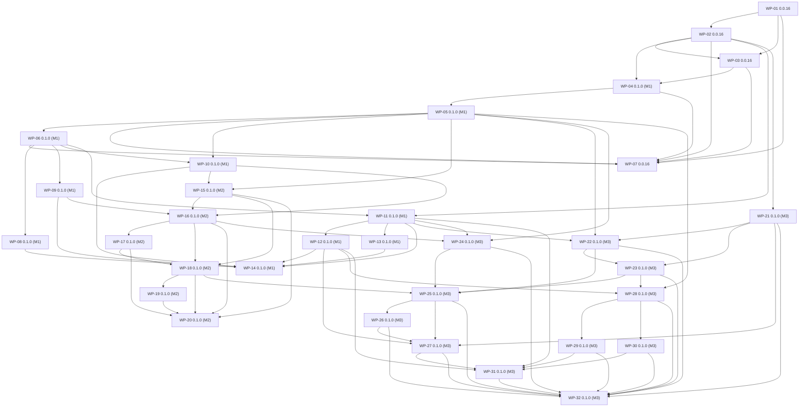

# Large lists: work packages
> Status: plan (spec only, no production code). Spec set: large_lists (see large_lists_README.md).
> Points: 1 to 9. Owner area: delivery. Work packages: WP-01 to WP-38. Decisions: UD-01 to UD-39.

## Purpose

This document cuts the plan into 32 small, reversible work packages (one pull request each), grouped into two releases: the patch release 0.0.16 and the single feature release 0.1.0 with milestones M1, M2 and M3 (UD-01). Every work package must leave the plugin specs green on Redmine 5.1, 6.0, 6.1 and 7.0 and must pass the gates of [`large_lists_quality_protocol.md`](large_lists_quality_protocol.md) before merge. The detailed designs live in the area documents; this document says what goes into which pull request, in which order, and how each one is accepted and rolled back.

## Contents

1. Overview
2. Dependency graph
3. Releases and CHANGELOG lines
4. Work packages
5. Consolidation amendments

## 1. Overview

| WP | Release | Size | Points | Depends on | Title |
|---|---|---|---|---|---|
| WP-01 | 0.0.16 | M | - | - | Local and CI tooling: .codex scripts, RuboCop ratchet, JS toolchain, manual workflows |
| WP-02 | 0.0.16 | M | - | WP-01 | Test hygiene, shared test infrastructure and repository cleanup |
| WP-03 | 0.0.16 | S | 1, 2 | WP-01, WP-02 | Hotfixes in the legacy code: MemCacheStore save crash and bulk-edit data loss |
| WP-04 | 0.1.0 (M1) | M | 1, 2, 3, 5, 6, 7, 9 | WP-02, WP-03 | Characterization specs (Ruby and jsdom) and DB-backed validation specs |
| WP-05 | 0.1.0 (M1) | M | 6, 5 | WP-04 | Central rules module DependencyRules and the single topology helper FieldIndex |
| WP-06 | 0.1.0 (M1) | M | 6 | WP-05 | Shared DependingFormatMethods module for both depending formats; dead code removed |
| WP-07 | 0.0.16 | S | - | WP-01, WP-02, WP-03 | Release 0.0.16 |
| WP-08 | 0.1.0 (M1) | S | 6 | WP-06 | Key/Value list (depending): edit options without duplicates and a single error |
| WP-09 | 0.1.0 (M1) | M | 2, 6 | WP-06 | D1 per-value leniency and issue copies (server) |
| WP-10 | 0.1.0 (M1) | M | 5 | WP-05, WP-06 | Effective parent, server cycle validation, parent select and cycle warning (point 5 server) |
| WP-11 | 0.1.0 (M1) | M | - | WP-02, WP-06 | MySQL TEXT 64 KB safety: storage size validation with a clear i18n error |
| WP-12 | 0.1.0 (M1) | M | 9 | WP-11 | Service error mapping, flash escaping and the audit value cap |
| WP-13 | 0.1.0 (M1) | M | - | WP-11 | Opt-in rake tasks report_sizes and widen_core_columns, MySQL documentation |
| WP-14 | 0.1.0 (M1) | S | - | WP-08, WP-09, WP-10, WP-11, WP-12, WP-13 | Release 0.1.0 (M1) |
| WP-15 | 0.1.0 (M2) | M | 1 | WP-05, WP-10 | Context menu without cache: selection graph, fail-closed wizard roots, named save route (D4) |
| WP-16 | 0.1.0 (M2) | L | 1, 4 | WP-09, WP-10, WP-15 | Issue-form data contract emitted per field (additive, legacy JS untouched) |
| WP-17 | 0.1.0 (M2) | L | 2, 3, 4, 5 | WP-16 | New issue-form runtime (single UMD file) shipped behind the legacy script |
| WP-18 | 0.1.0 (M2) | L | 1, 2, 3, 4, 5 | WP-15, WP-16, WP-17 | Switch: per-field attributes and meta tag replace the inline script; Rails.cache removed (point 1) |
| WP-19 | 0.1.0 (M2) | M | 2 | WP-18 | Radio blank sentinel and required '(none)' in bulk edit and the wizard |
| WP-20 | 0.1.0 (M2) | S | 1, 2, 3, 4, 5 | WP-15, WP-16, WP-17, WP-18, WP-19 | Release 0.1.0 (M2) |
| WP-21 | 0.1.0 (M3) | M | 7, 9 | WP-02 | DependencyPayload: one strict parser for both entry points |
| WP-22 | 0.1.0 (M3) | M | 7 | WP-05, WP-11, WP-21 | Admin JSON transport: virtual attribute dependencies_json (absent = unchanged, '{}' = clear) |
| WP-23 | 0.1.0 (M3) | M | 7 | WP-21, WP-22 | Editor model (pure JS) and cross-layer payload contract |
| WP-24 | 0.1.0 (M3) | M | 7, 9 | WP-05, WP-11, WP-16 | Values endpoint, compact value wire format, editor presenter and shared partial |
| WP-25 | 0.1.0 (M3) | L | 7 | WP-18, WP-22, WP-23, WP-24 | Admin dependency editor UI replaces the matrix (point 7) |
| WP-26 | 0.1.0 (M3) | L | 8 | WP-25 | CSV import and export of the mapping, add missing child values (point 8) |
| WP-27 | 0.1.0 (M3) | L | 9 | WP-12, WP-21, WP-25, WP-26 | Project dependency page on the shared editor with JSON transport and compact audit delta (point 9) |
| WP-28 | 0.1.0 (M3) | L | 9 | WP-05, WP-12, WP-23 | Project values page: server-side search and pagination (point 9) |
| WP-29 | 0.1.0 (M3) | M | 9 | WP-28 | Sort A-Z / Z-A as an audited service (point 9) |
| WP-30 | 0.1.0 (M3) | M | 9 | WP-28 | Page-scoped batch save for Key/Value list values (point 9) |
| WP-31 | 0.1.0 (M3) | M | 9 | WP-11, WP-12, WP-27, WP-29, WP-30 | Large-list safety on project pages: storage ceiling setting and value length cap |
| WP-32 | 0.1.0 (M3) | S | 7, 8, 9 | WP-21, WP-22, WP-23, WP-24, WP-25, WP-26, WP-27, WP-28, WP-29, WP-30, WP-31 | Release 0.1.0 (M3) |
| WP-33 | 0.1.0 (M3) | M | 8, 9 | WP-26, WP-28, WP-32 | Exact value matching on MySQL/MariaDB (SD-17), CSV import on an empty list, Security line, Extended API integration |
| WP-34 | 0.1.0 (M3) | M | 2, 9 | WP-33 | Core behaviour for required children in bulk edit (UD-10) and server-side confirmation for shared and global fields (UD-23) |
| WP-35 | 0.1.0 (M3) | S | 8 | WP-34 | '#<id>' cells in the enumeration CSV import (UD-19) |
| WP-36 | 0.1.0 (M2) | M | 4 | WP-35 | Load the context-menu wizard on demand (UD-13) |
| WP-37 | 0.1.0 (M3) | M | 1 to 9 | WP-36 and the final reviews | Side-by-side comparison with main: behaviour, speed and server memory |
| WP-38 | 0.1.0 (M3) | S | 3 | WP-34 | Time entries keep the hidden-child rule on current cores (SD-22) |

**Release structure (UD-01, resolved by the owner): two releases.** 0.0.16 is a patch release with WP-01, WP-02, WP-03 and WP-07 (tooling, test hygiene, the two hotfixes). Everything else ships together in one release, 0.1.0, built in three milestones: M1 (WP-04 to WP-06 and WP-08 to WP-14: characterization, rules and format modules, server rules, storage safety), M2 (WP-15 to WP-20: issue-form runtime) and M3 (WP-21 to WP-32: editor, import/export, project pages). WP-14 and WP-20 are milestone checkpoints: full evidence run on one SHA, no version bump, no tag. Every work package stays one small pull request. Wherever a document says '0.1.0 (M1)', '0.1.0 (M2)' or '0.1.0 (M3)', the change ships in release 0.1.0 and lands on the main branch during that milestone.

SD-01 (security, wizard save) is not a work package of this plan. Per UD-03 (resolved) it is its own pull request, merged before 0.0.16 is tagged.

## 2. Dependency graph

## 3. Releases and CHANGELOG lines

### 0.0.16

Patch release (UD-01, UD-02, UD-03 resolved): WP-01 tooling (.codex scripts, RuboCop ratchet, JS toolchain, manual 6.1 and JS workflows), WP-02 test hygiene, shared generator and locale parity, WP-03 hotfixes (MemCacheStore save crash, bulk-edit data loss in the legacy JS), WP-07 release, plus the separate SD-01 security pull request. No other behaviour change.

CHANGELOG:

- Fixed: Saving a depending field no longer fails with an internal error on MemCacheStore or other cache stores without delete_matched.
- Fixed: Bulk edit of issues and time entries no longer clears untouched multi-value dependent fields.
- Fixed: The admin custom field form shows 'Default value' instead of a missing translation.
- Removed: the unused and broken test/spec suite.
- Security: The context-menu wizard writes only fields the user may edit (SD-01, own pull request merged before this tag, UD-03).
- Development: local test scripts in .codex mirroring CI, RuboCop ratchet (Ruby 2.7 syntax gate), JavaScript tests with node --test and jsdom, manual workflows for Redmine 6.1 and JavaScript.
- Upgrade notes: Ruby 2.7 or newer is required. Redmine 5.0 remains declared but is not tested; 5.1, 6.0, 6.1 and 7.0 are tested.

### 0.1.0 (one release, built in milestones M1, M2 and M3)

UD-01 (resolved by the owner): everything after the patch release ships in one release. The milestones below are internal checkpoints (WP-14, WP-20) with a full evidence run each; only WP-32 bumps the version and tags 0.1.0. The CHANGELOG 0.1.0 section is the union of the three milestone lists, grouped by Added, Changed, Fixed, Deprecated, Removed, Security, API and Upgrade notes.

#### Milestone M1: server rules and storage safety (WP-04 to WP-06, WP-08 to WP-14)

Server rules and storage safety: WP-08 enumeration options and single error, WP-09 D1 per-value leniency incl. copies, WP-10 effective parent + cycle validation + parent select + cycle warning, WP-11 MySQL TEXT size validation with usage hint, WP-12 service error mapping + flash escaping + audit cap, WP-13 rake tasks report_sizes/widen_core_columns + README MySQL section (+ optional manual MariaDB workflow), WP-14 release. Storage safety ships here (ahead of the 'large-list safety' slot of the ordering) because the editor transport depends on it and it fixes HTTP 500s and silent truncation today.

CHANGELOG:

- Removed: QueryCustomFieldColumnPatch (it had no effect on any supported Redmine version).
- Added: Choosing the field itself or one of its dependent fields as 'Depends on' is refused (form error, HTTP 422 in the APIs).
- Added: The admin form warns about fields that are part of an existing circular dependency; such fields are treated as independent until the cycle is fixed.
- Added: Size validation against MySQL/MariaDB TEXT limits for List, Key/Value list and both depending formats; nothing is truncated anymore.
- Added: Rake tasks redmine:depending_custom_fields:report_sizes and redmine:depending_custom_fields:widen_core_columns (opt-in, dry run by default, CONFIRM=1 to apply).
- Added: A database storage usage line on the custom field form and project pages at 90 percent of the column limit.
- Changed: Stored values that no longer fit the parent are accepted on save until the parent changes; other values of a multi-value field can still be added or removed.
- Changed: Issue copies (single copy, bulk copy, project copy) keep such values when copied unchanged; project copy no longer skips those issues.
- Changed: On issues and projects, a parent field change is now refused while a dependent field that you cannot edit (read-only by workflow or hidden for your role) holds a value the new parent value does not allow (HTTP 422 in the REST API). A dependent field you can see reports is invalid; for one you cannot see, the error is shown on the parent field without naming it (or as a general error when you cannot see the parent field either or its value did not change). Other objects, except time entries, already refused such changes.
- Changed: The 'Depends on' select no longer offers the field's own dependent fields.
- Changed: Audit before/after values above 16 KB are stored shrunk with payload_truncated, payload_bytes and payload_sha256 of the full value.
- Fixed: Key/Value list (depending): a disallowed new value gives one error instead of two, and the edit form no longer shows the stored value twice.
- Fixed: On MySQL/MariaDB, a value list or dependency mapping that is too large gives a clear validation error (HTTP 422 in the APIs, audited error in project settings) instead of an internal error or silent truncation.
- Fixed: A large mapping save on widened MySQL columns no longer rolls back because its audit row overflowed.
- Fixed: Error messages in project settings no longer interpret HTML in field names.
- API: The response shape is unchanged. New HTTP 422 reasons: circular parent and MySQL oversize; on core issue and project updates, a parent change blocked by a dependent field you cannot edit.
- Upgrade notes: On issues and projects a parent change is now refused while a dependent field you cannot edit holds a value the new parent value does not allow; this also applies to bulk edit, the context-menu wizard, email and REST updates. A new issue, a new project or a copy gets the default value of a dependent field you cannot edit, and so does an issue moved to a tracker or project where that field was not available; the save is refused when the parent value does not allow that default, and a project copy skips such an issue. Ask someone who may edit that field to change or clear it first, or an administrator to fix a default value the parent value does not allow.
- Upgrade notes: On MySQL servers running without strict mode, saves that used to be truncated silently are now refused. Core List and Key/Value list fields are checked too. The plugin never alters core tables; widening is an explicit rake task and running Redmine processes keep the old limit until restarted. Run report_sizes once after upgrading: fields reported CORRUPT or SUSPECT were truncated earlier and need their values restored from a backup.

#### Milestone M2: issue-form runtime without inline script (WP-15 to WP-20)

Issue-form runtime without inline script (points 1 to 5): WP-15 context menu without cache, WP-16 per-field data contract (additive), WP-17 new UMD runtime behind the legacy script, WP-18 switch (meta tag + runtime, inline script/globals/Rails.cache/MappingBuilder removed, wizard rework), WP-19 radio sentinel and required '(none)' (the required '(none)' was removed by WP-34, UD-10 changed by the owner), WP-20 release. Must not be tagged before SD-01 (wizard save security) is merged.

CHANGELOG:

- Changed: Dependent fields are never disabled. Disallowed options are hidden and disabled, and a hint under the field names the parent field.
- Changed: In bulk edit and the context-menu wizard, choosing a parent value keeps '(No change)' available on dependent fields; a per-parent default is preselected with a visible hint; a dependent field is cleared automatically only when the parent is '(none)' or its value allows nothing. Setting the parent back to '(No change)' restores the previous choice.
- Changed: The context-menu wizard opens every field on '(No change)'; saving without choosing changes nothing (it used to write the root field's default).
- Changed: Per-parent defaults are filled in on new records that are no copy and when the parent changes; they are no longer filled into empty fields of existing records when the form opens.
- Changed: Dependent fields whose parent is read-only on the form or not available for the tracker are filtered by the stored parent value and may be hidden when 'Hide when no valid options' is set.
- Changed: Dependent fields whose parent you cannot see are no longer filtered in the browser and the page no longer contains that parent's mapping; the server still validates them.
- Changed: 'Hide when no valid options' hides the field with its label while the parent offers no options, only on single-record forms, never while a stored non-matching value is shown and never in bulk edit.
- Changed: The context menu hides only dependent fields available for the selected issues and their parents; parents of unavailable fields come back with their full list; fields whose parent was deleted or that are part of a circular configuration show as plain lists.
- Changed: Context-menu responses include dependency data for the wizard fields and can be larger for very big mappings.
- Changed: The change event fires only when a value really changes; listen to the new dcf:updated event for option changes (see README Integration).
- Changed: Fields rendered without Redmine's custom field helpers are no longer filtered in the browser (see README Integration); the server still validates them.
- Changed: Without JavaScript, Key/Value list (depending) fields show all active values; the server still rejects invalid combinations.
- Changed: A required dependent field that is part of or below a circular configuration, depends on itself or depends on a field of another type or of a format it cannot depend on now needs a value like any required field, also in the REST API, email and imports (up to 0.0.16 a blank value was accepted while the stored parent allowed nothing for it).
- Changed: A blank required radio-style dependent field whose parent value offers options now needs a value on every save of the issue form, also when only a note is added, as a required drop-down already does.
- Fixed: Stored values that do not match an unchanged parent stay selected, marked and saved instead of being removed silently on the next save; switching the parent back restores them.
- Fixed: Required radio-style dependent fields can be cleared.
- Fixed: No more browser errors with circular configurations.
- Fixed: The wizard reports server errors and stays open.
- Fixed: The dependency mapping is no longer embedded in every page, including the login page.
- Fixed: The context-menu wizard offers only fields you may edit on every selected issue; a field that is read-only for you on one of them is no longer shown (its value was not saved), and neither are the dependent fields below it.
- Added: Hints are announced to screen readers.
- Deprecated: DependingCustomFields.setup and requestSetup (aliases of DependingCustomFields.init) and CustomFieldVisibility; kept at least throughout 0.1.x, removable no earlier than 0.2.0.
- Removed: window.DependingCustomFieldData, window.ContextMenuWizardConfig, MappingBuilder, ParentMenuBuilder, the after_custom_field_save dispatch, data-depending-* attributes, depending_cf_N ids, the hidden mirror inputs and the data-field-id attribute.
- Upgrade notes: Restart Redmine. If automatic plugin asset mirroring (5.1) or redmine_detect_update (6.x/7.0) is disabled or assets are baked into an image, run rake redmine:plugins:assets (5.1) or rake assets:precompile (6.x/7.0). Reload open browser tabs. The cache key depending_custom_fields/mapping is no longer used; before downgrading to an earlier version on a persistent cache store, run bin/rails runner -e production "Rails.cache.delete('depending_custom_fields/mapping')" once.
- Added: The value you last picked for each parent value comes back when you switch the parent back, also after the form refreshes.

#### Milestone M3: dependency editor, import/export, project pages (WP-21 to WP-32)

Dependency editor, import/export and project pages (points 7, 8, 9): WP-21 payload parser, WP-22 admin JSON transport, WP-23 editor model + payload contract, WP-24 values endpoint + presenter + shared partial, WP-25 admin editor UI, WP-26 CSV import/export + add missing child values, WP-27 project dependency page on the shared editor with compact audit delta, WP-28 values page search/pagination, WP-29 sort A-Z/Z-A, WP-30 page-scoped enumeration batch, WP-31 project storage ceiling and value length cap, WP-32 release. WP-33 to WP-36 (owner follow-up of 2026-11-02, section 4) and WP-38 (owner decision of 2026-11-03, SD-22) add their lines at the end of this list.

CHANGELOG:

- Added: A dependency editor replaces the checkbox matrix on the admin custom field form and on the project dependency page: collapsible sections per parent value, search, check or uncheck all shown, filters for values without links, counters, per-parent defaults inside each section and inactive values shown and kept.
- Added: CSV import of links (paste or file, preview with per-line errors, merge or replace, undo) and CSV export from the editor, with optional spreadsheet formula protection; 'Add missing child values' for List (depending) fields on the admin form.
- Added: The CSV import of Key/Value list fields also accepts #<id> cells (the number of a value); the export writes #<id> for values whose name is ambiguous, so the file imports again unchanged.
- Added: A save is refused when someone else changed the dependency mapping after the page was opened; the editor then shows the current version and your version (use, keep or export yours).
- Added: Search on the project values page for fields with more than 25 values, and pagination for fields with more than 500 values.
- Added: Sort A-Z / Sort Z-A buttons on the project values page; members with 'Manage custom fields' get the new action automatically.
- Added: Page-scoped save of Key/Value list values on paginated or filtered pages, with a warning before leaving unsaved changes.
- Added: Plugin setting for the maximum stored size of changes made in project settings (default 2,048 KiB).
- Changed: The admin form sends the dependency mapping as one field (custom_field[dependencies_json]) and is submitted as multipart/form-data while the editor is active.
- Changed: Saving the admin form without touching the dependencies leaves the stored mapping unchanged.
- Changed: Changing the parent field in the admin form removes links that do not match the new parent's values.
- Changed: The default value field stays visible until a parent field is chosen.
- Changed: Editor saves store defaults as one value for single-value fields and as a list for multi-value fields and normalize the order; API GET output can change after an editor save. The JSON API itself is unchanged.
- Changed: The dependency editors need JavaScript. Without it the admin form keeps the mapping unchanged and the project page disables Save.
- Changed: Links to values that no longer exist are reported by the editor and removed at the next editor save; project audit rows count them.
- Changed: Project dependency audit rows store a compact summary (counts, samples, SHA-256 of the mapping); sort and reorder audit rows store the SHA-256 of the order. The source and import details are reported by the browser and are informational.
- Changed: Drag-and-drop ordering is offered only for unfiltered lists with at most 500 values; redirects keep the search and the page; 'Show usage' reports exact counts.
- Changed: Values added or renamed in project settings are limited to 255 characters, and project-settings changes cannot grow a field beyond the new storage setting.
- Fixed: Unticking every link clears the mapping; parent values containing [ or ] and mappings with more than about 4,000 links can be saved (admin form and project settings).
- Fixed: Links to inactive Key/Value list entries are kept on admin saves.
- Fixed: Correcting a failed dependency save in project settings and saving again no longer reports a conflict.
- Deprecated: Posting value_dependencies / default_value_dependencies as nested params to the project dependency page; send dependencies_json (accepted throughout 0.1.x, removed no earlier than 0.2.0). The admin safe attributes value_dependencies and default_value_dependencies remain permanently.
- Removed: Partials custom_fields/formats/_dependencies_matrix and _default_dependencies, CSS classes .dependencies-matrix*, .dependencies-defaults* and .dcf-dependencies-matrix, locale key text_dependency_matrix_help.
- Upgrade notes: Links dropped by earlier versions (inactive Key/Value entries) cannot be restored. Links stored under parent values containing [ or ] were saved under corrupted keys by earlier versions; the editor lists them as orphans and they must be re-linked once. Copied Key/Value list (depending) fields keep links to the source field's entries (no remap); they show as orphans and are removed at the first editor save. Reverse proxies may limit request bodies (nginx client_max_body_size is 1 MB by default): raise it for very large mappings. On PostgreSQL and SQLite, changes from project settings are limited by the new storage setting; the administration and the API are not. Restart Redmine after upgrading (new asset files).
- Upgrade notes: Members whose role has the permission 'Manage custom fields' (manage_project_custom_field_configuration) can now sort values A-Z/Z-A; the new action is granted without a role change.
- Changed: The project dependency page shows the global/shared field warning, and a notice instead of the editor when the parent field is not available in the project or no longer exists.
- Changed: The admin form asks for confirmation before a format change that would discard unsaved dependency edits, warns before leaving with unsaved edits, and now places the dependency editor after 'Hide when no valid options' and the edit style.
- Changed: On the admin form of a List (depending) field without values yet, the dependency editor offers the CSV import (not the export) with 'Add missing child values' ticked, so a new field can be filled from a file.
- Fixed: On MySQL/MariaDB, renaming a list value in project settings rewrites only the values stored exactly as that value, no longer those that differ only in case, accents or trailing spaces, and the usage counts of a rename or removal are exact.
- Security: The confirmation panel of a value rename or removal in project settings no longer names dependent fields you cannot see (not used in the project or hidden for your role); they are only counted.
- Changed: In bulk edit and the context-menu wizard, required dependent fields offer no '(none)', as in Redmine, and are not cleared when the parent is set to '(none)' or to a value that allows nothing; an issue whose required dependent field keeps a value the new parent value does not allow is not saved (is invalid), one where that field is blank is saved.
- Changed: In project settings, saving the dependencies (replace imports included) and sorting the values of a field shared with other projects or global need the confirmation checkbox, as rename and removal do; scripts post confirm=1.
- Fixed: On time entries, a parent field change is refused while a dependent field you cannot see holds a value the new parent value does not allow, on every supported Redmine version (Redmine 6.1 and 7.0 no longer check fields you cannot see); as on issues and projects, the error is shown on the parent field without naming that field, or as a general error when you cannot see the parent field either or its value did not change. This also applies to time entry bulk edit, the time entry context menu and REST updates (HTTP 422).
- Changed: The context menu holds only the wizard entry; the wizard loads its fields when you open it, shows a loading text meanwhile and a short message when they cannot be loaded, and closes with Escape or its Cancel button.

## 4. Work packages

### WP-01: Local and CI tooling: .codex scripts, RuboCop ratchet, JS toolchain, manual workflows

| Release | Size | Points | Depends on |
|---|---|---|---|
| 0.0.16 | M | - | - |

**Scope**

D10 tooling, no runtime change. Add .codex/lib/common.sh, .codex/redmine_clone.sh, .codex/test_setup.sh, .codex/test_plugin.sh (suites rspec, system, js, lint, css; --write-fixtures writes into the repo test/js/fixtures), .codex/test_matrix.sh, .codex/rubocop_ratchet.sh and .codex/lib/rubocop_ratchet.rb, mirroring the CI steps (quality design section 4; prototypes in the planning scratch space: design/qa/plugin/.codex, verified on 5.1, 6.0, 6.1, 7.0, evidence E1). Committed .rubocop.yml overlay inheriting core 7.0 config with TargetRubyVersion 2.7, TargetRailsVersion 6.1 and Rails/HttpStatusNameConsistency disabled (deviation from raw D10 config, UD-29; raw config suggests :unprocessable_content which raises on Rack 2.2). Ratchet = Ruby 2.7 Lint/Syntax on all Ruby files + compat grep on added lines (intersect?, Data.define, params.expect, :unprocessable_content, to_prepare, delete_matched, javascript_tag, en and em dash characters) + per-file per-cop count ratchet against the merge-base. The 7 endless defs in spec/patches/custom_field_required_validation_spec.rb become normal defs (otherwise the syntax gate cannot pass, E6). package.json (private, engines node >=22.13, devDependencies jsdom ~29.1.1, jquery 3.7.1, acorn ~8.18.0 per UD-30; scripts check, test, test:ci), package-lock.json, .gitignore (node_modules, coverage), test/js/support/check_assets.js (ES2017 parse of every assets/javascripts/*.js). Workflows: new rspec-61.yml (upstream redmine/redmine 6.1-stable, Ruby 3.3.9, UD-31) and js-tests.yml (npm ci, check, test:ci, core stylelint on plugin CSS), both workflow_dispatch only; rspec-51/60/70 get permissions: contents: read, a system_specs input (default false), rsync --exclude node_modules/, removal of the unused nodejs apt step; rspec-70 also gets lint (default true) and base_ref inputs with fetch-depth 0.

**Files**

- `.codex/lib/common.sh`
- `.codex/redmine_clone.sh`
- `.codex/test_setup.sh`
- `.codex/test_plugin.sh`
- `.codex/test_matrix.sh`
- `.codex/rubocop_ratchet.sh`
- `.codex/lib/rubocop_ratchet.rb`
- `.rubocop.yml`
- `package.json`
- `package-lock.json`
- `.gitignore`
- `test/js/support/check_assets.js`
- `.github/workflows/rspec-51.yml`
- `.github/workflows/rspec-60.yml`
- `.github/workflows/rspec-70.yml`
- .github/workflows/rspec-61.yml (new)
- .github/workflows/js-tests.yml (new)
- `spec/quality/ci_workflows_spec.rb`
- `spec/quality/rubocop_ratchet_spec.rb`
- `spec/quality/fixtures/*.json`
- spec/patches/custom_field_required_validation_spec.rb (endless defs only)

**Tests**

- spec/quality/ci_workflows_spec.rb: every workflow has exactly workflow_dispatch, declares permissions contents read, negative case with push fails
- spec/quality/rubocop_ratchet_spec.rb: identical base/head passes; extra offense in changed file fails with NEW line; new file must be clean; javascript_tag or en dash on an added line fails compat unless marked dcf-compat-ok
- npm run check: every shipped asset parses as ES2017 (acorn rejects ?. ?? and object spread)
- Manual script checks recorded in the WP report: unsupported version exit 2, unmanaged dir exit 3, missing setup exit 6, DB unreachable exit 5

**Acceptance**

- .codex/test_matrix.sh --setup --suite rspec --suite lint prints version=5.1/6.0/6.1/7.0 exit=0 with equal example counts (259 baseline plus the new quality examples, 0 failures) and 'SYNTAX PASS COMPAT PASS RATCHET PASS'
- npm ci && npm run check && npm test exit 0 on Node 22
- git diff shows no change under app/, lib/, config/, assets/, init.rb and the plugin Gemfile
- Every workflow file still triggers only on workflow_dispatch (spec green)

**Compatibility notes**

Developer-only files. Redmine never loads .codex, package.json or test/js; core RuboCop ignores plugins/** so the overlay only affects the ratchet (E5). Plugin Gemfile untouched because it is eval'd into every Redmine bundle. CI stays manual-only.

**Rollback**

Revert the PR. No runtime or data effect; rspec-61.yml and js-tests.yml disappear from the Actions list.

**Related decisions and defects**: UD-29, UD-30, UD-31, UD-32 (resolved), UD-33, UD-34

**Definition of done**: the per-WP report of [`large_lists_quality_protocol.md`](large_lists_quality_protocol.md) (sections 1 to 9) with observed evidence for every applicable gate.

### WP-02: Test hygiene, shared test infrastructure and repository cleanup

| Release | Size | Points | Depends on |
|---|---|---|---|
| 0.0.16 | M | - | WP-01 |

**Scope**

spec/rails_helper.rb: config.order = :random with Kernel.srand, remove the second init.rb load (verified green on 4 versions, E12), reset I18n.locale after each example, system specs opt-in (DCF_SYSTEM_SPECS=1, spec/support/system_driver.rb with core capybara/selenium headless chrome, dcf_login via a.logout, dcf_selectable_options on DOM state because Selenium reports hidden options as displayed, E9), tag exclusions :mysql (unless Redmine::Database.mysql?) and :perf (unless DCF_PERF_SPECS=1). spec/support/query_counter.rb (dcf_count_queries, dcf_count_yaml_loads on ActiveRecord::Store::IndifferentCoder#load, dcf_plugin_overhead) so every later G6 assertion is invariance or differential only. ONE large-list generator: the arithmetic generator of quality revision 2 (spec/support/dcf_large_list.rb plus JS twin test/js/support/large_list.js, naive left-fold sizes(), tricky values, limits byte helpers element_bytes / yaml_list_bytes / values_of_yaml_bytes), pinned SHA-256 prefixes 233acf899217e962 (names(5570, tricky_every: 97)) and 466b240daca61be9 (partition), verified identical on Ruby 3.2.6, 3.3.6 and Node 22.22.0 (E17). Reconciliation: limits revision 2 proposed the mulberry32 generator (0634a624422f2f06) while quality revision 2 adopted the arithmetic one; the arithmetic one wins (cross-language parity proven, exact YAML byte targets, quality owns the generator). spec/support/dcf_config_helpers.rb: dedicated tracker/status builders and dcf_fixture_record with fixed disjoint id ranges (CustomField 9_100_001+, CustomFieldEnumeration 9_200_001+, Issue 9_300_001+, Project 9_400_001+, User 9_500_001+, Role 9_600_001+, Tracker 9_700_001+, IssueStatus 9_800_001+; E23). spec/quality/locale_parity_spec.rb (flattened keys incl. nested activerecord keys, duplicate mapping keys via Psych.parse_stream walk, same %{} variables, no blanks, reviewed English-leftover allowlist, used keys incl. prefixed symbol literals and dcf_* error symbols, I18N constant maps when they exist, per-locale quote convention, no dashes) and spec/quality/no_dash_spec.rb. Fix the only undefined key: l(:label_default_value) becomes core l(:field_default_value) in app/views/custom_fields/formats/_default_dependencies.html.erb:17. Replace the 14 (README) and 3 (CHANGELOG) en/em dashes; README Development and Compatibility sections (Redmine 5.1 to 7.0 tested, 5.0 declared, Ruby 2.7 or newer). Delete the never-run, broken test/spec/** and test/test_helper.rb. Amend docs/specs/project_custom_field_configuration_test_plan.md section 8 (system specs exist, opt-in).

**Consolidation amendments**

- Locale parity spec iterates RedmineDependingCustomFields::ClientConfig::I18N and DependencyEditorConfig::I18N when they are defined (gap 5). The constant name I18N_KEYS is not used anywhere.
- Parity allowlist (keys intentionally identical to en): de and nl text_dcf_live_message; pre-listed fr label_dcf_inactive, fr label_dcf_import_mode and nl label_dcf_tab_char (gap 10). The full allowlist lives in large_lists_i18n_registry.md.

**Files**

- `spec/rails_helper.rb`
- `spec/support/system_driver.rb`
- `spec/support/query_counter.rb`
- `spec/support/dcf_large_list.rb`
- `test/js/support/large_list.js`
- `test/js/large_list_parity.test.js`
- `spec/quality/dcf_large_list_spec.rb`
- `spec/support/dcf_config_helpers.rb`
- `spec/quality/locale_parity_spec.rb`
- `spec/quality/no_dash_spec.rb`
- `spec/system/smoke_spec.rb`
- `app/views/custom_fields/formats/_default_dependencies.html.erb`
- `README.md`
- `CHANGELOG.md`
- `docs/specs/project_custom_field_configuration_test_plan.md`
- test/spec/** (deleted)
- test/test_helper.rb (deleted)

**Tests**

- spec/quality/dcf_large_list_spec.rb and test/js/large_list_parity.test.js pin both hashes; values_of_yaml_bytes(1_000 / 65_535 / 65_536) exact
- spec/quality/locale_parity_spec.rb green (74 keys each, the label_default_value failure is fixed in the same PR); negative fixture with a duplicated nested key fails
- spec/quality/no_dash_spec.rb green on README.md, CHANGELOG.md and config/locales
- spec/system/smoke_spec.rb (opt-in) logs in and opens an issue form on 5.1 and 7.0
- Request spec: admin custom field edit page of a depending field renders the core 'Default value' label and no 'translation missing'

**Acceptance**

- Standard gate: .codex/test_matrix.sh --setup --suite rspec --suite lint green on 5.1, 6.0, 6.1, 7.0 at one SHA (dirty=0)
- Random order: seeds 1, 4242 and 31337 green on 7.0, seed printed in the log
- DCF_SYSTEM_SPECS=1 .codex/test_plugin.sh 5.1 --suite system and 7.0 --suite system exit 0
- No en or em dash in README.md, CHANGELOG.md, locale files

**Compatibility notes**

Only user-visible change is the corrected 'Default value' header. Removing the duplicate init.rb load removes duplicate callbacks in the test process only. Deleting test/spec has no effect: it was never run by CI or rake.

**Rollback**

Revert the PR; specs return to defined order and the label falls back to the missing translation.

**Related decisions and defects**: none

**Definition of done**: the per-WP report of [`large_lists_quality_protocol.md`](large_lists_quality_protocol.md) (sections 1 to 9) with observed evidence for every applicable gate.

### WP-03: Hotfixes in the legacy code: MemCacheStore save crash and bulk-edit data loss

| Release | Size | Points | Depends on |
|---|---|---|---|
| 0.0.16 | S | 1, 2 | WP-01, WP-02 |

**Scope**

Two surgical fixes ahead of the rewrite (UD-02). (1) Remove Rails.cache.delete_matched('dcf/*') from both formats' after_custom_field_save (depending_list_format.rb:79, depending_enumeration_format.rb:89). No 'dcf/*' key is written anywhere in app/ or lib/ (grep), and delete_matched raises NotImplementedError on MemCacheStore, rolling back every depending save. The plain Rails.cache.delete('depending_custom_fields/mapping') stays until WP-18 removes the cache. (2) In assets/javascripts/depending_custom_fields.js replace '#bulk-edit-form' with '#bulk_edit_form' (lines 101, 201, 298); core uses id bulk_edit_form for both issues (core-7.0 app/views/issues/bulk_edit.html.erb:26) and time entries (core-7.0 app/views/timelog/bulk_edit.html.erb:32, core-5.1 :31). Evidence (planning scratch space, design/delivery/hf_harness.js, hf_harness2.js on the jsdom harness): scenario B (untouched multi child) form data goes from ['[1]=','[2][]='] (clears the field on every issue) to ['[1]='] only; B2 likewise; A1 and U2 lose a duplicated child entry; every other scenario output is identical.

**Files**

- `lib/redmine_depending_custom_fields/depending_list_format.rb`
- `lib/redmine_depending_custom_fields/depending_enumeration_format.rb`
- `assets/javascripts/depending_custom_fields.js`
- `spec/models/custom_field_cache_callback_spec.rb`
- `spec/models/depending_format_cache_spec.rb`
- spec/models/cache_store_independence_spec.rb (new, interim part)
- test/js/legacy_bulk_hotfix.test.js (new)
- spec/system/bulk_edit_untouched_multi_spec.rb (new, opt-in)
- `CHANGELOG.md`

**Tests**

- spec/models/cache_store_independence_spec.rb: with Rails.cache replaced by a store whose delete_matched raises NotImplementedError, creating and updating depending_list and depending_enumeration fields and a project-service save succeed (red on fa0adaf, green after)
- Updated cache callback specs assert delete_matched is never called
- test/js/legacy_bulk_hotfix.test.js: harness scenarios A, A', B, B2, Q, U on bulk_edit_form; B posts no child entry (red on fa0adaf, green after)
- Opt-in system spec on 5.1 and 7.0: bulk edit of 2 issues with an untouched multi-select child keeps both stored values after Submit

**Acceptance**

- Standard gate green on 5.1, 6.0, 6.1, 7.0
- Red-green evidence for both defects quoted in the WP report (failing excerpt on fa0adaf, passing after)
- System spec green on 5.1 and 7.0 with screenshots

**Compatibility notes**

Pure fixes. The legacy bulk branch now runs on core bulk edit pages as it already did in the wizard: '(no change)' handling is unchanged, a required multi child stays disabled but no longer posts an empty array. Cache behaviour otherwise unchanged.

**Rollback**

Revert the PR (two code edits). No data effect; reverting reintroduces both defects.

**Related decisions and defects**: UD-02

**Definition of done**: the per-WP report of [`large_lists_quality_protocol.md`](large_lists_quality_protocol.md) (sections 1 to 9) with observed evidence for every applicable gate.

### WP-04: Characterization specs (Ruby and jsdom) and DB-backed validation specs

| Release | Size | Points | Depends on |
|---|---|---|---|
| 0.1.0 (M1) | M | 1, 2, 3, 5, 6, 7, 9 | WP-02, WP-03 |

**Scope**

Pin current behaviour before any refactor (quality 5.1, server 18.1), committed alone. Delivered: reference commit 36b74c7 (the last of four WP-04 commits; later "spec/characterization unchanged" checks diff against it). The SD-14 security fix flips the options rows of wizard_routes_spec.rb right after it. Ruby, DB-backed under spec/characterization/: possible_values_options for nil, a record and an Array, and for a Project passed to an Issue field (all-hidden 3-tuples today); query_filter_values (list all, enum restricted, nil query raises); value_from_keyword (case folding, ; and , split, comma values not importable in multi, duplicates kept, enum id strings, import ordering with unset parent matches full list); validate_custom_value (list one error, enum double error, unchanged legacy combination rejected, multi add next to legacy rejected, issue copy with legacy rejected, stored cycle validated per mapping); enum possible_custom_value_options duplicate; before_custom_field_save normalisation; ContextMenusControllerPatch on the flat 5.x/6.x and namespaced 7.0 controllers; GET depending_custom_fields/options routed to API#show; admin nested-param save (untick-all ignored, ']' corrupts keys, inactive enumeration links dropped); project update_dependencies with no params clears the mapping; enumeration reorder with 3+ rows. JS: test/js/legacy_characterization.test.js pins harness scenarios A0..U2 on the hotfixed legacy script. Also rewrite spec/patches/custom_field_required_validation_spec.rb and spec/lib/value_validation_spec.rb (moved to spec/models/dependency_validation_spec.rb) DB-backed with real fields and identical assertions, so no later WP depends on stand-in classes that lack a callback API (limits V11, server S12).

**Files**

- `spec/characterization/depending_formats_spec.rb`
- `spec/characterization/context_menu_spec.rb`
- `spec/characterization/wizard_routes_spec.rb`
- `spec/characterization/admin_nested_params_spec.rb`
- `spec/characterization/project_dependencies_spec.rb`
- `test/js/legacy_characterization.test.js`
- `spec/patches/custom_field_required_validation_spec.rb`
- `spec/models/dependency_validation_spec.rb`
- spec/lib/value_validation_spec.rb (deleted, replaced)

**Tests**

- All characterization examples listed in scope, both formats via shared examples
- Rewritten required-validation and value-validation specs keep every former assertion, now DB-backed
- Mutation sanity: temporarily breaking the required bypass, the legacy rejection and the bulk selector each makes a named example fail (recorded, reverted)

**Acceptance**

- Standard gate green on 5.1, 6.0, 6.1, 7.0 with no production code change (git diff app lib assets config init.rb empty)
- Characterization commit is a single commit that later WPs reference; later WPs may change these files only for listed flips

**Compatibility notes**

Specs only.

**Rollback**

Revert the PR.

**Related decisions and defects**: none

**Definition of done**: the per-WP report of [`large_lists_quality_protocol.md`](large_lists_quality_protocol.md) (sections 1 to 9) with observed evidence for every applicable gate.

### WP-05: Central rules module DependencyRules and the single topology helper FieldIndex

| Release | Size | Points | Depends on |
|---|---|---|---|
| 0.1.0 (M1) | M | 6, 5 | WP-04 |

**Scope**

New lib/redmine_depending_custom_fields/dependency_rules.rb (module_function, require 'set', literal format names, Ruby 2.7 syntax): DEPENDING_FORMATS, family constants, ParentState (parent, available, values, baseline), normalize_id/normalize_values, parent_id, resolve_parent_for_save (exact today's find_by, memoized on the record through CustomFieldPatch#dcf_memo, never on format singletons), find_parent, carries?, lookup_records (0 queries from loaded objects), allowed_set/allowed_values/default_values (Set based), value_keys and value_options (Ruby tuples [key, label, active], inactive enumerations included, order by possible_values or [position, id]), mapping_problems, prune_mapping (for the admin JSON transport only), parent_candidates/descendant_ids/in_cycle?/cycle_member_ids/children_of on FieldIndex. New field_index.rb: anchored raw-YAML regex PARENT_RE with deserialization fallback, FieldIndex.load (one select_all, no deserialization), FieldIndex.new(records:) lazy from loaded read-only records, ensure (one batched query), ancestor_ids/descendant_ids/children_ids with visited Set and cap 1,000, effective_parent_id_for. Reconciliation: one helper with the server names (load, children_ids); limits' build/child_ids proposal and DependencyRules::Graph are not created. CustomFieldPatch gains dcf_memo only (no callbacks). FieldRelevance.children_of delegates to children_of (same result set and order, characterized). Shared rules case table test/js/fixtures/shared/rules_cases.json (allowed sets, defaults; D1 rows added in WP-09). Nothing else calls the new code yet.

**Delivered (decisions taken during implementation)**

- Walks (ancestor_ids, cycle_from, the effective-parent chain check) follow the raw stored pointers of depending rows through any type and family; only the first hop of effective_parent_id_for is validated (exists, same type, family, not self).
- A self-pointer is a cycle of one (UD-35, owner): cycle_from(A) == [A], in_cycle?(A) is true and children of a self-parent field get no effective parent. in_cycle? and cycle_member_ids are true only for cycle members, not for fields whose chain only reaches a cycle.
- At WALK_CAP (1,000) effective_parent_id_for gives nil (unconstrained) and cycle_from gives [].
- FieldIndex.load(scope = nil): without a scope it loads every depending field and its walks never fetch; with a scope unknown ids are fetched lazily (one batched query per chain level). Deviation from the literal default argument in server design 4, same behaviour for callers.
- children_of orders by [position, id] (core `sorted` orders by position only); the result set equals the stored pointer comparison, a self-parent included. parent_candidates never offers the field itself (UD-36, owner).
- kind returns 'list' or 'enumeration' by family; value_keys and value_options read the enumerations association and deduplicate list values, so value_options.map(&:first) == value_keys.
- mapping_problems is empty exactly when DependencyMappingService#validate_mapping! passes; one Problem per [type, parent_key, child_key], in vd then dd order.
- rules_cases.json schema: {version, description, allowed: [{id, map, parent, expected}], defaults: [{id, map, defaults, parent, expected_multiple, expected_single}]}; the d1 section is reserved for WP-09.
- Not added (later WPs): parent_state, allowed_for, effective_parent_id, dependency_check, no_options?, baseline_source, child_baseline, parent_changed?, parent_errors. WP-06 adds parent_state and allowed_for (it may edit dependency_rules.rb); WP-10 adds effective_parent_id and the cycle validation.
- dcf_memo is not reset on reload: within one request the record is the unit of memoization; callers that need fresh topology use a fresh instance (WP-27).

**Consolidation amendments**

- DependencyRules API adds parent_of(cf): memoized on the record, returns the parent record or nil for blank, dangling, wrong type or family, or self (gap 2). Specified and spec-covered here; used by WP-16 (through effective_parent_id) and WP-27.

**Files**

- lib/redmine_depending_custom_fields/dependency_rules.rb (new)
- lib/redmine_depending_custom_fields/field_index.rb (new)
- `lib/redmine_depending_custom_fields.rb`
- `lib/redmine_depending_custom_fields/patches/custom_field_patch.rb`
- `app/services/redmine_depending_custom_fields/field_relevance.rb`
- test/js/fixtures/shared/rules_cases.json (new)
- spec/lib/dependency_rules_spec.rb (new)
- spec/lib/field_index_spec.rb (new)

**Tests**

- spec/lib/field_index_spec.rb: parent_id_from_raw for 12, '12', "12", '', nil, nested keys and block scalars; raw read leaves format_store undeserialized; ensure batches into one query; ancestor/descendant terminate on A->A, A<->B and long chains
- spec/lib/dependency_rules_spec.rb: normalize_id, carries?, lookup_records 0 queries (invariance), allowed/default cases from rules_cases.json, mapping_problems, prune_mapping keeps inactive enum ids, value_options order and inactive handling
- FieldRelevance.children_of returns the same set of records as before (characterization unchanged; today's query has no ORDER BY, the new one orders by position and id)
- spec/lib/dependency_rules_spec.rb: parent_of returns nil for blank, dangling, wrong STI type, wrong family and self; returns the record otherwise; second call does not query (gap 2).

**Acceptance**

- Standard gate green on 5.1, 6.0, 6.1, 7.0
- git diff <WP-04 commit>..HEAD -- spec/characterization is empty
- FieldIndex.load issues exactly one query regardless of 1 or 25 depending fields (invariance spec)
- Ratchet: new files have zero offenses under the overlay

**Compatibility notes**

Internal only; no caller behaviour change.

**Rollback**

Revert the PR; FieldRelevance returns to its own walk.

**Related decisions and defects**: none

**Definition of done**: the per-WP report of [`large_lists_quality_protocol.md`](large_lists_quality_protocol.md) (sections 1 to 9) with observed evidence for every applicable gate.

### WP-06: Shared DependingFormatMethods module for both depending formats; dead code removed

| Release | Size | Points | Depends on |
|---|---|---|---|
| 0.1.0 (M1) | M | 6 | WP-05 |

**Scope**

New lib/redmine_depending_custom_fields/depending_format_methods.rb, INCLUDED in DependingListFormat and DependingEnumerationFormat (field_attributes in self.included; assigns no instance variables). It carries: normalized_store_pairs (sanitize-only, exactly today's before_save incl. parent normalization; never prunes, BC-02), storage_preview(custom_field, store) (same pairs, byte-identical YAML, for limits), before_custom_field_save via the pairs, possible_values_options (parent read from customized.custom_field_values, 0 queries; same output as today incl. hidden 3-tuples for non-carrying objects until WP-15), validate_custom_value (today's semantics incl. whole-set legacy rejection until WP-09 and the enum double error until WP-08), validate_custom_field (super for now), value_from_keyword (one downcase(:fold) Hash per call over the full list, first match wins, results identical), after_custom_field_save (plain delete, kept until WP-18). Class bodies keep add, form_partial, label, query_filter_values. Duplicated code removed from both format files. Delete QueryCustomFieldColumnPatch, its init.rb lines (Query reference and prepend) and its spec: verified no-op because core ignores options[:sortable] (core-5.1 app/models/query.rb:128-135, core-7.0 :136-143).

**Files**

- lib/redmine_depending_custom_fields/depending_format_methods.rb (new)
- `lib/redmine_depending_custom_fields/dependency_rules.rb` (adds parent_state and allowed_for, used by the shared module)
- `lib/redmine_depending_custom_fields/depending_list_format.rb`
- `lib/redmine_depending_custom_fields/depending_enumeration_format.rb`
- `init.rb`
- lib/redmine_depending_custom_fields/patches/query_custom_field_column_patch.rb (deleted)
- spec/patches/query_custom_field_column_patch_spec.rb (deleted)
- spec/lib/depending_format_methods_spec.rb (new)
- `spec/lib/depending_list_format_spec.rb`
- `spec/lib/depending_enumeration_format_spec.rb`
- spec/quality/format_singleton_state_spec.rb (new)
- spec/requests/issue_form_query_invariance_spec.rb (new)
- `CHANGELOG.md`

**Tests**

- spec/lib/depending_format_methods_spec.rb: normalized_store_pairs/storage_preview YAML equals persisted bytes (string parent id, invalid parent, blank keys); one parent lookup across validation and save (memo); value_from_keyword equals characterized results; 100,000 keywords vs 5,570 options under 200 ms (tag :large)
- spec/quality/format_singleton_state_spec.rb: no instance-variable assignment in the three format files; two sequential requests with different parents do not share results
- Issue edit query count identical for 1 child and 5 children of 5 distinct available parents (invariance)

**Acceptance**

- Standard gate green on 5.1, 6.0, 6.1, 7.0
- git diff <WP-04 commit>..HEAD -- spec/characterization is empty (no flips in this WP)
- Ratchet passes; offenses of deleted duplicate code show as fixed=

**Compatibility notes**

No behaviour change. Removing QueryCustomFieldColumnPatch is invisible (it never had an effect). CHANGELOG Removed line.

**Rollback**

Revert the PR; both format classes return to their duplicated bodies.

**Related decisions and defects**: UD-38

**Delivered (decisions taken during implementation)**

- DependencyRules.parent_state and allowed_for carry today's semantics (any type, any family and the field itself count as a parent; the parent value is read from customized.custom_field_values without a query; the raw 0.0.16 union, blank keys included). WP-09, WP-10 and WP-15 switch them to the design contract (allowed_set, effective parent, carries?).
- Both query_filter_values bodies are kept verbatim (pre-existing RuboCop offenses included), so their behaviour cannot drift.
- Perf budget: the default run asserts exact results and under 2 s for 100,000 keywords against 5,570 options; the literal 200 ms budget runs with DCF_PERF_SPECS=1 (measured 110 to 147 ms), because G6 allows wall clock only with 10x headroom.
- The issue form invariance spec uses the PATCH path and an enumeration variant: the literal list GET edit shape was already equal before WP-06. It was red on the WP-05 head and is green now (fewer queries, same output).
- spec/lib/dependency_rules_spec.rb is changed too (parent_state and allowed_for examples). "spec/characterization unchanged" is checked against the WP-06 base (156b8a2), because the SD-14 flips already changed wizard_routes_spec.rb after 36b74c7.

**Definition of done**: the per-WP report of [`large_lists_quality_protocol.md`](large_lists_quality_protocol.md) (sections 1 to 9) with observed evidence for every applicable gate.

### WP-07: Release 0.0.16

| Release | Size | Points | Depends on |
|---|---|---|---|
| 0.0.16 | S | - | WP-01, WP-02, WP-03 |

**Scope**

Bump init.rb version to 0.0.16, finalize the CHANGELOG 0.0.16 section (Fixed: MemCacheStore, bulk data loss, Default value label; Removed: unused test/spec suite; Upgrade notes: Ruby 2.7 or newer), README Compatibility and Development. Add the Security line for SD-01: per UD-03 (resolved) the wizard-save fix is its own pull request, merged before this tag. Full evidence run. WP-04 to WP-06 are not part of this patch release (UD-01 resolved: they move to 0.1.0, milestone M1).

**Files**

- `init.rb`
- `CHANGELOG.md`
- `README.md`

**Tests**

- Full matrix rspec + lint, npm test, system specs on 5.1 and 7.0

**Acceptance**

- One SHA green on 5.1, 6.0, 6.1, 7.0 plus SYNTAX/COMPAT/RATCHET PASS
- CHANGELOG lists every 0.0.16 perceptible change (PC-01, PC-02, PC-03, PC-05) and the SD-01 Security line
- Optional manual CI dispatch per quality protocol section 10 (UD-32, resolved): only after the local gates pass, at most once per workflow per SHA, reported with workflow, SHA, run URL and result; headSha equals the release SHA

**Compatibility notes**

Patch release; no intended behaviour change beyond the listed fixes.

**Rollback**

Do not tag; revert the version bump commit.

**Related decisions and defects**: SD-01, UD-01, UD-03, UD-32 (resolved), UD-34

**Definition of done**: the per-WP report of [`large_lists_quality_protocol.md`](large_lists_quality_protocol.md) (sections 1 to 9) with observed evidence for every applicable gate.

### WP-08: Key/Value list (depending): edit options without duplicates and a single error

| Release | Size | Points | Depends on |
|---|---|---|---|
| 0.1.0 (M1) | S | 6 | WP-06 |

**Scope**

DependingEnumerationFormat#possible_custom_value_options returns the unfiltered active list plus the stored value_was ids (inactive included) as 2-tuples, fixing the hidden 3-tuple plus visible duplicate caused by core RecordList using options.map(&:last) (core-7.0 lib/redmine/field_format.rb:789-806). validate_custom_value merges dependency errors with core errors as errors + (dep_errors - errors), so a disallowed new value gives exactly one 'is invalid'. A crafted inactive id that is not stored stays rejected (QA-21). Flips the characterized enum rows: the duplicate option, and the double error through the shared parameter %w[inclusion invalid] (new disallowed value and issue copy).

**Files**

- `lib/redmine_depending_custom_fields/depending_enumeration_format.rb`
- `lib/redmine_depending_custom_fields/depending_format_methods.rb`
- spec/characterization/depending_formats_spec.rb (listed flips: enum duplicate option, enum double error parameter)
- `spec/lib/depending_format_methods_spec.rb`
- `CHANGELOG.md`

**Tests**

- Enum edit options: 2-tuples only, no duplicate, stored inactive id appended, crafted unstored inactive id rejected
- Disallowed new enum value gives exactly ['is invalid'] in en and de

**Acceptance**

- Standard gate green on 5.1, 6.0, 6.1, 7.0
- Characterization diff shows only the two listed rows, each referenced in the PR

**Compatibility notes**

Strictness for new values unchanged; one error message instead of two; edit form no longer lists the stored value twice.

**Rollback**

Revert the PR.

**Related decisions and defects**: none

**Delivered (decisions taken during implementation)**

- DependingEnumerationFormat#possible_custom_value_options takes possible_values_options(custom_field) without the object and appends the stored value_was ids missing from it as [name, id] pairs. Like core RecordList they are looked up across fields (CustomFieldEnumeration.where(id:)), so a stored id of another field assigned unchanged stays accepted and an unknown or non-numeric id adds nothing; they are ordered by position. Only value_was is read, so a crafted inactive id that is not stored stays rejected (QA-21).
- validate_custom_value returns the core errors first, then 'is invalid' unless core already gave it (errors + (dep_errors - errors)). The list format output is unchanged.
- Interim state until WP-16 to WP-18 (M2): the server no longer hides disallowed enumeration options in the issue, project and time entry forms. A Key/Value list (depending) child whose parent is read-only by workflow or not available for the tracker therefore shows all active values even with JavaScript, because the legacy script has no parent input to filter by; after an AJAX form re-render the list also stays unfiltered for the legacy debounce window (about 100 ms). The server still rejects disallowed values with 'is invalid'; strictness is unchanged. Pinned by 'renders every active value, none hidden, when the parent is not available for the tracker' (spec/lib/depending_format_methods_spec.rb). WP-16 to WP-18 filter these cases in the browser through data-dcf-parent-values (fixture scenarios workflow read-only parent and parent unavailable for tracker); the server keeps rendering the full list, so that example does not flip.
- Characterization flips, only in spec/characterization/depending_formats_spec.rb: the enumeration shared parameter %w[inclusion invalid] became %w[invalid] (the rows that read it: "rejects a disallowed value on a new issue", "rejects an issue copy holding a legacy combination like a new disallowed value" and the new-value row of "validates the members of a stored cycle against their mappings"), and "offers a stored disallowed value twice" became "offers a stored disallowed value once in the edit form, as a plain pair (Flipped by WP-08)".
- The stale comments of spec/requests/issue_form_query_invariance_spec.rb (header and enumeration describe) are corrected: since WP-08 the enumeration edit form does not read the parent.

**Definition of done**: the per-WP report of [`large_lists_quality_protocol.md`](large_lists_quality_protocol.md) (sections 1 to 9) with observed evidence for every applicable gate.

### WP-09: D1 per-value leniency and issue copies (server)

| Release | Size | Points | Depends on |
|---|---|---|---|
| 0.1.0 (M1) | M | 2, 6 | WP-06 |

**Scope**

DependencyRules.dependency_check implements D1 per value (UD-04): while the parent is unchanged (order-insensitive; a parent not available on the object counts as changed, so the child must be cleared as today, UD-05) every value in the baseline is tolerated and only newly added values must be allowed; when the parent changed, all values are validated. Baseline = the stored value (value_was when a saved row holds the field; [] without one, also when a tracker or project change fills in the field default), or for new records with copy? true the source issue's stored values via @copied_from (core has no reader; pinned by a spec on all 4 versions; falls back to strict, never crashes) (UD-06). A child the current user cannot edit gets the same rule (UD-07, confirmed after the WP-09 observation: the rules lead on every object): core validates it on time entries and the other customizables; on issues and projects, which validate only editable_custom_field_values, the WP-09b follow-up adds the check, where a parent not available on the record counts as unchanged (WP-09c, owner; see Delivered). No editable_by? helper. validate_custom_value uses it; the required bypass in CustomFieldPatch#validate_custom_value moves to DependencyRules.no_options? with unchanged semantics. Rows added to test/js/fixtures/shared/rules_cases.json (multi add allowed, add disallowed, remove legacy, reorder, keep legacy and change parent, single legacy to allowed, single legacy to other disallowed, parent unavailable untouched: invalid). Legacy JS (still active until WP-18) drops a disallowed stored value on load, so form saves of editable children are unchanged until 0.1.0 (M2) (when a field the user cannot edit depends on the cleared field, WP-09b refuses the save; see Delivered); REST, mail, bulk '(no change)', wizard and copies benefit now.

**Files**

- `lib/redmine_depending_custom_fields/dependency_rules.rb`
- `lib/redmine_depending_custom_fields/depending_format_methods.rb`
- `lib/redmine_depending_custom_fields/patches/custom_field_patch.rb`
- `test/js/fixtures/shared/rules_cases.json`
- `spec/models/dependency_validation_spec.rb`
- `spec/patches/custom_field_required_validation_spec.rb`
- spec/requests/dcf_issue_flows_spec.rb (new)
- spec/requests/dcf_issue_copy_spec.rb (new)
- spec/characterization/depending_formats_spec.rb (listed flips)
- `CHANGELOG.md`
- WP-09b: `lib/redmine_depending_custom_fields/non_editable_dependencies.rb` (new), `lib/redmine_depending_custom_fields/patches/issue_validation_patch.rb` (new), `lib/redmine_depending_custom_fields/patches/project_validation_patch.rb` (new), `init.rb`, `config/locales/{de,en,fr,nl}.yml`, `docs/specs/large_lists_i18n_registry.md`, spec/requests/dcf_non_editable_children_spec.rb (new), spec/requests/dcf_issue_flows_spec.rb (two flips), spec/quality/format_singleton_state_spec.rb (scans the new files)

**Tests**

- D1 matrix through safe_attributes for list single, list multi and enum (incl. stored inactive enum id): unchanged, reorder, remove one, add allowed, add disallowed, each with parent unchanged, changed, unavailable (unavailable is strict: a non-blank child gives 'is invalid', as today, UD-05)
- REST notes-only update keeps a legacy combination; REST add of a new disallowed value gives 422
- Issue#copy, bulk copy and Project#copy_issues of a legacy combination succeed; project copy drops no issue (WP-09b exception: an issue whose non-editable child core resets to a stale default the parent value does not allow is skipped, pinned); copy with a changed child or parent is strict
- Non-editable child unchanged while the parent changes to a value that does not allow it (UD-07 confirmed, WP-09b): rejected on issue, project and time entry. On issues and projects: visible read-only child: 'is invalid' under its name; role-invisible child: dedicated message on the changed parent, child not named, or the base message (`error_dcf_hidden_child_conflict`) when the parent is not shown to the user either (role-invisible) or its value did not change; every failing value is placed (a read-only child, a hidden sibling and a hidden child of a second parent in one validation give three entries); en and de; list and enumeration children, single and multiple. On a time entry (and a version) core validates every value and names the child, also a role-invisible one (known exception, recorded under UD-07; for time entries changed by WP-38, SD-22: the issue and project placement on every supported core). Parent not available on the issue (WP-09c, owner): for a hidden or read-only child holding a value it does not count as changed, so form, bulk, wizard, notes-only mail and REST edits and tracker or project moves that make the parent unavailable save and keep the value (flipped from the WP-09b UD-05 steady-state refusals); a child the user can edit is still refused (UD-05), and a parent that is available again and changes is still refused (WP-09b). New issues, new projects, copies and moves: a stale non-editable default the parent value does not allow gives 422 (REST issue create and copy, REST project create, REST tracker change that makes the child available) and is skipped by a project copy; a copy that keeps the parent and the tracker move get the base message; under an unavailable parent a stale default is still refused with the base message (REST create, copy against the source, tracker move)
- Shared rules_cases.json rows evaluated by spec/lib/dependency_rules_spec.rb
- Bulk update of an unrelated attribute on issues holding legacy combinations succeeds (D1, QA-14, gap 12).

**Acceptance**

- Standard gate green on 5.1, 6.0, 6.1, 7.0 (the @copied_from spec passes on every version)
- Characterization diff limited to the listed rows (unchanged legacy, multi add, copy)
- Mutation check: disabling the per-value exemption makes a named example fail

**Compatibility notes**

Fewer rejected saves for editable children; never accepts a newly added invalid value. Stored invalid combinations can persist by design while the parent is unchanged (data hygiene report tracked as SD-12). Stricter (WP-09b, UD-07): on issues and projects a parent change is now refused while a dependent field the user cannot edit holds a value the new parent value does not allow (PC-69).

**Rollback**

Revert the PR to restore strict whole-set validation; no data migration. Records saved meanwhile keep their already-existing legacy values.

**Related decisions and defects**: SD-12, UD-04, UD-05 (kept as today; for non-editable children refined by WP-09c), UD-06, UD-07 (confirmed: the rules lead, WP-09b; UD-05 steady state resolved, WP-09c)

**Delivered (decisions taken during implementation)**

- WP-09b (follow-up, UD-07 confirmed on 2026-10-15): `Patches::IssueValidationPatch` and `Patches::ProjectValidationPatch` (prepended in init.rb on Issue and Project only) call core's `validate_custom_field_values` first, then `NonEditableDependencies.validate`, which applies `DependencyRules.parent_state` and `dependency_check` (the same D1 rule: tolerated while the parent is unchanged, copies judged against the source; an unavailable parent counted as changed until WP-09c, see below) to the depending children NOT in `editable_custom_field_values(user)`. Core's user and gate: issue `new_record? ? author : current_journal.try(:user)` (nil falls back to User.current), project `User.current`; only on `new_record? || custom_field_values_changed?`. No core required, inclusion or regexp check and no value rewrite on those children. Time entries and other customizables are not patched (core validates every value).
- Placement: a child in `visible_custom_field_values(user)` (read-only by workflow) gets core's 'is invalid' under its name. A role-invisible child is never named: `activerecord.errors.messages.dcf_hidden_child_conflict` on the parent field when its value changed, once per parent. When the parent is not shown to the user either (role-invisible, or not available after a tracker or project change), naming it would show a hidden field, so a second key, `error_dcf_hidden_child_conflict`, goes on base, once; the same key goes on base when the parent value did not change (core gave the hidden child a stale default on a copy, a move or a programmatic project copy), where 'cannot be changed ... the new value' would be wrong (refinements recorded under UD-07, owner acknowledgement pending). Both keys are in all four locales and in the i18n registry (owner WP-09b; WP-09b creates the nested `activerecord.errors.messages` block).
- Cost: no query unless a depending child fails the check; then the editable and visible sets once per validation. New issues: core resets non-editable values to the field default before validation (Issue only), so issue copies, imports and new issues never keep a non-editable source value; a stale non-blank default is judged strictly (a copy: against the source), so REST create and copy answer 422 and Project#copy_issues skips that issue (logged; Project#copy returns false). A tracker or project move that makes a non-editable child available gives it the default too, judged without tolerance (no stored row). A new project gets the default of every field the user cannot see (Project#safe_attributes= drops the posted value), so REST POST /projects.json answers 422 for a stale default; the UI project copy is admin-only, where core validates every field. Project.copy_from keeps the project values the user cannot edit; such a programmatic copy is judged strictly (base message: its cloned rows make the parent read as unchanged). Pinned in spec/requests/dcf_non_editable_children_spec.rb.
- Accepted consequences (server design section 8 rule 3; recorded under UD-07, owner acknowledgement pending): WP-09b refused every edit that assigned custom values while the parent field was not available on the issue (UD-05 steady state); the owner resolved this on 2026-10-16 (WP-09c, below). Until 0.1.0 (M2) the legacy script clears an editable dependent field whose stored value its parent does not allow and posts '', so a form save is refused when a field the user cannot edit depends on it (open input to WP-17 and WP-18).
- Leak checks: JSON bodies (issue REST, tracker moves, wizard, also a save under an unavailable parent, project REST update and create, REST create and copy) never contain the child name or value; HTML bodies (issue form, bulk edit, project settings) are checked outside the pre-existing `window.DependingCustomFieldData` head script, which carries every mapping until WP-18 removes it (FM-20b).
- Flipped by WP-09b, only in spec/requests/dcf_issue_flows_spec.rb: "saves the change when the child is read-only by workflow (core does not validate it), in en and de" became "rejects the change when the child is read-only by workflow, with is invalid under the child name, in en and de (Flipped by WP-09b)"; "saves the change when the child is not visible for the user role (core does not validate it), in en and de" became "rejects the change on the parent field without naming a child the user cannot see, in en and de (Flipped by WP-09b)". The time entry example is kept and also asserts no parent error. spec/characterization is unchanged.
- Review round 2 (WP-09b): a hidden child under a parent whose value did not change now gets the base message instead of the parent-field message (no 'new value' exists: a copy that keeps the parent, a tracker or project move with a stale default, a programmatic `Project.copy_from`); the WP-09b example "judges a programmatic copy strictly" was adjusted accordingly. New pins: three distinct placements in one validation, a visible read-only child under a parent made unavailable by a tracker change, the wizard in the UD-05 steady state, a REST project move, a REST project create with a stale hidden default, a copy that keeps the parent (model and REST) and a tracker move with a stale default.
- WP-09c (owner decision 2026-10-16, refining UD-07 and WP-09b): for a depending child the user cannot edit (read-only by workflow or role-invisible), a parent field that is not available on the record (disabled for the tracker or project, or removed) does not count as changed, because nobody changed it. `NonEditableDependencies.failing_values` replaces such a parent state by `DependencyRules::ParentState.new(parent, true, [], [])`, so `changed?` is false, nothing is allowed and the child baseline is tolerated (only new values must be allowed); `DependencyRules.parent_state` and `ParentState#changed?` are unchanged, so a child the user can edit keeps UD-05 through the formats, and an available parent that changed stays strict (WP-09b). Notes-only form and bulk edits, the wizard, email replies, REST updates and tracker or project moves that make the parent unavailable now save. Stale core defaults stay judged by D1: a new issue that is no copy has no baseline, so a stale default under an unavailable parent is still refused, with the base message for a hidden child; a copy is judged against the source. Flipped by WP-09c (owner: unavailable parent does not count as changed for non-editable children), only in spec/requests/dcf_non_editable_children_spec.rb: the UD-05 tracker-change refusals of a hidden and of a visible read-only child, the REST project move, and the five steady-state refusals (form edit of another field, form note, bulk note, wizard save, notes-only mail reply) now save. New pins: a read-only child under a disabled parent saves on the model; an editable child is still refused after a tracker change (en and de) and on a form edit (UD-05); a parent that is available again and changes is still refused (WP-09b); a stale hidden default under an unavailable parent is still refused with the base message on a REST create, a copy (while the source value is tolerated) and a tracker move. The upgrade note no longer lists the steady-state refusal or tracker and project moves that make the parent unavailable (identical in CHANGELOG.md, the compatibility PC-69 and section 6, section 3 and the server design section 19). spec/characterization is unchanged.

**Definition of done**: the per-WP report of [`large_lists_quality_protocol.md`](large_lists_quality_protocol.md) (sections 1 to 9) with observed evidence for every applicable gate.

### WP-10: Effective parent, server cycle validation, parent select and cycle warning (point 5 server)

| Release | Size | Points | Depends on |
|---|---|---|---|
| 0.1.0 (M1) | M | 5 | WP-05, WP-06 |

**Scope**

DependencyRules.effective_parent_id: parent exists, same type, family format, not self, and the ancestor chain (FieldIndex, visited Set) is acyclic; parent_state uses it, so fields in or below a stored cycle and dangling parents are unconstrained on the server (UD-08). parent_changed? compares the normalized id with attribute_in_database('format_store') (store dirty helpers are unreliable, F1). parent_errors returns [:parent_custom_field_id, :dcf_circular_dependency] only for persisted fields whose normalized parent id changed (D9 refinement so reorder, cascades and unrelated API saves of stored-cycle members keep working); unresolvable parents keep the silent nil. validate_custom_field = super + parent_errors, which flows to the admin form, the plugin API (422 {errors}), project services and jc-redmine_extended_api. _depending_list/_depending_enumeration parent select from DependencyRules.parent_candidates (same type and family, minus self and descendants, always keeps the current parent). Cycle warning p.icon.icon-warning with sprite_icon guard (UX-10) and comma-joined names. Locale keys at parity (server design section 15): field_parent_custom_field ('Depends on'), warning_dcf_parent_cycle, activerecord.errors.messages.dcf_circular_dependency.

**Consolidation amendments**

- README note: concurrent creation of a cycle by two simultaneous admin saves is an accepted race; the guards are the client visited-set, server leniency for cycle members and the admin cycle warning (QA-19, gap 14).

**Files**

- `lib/redmine_depending_custom_fields/dependency_rules.rb`
- `lib/redmine_depending_custom_fields/field_index.rb`
- `lib/redmine_depending_custom_fields/depending_format_methods.rb`
- `app/views/custom_fields/formats/_depending_list.html.erb`
- `app/views/custom_fields/formats/_depending_enumeration.html.erb`
- `config/locales/en.yml`
- `config/locales/de.yml`
- `config/locales/fr.yml`
- `config/locales/nl.yml`
- spec/support/dcf_stored_cycle.rb (new)
- spec/models/custom_field_cycle_validation_spec.rb (new)
- `spec/requests/depending_custom_fields_api_spec.rb`
- spec/requests/custom_fields_admin_form_spec.rb (new)
- `spec/views/custom_fields/formats/depending_list_spec.rb`
- `spec/views/custom_fields/formats/depending_enumeration_spec.rb`
- spec/characterization/depending_formats_spec.rb (stored cycle flip)
- `CHANGELOG.md`

**Tests**

- Self parent and closing A->B->A or a 3-level cycle give :dcf_circular_dependency; same id posted as String is no change; unresolvable parent saves nil; new records never error
- Stored cycle written with validate: false: position-only save, change to a non-cycle parent and a RenameValueService cascade succeed
- API: PUT own id as parent 422; PUT closing A<->B 422; unknown parent 200 with null; name-only PUT leaves value_dependencies byte-identical incl. orphan and bracket keys
- Admin form: select excludes self and descendants and keeps the current parent in a stored cycle; warning rendered with svg on 6.x/7.0 and classic class on 5.1; dangling parent not offered
- Stored cycle members and children of a cycle member are unconstrained on validation
- Full messages in en, de, fr, nl read 'Depends on refers to this field ...' and equivalents

**Acceptance**

- Standard gate green on 5.1, 6.0, 6.1, 7.0
- Locale parity spec green with the 3 new keys
- Characterization diff limited to the stored-cycle row

**Compatibility notes**

New 422 reason only for invalid configurations. The legacy JS still recurses on stored cycles until 0.1.0 (M2), but no new cycle can be created from now on.

**Rollback**

Revert the PR; cycles can be saved again silently. No data change.

**Related decisions and defects**: UD-08

**Delivered (decisions taken during implementation)**

- `DependencyRules.effective_parent_id(cf, lookup = {})` delegates to `FieldIndex#effective_parent_id_for` (no second walk). A first hop that `lookup` lacks comes from the memoized `find_parent` (`parent_record`) and is seeded into the index, so an unavailable parent still costs one query, shared with `parent_state` and `no_options?` ([1, 0] kept); later unknown hops cost one raw select per chain level. The index is kept on the first-hop record (`dcf_memo(:chain_index, nil)`), so the children of one loaded parent share the rows it fetched: a grandparent the object does not carry costs one select for 1 or 5 children (G6, `spec/requests/issue_form_query_invariance_spec.rb`); each child still walks with its own id. A first hop the object does not carry is looked up per child (as before WP-10), so its chain is walked once per such child (server design 3.3). Memoized with `dcf_memo(:effective_parent, [cf.id, pid])`, nil included; no visibility check (WP-16 adds it).
- `parent_state` returns nil without an effective parent; the guards for a nil or invalid pointer and a nil object still come first (no query, no lookup). Everything else is unchanged: no carries? (WP-15), and an object without custom field values still raises NoMethodError as in 0.0.16 when the parent is valid (the server design 3.1 row describes the state after WP-15). `no_options?` (the required bypass) falls back to the 0.0.16 read without a parent state (private `legacy_parent_state`, the pre-WP-10 body, shared with `parent_state` through `read_parent_state`): for cycle members, fields below a cycle or a self-parent, self-parents and wrong type or family the raw pointer names any existing field, the field itself included, and the blank error is dropped while that parent value allows nothing, as in 0.0.16 (review semantics-r2-1). Without it, the legacy script, which disables such a field while its parent is blank or allows nothing and posts '', would make a required field of that kind unsaveable from the issue form (a cycle partner or the field itself starts blank on a new issue). WP-18 removes the fallback with the legacy script (noted there). A dangling parent keeps no bypass; the find_parent existence check for a parent deleted after the values were loaded is unchanged. Pinned by `spec/requests/dcf_stored_cycle_issue_form_spec.rb` (new issue form posts with '' for a required member, self-parent and fields below them save, both formats) and the `no_options?` examples of `spec/lib/dependency_rules_spec.rb` and `spec/models/custom_field_cycle_validation_spec.rb`. The admin form shows `warning_required_child_no_options` as before WP-10 (required field, existing stored parent, an unmapped parent value), since the bypass it describes applies to these fields too; it walks no chain, so the edit page costs the same queries whatever the depth of the parent's stored chain (`spec/requests/custom_fields_admin_form_spec.rb`).
- `parent_changed?` reads the old pointer with `FieldIndex.parent_id_from_raw(attribute_in_database('format_store'))`; `parent_errors` returns the frozen pair `CIRCULAR_ERROR`. `validate_custom_field` is `super + DependencyRules.parent_errors(custom_field)`; no CustomField callback is added (core already validates through the format).
- Both format partials load one `FieldIndex.load` per render of a persisted field and pass it to `parent_candidates` and `cycle_member_ids`; a new record loads none. `parent_candidates` keeps the in-memory pointer as the current parent (WP-05 contract): after a refused change, the re-rendered select offers the rejected value unless it is the field itself, and a stored partner that is a descendant is then not offered.
- Stored-cycle fixtures: `spec/support/dcf_stored_cycle.rb` (`dcf_stored_cycles(kind)`: x <-> y, a child below x, a self-parent and a field below it, the 3-cycle a -> b -> c -> a, written with `update_all` and checked). The characterization helper `build_cycle` closes its cycle with `save!(validate: false)`.
- Flipped by WP-10, in spec/characterization only "validates the members of a stored cycle against their mappings" (now "accepts any value in the members of a stored cycle (Flipped by WP-10)", both formats). Outside it, the examples that pinned the any-type, any-family and self-parent read were flipped with a note (spec/lib/dependency_rules_spec.rb, spec/lib/depending_format_methods_spec.rb) and spec/views/custom_fields/formats/depending_enumeration_spec.rb moved to real records.
- `DependingEnumerationFormat#query_filter_values` reads the effective parent (`effective_parent_id` with the query project's loaded fields as lookup, and `project.custom_field_value(id)`), so a field in or below a stored cycle, a self-parent and a stored pointer to another type or family offer every value in the issue filter, as the form and validation accept them; a valid project parent still restricts them, and a nil query still raises in core (characterized). No lookup without a project. The list/enumeration asymmetry of S23 is unchanged. Pinned by `spec/lib/depending_enumeration_format_spec.rb`.
- `parent_changed?` normalizes both sides: a pointer stored as a String ('12') equals the Integer 12, so a mapping-only save of such a stored-cycle member runs no cycle check (pinned in `spec/models/custom_field_cycle_validation_spec.rb`). The new-record guard of `parent_errors` keeps creates and copies free of a `FieldIndex.load` (pinned there with a spy).
- CHANGELOG: the PC-10, PC-11 and PC-12 lines, and the PC-21 API line without "MySQL oversize" (WP-11 adds it). README: section "Circular dependencies" with the accepted concurrent-creation race and its guards, and the 422 reason in the API section.

**Definition of done**: the per-WP report of [`large_lists_quality_protocol.md`](large_lists_quality_protocol.md) (sections 1 to 9) with observed evidence for every applicable gate.

### WP-11: MySQL TEXT 64 KB safety: storage size validation with a clear i18n error

| Release | Size | Points | Depends on |
|---|---|---|---|
| 0.1.0 (M1) | M | - | WP-02, WP-06 |

**Scope**

Cross-cutting, placed before the editor transport on purpose (limits risk: StorageLimits and the callback module must exist before WP-22; it also fixes 500s and silent truncation today). lib/redmine_depending_custom_fields/storage_limits.rb (module_function): column_limit(column, model = CustomField) with a 65,535 fallback for a text column with nil limit on MySQL; guarded formats list, enumeration, depending_list, depending_enumeration (UD-25); checks only new records or changed columns; exact bytes via type_for_attribute(col).serialize(preview) with the shared storage_preview; violations, validate, violation_in, usage, base_bytes, delimited. New Patches::CustomFieldValidationPatch, prepended in init.rb right after CustomFieldPatch: the single registration point for every new CustomField callback (validate :dcf_validate_storage_limits now; the editor transport callbacks join in WP-22). Reconciliation: one module instead of the separate storage/transport modules proposed by server and editor. Model error activerecord.errors.messages.dcf_storage_too_large with locale-delimited %{size}/%{limit} and integer details; label field_value_dependencies = 'Dependency mapping' / 'Abhängigkeitszuordnung' / 'Mappage des dépendances' / 'Afhankelijkheidskoppeling' (limits owner). Usage hint at 90% of the limit (UD-28): view_custom_fields_form_upper_box hook rendering custom_fields/_dcf_storage_usage (admin variant with README line) and helper dcf_storage_usage_hint on project pages (no README reference); both rescue StandardError and never break a form.

**Files**

- lib/redmine_depending_custom_fields/storage_limits.rb (new)
- lib/redmine_depending_custom_fields/patches/custom_field_validation_patch.rb (new)
- `init.rb`
- `lib/redmine_depending_custom_fields.rb`
- lib/redmine_depending_custom_fields/hooks/custom_field_storage_hook.rb (new)
- app/views/custom_fields/_dcf_storage_usage.html.erb (new)
- `app/helpers/project_custom_field_configuration_helper.rb`
- `app/views/project_custom_field_configuration/show.html.erb`
- `app/views/project_custom_field_configuration/edit_dependencies.html.erb`
- `config/locales/en.yml`
- `config/locales/de.yml`
- `config/locales/fr.yml`
- `config/locales/nl.yml`
- spec/lib/storage_limits_spec.rb (new)
- spec/lib/storage_limits_scale_spec.rb (new)
- spec/lib/storage_normalizer_no_prune_spec.rb (new)
- spec/requests/custom_fields_storage_limit_spec.rb (new)
- `spec/requests/depending_custom_fields_api_spec.rb`
- spec/mysql/storage_limits_mysql_spec.rb (new, tag :mysql)
- `CHANGELOG.md`

**Tests**

- Stubbed column_limit: limit == bytes valid, limit == bytes - 1 adds dcf_storage_too_large with details; only changed columns checked; new records always checked; non-guarded formats untouched
- preview bytes equal raw stored bytes for list, enumeration and both depending formats (string parent id, invalid parent, blank keys)
- Fallback branch with stubbed columns_hash and mysql?
- S1 from the generator with stubbed 65,535 gives two errors; values_of_yaml_bytes(65_535) saves, 65_536 fails (tag :large)
- Admin form and legacy nested params re-render with the message, DB unchanged; plugin API 422 with full message; create rolls back enumerations
- BC-02: API name-only PUT byte-identical, extended-API style safe_attributes save not pruned, rename cascade keeps keys
- Exactly one error per column with init.rb loaded twice; spec/patches/custom_field_required_validation_spec.rb green
- Usage hint shown at or above 90% only when mysql? is stubbed true; never raises
- Messages in en/de/fr/nl with delimited numbers

**Acceptance**

- Standard gate green on 5.1, 6.0, 6.1, 7.0 (PostgreSQL)
- Manual MariaDB recipe on 5.1 and 7.0: suite green including :mysql specs (log quoted)
- No change in behaviour on PostgreSQL/SQLite except the presence of the module

**Compatibility notes**

MySQL/MariaDB only. Saves that returned 500 now return a validation error; on non-strict servers saves that silently truncated are now refused (upgrade note). Core List and Key/Value list fields are checked too.

**Rollback**

Revert the PR; MySQL returns to 500 or truncation. No data change.

**Related decisions and defects**: UD-25, UD-28, UD-38

**Delivered (decisions taken during implementation)**

- `StorageLimits` as in limits design 4.2 (stateless `module_function`, called on the module so `column_limit` and `mysql?` stay the spec seams). `violations` checks per column, in `COLUMNS` order: `guarded?`, then `column_limit` (nil skips the column), then `writes_column?` (`check_column?` or a normalized format_store, see "What a save writes" below), then `preview_bytes`, and above the limit `writes_back?`, so PostgreSQL and SQLite never dump a value or resolve a parent for it. The limit is `column_limit` alone until WP-31. Errors carry `size`/`limit` delimited in the locale active during validation and the Integers `bytes`/`max_bytes` plus `column` in `errors.details`; `violation_in` rebuilds the first one (possible_values first). Core delimiters differ by version: on 5.1 en and nl have none and fr uses U+00A0, so the specs build expected numbers with `number_to_delimited` (the nl `65.536` of limits design 4.7 holds from 6.0 on).
- `usage` checks `mysql?` first and returns `[]` without a query when the database is not MySQL, the record is new, its format is not guarded or no column limit is known; otherwise one `pick` of `LENGTH(possible_values)` and `LENGTH(format_store)`. A row is shown when `bytes * 100 >= limit * 90`; the percent is floored, so a shown value is never below 90; values above 100 percent (only after a limit drop) are shown as measured. It reads the stored bytes, so after a refused save the line shows the persisted usage.
- What a save writes (review fix; refines the `check_column?` rule of limits design 4.5 so that its outcome, V5 and the section 14 row "Unrelated edit of a field whose stored columns exceed the limit: allowed" hold; `check_column?` itself is unchanged). `writes_back?` skips, above the limit only, a persisted column whose raw stored value equals the dump of its preview byte for byte (one `select_value` of that column, so only on MySQL and only above the limit). The admin form posts the parent id as a String, which dirties format_store (Rails 6.1 `format_store_will_change!`, Rails 7 and later an in-place change) without changing what before_save writes, so without it an unrelated admin-form edit of a depending field with a parent was refused once the stored bytes exceeded the limit (only after a limit drop, or with a 65,535 schema cache that predates widening); a row written by Rails stores exactly the Rails dump, so that save passes. A row whose stored YAML is not the Rails dump is dirty on every save (Rails compares the raw stored value with the new dump); when that dump exceeds the limit every save is refused with `dcf_storage_too_large` and nothing is written (PC-15, second review), for example a list that MariaDB stored without its final YAML newline (one byte over TEXT) or a raw-SQL row in another YAML style. `writes_column?` also measures a persisted format_store that the before_save of a depending format rewrites although the column is not dirty (`storage_preview` differs from the store, compared as Hashes, nothing dumped), for example a row without `default_value_dependencies` (last saved before 9d3df09 or written by raw SQL), to which before_save adds an empty mapping of about 83 bytes; without it such a name-only save could still overflow the column. A rename of a depending field therefore runs `storage_preview` once and dumps nothing; without a known limit it runs neither (`column_limit` is checked first).
- `base_bytes` measures the in-memory format_store without the two mapping keys (design text). A parent id posted as a String is dumped quoted (2 bytes more than the stored Integer), and an id that does not resolve is counted as posted while the stored value is nil; WP-24 decides whether its fixture needs the `storage_preview` variant.
- Registration: `CustomFieldValidationPatch` is required next to the other patches and prepended on the line after `CustomFieldPatch` (init.rb:59); its only callback is `validate :dcf_validate_storage_limits`, a Symbol, so a second prepend keeps one callback (ActiveSupport moves it to the end of the chain, still after `validate_custom_field`; the spec puts the chains back). Rails merges identical errors (autosave `errors.uniq!`), so the spec also checks that the measurement runs once. `CustomFieldPatch` is unchanged. Storage errors therefore follow every core and format error, the WP-10 circular error included.
- Usage hint: `CustomFieldStorageHook` is required from init.rb next to `ContextMenuHook` (a listener that is only autoloadable never registers). It renders `custom_fields/_dcf_storage_usage` through `context[:hook_caller].render` with explicit locals (not `render_on`, which passes the whole context and has no rescue) and returns '' for a missing field or on any StandardError. `dcf_storage_usage_hint(field)` does the same with `admin: false` (no README line, no instance-variable memo); it sits after the scope banner on the values page and after the heading on the dependency page. The partial names `RedmineDependingCustomFields::StorageLimits` in full (a bare `StorageLimits` raises NameError in a view and the rescue would hide it). No CSS rule: assets are not in the file list.
- Locales: the four registry texts unchanged (flat `field_value_dependencies`, `text_dcf_storage_usage`, `text_dcf_storage_admin_help`; `dcf_storage_too_large` inside the existing `activerecord.errors.messages` block).
- Specs: `spec/lib/storage_limits_spec.rb` (API, seams, preview bytes equal stored bytes for the four formats, boundary per format and column, changed columns only, a write-back with a String parent id, a normalized row without a mapping key, a raw possible_values without its final newline refused on every save above the limit, no preview of a persisted field without a limit, the field id of a persisted violation, other formats untouched, order after the circular error, registration and a second prepend with the callback chains restored, texts in four locales, usage with its query-free early returns, the same queries shown or not and a percent above 100, base_bytes), `spec/lib/storage_limits_scale_spec.rb` (:large, S1 and the 65,535/65,536 boundary), `spec/lib/storage_normalizer_no_prune_spec.rb` (BC-02, a name-only API PUT saving while both stored columns are above a stubbed limit, a rename cascade refused over a stubbed limit with everything rolled back), `spec/requests/custom_fields_storage_limit_spec.rb` (admin form, legacy nested params, the full edit form of a depending field above the limit saving a rename and refusing a changed mapping, .js 422, reorder, usage line on the three pages with one added query each (differential), en and de, no `translation missing` in either spelling), new examples in `spec/requests/depending_custom_fields_api_spec.rb` and `spec/mysql/storage_limits_mysql_spec.rb` (:mysql). Request specs stub `StorageLimits.mysql?`, never `Redmine::Database.mysql?` (core switches to MySQL-only SQL on it).
- WP-12 replaced the generic audited `error_save_failed` that a storage violation gave on a project page (one `save_failed` row) with `error_dcf_values_too_large` / `error_dcf_mapping_too_large` and one `validation_failed` row; the WP-11 specs assert only that an `OperationError` is raised and nothing is written, so they stay unchanged.
- MariaDB 10.11 (manual run, strict session mode): a value one byte over TEXT whose cut-off part is white space is stored truncated without an error (a 65,536-byte possible_values lost its final YAML newline and was stored as 65,535 bytes); a larger overflow raises `ActiveRecord::ValueTooLong`. The validation is the only guard for that case (pinned for MariaDB in the :mysql spec, which skips the example on other MySQL servers: not observed here).
- **Acceptance item 2 was NOT met in WP-11; it is met since WP-13** ("Manual MariaDB recipe on 5.1 and 7.0: suite green including :mysql specs"; WP-13 outcome at the end of this item). MariaDB 10.11.14, full plugin suite including the :mysql specs after the second review fixes (1,309 examples: the 1,303 of PostgreSQL plus the 6 :mysql examples, run options without the :mysql exclusion): 7.0 `1309 examples, 1 failure` (seed 45519) (`<MariaDB work dir>/logs/7.0-rspec-20261019-150205.log`), 5.1 `1309 examples, 4 failures` (seed 43232) (`<MariaDB work dir>/logs/5.1-rspec-20261019-150740.log`); `--tag mysql` alone: `6 examples, 0 failures` on both (`5.1-rspec-subset-20261019-151500.log`, `7.0-rspec-subset-20261019-151527.log`). The 7.0 failure and one 5.1 failure are `spec/lib/depending_format_methods_spec.rb:395`, pre-existing at 92b2a13 (baseline logs `7.0-rspec-20261019-112739.log`, 1 failure, and `5.1-rspec-20261019-113149.log`, 2 failures; that example alone at 92b2a13 raises `ActiveRecord::ValueTooLong` on both copies, `7.0-rspec-subset-20261019-132802.log` and `5.1-rspec-subset-20261019-132817.log`). `spec/lib/depending_format_methods_spec.rb:395` (WP-06, :large) saves the S1 list (5,570 values, 81,239 bytes of YAML) for real, which no TEXT column holds: `ActiveRecord::ValueTooLong` at 92b2a13, `RecordInvalid` (`dcf_storage_too_large`) now. Owner decision UD-38 (resolved): that example skips itself where the measured column limit cannot hold S1; WP-13 applies it, so the item stays open until WP-13. On 5.1 only, the "validates and saves an update with the same number of queries" examples of `spec/requests/issue_form_query_invariance_spec.rb` differ by one query in either direction from run to run; they are the other three 5.1 failures above. At 92b2a13 that file alone with `--seed 43232` failed three times with one different example each time (`5.1-rspec-subset-20261019-151237.log`, `-151301.log`, `-151326.log`; earlier with `--seed 1`: two failures, two failures, then green); WP-11 adds no query to an issue update. WP-13 outcome: with the UD-38 skip and the test-only `update_queries` fix (cause in the WP-13 Delivered block), MariaDB 10.11.14 gives 5.1 `1480 examples, 0 failures, 1 pending` (seed 9757, `<MariaDB work dir>/logs/5.1-rspec-20261019-221123.log`) and 7.0 `1480 examples, 0 failures, 1 pending` (seed 3371, `7.0-rspec-20261019-221411.log`), the pending example being `spec/lib/depending_format_methods_spec.rb:395` with its UD-38 reason; after the WP-13 review fixes 5.1 `1486 examples, 0 failures, 1 pending` (seed 37225, `5.1-rspec-20261019-232555.log`) and 7.0 `1486 examples, 0 failures, 1 pending` (seed 29415, `7.0-rspec-20261019-232758.log`), the same pending example.
- CHANGELOG: the PC-14 Added and Fixed lines, the PC-17 Added line, "circular parent and MySQL oversize" in the PC-21 API line, and the first two sentences of the PC-15 Upgrade-notes line; WP-13 appends the widening and report_sizes sentences and adds the rake-task Added line.

**Definition of done**: the per-WP report of [`large_lists_quality_protocol.md`](large_lists_quality_protocol.md) (sections 1 to 9) with observed evidence for every applicable gate.

### WP-12: Service error mapping, flash escaping and the audit value cap

| Release | Size | Points | Depends on |
|---|---|---|---|
| 0.1.0 (M1) | M | 9 | WP-11 |

**Scope**

OperationError gets the single consolidated signature (key, http_status:, audit_status:, summary:, interpolations:, payload:). BaseService#call maps a RecordInvalid carrying a storage violation (StorageLimits.violation_in(e.record)) to :error_dcf_values_too_large or :error_dcf_mapping_too_large with interpolations {field, size, limit} and an audit summary; ActiveRecord::ValueTooLong maps to :error_dcf_value_too_long with a sanitized summary (class, regex-constrained column, field id, byte counts; never e.message, SP-09); exactly one failure row per rejected call; no project pre-check. record_failure(status, message, summary). ProjectCustomFieldConfigurationController#translate_error(error_or_key) HTML-escapes every interpolation before l() (Redmine renders flash with html_safe: core-5.1 application_helper.rb:487, core-7.0 :527; SP-06) and is used by every flash of the controller; numeric 422 via dcf_status_code (no Rack 3.1 deprecation). AuditPayload (16,384 B per before/after, byte-identical under the cap, deterministic shrink keeping top-level scalars, markers payload_truncated / payload_bytes / payload_sha256, ids capped at 1,000, error_message at 4,000) used by AuditRecorder. Reconciliation: limits marker names (they cannot collide with the project delta's own truncated / mapping_sha256); service texts use the neutral project wording ('at most %{limit} bytes can be stored for this field ... ask an administrator'), correct for the column limit and the later project ceiling, no README reference.

**Files**

- `app/services/redmine_depending_custom_fields/operation_error.rb`
- `app/services/redmine_depending_custom_fields/base_service.rb`
- app/services/redmine_depending_custom_fields/audit_payload.rb (new)
- `app/services/redmine_depending_custom_fields/audit_recorder.rb`
- `app/controllers/project_custom_field_configuration_controller.rb`
- `config/locales/en.yml`
- `config/locales/de.yml`
- `config/locales/fr.yml`
- `config/locales/nl.yml`
- spec/services/dcf_storage_limit_services_spec.rb (new)
- spec/services/dcf_audit_payload_spec.rb (new)
- `spec/requests/dcf_project_custom_field_configuration_spec.rb`
- `CHANGELOG.md`

**Tests**

- AddValueService over a stubbed limit raises :error_dcf_values_too_large with interpolations; exactly one validation_failed row with summary; no success row; DB unchanged
- DependencyMappingService and a RenameValueService cascade overflowing a child (named in the message)
- ValueTooLong stubbed with SQL and a value in the message: save_failed row contains neither
- Field named  triggering the size error renders escaped in the 422 flash
- AuditPayload: under-cap byte-identical; S1-like mapping shrunk under 16,384 with markers and top-level scalars; adversarial inputs stay under the cap; deterministic; encode_ids keeps 1,000
- Rack status deprecation warnings at or below the baseline 11 per run on 6.x/7.0

**Acceptance**

- Standard gate green on 5.1, 6.0, 6.1, 7.0
- Every flash interpolation in the controller goes through translate_error (grep in the review)

**Compatibility notes**

Additive kwargs keep every existing OperationError call valid. Audit values above 16 KB are stored shrunk with markers; no view renders these columns.

**Rollback**

Revert the PR; services return to generic save_failed; audit values unbounded again. Rows written with markers stay valid JSON.

**Related decisions and defects**: none

**Delivered (decisions taken during implementation)**

- `OperationError` has the one constructor of limits design 5.1 (`summary`, `interpolations`, never nil, and `payload` added as keywords); no existing raise site changed and `http_status` stays a Symbol. The new values are not part of the message, which stays the key.
- `BaseService#call` rescues exactly `ConfirmationRequired`, `OperationError` (its `summary` is recorded), `ActiveRecord::RecordInvalid` and `ActiveRecord::ValueTooLong`; there is no broad rescue, so other `StatementInvalid` errors and a StandardError of the success row insert propagate as before (T-AUD-2). The violation lookup runs only for a `CustomField` record and returns nil on any error, so a `RecordInvalid` without a record or from an enumeration keeps `error_save_failed` with one `save_failed` row (its message now through `AuditPayload.error_message`). Each mapped error is raised inside its rescue clause, so every rejected call writes one failure row, also when the success row insert raises `ValueTooLong`. No service pre-checks sizes; `StorageLimits` is used by `BaseService` only.
- Cascades (security rule: a role-invisible field is never named): the flash names `e.record` when it is the edited field, the user is an administrator, or the field is used in the project (`FieldRelevance.in_project?`) and visible to the user (core `visible_by?`), checked fail closed. The row is the same in every case: `validation_failed` with the storage key (`error_dcf_values_too_large` or `error_dcf_mapping_too_large`) and the numeric summary, which holds the field id, not its name. For any other field the flash is the generic `error_save_failed` (no name, no sizes; fixer decision, review finding contracts-r1-1): `error_dcf_value_too_long` stays reserved for the `ValueTooLong` safety net, because here the plugin's validation refused the change before any SQL ran.
- `ValueTooLong` gives `error_dcf_value_too_long`, audit status `save_failed` and HTTP 422; it is raised with `cause: nil`, so the original exception and its `sql` and `binds` cannot be reached from it. The column of the summary is taken with the regex of limits design 5.3 (at most 64 characters) and kept only when it is a column of `custom_fields`, `custom_values`, `custom_field_enumerations` or `dcf_config_audit_events`, otherwise `unknown`. The sizes are those of the edited field, also when a cascaded write failed (the error carries no record).
- `translate_error(error_or_key)`: each interpolation is copied into a plain String before `ERB::Util.html_escape` (an `html_safe` value would pass unescaped otherwise), I18n option keys (`I18n::RESERVED_KEYS` and `:locale`, which that list does not hold although `I18n.t` takes it as a keyword) are dropped, the locale text is not escaped and the result is a plain String. Every flash of the controller, the two notices included, and the audit-table error page go through it with unchanged texts. `dcf_status_code` (409 for `:conflict`, else 422) is used by the two `OperationError` renders; the `ConfirmationRequired` render and `render_field_error` keep their Symbols (the error page prints the status) and emit no deprecation warning.
- `AuditPayload` as limits design 6.1, plus: a value JSON cannot encode (invalid or binary bytes, nesting deeper than 100 levels, any encoder error) is scrubbed, cut at 100 levels and always marked, and its `payload_bytes` and `payload_sha256` describe that cleaned JSON; other objects go through `as_json` (not `to_s`, which holds an object address); a `max_bytes` below 160 raises `ArgumentError` (the marker object alone is about 132 bytes); `encode_ids` keeps Integer ids of at most 63 bits and digit Strings of at most 18 digits, so the column stays bounded; a user key named `(more)` is never kept in a shrunk Hash, so the `"(more)": N` marker always counts the omitted keys; `error_message` scrubs invalid bytes and is idempotent. `AuditRecorder` uses it for before, after, ids and the failure message; `changes_summary` stays cut at 1,000 characters. No migration.
- Specs: `spec/services/dcf_storage_limit_services_spec.rb` (the name of the file list; the quality ownership register names `dcf_storage_mapping_spec.rb`), `spec/services/dcf_audit_payload_spec.rb` and new examples in `spec/requests/dcf_project_custom_field_configuration_spec.rb` (escaped flash on the values page in en and de, the dependency page and a rename cascade, the failure row escaped on the project audit page, a hidden child not named, the `ValueTooLong` text without database content in the body or in the `Rails`, controller and SQL logs, numeric 409 and 422, the error page escaped once, `translate_error` and a source check of every flash). They use `have_http_status(422)` and `(409)`.
- Locales: the three registry texts, flat, after `error_dcf_hidden_child_conflict`. CHANGELOG: the Changed audit line and the two Fixed lines of section 3; the MySQL Fixed line is unchanged and now true.
- Not changed here: after a storage error on the dependency page the re-render shows the posted mapping and its state_hash (WP-27); the rename confirmation panel lists every dependent field name, hidden ones included (pre-existing, `_confirm_panel.html.erb`).

**Definition of done**: the per-WP report of [`large_lists_quality_protocol.md`](large_lists_quality_protocol.md) (sections 1 to 9) with observed evidence for every applicable gate.

### WP-13: Opt-in rake tasks report_sizes and widen_core_columns, MySQL documentation

| Release | Size | Points | Depends on |
|---|---|---|---|
| 0.1.0 (M1) | M | - | WP-11 |

**Scope**

lib/tasks/redmine_depending_custom_fields.rake with thin wrappers (no DB access at load time). StorageReport (the one report: read-only raw select_all, value counts, links, bytes and percent per column, load_ms, statuses CORRUPT / SUSPECT / OVER / WARN / ok / n/a, table or CSV, WARN_AT, FAIL_ABOVE exit 1; MySQL header with sql_mode strictness and max_allowed_packet). CoreColumnWidener (MySQL/MariaDB only; dry run by default, CONFIRM=1 applies; single ALTER built from information_schema preserving charset, collation, nullability and comment; charset and collation validated against /\A[A-Za-z0-9_]+\z/ (SP-19); max_allowed_packet warning below 16 MB; strict sql_mode before the ALTER; idempotent, never narrows; REVERT=1 refused while any row exceeds 65,535 bytes; default MEDIUMTEXT, TYPE=longtext, UD-26; reset_column_information and restart notice). Never called from migrations, init.rb or install steps. README section 'MySQL / MariaDB and large lists' (ceilings, overflow behaviour, check, widen, revert, recommend depending_enumeration for very large lists, manual MariaDB recipe). .codex/test_setup.sh --db mysql. Optional .github/workflows/rspec-mysql.yml, workflow_dispatch only (UD-27).

**Files**

- lib/tasks/redmine_depending_custom_fields.rake (new)
- lib/redmine_depending_custom_fields/storage_report.rb (new)
- lib/redmine_depending_custom_fields/core_column_widener.rb (new)
- `README.md`
- `.codex/test_setup.sh`
- .github/workflows/rspec-mysql.yml (new, optional per UD-27)
- spec/lib/storage_report_spec.rb (new)
- spec/lib/core_column_widener_spec.rb (new)
- spec/tasks/redmine_depending_custom_fields_rake_spec.rb (new)
- spec/mysql/core_column_widener_mysql_spec.rb (new, tag :mysql)
- `spec/quality/ci_workflows_spec.rb`
- `spec/lib/depending_format_methods_spec.rb` (only the :395 example: the UD-38 column-limit skip)
- `CHANGELOG.md`

**Tests**

- StorageReport rows, CORRUPT/SUSPECT rows written with raw SQL, CSV output, FAIL_ABOVE exit code
- CoreColumnWidener with a fake connection: not_mysql exit 0 without SQL; exact dry-run SQL; CONFIRM sets strict mode then ALTER; idempotent; REVERT guarded; malicious collation name refused with exit 1 and no SQL; packet warning
- Loading the rake file performs no query; tasks propagate exit codes
- MariaDB (:mysql): real limit 65,535, dry-run SQL contains the real collation, schema cache keeps the old limit until reset_column_information

**Acceptance**

- Standard gate green on 5.1, 6.0, 6.1, 7.0
- Manual MariaDB run on 5.1 and 7.0: report_sizes, widen dry run, CONFIRM=1, REVERT=1 CONFIRM=1 logs quoted
- ci_workflows_spec green (rspec-mysql.yml is workflow_dispatch only)

**Compatibility notes**

Opt-in tools; nothing alters core tables automatically. Widened columns are harmless if the plugin is removed.

**Rollback**

Revert the PR. Columns already widened stay widened; revert them with REVERT=1 CONFIRM=1 before reverting if wanted.

**Open input from WP-11**: `text_dcf_storage_admin_help` (admin custom field form, under the storage usage line) points to the README section "MySQL / MariaDB and large lists"; that section must exist before the M1 checkpoint (WP-14), and so before the 0.1.0 tag (WP-32). WP-13 also completes the canonical MySQL Upgrade-notes line of 0.1.0 (M1) (WP-11 wrote "On MySQL servers running without strict mode, ... Core List and Key/Value list fields are checked too."; the widening and report_sizes sentences are WP-13's) and adds the rake-task Added line between the two WP-11 Added lines. The WP-11 MariaDB evidence came from a manual run in copies of the 5.1 and 7.0 checkouts (private MariaDB 10.11 on 127.0.0.1:3307, `tx_isolation` because MariaDB 10.11 has no `transaction_isolation`, `mariadb-install-db --skip-test-db`, `bundle install --local`, PostgreSQL `db/schema.rb` removed); `.codex/test_setup.sh --db mysql` and the optional workflow can follow it. `spec/lib/depending_format_methods_spec.rb:395` (S1 saved for real, 81,239 bytes) cannot pass on TEXT columns; per owner decision UD-38 (resolved) WP-13 adds a column-limit guard so that example skips itself, with the reason, where the column cannot hold S1, and WP-11 acceptance item 2 waits for it. A row whose stored YAML is not the Rails dump and whose dump exceeds the limit (for example a list MariaDB stored one byte over TEXT without its final newline) refuses every save since WP-11, a rename included; the README section names widening as the way out. On Redmine 5.1 the issue-update query-count examples of `spec/requests/issue_form_query_invariance_spec.rb` are unstable on MariaDB (one query more or less between runs of the same seed, already at HEAD 92b2a13); not yet investigated.

**Related decisions and defects**: UD-26, UD-27, UD-38

**Delivered (decisions taken during implementation)**

- Rake file: the two tasks under `redmine:depending_custom_fields`, each with `:environment` as its only prerequisite. Outside the task bodies only Rake DSL calls with literal strings (no constant, ENV, require or query at load time; a spec loads the file in a plain Ruby process without Rails and counts 0 SQL events in process). A body requires its class, calls `from_env(ENV, out: $stdout).run` and does `exit(status) if status.nonzero?`, so `rake a b` goes on after a 0. The plugin `.rubocop.yml` overlay replaces core's `AllCops: Exclude` list (which holds `**/lib/tasks/**/*`), so the ratchet lints the rake file too (0 offenses), unlike limits design 7.1 and 12.6 assume. The classes never call `exit` or receiver-less `puts`; they write to the injected `out` and return the exit code. Neither is required from init.rb or `lib/redmine_depending_custom_fields.rb`; `zeitwerk:check` is clean on 5.1 and 7.0.
- `StorageReport`: limits design 7.2. Options are validated before any query: `FORMAT` table or csv, `ALL` 1, 0 or blank, `WARN_AT` and `FAIL_ABOVE` non-negative numbers (decimals allowed); anything else prints `Invalid <NAME>=...` and exits 1. Percent comparisons are exact (`bytes * 100 >= limit * percent`); the shown percent is floored like the WP-11 usage line, `n/a` without a limit. Status precedence: CORRUPT, SUSPECT, `n/a (no column limit)`, OVER, WARN, ok; CORRUPT and SUSPECT carry their reasons after a colon (also in the CSV status column), and a NULL or empty column is never SUSPECT. `value_count` is the grouped enumeration count for formats ending in `enumeration`, else the size of the possible_values Array. CSV holds the header row and one row per field only; the server lines (adapter, session `sql_mode` with `strict: yes` when STRICT_TRANS_TABLES or STRICT_ALL_TABLES is a token, `max_allowed_packet`, both column types and limits), a summary and the notes (CORRUPT/SUSPECT advice, the FAIL_ABOVE outcome) are table mode only. `FAIL_ABOVE` without a column limit exits 0 with a note. MySQL is detected with `Redmine::Database.mysql?` (injectable `mysql:`) in both classes, not with `StorageLimits.mysql?`, which answers false on a connection error. CLI numbers always use a comma (core 5.1 en has no delimiter).
- `CoreColumnWidener`: limits design 7.3 to 7.5, fail closed. Not MySQL comes first (the exact text, exit 0, no call on the connection). Options are checked before any SQL: `TYPE` mediumtext or longtext in any case, `TYPE` together with `REVERT=1` refused, `CONFIRM` and `REVERT` accept only 1, 0 or blank (so `REVERT=true CONFIRM=1` is refused instead of widening). information_schema is read with lower-case aliases and the keys are normalized (MySQL 8 returns upper-case labels). `COLUMN_DEFAULT` nil or the String `NULL` (MariaDB 10.11) counts as no default. Refused besides the design list: a `COLUMN_TYPE` that differs from `DATA_TYPE` (for example MariaDB `COMPRESSED`, which a MODIFY would drop) and an `IS_NULLABLE` other than YES or NO. A nil character set or collation fails SP-19 too. The ALTER lists the columns in COLUMN_NAME order (format_store first, the design example); the type keyword comes from a constant map. 16 MB is 16,777,216 bytes, so the MariaDB default shows no warning. The dry run prints the plan, the SET and the ALTER; after an apply the types are read again from information_schema. A refusal runs no SET or ALTER; the reads that build the plan (`@@max_allowed_packet`, information_schema, on REVERT the MAX(LENGTH) per column) have run by then, only an invalid option stops before any query. REVERT (review fix): a running process keeps the MEDIUMTEXT limit from its schema cache, so it would let a list TEXT cannot hold reach the column (500 in strict mode, a silent cut otherwise, and a cut of trailing white space even in strict mode, also for a write between the MAX(LENGTH) guard and the ALTER). So the README, limits design 7.5 and the rake description say to stop Redmine (or block writes) before `REVERT=1 CONFIRM=1` and to regenerate `db/schema_cache.yml`; the REVERT dry run ends with "Back up the database and stop Redmine (or block writes), then run again with CONFIRM=1 to apply." and an applied revert with `RESTART_REVERT` ("Start Redmine only now ...") instead of the restart notice. No `LOCK TABLES` around the guard and the ALTER: Galera, which the README names, does not support explicit table locks, and a stopped Redmine closes the window.
- `.codex/test_setup.sh --db postgresql|mysql`: without `--db` the PostgreSQL path is unchanged (checked against the HEAD script with stub commands: the same commands, `database.yml`, `.dcf-setup-ok` and output). `--db mysql`: defaults 127.0.0.1:3307, redmine/redmine, database `dcf_mysql_<v>` (the WP-11 copies); `mariadb_config` or `mysql_config` (apt `libmariadb-dev`, else exit 4); a TCP login with `MYSQL_PWD` and `SELECT VERSION()` (exit 5); `tx_isolation` for MariaDB before 11.1, `transaction_isolation` otherwise (`DCF_DB_ISOLATION_VAR` overrides); `rm -f db/schema.rb`; no `build.pg`; `DCF_BUNDLE_LOCAL=1` installs with `--local`; it refuses (exit 2) a checkout with `.dcf-setup-ok` whose `database.yml` says postgresql, so the MariaDB run needs its own `DCF_WORK_DIR`; `db=mysql2 <name> MariaDB 10.11.14 127.0.0.1:3307`. Run on the WP-11 copies: exit 0 on 5.1 and 7.0, `database.yml` byte-identical with the WP-11 one, the PostgreSQL checkouts untouched.
- `.github/workflows/rspec-mysql.yml` (UD-27): a two-entry matrix (5.1-stable with Ruby 3.2.5, 7.0-stable with 3.4.5) instead of the `redmine_branch` input that quality protocol 5.9 first named (its table now says: no inputs, one dispatch runs both), so one dispatch covers both versions (UD-32 counts dispatches per workflow and SHA). MariaDB 10.11 service with a literal root password (no secret), `libmariadb-dev`, the limits 10.5 `database.yml` (port 3306 of the service), no `DATABASE_URL`, then the whole spec directory and the rake sequence. Not dispatched; it becomes dispatchable on the default branch. `ci_workflows_spec` lists the file, checks its service, matrix, adapter settings and the exact rake lines in recipe order after the rspec step, and checks every workflow for `secrets`.
- UD-38: `spec/lib/depending_format_methods_spec.rb:395` measures `DcfLargeList.yaml_list_bytes` of S1 (81,239 bytes) and skips before its first write when the smaller column limit is below it; the reason names UD-38, both numbers and `widen_core_columns`. It passes on PostgreSQL and on widened MariaDB columns (5.1 and 7.0).
- 5.1 MariaDB query counts (test-only cause): core 5.1 and 6.0 `force_updated_on_change` set `updated_on` on every update with a journal (`IssuesController#update` always calls `init_journal`), and the MySQL `timestamp` column keeps whole seconds, so the measured PATCH ran `UPDATE issues SET updated_on, lock_version` only when a second boundary passed since the warm-up PATCH: one query more or less at random (diagnostic logs: 0 of 14 measured PATCHes wrote the issue in three runs, while warm-ups did when they crossed a second). PostgreSQL keeps microseconds (always the UPDATE); 6.1 and 7.0 set `updated_on` only on a change or a non-empty journal (never). `update_queries` now moves `updated_on` back an hour between the warm-up and the measured PATCH (note in the spec), so the UPDATE runs every time on 5.1 and 6.0; PostgreSQL counts are unchanged. On MariaDB 5.1 the file passed 8 runs in a row (seed 43232 five times, seed 1 three times) with all 14 measured PATCHes writing the issue (`<MariaDB work dir>/logs/5.1-rspec-subset-20261019-220930.log` to `-221059.log`). The plugin adds no query.
- Specs: `spec/lib/storage_report_spec.rb` (31), `spec/lib/core_column_widener_spec.rb` (47, fake connection with only the six allowed methods), `spec/tasks/redmine_depending_custom_fields_rake_spec.rb` (7), `spec/mysql/core_column_widener_mysql_spec.rb` (4, :mysql; the real ALTER runs on a scratch table without the fixture transaction, so custom_fields stays TEXT), 12 new examples in `spec/quality/ci_workflows_spec.rb`. PostgreSQL: 1,379 + 97 = 1,476 examples on 5.1, 6.0, 6.1 and 7.0. MariaDB: 1,476 + 10 :mysql = 1,486. Review fixes added examples for: the report's default MySQL detection (no `@@` query when `Redmine::Database.mysql?` is false), CORRUPT before SUSPECT for a value cut inside a quoted scalar, no CustomField instantiated while reading (`instantiation.active_record`), ALL=1 through `from_env`, the floored percent at 95.9, a different character set and collation per column in the exact ALTER, REVERT through `from_env`, the packet warning at 16,777,215 bytes, the REVERT dry-run and applied messages, no plugin file in `$LOADED_FEATURES` after loading the rake file in a plain Ruby process.
- README section "MySQL / MariaDB and large lists" (limits 7.6 items 1 to 6 and 8; Performance notes stay WP-31) and a pointer under Development; the Docker recipe there and in limits design 10.5 waits for `healthcheck.sh --connect --innodb_initialized` before the GRANT (the first start sets up the user and password with networking off; not run here, no Docker daemon); `CORRUPT` is described as a missing (null) entry, as the report checks; the Compatibility line keeps "(PostgreSQL)" until WP-14. CHANGELOG: the PC-16 rake-task line between the two WP-11 Added lines and the completed PC-15 Upgrade-notes line, both equal to section 3 (compatibility PC-15 now quotes the full line); no README Added line (section 3 has none). No locale key, migration, init.rb or StorageLimits change; nothing but the rake task calls the widener.
- MariaDB 10.11.14 (manual run in the WP-11 copies, TEXT columns): full suite 5.1 `1480 examples, 0 failures, 1 pending` (seed 9757, `<MariaDB work dir>/logs/5.1-rspec-20261019-221123.log`) and 7.0 `1480 examples, 0 failures, 1 pending` (seed 3371, `7.0-rspec-20261019-221411.log`), the pending example being the UD-38 skip; `spec/mysql --tag mysql`: `10 examples, 0 failures` on both before and after the rake sequence. Rake sequence per version (`<MariaDB work dir>/logs/<v>-rake-<step>-<stamp>.log`): report_sizes (strict: yes, 16,777,216, text 65,535) exit 0, widen dry run exit 0 with the exact ALTER, CONFIRM=1 exit 0 (mediumtext, restart notice), report_sizes (16,777,215) exit 0, a second CONFIRM=1 up to date exit 0, TYPE=bogus exit 1, TYPE=longtext dry run exit 0 (7.0 also applied it; a default run then skipped with "never narrowed"), REVERT=1 CONFIRM=1 refused at 70,204 bytes exit 1, REVERT=1 dry run and REVERT=1 CONFIRM=1 exit 0, report_sizes exit 0; afterwards SHOW CREATE TABLE custom_fields is identical with the baseline (AUTO_INCREMENT aside). Seeded rows on TEXT gave WARN (61,104 bytes), SUSPECT (65,535 bytes without the final newline) and CORRUPT, `FAIL_ABOVE=90` exit 1; the rows were deleted. Both databases ended on TEXT with no rows. After the review fixes (same copies): full suite 5.1 `1486 examples, 0 failures, 1 pending` (seed 37225, `5.1-rspec-20261019-232555.log`) and 7.0 `1486 examples, 0 failures, 1 pending` (seed 29415, `7.0-rspec-20261019-232758.log`), the UD-38 skip pending; `spec/mysql --tag mysql` `10 examples, 0 failures` on both before and after the rake sequence; the sequence again with a REVERT=1 dry run before the revert (`<v>-rake-<n>-<step>-20261019-233125.log` for 5.1, `-233151.log` for 7.0), every step exit 0, the REVERT dry run ending with the stop-Redmine message and the applied revert with `RESTART_REVERT`, SHOW CREATE TABLE custom_fields identical before and after; the invariance file 5 runs in a row with seed 43232 on 5.1, each `11 examples, 0 failures`.

**Definition of done**: the per-WP report of [`large_lists_quality_protocol.md`](large_lists_quality_protocol.md) (sections 1 to 9) with observed evidence for every applicable gate.

### WP-14: Milestone M1 checkpoint (no release tag)

| Release | Size | Points | Depends on |
|---|---|---|---|
| 0.1.0 (M1) | S | - | WP-08, WP-09, WP-10, WP-11, WP-12, WP-13 |

**Scope**

Milestone checkpoint inside the single release 0.1.0 (UD-01 resolved): no version bump and no tag. Full evidence run on one SHA, and the CHANGELOG 'Unreleased (0.1.0)' section gets the M1 lines (Added, Changed, Fixed, API, Upgrade notes per PC-04, PC-06..PC-21 and PC-69, without the withdrawn PC-07 and PC-09), README API section (new 422 reasons, unchanged shape), README validation section (legacy values accepted until the parent changes, copies, cycles; an unavailable parent behaves as before; on issues and projects a parent change is refused while a dependent field the user cannot edit holds a value the new parent value does not allow, WP-09b). Full evidence including the manual MariaDB run.

**Files**

- `init.rb`
- `CHANGELOG.md`
- `README.md`

**Tests**

- Full matrix rspec + lint, npm test, system smoke on 5.1 and 7.0, manual MariaDB run

**Acceptance**

- One SHA green on 5.1, 6.0, 6.1, 7.0 and on MariaDB 10.11 (5.1, 7.0); the MariaDB item needs UD-38 applied (WP-13)
- CHANGELOG 'Unreleased (0.1.0)' covers PC-04, PC-06..PC-21 and PC-69; init.rb version unchanged

**Compatibility notes**

Minor release: API returns new 422 reasons; validation is more lenient for stored values, and stricter for parent changes with a non-editable dependent value on issues and projects (WP-09b); MySQL saves refuse oversize instead of 500/truncation.

**Rollback**

Do not tag; revert the version bump.

**Related decisions and defects**: UD-01, UD-38

**Delivered (decisions taken during implementation)**

- CHANGELOG `## Unreleased (0.1.0)`: the 18 lines of the section 3 M1 list were already there word for word (G9 byte comparison without the `* ` and `- ` prefixes: none missing, none extra, no duplicate). WP-14 only moved the four Fixed lines after the five Changed lines, whole lines without a changed byte, so the section now equals the section 3 M1 list also in order (Removed, Added, Changed, Fixed, API, Upgrade notes) and `diff` of the two 18-line lists is empty. The final grouping of the 0.1.0 section (Added, Changed, Fixed, Deprecated, Removed, Security, API, Upgrade notes) is left to WP-32, which merges the three milestone lists.
- Coverage (G9, quality protocol section 9), CHANGELOG.md line per PC: PC-04 171 (Removed); PC-10 172; PC-11 173; PC-14 174 (Added) and 183 (Fixed); PC-16 175; PC-17 176; PC-06 177; PC-08 178; PC-69 179 (Changed) and 187 (Upgrade notes); PC-12 180; PC-18 181; PC-13 182; PC-19 184; PC-20 185; PC-21 186; PC-15 188. PC-07 and PC-09 are withdrawn and have no line (UN-03, UN-48). No M2 or M3 line was added; in particular none for PC-36, although UN-55 names WP-10, because the legacy script still recurses on stored cycles (WP-10 compatibility notes).
- Kept as canonical, recorded for WP-32: the CHANGELOG follows section 3, not the compatibility PC quotes, which differ in three places (PC-10 and PC-12 drop the inner quotes around 'Depends on'; PC-06 keeps the M1/M2 sentence in its Note; the PC-21 quote lacks the WP-09b clause of the API line). `large_lists_compatibility.md` is not in the WP-14 file list, so the PC-21 quote is not aligned here. The Added size-validation line (174) is quoted by no PC row; it belongs to PC-14 (Added/Fixed). The API line keeps the internal id '(WP-09b)', and the PC-06 Changed line and the PC-69 Upgrade-notes line keep their 0.1.0 (M1)/(M2) qualifiers; they are accurate at this checkpoint and are rewritten at WP-20 or WP-32, because users only install 0.1.0. Line 186 says 'on core issue and project updates'; the README API section also lists the stale-default 422 cases (creates, copies, moves) that the PC-69 upgrade note describes. Line 178 ('Issue copies (single copy, bulk copy, project copy) keep such values when copied unchanged') is kept word for word, but at this M1 checkpoint its 'single copy' holds only for a REST or programmatic single copy: the browser copy form is the issue form, whose legacy script drops such values on open (README Validation says so), so 'single copy' holds for the browser copy form only from M2 on; WP-20 and WP-32 check this line together with the qualifiers of lines 177 and 187.
- README, API: a new "Errors" part after the circular-parent paragraph (which is unchanged). Plugin API: routes, administrator-only authentication, parameters and response shape unchanged, every refusal HTTP 422 with `{"errors": [...]}`; the reasons circular parent and MySQL/MariaDB oversize (example in the `dcf_storage_too_large` shape, nothing written, a create with `enumerations` rolled back, the four guarded formats, PostgreSQL and SQLite without a limit, link to the MySQL section). Redmine's own REST API, named as such: `PUT /issues/:id.json` and `PUT /projects/:id.json` refused for a parent change blocked by a dependent field the user cannot edit (a visible read-only field reports 'is invalid', a hidden one is never named: parent message or the `error_dcf_hidden_child_conflict` text); `POST /issues.json`, a REST copy (`POST /projects/:id/issues.json?copy_from=<id>`), `POST /projects.json` and a tracker or project move refused for a stale default of such a field (server design 12; WP-09 Delivered), a copy judged against its source, so a default the source holds under the same parent value is accepted (`spec/requests/dcf_non_editable_children_spec.rb:941`); fewer refusals (a PUT that sends the stored `custom_fields` unchanged, or changes only another custom field, keeps a stored value: `spec/requests/dcf_issue_flows_spec.rb:203` and `:209`; a new disallowed value still 422, one 'is invalid' for Key/Value list (depending)). A notes-only PUT is not named as a change: it assigns no custom values, so core never validated them, also in 0.0.16 (unflipped characterization `spec/characterization/depending_formats_spec.rb:164`).
- README, new section "Validation" between "Context menu wizard" and "Circular dependencies" (which stays a `##` sibling, so its anchor and the link from the API section are unchanged): the basic rule on every path, including the forms of projects and other objects; "Stored values" (D1 per value, a multi-value parent compared regardless of order, strict for a new record that is no copy and for a default filled in by a tracker or project change, a copy checked against its source with a link to "Copies"); where it applies now (REST, email, bulk edit fields left on "(No change)" and updates of other attributes, the wizard, copies) and the current forms in the browser (the issue form including the copy form, project settings, time entries and others: the legacy script is loaded on every page and filters every `<prefix>[custom_field_values][N]` field), which remove such a value when they open if the parent field is on the form, so the save clears it or is refused for a required field, written in the present tense without a version promise and without claiming that the form keeps, marks or restores it; "Copies" (judged against the source; bulk copy, project copy and a REST copy keep the values; fields the user cannot edit get their default; the browser copy form clears them); "Unavailable parent, missing parent and cycles" (UD-05 as before for a field the user can edit, a dangling parent unchecked as before, cycles unchecked on the server and refused on save, with a link instead of a repeated cycle text); "Dependent fields you cannot edit" (the WP-09b rule and its paths, the project settings form included (`ProjectValidationPatch`, `spec/requests/dcf_non_editable_children_spec.rb:1135`); placement, where the only field named in an example is the visible parent 'Hardware'; stale defaults and the project-copy skip, a copy judged against its source, told apart from the stored values a project copy keeps; WP-09c; the current form consequence, for the browser forms whose parent field is on the form and only when the field the user cannot edit holds a value; the remedy; time entries, versions and other objects validated by core, whose error names the dependent field also when it is hidden for the role, the UD-07 known exception, without an example name).
- README, corrected lines: the third guard of "Circular dependencies" claimed a browser visited list 'with the new issue-form script' (M2, PC-36, WP-17); it now says that the server walk keeps a visited list and stops after 1,000 fields, and that the issue-form script of this version has no such guard, still filters cycle members by their mappings and can loop on a stored cycle. Features (Bulk edit) 'Invalid combinations ... rejected server-side', the context menu wizard paragraph (values of fields the user may not edit on an issue are ignored, since 0.0.16; each issue is saved on its own, a failing issue keeps its values while the others are saved, and the wizard shows the error messages) and the incoming-email line now match D1 and link to #validation; the wizard menu description is unchanged.
- README, Compatibility: 'on PostgreSQL; 5.1 and 7.0 also on MariaDB 10.11 (manual run ...)', because the MariaDB run below ran on the same working tree (WP-13 kept "(PostgreSQL)" until WP-14). No claim for MySQL 8 or SQLite, and none that the manual GitHub workflow `rspec-mysql.yml` ran (it was never dispatched).
- README, left unchanged on purpose: the M1-true legacy lines of Features (children disabled until a parent value is chosen, values calculated across all selected issues, 'None' clears dependents, a parent value hides 'No change' on descendants), which WP-20 rewrites; the MySQL section, including 'about 2.7 times smaller' (WP-13 territory); the Project-level Safety list (the 16 KB audit cap is in the CHANGELOG only). Not described: the WP-08 interim (a Key/Value list (depending) child of a read-only or unavailable parent shows all active values), which has no CHANGELOG line and changes in M2. No M2 or M3 material: `grep -n 'dcf:updated\|dependencies_json\|never disabled\|data-dcf\|new issue-form script\|Until 0.1.0\|0.1.0 (M' README.md` prints nothing.
- Style: no U+2013 or U+2014 in README.md or CHANGELOG.md (Python scan: `[]` for both; `spec/quality/no_dash_spec.rb` green in the runs below); no added line repeats another line of its file; the heading 'MySQL / MariaDB and large lists' and the anchors #circular-dependencies and #mysql--mariadb-and-large-lists are unchanged; the new headings (Validation, Stored values, Copies, Unavailable parent, missing parent and cycles, Dependent fields you cannot edit, Errors) are unique.
- init.rb stays at version '0.0.16' (init.rb:17): no bump and no tag, so the Rollback line 'revert the version bump' does not apply; init.rb is in the file list but unchanged. `git diff HEAD --stat -- spec lib app init.rb` is empty (docs-only WP).
- Decisions on the open questions (taken conservatively, plan text first): the Unreleased section follows the section 3 order now and the final grouping waits for WP-32; the compatibility PC-21 quote and a PC-14 quote of the Added line are not changed here (file not in the WP-14 list) and the internal id in the API line stays (canonical), all three for WP-32; the MariaDB run is part of the evidence, so Compatibility names MariaDB 10.11; the WP-08 interim is not described; the stale-default 422 cases are listed in the API section; "Circular dependencies" stays a `##` section; the time-entry naming exception is mentioned without a field name; 'about 2.7 times smaller' and the Safety list are left as they are.
- One-SHA evidence (acceptance met): commit 2324ad9 (this WP's docs) with `plugin_worktree_sha=2324ad935f643c42216b3f8720ee8d90c9e909c6 dirty=0` in every summary. PostgreSQL `test_matrix.sh --suite rspec --suite js --suite lint`: 5.1, 6.0, 6.1 and 7.0 each `1476 examples, 0 failures` and `# pass 95 # fail 0`; lint `SYNTAX PASS COMPAT PASS RATCHET PASS`. System smoke (`--suite system`): 5.1 and 7.0 each `3 examples, 0 failures`. MariaDB 10.11.14 (manual recipe): 5.1 and 7.0 each `1486 examples, 0 failures, 1 pending` (the UD-38 example). The earlier working-tree runs below are kept for reference.
- Evidence, one working tree and not one SHA (a deviation, see the last two sentences): the full runs below ran on HEAD a41061a plus the uncommitted diff of README.md and CHANGELOG.md (every summary prints `plugin_worktree_sha=a41061a23d9d0a85c2b96b0f7de71d939c9694ee dirty=2`; sha256 README.md `dcd2d8e315bc4db2...`, CHANGELOG.md `0387ccd704d4fde4...`, unchanged after the last full run). This block was added to `large_lists_work_packages.md` after the runs; no spec and no lint step reads that file. PostgreSQL, `.codex/test_matrix.sh --suite rspec --suite js --suite lint`: 5.1 `1476 examples, 0 failures` (seed 37853), 6.0 `1476 examples, 0 failures` (seed 40096), 6.1 `1476 examples, 0 failures` (seed 5026), 7.0 `1476 examples, 0 failures` (seed 32850), js `# pass 95 # fail 0` on each version, lint `SYNTAX PASS COMPAT PASS RATCHET PASS files=90 base_offenses=87 head_offenses=63 fixed=16` (`<work dir>/logs/<v>-rspec-20261020-<stamp>.log` with stamps 000111, 000324, 000605, 000846, `matrix-lint.log`). System smoke, `.codex/test_plugin.sh <v> --suite system` (headless Chromium through Selenium Manager): 5.1 `3 examples, 0 failures` (seed 61127, `5.1-system-20261020-001241.log`), 7.0 `3 examples, 0 failures` (seed 33385, `7.0-system-20261020-001318.log`). MariaDB 10.11.14, manual run in the WP-11 copies (TEXT columns, full suite with the 10 :mysql examples): 5.1 `1486 examples, 0 failures, 1 pending` (seed 20184, `<MariaDB work dir>/logs/5.1-rspec-20261020-001338.log`), 7.0 `1486 examples, 0 failures, 1 pending` (seed 38659, `7.0-rspec-20261020-001541.log`); the pending example is `spec/lib/depending_format_methods_spec.rb:395` with its UD-38 reason. Both databases were still on TEXT afterwards and the server was stopped. Review fixes after the full runs (findings coverage-1 to coverage-3 and accuracy-1 to accuracy-5): README.md wording only (Validation section and the API Errors part) and this block; no code, spec, locale or CHANGELOG change (`git diff HEAD --stat -- spec lib app assets config db init.rb` is empty). Docs-only rerun on that tree, `.codex/test_plugin.sh 7.0 --suite rspec --suite lint -- spec/quality` (spec/quality holds the only spec that reads README.md and CHANGELOG.md, `no_dash_spec.rb`; lint excludes `*.md`): `82 examples, 0 failures` (seed 32109, `<work dir>/logs/7.0-rspec-subset-20261020-003230.log`), lint `SYNTAX PASS COMPAT PASS RATCHET PASS files=90 base_offenses=87 head_offenses=63 fixed=16` (`7.0-lint-20261020-003230.log`), summary `plugin_worktree_sha=a41061a23d9d0a85c2b96b0f7de71d939c9694ee dirty=3` (README.md, CHANGELOG.md and this file); sha256 README.md `d22e6f0c73f2387c...`, CHANGELOG.md `0387ccd704d4fde4...` (unchanged). Result: green on 5.1, 6.0, 6.1 and 7.0 and on MariaDB 10.11 (5.1, 7.0) for a41061a plus the docs diff; the CHANGELOG covers PC-04, PC-06 to PC-21 and PC-69 without PC-07 and PC-09; init.rb unchanged. No CI workflow was dispatched. Deviation, stated plainly: this does not meet the acceptance 'One SHA green' (G10) or the evidence rule of the quality protocol (section 3: `plugin_worktree_sha` with `dirty=0`), because no commit ran as such; every run had a dirty tree, and the WP-14 commit will be the first SHA holding this content. The tested content equals that commit except for the README.md wording fixed after the full runs (covered by the docs-only rerun above) and this docs-only Delivered block. A run at the committed SHA with `dirty=0` is still open and is owed before the 0.1.0 release (WP-32).

**Definition of done**: the per-WP report of [`large_lists_quality_protocol.md`](large_lists_quality_protocol.md) (sections 1 to 9) with observed evidence for every applicable gate.

### WP-15: Context menu without cache: selection graph, fail-closed wizard roots, named save route (D4)

| Release | Size | Points | Depends on |
|---|---|---|---|
| 0.1.0 (M2) | M | 1 | WP-05, WP-10 |

**Scope**

New app/models/redmine_depending_custom_fields/selection_graph.rb: candidate fields = union of the selected issues' available_custom_fields (0 queries after core editable_custom_fields), FieldIndex from loaded records, children with an effective parent, hidden_field_ids = children and their parents, root_parent_ids, children_of. ContextMenusControllerPatch filters through the graph (early return when @options_by_custom_field is blank, no Rails.cache, dead @custom_fields branch dropped); ContextMenuHook reuses the controller graph; ParentDetector.for_issues(issues, graph:, user:) keeps its signature, uses core visible_by? fail closed and memoized per [cf, project, tracker] (SP-10); ParentDetector.wizard_levels with a visited Set. Named route match 'depending_custom_fields/save' ... as: 'depending_custom_fields_save' (same path); the wizard form gets action from it and method post (the legacy wizard JS still posts to the same URL via basePath until WP-18). Delete ContextMenuWizardHelper#intersect_allowed_values and ParentMenuBuilder (the shadowed options route and ContextMenuWizardController#options/parent_options/child_options are already removed by the SD-14 fix in 0.0.16). CustomFieldVisibility loses its callers, kept and marked deprecated. DependingFormatMethods#possible_values_options returns the core base list for non-carrying objects (carries? flip; invisible because core menus destructure 2 elements, F5). The head hook still emits the legacy global for the legacy JS until WP-18.

**Added after the SD-01 review**

- The wizard must offer only fields in `issue.editable_custom_fields(User.current)` for all selected issues (today it filters by availability and visibility, so a field that is read-only by workflow is shown and its value is silently ignored since SD-01). Decide what happens below a read-only parent (the child is never offered, or offered with the parent shown read-only), and add a request spec. Until then the CHANGELOG lists it as a known limitation.

**Files**

- app/models/redmine_depending_custom_fields/selection_graph.rb (new)
- `app/models/redmine_depending_custom_fields/parent_detector.rb`
- `lib/redmine_depending_custom_fields/patches/context_menus_controller_patch.rb`
- `lib/redmine_depending_custom_fields/hooks/context_menu_hook.rb`
- `app/views/depending_custom_fields/_context_menu_wizard.html.erb`
- `config/routes.rb`
- `app/controllers/context_menu_wizard_controller.rb`
- `app/helpers/context_menu_wizard_helper.rb`
- app/services/redmine_depending_custom_fields/parent_menu_builder.rb (deleted)
- lib/redmine_depending_custom_fields/custom_field_visibility.rb (deprecation comment)
- `lib/redmine_depending_custom_fields/depending_format_methods.rb`
- spec/requests/context_menu_spec.rb (new)
- spec/models/selection_graph_spec.rb (new)
- spec/models/parent_detector_spec.rb (rewrite)
- `spec/hooks/context_menu_hook_spec.rb`
- spec/routing/depending_custom_fields_routing_spec.rb (new)
- `spec/controllers/context_menu_wizard_controller_spec.rb`
- `spec/helpers/context_menu_wizard_helper_spec.rb`
- spec/characterization/context_menu_spec.rb (listed flips)
- spec/characterization/wizard_routes_spec.rb (no flips left: the options rows were flipped by the SD-14 fix in 0.0.16)
- spec/characterization/depending_formats_spec.rb (listed flip: carries?, the Project example)
- `CHANGELOG.md`

**Tests**

- /issues/context_menu on flat 5.x/6.x and namespaced 7.0: children with an effective parent and their parents absent from core submenus; parent of an unavailable child stays; dangling-parent and cycle children shown as plain lists; child common but parent not on all issues hidden without wizard; closed project no wizard; extended_user __group_* removed
- No Rails.cache call during the context menu; no format_store deserialization of hidden children (YAML load spy)
- Query count identical for 1 vs 10 selected issues and 5 vs 25 custom fields (invariance)
- ParentDetector: visible_by? raising hides the field and logs (fail closed); visibility checked once per [cf, project, tracker]; wizard_levels terminates on injected cycles
- Routing: POST save named helper; GET options reaches API#show; no route to context_menu_wizard#options
- Wizard save still requires login, issue visibility and editability (pinned, SD-01 tracked separately)

**Acceptance**

- Standard gate green on 5.1, 6.0, 6.1, 7.0
- Opt-in system spec: context menu wizard opens and saves on 5.1 and 7.0 with the legacy JS
- Characterization flips listed per row (global hiding becomes per selection)

**Compatibility notes**

D4 behaviour change: only children relevant to the selection and their parents are hidden; previously hidden parents of unavailable children come back. ParentDetector signature kept with optional keywords. Removed ParentMenuBuilder (no external user found).

**Rollback**

Revert the PR; the menu returns to global hiding through the cached mapping (the cache still exists until WP-18).

**Related decisions and defects**: SD-01, UD-14

**Delivered (decisions taken during implementation)**

- `SelectionGraph` (design 7.2): candidates from `DependencyRules.lookup_records(issues)` (first instance per id); children as designed. Before `effective_parent_id_for` runs, the stored chains above the children's parents are fetched level by level (one `FieldIndex#ensure` per level, rows of loaded candidates cost nothing), because the per-child walk alone fetched one row per unknown ancestor: 5 or 25 children whose parents and grandparents are outside the selection cost two raw selects either way. `built_for?(objects)` compares the ids of the selection (the hook's reuse guard). No Issue-only call, so SD-03 can reuse it.
- `ContextMenusControllerPatch`: early return, with no graph, when `@options_by_custom_field` is undefined (core 404 and 403 paths), blank or without `reject!`. `render`, `remove_illegal_user_values` and the rescue are unchanged, so a filtering failure still leaves the `__group_*` rows (characterized).
- `ContextMenuHook`: the `:edit_issues` gate is unchanged (no `@can[:edit]`, SD-02). It reuses `dcf_selection_graph` only when `built_for?(ctx[:issues])`, passes the gate user to `ParentDetector.for_issues` and, as the local `user`, to the partial, returns nil without a view context when there is no root, and renders `as: :parent_field` with locals `issues`, `graph` and `user`. New: `rescue StandardError` logs `[DCF] context menu wizard failed: <class>` and renders no wizard (fail closed; before, an error made the menu answer 500).
- `ParentDetector` (design 7.5 plus the SD-01 review item): a field is usable on an issue when it is available, core `visible_by?` holds (memo per `[cf.id, project_id, tracker_id]`) and its id is not in `read_only_attribute_names` (memo per `[:read_only, project_id, tracker_id, status_id]`, because workflow rules depend on the status); together this equals core `editable_custom_fields(user)`, which the specs use as the oracle. For `user == User.current` the read-only names come from the call without a user, which reuses the rules core memoized on the same issues in the context menu action (plugin overhead 0 queries for 1 and 10 issues); another user gets `read_only_attribute_names(user)`. Any error hides the field and logs `[DCF] wizard visibility check failed for custom field #<id>: <class>`. Memos are local to one call; no class-level state (Ripper scan in `spec/models/parent_detector_spec.rb`).
- Sub-decision on the owner's mandate of 2026-10-19 (fail closed, recorded under SD-01): a dependent field whose parent is read-only, hidden or not available for the user on any selected issue is not offered in the wizard, even when the field itself is editable; it is not shown under a read-only parent. It stays hidden from the core submenus (it is a graph child), so the context menu does not edit it. Pinned by `spec/requests/context_menu_spec.rb` ("offers nothing below a child that is read-only on one selected issue (fail closed)", "offers no wizard for a parent that is read-only by workflow on one selected issue, whatever the order") and the `wizard_levels` examples of `spec/models/parent_detector_spec.rb`.
- Partial: locals `parent_field`, `issues`, `graph` and `user` (default `User.current`, so a render without it keeps working); levels from `ParentDetector.wizard_levels` for that user, so the roots and the levels are checked for the same user; nothing is rendered for an empty level list; the form gets `action` from `depending_custom_fields_save_path` (relative URL root included) and `method="post"`; the rest of the markup, `render_custom_field` and the hidden inputs are unchanged for the legacy script.
- Route: `as: 'depending_custom_fields_save'` on the existing line (the name Rails derived before); the em dash in the `dcf_config_audit` comment of `config/routes.rb` is replaced. `ContextMenuWizardController` was already in its target state (SD-14) and is unchanged; `spec/controllers/context_menu_wizard_controller_spec.rb` pins its single action and callbacks.
- carries? lives in `DependencyRules.parent_state` (design 3.1), before the parent pointer is read, so a Project or any other object the field does not carry costs no format_store parse and no query. Deviation from the Files list: `lib/redmine_depending_custom_fields/dependency_rules.rb`, `spec/lib/dependency_rules_spec.rb` and `spec/lib/depending_format_methods_spec.rb` are changed too (the source guard of the latter, which forbids `carries?` in the format module, stays). `no_options?` and its `legacy_parent_state` fallback are unchanged (WP-18).
- `ParentMenuBuilder` deleted (UD-14), `ContextMenuWizardHelper#intersect_allowed_values` deleted, `CustomFieldVisibility` kept with a deprecation comment and no caller in app or lib. MappingBuilder, `after_custom_field_save`, the CustomFieldPatch dispatch, the head hook and both scripts are untouched (WP-18); the time-entry menu is untouched (SD-03).
- Flipped by WP-15 in spec/characterization: `context_menu_spec.rb` "rescues and logs a failure inside the filtering and renders the menu unfiltered (Flipped by WP-15)" (the failure goes into the first `SelectionGraph.new` instead of the first `MappingBuilder.build`; the hook's call to `dcf_selection_graph` builds the graph a second time and reuses it; same assertions) and `depending_formats_spec.rb` "returns the core list when a Project is passed for an issue field (Flipped by WP-15)" (both formats; was all hidden 3-tuples), plus its header line marked done. The offstage row and `wizard_routes_spec.rb` are unchanged. Outside it, with a note each: `spec/lib/dependency_rules_spec.rb` (a Project gives nil instead of an unavailable state; `Object.new` gives nil instead of NoMethodError; a new example for no parse and no query), `spec/lib/depending_format_methods_spec.rb` (`Object.new` gives the core list; the helper intersection example removed), `spec/helpers/context_menu_wizard_helper_spec.rb` (intersection examples removed), and the rewrites of `spec/hooks/context_menu_hook_spec.rb` and `spec/models/parent_detector_spec.rb`.
- New specs: `spec/models/selection_graph_spec.rb`, `spec/requests/context_menu_spec.rb` (per-selection hiding, wizard availability, form action, escaping, editable-only wizard, role-hidden fields never named, no Rails.cache, no format_store parse of hidden children, query and format_store parse invariance for 5 or 25 fields in the system (queries alone also held for the 0.0.16 global scan), one raw select per level outside the selection as a differential, no rescued `[DCF]` warning in the submenu and availability examples, a source scan of the context-menu files (no `Rails.cache`, MappingBuilder, ParentMenuBuilder, CustomFieldVisibility or `CustomField.where`; CustomFieldVisibility still loaded, without a caller), time-entry menu, and a second group pinning the save gates: anonymous redirect and XHR 401, an invisible issue 403 with nothing written, no edit permission 403, no API-key or `.json` session authentication, CSRF 422), `spec/routing/depending_custom_fields_routing_spec.rb`, and the opt-in `spec/system/context_menu_wizard_spec.rb` (not in the Files list; opens and saves the wizard with the legacy script on 5.1 and 7.0).
- CHANGELOG: the canonical PC-31 Changed line of section 3; interim "Deprecated: CustomFieldVisibility; ..." and "Removed: ParentMenuBuilder." lines that WP-18 extends to the canonical combined lines (WP-10 precedent); a Fixed line for the 0.0.16 known limitation of the wizard, added word for word to the section 3 M2 list (the released 0.0.16 text is unchanged).
- Decisions on the open questions (taken conservatively): README stays for WP-20 (open input there); memos per call as in design 7.5; `remove_illegal_user_values` keeps its unscoped `__group_` filter; the G1 row "GET /depending_custom_fields/options shadowed by :id (WP-15)" is covered by the SD-14 red-green evidence (`spec/characterization/wizard_routes_spec.rb`, `spec/requests/wizard_options_endpoint_spec.rb`) and the new routing spec.

**Definition of done**: the per-WP report of [`large_lists_quality_protocol.md`](large_lists_quality_protocol.md) (sections 1 to 9) with observed evidence for every applicable gate.

### WP-16: Issue-form data contract emitted per field (additive, legacy JS untouched)

| Release | Size | Points | Depends on |
|---|---|---|---|
| 0.1.0 (M2) | L | 1, 4 | WP-09, WP-10, WP-15 |

**Scope**

lib/redmine_depending_custom_fields/client_data.rb (fails open: any exception logs a warning and the field renders without data-dcf-*, BC-12) and edit_tag / bulk_edit_tag overrides in DependingFormatMethods that merge data into options[:data] without mutating the caller (tolerates data: nil). Canonical attribute table (binding, see compat section 2.4 and server design section 2.2): on every depending field data-dcf-field, data-dcf-context ('form' from edit_tag, 'bulk' from bulk_edit_tag incl. time-entry bulk edit and the wizard; the client reads missing or unknown as form), data-dcf-kind, data-dcf-multiple; on managed fields only (effective parent: exists, same type and family, not self, acyclic, and visible to the user via parent.visible_by?(scope_project, user) in form context or for every selected project in bulk, fail closed) data-dcf-parent, data-dcf-parent-name, data-dcf-map (Sanitizer output, NOT pruned, canonical enumeration ids as JSON integers), data-dcf-defaults (non-empty only), data-dcf-hide; form context only data-dcf-parent-values ([] when blank or unavailable), data-dcf-parent-label and data-dcf-stored = {child, parent} from the server D1 baseline (the stored value for persisted records: value_was with a saved row, else []; source issue values for copies, absent for other new records; child is [] while the parent is not available on the record, UD-05). No new element ids; label for= unchanged. The wizard template gets bulk attributes automatically. Fixture infrastructure spec/support/dcf_js_fixtures.rb (fixed id ranges from WP-02, normalizer for tokens, state hashes and digests, guard failing on any id-bearing number outside the ranges, sequence-bump self check, write or compare with DCF_WRITE_JS_FIXTURES) and spec/frontend/markup_fixtures_spec.rb generating test/js/fixtures/markup/*.html for the mandatory scenarios (list single, required, multi select, radio, radio required, multi checkbox, enumeration, chain of three, workflow read-only parent, role-invisible parent, parent unavailable for tracker, stored cycle, self parent, dangling parent, legacy value, issue copy, issue + time_entry prefixes, project form, user form, bulk single/multi/required/chain, time-entry bulk, wizard template, tricky values). The legacy JS ignores these attributes; the global inline mapping is still emitted until WP-18.

**Consolidation amendments**

- Client emission uses DependencyRules.effective_parent_id (valid, acyclic and visible parent); parent_of is the raw lookup it builds on (gap 2).

**Files**

- lib/redmine_depending_custom_fields/client_data.rb (new)
- `lib/redmine_depending_custom_fields/depending_format_methods.rb`
- `lib/redmine_depending_custom_fields/dependency_rules.rb`
- spec/support/dcf_js_fixtures.rb (new)
- spec/frontend/markup_fixtures_spec.rb (new)
- test/js/fixtures/markup/*.html (generated)
- spec/lib/client_data_spec.rb (new, unit only)
- `spec/lib/depending_format_methods_spec.rb`
- spec/requests/issue_form_contract_spec.rb (new)

**Tests**

- markup_fixtures_spec compares clean under --seed 1 and --seed 4242; sequence-bump self check identical; guard catches a leaked sequence id
- client_data_spec: unmanaged fields (no parent, dangling, cycle, self, invisible parent) carry only field/context/kind/multiple; managed form context carries parent-values and stored; bulk gated per project; User form with a role-restricted parent uses the base rule; visible_by? raising counts as not visible; corrupt mapping renders 200 without data-dcf (fail open)
- edit_tag: data on the select or span.check_box_group, label for= kept, exactly one id, caller options not mutated, escaping of < > & quotes and brackets, JSON parseable
- Non-admin member without the parent's role sees no data-dcf-map on issue form, bulk edit and wizard; admin does (SP-05)
- Query count identical for 1 parent vs 5 distinct parents incl. a role-restricted one (non-admin); differential plugin overhead 0 when parents are available; 0 extra format_store deserializations
- Scenario list adds: a stored inactive child id, a stored inactive parent value, a per-parent default on an inactive id, and inactive ids in data-dcf-map without a matching option (QA-21, gap 12).

**Acceptance**

- Standard gate green on 5.1, 6.0, 6.1, 7.0
- Fixtures committed; any version-specific variant named <scenario>.redmine-<x.y>.html and reviewed
- Legacy characterization (jsdom) still green: the legacy runtime ignores the new attributes

**Compatibility notes**

Additive markup only; HTML grows by per-field JSON bounded by the stored YAML (about 95 KB worst case on MySQL TEXT). No behaviour change in this WP.

**Rollback**

Revert the PR; markup returns to the previous shape. No data effect.

**Open input from WP-09b (UD-07)**: a child the user cannot edit is never rendered as an input (core iterates `editable_custom_field_values` on the issue form and `visible_custom_field_values` on the project form), so it carries no data-dcf-* and the runtime cannot predict the WP-09b refusal of a parent change. A warning needs a separate carrier in the form scope (proposal: one hidden element per visible read-only child, rendered from view_issues_form_details_bottom or view_projects_form, holding the parent id, the stored parent baseline and per non-tolerated child value the parent keys that allow it). For a role-invisible child the page must never contain its id, name, value or mapping; even a minimal carrier would reveal per parent value whether the hidden value is allowed. UD-37 was resolved on the owner's mandate of 2026-10-19: WP-16 renders the data-dcf-locked-* carrier for a visible read-only child and nothing for a role-invisible child, whose only feedback stays the server message (see Delivered).

**Open input from WP-15**: the wizard partial `depending_custom_fields/_context_menu_wizard` takes the locals `parent_field` (a CustomField), `issues` and `graph` (a `SelectionGraph`), and optionally `user` (the hook passes its gate user; default `User.current`), so the markup fixture scenario 'wizard template' renders it with those names. Its fields still render through `ContextMenuWizardHelper#render_custom_field`, that is `custom_field_tag_for_bulk_edit('issue', cf, issues, cf.default_value)` with the selected issues as objects, so the `bulk_edit_tag` overrides reach them. `DependencyRules.parent_state` now returns nil unless the object carries `custom_field_values` and is an object the field belongs to (`carries?`), before the pointer is read.

**Related decisions and defects**: UD-06, UD-08, UD-37, UD-39

**Delivered (decisions taken during implementation)**

- `ClientData` (`lib/redmine_depending_custom_fields/client_data.rb`, loaded with `require_relative` from the format module): `attributes_for(cf, context:, customized: nil, objects: nil, custom_value: nil, tag_name: nil, user: User.current)` returns a Symbol-key Hash in the fixed order field, context, kind, multiple, parent, parent_name, map, defaults, hide, parent_values, parent_label, stored (Rails dasherizes; Hashes, Arrays and Integers go to the tag helper as they are, so every value is escaped once); `merge_options(options, data)` returns the caller's options themselves for `{}` and otherwise a new Hash (caller data kept, `data: nil` or a non-Hash tolerated); `stored_baseline`, `parent_visible?` and `locked_children` are public too. module_function, no state, no `FieldIndex.load`, `Rails.cache`, MappingBuilder or CustomFieldVisibility. No `sentinel?` (WP-19).
- Differences from the server design 6 sketch: the parent instance comes from the lookup or from `DependencyRules.parent_record` (the memoized first hop of `effective_parent_id`, now public in `dependency_rules.rb`), never from `find_parent` (one more query per unavailable parent and child); `data-dcf-parent-values` is `normalize_values(state.values)`, so a blank parent gives `[]`, not `[""]`; `data-dcf-stored.child` is `[]` while the parent is not available (UD-05), `child_baseline` otherwise; the warning names the field id and the exception class only (`[DCF] client data skipped for custom field #<id>: <class>`, no message, WP-15 precedent); a stored `value_dependencies` that is not a Hash raises inside ClientData, so such a field renders without any data-dcf-* (WP-16 Tests "corrupt mapping renders 200 without data-dcf"; `Sanitizer` alone would give `{}`, which the client reads as "nothing allowed"); a canonical enumeration id above `Number.MAX_SAFE_INTEGER` stays a String.
- Visibility lives only in ClientData; `DependencyRules` and validation take no user (a member who cannot see the parent still gets 'is invalid' for a disallowed child value, pinned). Form context: `parent.visible_by?(scope_project(customized), user)`, and also for the source issue of a copy and, for a persisted record moved in memory (`project_id_changed?`, updateIssueFrom), the project of `project_id_was` (`form_scope`: the copy's values and the stored baseline come from there, so a parent hidden there gives no parent data; review round 2); bulk: every distinct project of all selected objects, `visible_by?(nil, user)` (the base rule) without objects; an error in the check counts as not visible and logs `[DCF] client data visibility check failed for custom field #<id>: <class>`. User forms have no project, so the base rule applies (`visible?` or admin; the roles of a user field play no part, pinned with a parent role the member holds): on My account and the registration form a parent hidden from non-admins that core shows there as a control leaves its child unmanaged (pinned by request specs and the `my_account` fixture; owner decision UD-39, open, before WP-18 removes the global). Bulk lookups take one object per class, and for issues per project and tracker (only `Issue#available_custom_fields` depends on them; core does not memoize `TimeEntry#available_custom_fields`), so the cost grows neither with the selection nor with the number of its projects. Bulk context emits field, context, kind, multiple, parent, parent name, map, defaults and hide, never parent values, label or stored.
- `DependingFormatMethods#edit_tag` and `#bulk_edit_tag` (core signatures) call `super` with `ClientData.merge_options(options, data)`; the output is core's plus data-dcf-* on the select or `span.check_box_group` (no element, no id, `label for=` unchanged, no sentinel, no `__none__` for required children). The context-menu wizard gets the bulk attributes through `render_custom_field` unchanged; its regex-injected `data-field-id` still lands on the select (a map key `<select x>` is escaped).
- UD-37 carrier (resolved on the owner's mandate): `Hooks::ReadOnlyCarrierHook` (`lib/redmine_depending_custom_fields/hooks/read_only_carrier_hook.rb`, required from `init.rb`; both outside the Files list) on `view_issues_form_details_bottom` (inside `#all_attributes`, so `updateIssueFrom` re-renders it) and `view_projects_form`. One `" data-dcf-locked-stored='["A"]' data-dcf-locked-allowed-by='[["B","D"],["C"]]'>` per depending child that is in `visible_custom_field_values` but not in `editable_custom_field_values` (core calls without a user, memoized), on a persisted record whose custom fields the user may edit (`safe_attribute?('custom_field_values')`, core's own guard: a notes-only user gets the form of `edit.js` without custom fields and no carrier), holding a stored value (`child_baseline`, unique), whose effective parent the user can see and edit on the form and that is available on the record. `locked-stored` is `ParentState#baseline`; `locked-allowed-by` has one entry per stored child value, in stored order, with the keys of the sanitized, unpruned mapping that allow it. No child id, name, value, label or full mapping; no id, name, class or text; strings only, built with the view's `content_tag` (escaped exactly once: tricky parent keys and stored values such as `">`, `<b>&"`, `O'Brien` and `[x]` round-trip, pinned by a request example). Prediction rule for WP-17 (request spec 'predicts exactly the parent changes the server refuses'): a parent change to the values V is refused when V differs from `locked-stored` as a set and some entry of `locked-allowed-by` holds none of V. New records and copies get none (core gives their non-editable fields the default). A role-invisible child gives nothing: the whole edit page without the legacy head script is byte-identical, apart from the CSRF token and core's random form names, whether the issue's hidden child holds an allowed or a disallowed value (one issue, the stored value changed between the renders). Project forms render none on 5.1 to 7.0 (`Project#editable_custom_field_values` is `visible_custom_field_values`; the generic rule is pinned with a stub). Any error renders `''` and logs `[DCF] read-only carrier skipped: <class>`.
- Fixtures: `spec/support/dcf_js_fixtures.rb` (`DcfJsFixtures`, required and included by the specs that use it; rails_helper does not load it): `dcf_js_fixture(group, scenario, html)` normalizes, guards, then writes (`DCF_WRITE_JS_FIXTURES=1`, into `DCF_JS_FIXTURE_DIR`, default the plugin's `test/js/fixtures`) or compares; base version 7.0, a `<scenario>.redmine-<x.y>.html` variant is written only when that version renders differently, and none was needed (compare clean on 5.1, 6.0, 6.1 and 7.0); the variant logic is pinned by 'the writer' examples on a temporary directory with the version and the mode stubbed (base written on 7.0, a stale variant removed and a differing one written on another version, the variant preferred in compare mode, a missing fixture raised). Pages are parsed with `Nokogiri::HTML5` (template contents included) and written by a fixed serializer (`dcf_serialize`), so the bytes do not depend on the Nokogiri version. The guard also covers `cf-wizard-N`, `data-issue-ids`, `ids[]`, `issue_ids`, `data-field-id`, `data-parent-id`, the carrier attributes, enumeration option, radio and check box values, and digit strings in the JSON attributes. `dcf_bump_sequences(37)` and `dcf_reset_fixture_ids` serve the self check. `dcf_js_mapping_fixture(group, scenario, mapping)` writes or compares the legacy head global of a scenario as JSON with the same modes, after a guard on its field and enumeration ids. `dcf_fixture_record` (spec/support/dcf_config_helpers.rb, outside the Files list) now uses a class's own range before its base class range, so `User` (base class Principal) gets 9,500,001+.
- `spec/frontend/markup_fixtures_spec.rb` renders real requests (frontend design 12.1) and extracts only the custom field paragraphs, the carriers, the time-entry block and the wizard entry with its template, inside `<form id="issue-form">
` (plus `<fieldset id="log_time">`), `<form id="bulk_edit_form">`, `<form>` or `
<ul>`, so no priority, status or user id reaches a fixture. 36 scenarios in `test/js/fixtures/markup/`: list_single, list_single_required, list_multi_select, radio, radio_required, multi_checkbox, enumeration, enumeration_inactive_child, enumeration_inactive_parent, chain_of_three, read_only_parent, role_invisible_parent, parent_unavailable, stored_cycle, self_parent, dangling_parent, legacy_value, legacy_value_multi, legacy_parent_value, issue_copy, new_issue, issue_time_entry_prefixes, project_form, user_form, my_account, bulk_single, bulk_multi, bulk_required, bulk_chain, time_entry_bulk, wizard_template, tricky_values, read_only_child_carrier, role_invisible_child, hide_when_disabled, bulk_hide_when_disabled (the last two carry `data-dcf-hide`, form and bulk context, for WP-17 F16 and B6). Each example also checks the table rules of server design 2.2 on every field (`data-dcf-hide` is `1` when present, `data-dcf-defaults` a non-empty object) and the scenario's own expectations; one example renders every scenario in a rolled-back savepoint, creates 37 throwaway rows of each ranged kind and renders again (identical); guard and normalizer unit examples. The project, user and My account scenarios assign their values on fresh records (the saved world records memoized their custom field values before the scenario's fields existed), so `project_form` holds Bee under Alpha (a legacy combination) and `user_form` the stored Alpha and Ant. Each scenario also writes `test/js/fixtures/legacy_mapping/<scenario>.json`, the `MappingBuilder.build` entries of every depending field of the scenario in the fixed range, rendered or not (what the head hook emits until WP-18, so the two carrier scenarios hold their read-only or hidden child; part of the self check). `test/js/legacy_ignores_contract.test.js` (outside the Files list) runs the legacy script on each fixture with that mapping, once as rendered and once with every data-dcf-* attribute removed (template contents included, the stripped copy parsed without scripts); the wizard fixture runs in the head page order and is opened by a click first. It compares the documents after setup and after a change of the first parent control on the page, which it requires for every fixture except the four whose parent is not on the page (dangling, unavailable, read-only or role-invisible parent), the two carrier scenarios included, and the kinds of error (none; the legacy RangeError of characterization X2 on the stored cycle and the self-parent).
- G6, on 5.1, 6.0, 6.1 and 7.0: issue edit form differential 0 queries with 5 managed children of 5 available parents (one role-restricted); invariance for 1 vs 5 distinct parents (member with and without the parent role) and for 1 vs 5 children of one parent, each on the edit and the new form (the new form gets its tracker through `issue[tracker_id]`, which core reads, and the specs check the number of managed fields); one database round trip per distinct parent the issue does not carry; 0 extra format_store payloads. Bulk edit: invariant for 1 vs 5 distinct parents, 1 vs 5 children of one parent and 1 vs 10 issues (equal overhead); differential 0 database round trips with 5 available parents (one role-restricted) and one per distinct parent the selected issues do not carry. Time-entry bulk edit: invariant for 1 vs 5 entries of one project; the same overhead for 1 entry and for 5 entries in 5 projects (two depending fields, a role-restricted parent, a member: 4 counted statements each, 4 and 12 before review round 2); differential 0 round trips for one and for two depending fields. Bulk differentials are measured in round trips (real minus `ClientData` stubbed, query-cache hits excluded): `dcf_count_queries` also counts query-cache hits on every supported Rails (a hit keeps the statement's name and carries `cached: true`), and the statements `ClientData` runs in bulk context (the available fields of the representatives, the restricted parent's roles; `TimeEntry#available_custom_fields`) repeat SQL core's `bulk_edit` already ran in the same request, which the first count reported as 3 queries for issue bulk edit and one per depending time-entry field. Carrier: 0 queries (the measured render shows the carrier), at most one format_store payload per qualifying child. Payload (C4): one S1 child 139,038 bytes of escaped map and defaults for 93,638 bytes of stored YAML, S2 40,261 for 73,353; the spec asserts at most twice the stored YAML (`:large`).
- Existing specs changed with a WP-16 note: `spec/lib/depending_format_methods_spec.rb` (shared list ten methods, `edit_tag`/`bulk_edit_tag` super owners List, the edit-tag ownership example and the method count example flipped; the source guard is unchanged and holds), `spec/quality/format_singleton_state_spec.rb` (scans `client_data.rb` and the hook, calls the edit tags and `locked_children`, checks `ClientData.instance_variables`), comments in `spec/requests/issue_form_query_invariance_spec.rb`. Outside the Files list, each with a WP-16 note: `spec/support/query_counter.rb` (WP-02 quality infrastructure) gains `dcf_yaml_payloads { }` for the SP-20d check of the request spec (the same spy records the YAML inputs, so the request spec needs no prepend of its own), with an example in `spec/quality/query_counter_spec.rb`. Also outside the Files list: the generated `test/js/fixtures/legacy_mapping/*.json` (the Files list names `test/js/fixtures/markup/*.html` only). No characterization flip. No CHANGELOG, README, locale or version change (PC-25 and PC-26 ship with the switch, WP-17 and WP-18).
- Evidence (HEAD 871d55a plus the uncommitted WP-16 tree, PostgreSQL): `.codex/test_matrix.sh --suite rspec --suite js --suite lint` gives 1,706 examples, 0 failures on 5.1 (seed 26142), 6.0 (seed 3052), 6.1 (seed 53889) and 7.0 (seed 25120) (1,559 before WP-16), js `# pass 130 # fail 0` (95 before), lint `SYNTAX PASS COMPAT PASS RATCHET PASS`; the new and changed spec files green with seeds 1, 4242 and 31337 on 5.1 and 7.0; `spec/frontend` compare-clean with seeds 1 and 4242 and on every version, fixtures unchanged; `git diff 871d55a -- spec/characterization` empty. Red first: before the production code the new examples failed (89 of 257 plus the load error of `client_data_spec.rb`; `npm test` "the markup fixtures exist"). Mutation sanity on 7.0, each restored and checked by sha256: parent data for an invisible parent, a raising `visible_by?` counted as visible, a mutated caller options Hash, the raw `parent_of` instead of the effective parent, `custom_field_values` instead of the visible ones in the carrier, a dropped guard (and a scenario with a sequence id), and an html_safe parent name each made named examples fail. After the review fixes (same HEAD, uncommitted tree): the matrix gives 1,717 examples, 0 failures on 5.1 (seed 38071), 6.0 (seed 35250), 6.1 (seed 26815) and 7.0 (seed 1364), js `# pass 130 # fail 0` on each, lint `SYNTAX PASS COMPAT PASS RATCHET PASS` (the new and changed Ruby files without offenses); the new and changed spec files (334 examples) green with seeds 1, 4242 and 31337 on 5.1 and 7.0; `git diff 871d55a -- spec/characterization` still empty. Red first for the fixes: against the unchanged production code the notes-only carrier example failed, as did the three regenerated scenarios (project_form, user_form, my_account), every scenario without its legacy mapping and the legacy jsdom suite (35 tests without the mappings); the other new examples were written against behaviour that was already right and are pinned by the mutations below. Mutation sanity on 7.0 (each restored, sha256 and `git status` checked): the visibility gate removed (16 named examples, among them the role-invisible parent, bulk, registration, My account and the `role_invisible_parent` and `my_account` fixtures), a raising `visible_by?` counted as visible (the two fail-closed examples, which also pin the log line), a mutated caller options Hash (2), `parent_of` added as a fallback to the effective parent (the cycle examples and the `stored_cycle` fixture), `custom_field_values` in the carrier (`role_invisible_child`, the byte-identity and project settings examples), the dropped guard ('names the position of a sequence id'), an html_safe parent name ('escapes the parent name derived from an unusual tag name exactly once'), the stored gating removed (the copy and plain new issue examples, the `new_issue` and `issue_time_entry_prefixes` fixtures), the fail-open rescue removed (the two unit and two request fail-open examples), `state.values` for the stored parent baseline (the two parent-changed unit examples and the `updateIssueFrom` request example) or for `locked-stored` ('re-renders the carrier on updateIssueFrom'), the `safe_attribute?` guard removed ('renders no carrier for a user who cannot edit the issue attributes'), `<` for `<=` at `MAX_SAFE_INTEGER` (the encoding example) and one cached extra statement per bulk field (the bulk differentials and invariances). After review round 2 (same HEAD, uncommitted tree): the matrix gives 1,729 examples, 0 failures on 5.1 (seed 63667), 6.0 (seed 20033), 6.1 (seed 33090) and 7.0 (seed 12263), js `# pass 132 # fail 0` on each, lint `SYNTAX PASS COMPAT PASS RATCHET PASS` (the new and changed Ruby files without offenses); the new and changed spec files (346 examples) green with seeds 1, 4242 and 31337 on 5.1 and 7.0; `git diff 871d55a -- spec/characterization` still empty; only `legacy_mapping/read_only_child_carrier.json` and `role_invisible_child.json` changed on regeneration, plus the two new hide scenarios. Red first: against the unchanged production code the copy and move examples (request and unit), the time-entry multi-project overhead (4 vs 12), the two new scenarios, the two carrier mappings and the file-set example failed, and `npm test` failed on the two carrier fixtures ('a parent control to change'); the carrier escaping and writer examples were written against behaviour that was already right and are pinned by the mutations below. Mutation sanity on 7.0 (each restored, sha256 and `git status` checked): the visibility gate removed (20 named examples, the copy and move ones included), a raising `visible_by?` counted as visible (2), a mutated caller options Hash (2), `parent_of` as a fallback to the effective parent (the cycle examples and `stored_cycle`), `custom_field_values` in the carrier (`role_invisible_child`, the byte-identity and project settings examples), the dropped guard ('names the position of a sequence id'), an html_safe parent name ('escapes the parent name derived from an unusual tag name exactly once'), `form_scope` reduced to the record (the four copy and move examples) or without the move (the three move examples), representatives keyed by project for every class ('adds the same overhead to time-entry bulk edit for 1 entry and 5 entries in 5 projects'), the carrier built by string interpolation and html_safe ('escapes the tricky values of a carrier exactly once', 're-renders the carrier on updateIssueFrom'), the child left out of the legacy mappings (34 scenario examples, the carrier ones included), the base preferred over the variant in compare mode (2 writer examples), a stale variant kept (1 writer example) and `data-dcf-hide` emitted as `true` (the two hide scenarios and the two hide unit examples).
- Decisions on the open questions: one carrier per child; names `data-dcf-locked-*`; every stored value gets its entry; persisted records only; only for a parent the user can edit on the form; real requests for the fixtures; base version 7.0; budget twice the stored YAML; no `sentinel?`; `.codex/test_plugin.sh --write-fixtures` not added (generate with `DCF_WRITE_JS_FIXTURES=1 DCF_JS_FIXTURE_DIR=<repo>/test/js/fixtures .codex/test_plugin.sh 7.0 --suite rspec -- spec/frontend`); bulk gate on the projects of core's `@issues` (not on a target project).

**Definition of done**: the per-WP report of [`large_lists_quality_protocol.md`](large_lists_quality_protocol.md) (sections 1 to 9) with observed evidence for every applicable gate.

### WP-17: New issue-form runtime (single UMD file) shipped behind the legacy script

| Release | Size | Points | Depends on |
|---|---|---|---|
| 0.1.0 (M2) | L | 2, 3, 4, 5 | WP-16 |

**Scope**

Rename the current script to assets/javascripts/depending_custom_fields_legacy.js (byte-identical; the head hook includes it with the inline global) and add the new assets/javascripts/depending_custom_fields.js, not yet included by any page. One UMD file (frontend FD-1; reconciliation: no separate rules asset, so no 'rules missing' inert mode): pure rules as module.exports under CommonJS, window.DependingCustomFields with init(root), setup/requestSetup (deprecated aliases), rules, t, VERSION and a load guard in browsers. Behaviour: discovery only [data-dcf-parent] (point 4); scope closest('form') or .cf-wizard; parent control by data-dcf-parent-name; data-dcf-parent-values when the parent control is absent; never disable the control, hide and disable disallowed options and choice inputs (selected options deselected first, labels hidden with [hidden]), no mirror inputs (point 2); D1 client: a stored value from data-dcf-stored stays selected, enabled and marked while the parent is unchanged and comes back when the parent returns to its stored value; defaults at load only for new records (UD-12); bulk/wizard per revised D2 (UD-09): '(no change)' stays available, per-parent default preselected with hint and dcf-auto-applied, forced to '(none)' only for parent '(none)' or a value without links, parent back to '(no change)' restores, the data-dcf-required-none option enabled only while nothing is allowed (UD-10); hide_when_disabled hides the field's own 
 only in form context while nothing is allowed and no legacy value is shown (D3); hints em.info.dcf-hint with JS-generated id, aria-describedby, one debounced polite live region, texts from <meta name='dcf-i18n'> (flat, 10 keys: selectParent, noOptions, noOptionsGeneric, legacy, legacyLocked, legacyGeneric, bulkDefault, bulkCleared, liveMessage, saveFailed) with English fallbacks; one delegated native change listener plus a jQuery delegate handling only isTrigger events, own events in a WeakSet, native change dispatched only when values changed plus dcf:updated (points 3 and 5); BFS cascade with visited Set and depth-ordered init (stored cycles terminate); MutationObserver childList initialising added roots inside the callback; WeakMap memory. ES2017, no CSS.escape.

**Consolidation amendments**

- Frontend row F6b is split (gap 6): (a) issue copy with data-dcf-stored: the legacy value is kept, enabled, marked and posted, and the server accepts it; (b) plain new record without data-dcf-stored: a disallowed value is dropped at load. contract_fixtures.test.js copy expectation updated accordingly.
- MutationObserver (gap 13, point 3 deviation): all mutations delivered in one observer callback are coalesced and the added roots are initialised synchronously in that callback instead of a timer debounce, so there is no unfiltered window after an AJAX re-render (QA-15, QA-20b). Recorded as a contract row in large_lists_compatibility.md section 3.

**Files**

- assets/javascripts/depending_custom_fields.js (new runtime)
- assets/javascripts/depending_custom_fields_legacy.js (renamed, byte-identical)
- lib/redmine_depending_custom_fields/hooks/view_layouts_base_html_head_hook.rb (legacy file name)
- `test/js/support/dom.js`
- `test/js/support/entries.js`
- `test/js/support/fixtures.js`
- `test/js/support/fire.js`
- `test/js/rules.test.js`
- `test/js/rules_cases.test.js`
- `test/js/runtime_edit.test.js`
- `test/js/runtime_ajax.test.js`
- `test/js/runtime_bulk.test.js`
- `test/js/runtime_wiring.test.js`
- `test/js/contract_fixtures.test.js`
- test/js/support/legacy_dom.js (the asset path, line 11, points at the legacy file)

**Tests**

- rules.test.js: parseFieldName, normalizeMap, normalizeStored, parentState, legacyEligible per value, decide edit/bulk tables, optionEnabled, orderByDepth on cycles, interpolate; 25,000 options x 5,000 keys under 100 ms
- rules_cases.test.js: shared table rows give the same allowed/default/D1 results as Ruby
- runtime_edit/bulk/ajax/wiring: behaviour rows F1..F20, B1..B9, X1..X10 of the frontend design on generated fixtures, with jQuery 3.7.1 for updateIssueFrom serialize parity and jQuery-triggered changes
- contract_fixtures.test.js: expected data-dcf-state, enabled options and spec-compliant entry list for every WP-16 scenario
- acorn ES2017 gate via npm run check
- test/js: one replaceIssueFormWith insertion causes exactly one init per root (gap 13).
- test/js: copy with data-dcf-stored keeps the legacy value enabled and posted; new record without it drops the value (gap 6).

**Acceptance**

- npm ci && npm run check && npm test green
- Standard gate green on 5.1, 6.0, 6.1, 7.0 (only the asset rename on the Ruby side)
- Legacy characterization still green against depending_custom_fields_legacy.js

**Compatibility notes**

No user-visible change: the new file is not loaded yet. The legacy asset path changes (5.1 mirrors plugin assets on restart; 6.x/7.0 digests).

**Rollback**

Revert the PR; the legacy file returns to its original name.

**Open input from WP-09b (UD-07)**: the runtime never disables parent options and never blocks submit for a child the user cannot edit; any hint for a predicted WP-09b refusal follows the carrier decision UD-37 (recorded under WP-16) and would need new runtime keys owned by WP-18. The runtime must keep an editable dependent field's stored value that its parent does not allow until the user changes that parent (UD-04, F6): the legacy script clears it and posts '', which makes WP-09b refuse the form save when a field the user cannot edit depends on it (0.1.0 (M1) only).

**Open input from WP-16**: the markup fixtures are `test/js/fixtures/markup/<scenario>.html` (36 files, no version variants; names in the WP-16 Delivered block; `data-dcf-hide` in `hide_when_disabled` and `bulk_hide_when_disabled`); each holds the custom field paragraphs inside `<form id="issue-form">
` (the time-entry block in `<fieldset id="log_time">` of the same form), `<form id="bulk_edit_form">`, `<form>` or, for the wizard, `
<ul>` with the `li.cf-parent` entry and its `<template>`. A depending field always carries `data-dcf-field`, `data-dcf-context` and `data-dcf-kind` (plus `data-dcf-multiple`), so discovery stays `[data-dcf-parent]`; the wizard root is a plain list without data-dcf-*. The UD-37 carrier of a visible read-only child is `span[hidden][data-dcf-locked-parent][data-dcf-locked-stored][data-dcf-locked-allowed-by]` in the form scope (scenario `read_only_child_carrier`): the runtime may warn that a parent change to the values V will be refused when V differs from `locked-stored` as a set and some entry of `locked-allowed-by` holds none of V (never disable an option or block submit); the parent control is the one named `issue[custom_field_values][<locked-parent>]` (or `project[...]`). A role-invisible child leaves no trace (`role_invisible_child`). The warning text needs a new key owned by WP-18.

**Related decisions and defects**: UD-04, UD-05, UD-09, UD-10, UD-12, UD-30, UD-37

**Delivered (decisions taken during implementation)**

- Files: `git mv` of the legacy script to `assets/javascripts/depending_custom_fields_legacy.js` (sha256 151f4b4d...e841fb5 before and after, byte-identical); the head hook changes only the include name on its line 26 (`javascript_tag(script)` on line 27 untouched); the new runtime is `assets/javascripts/depending_custom_fields.js`, included by no page, partial or hook. On 5.1 the mirror copies both files to `public/plugin_assets` on boot; on 6.x/7.0 Propshaft digests the new name.
- UMD: one IIFE with `buildRules()` (pure) and `startRuntime(window, document, rules)`. The browser branch runs when `window.document` exists, so a page global named `module` does not switch it off; otherwise `module.exports` is the rules object, with no DOM access, timer or listener. `window.DependingCustomFields` = `{__runtime, VERSION, rules, t, init, setup, requestSetup}` is set at evaluation time, before DOMContentLoaded; a second copy returns on `__runtime` (one native listener, one jQuery delegate and one observer, pinned). `VERSION` is `'1'`, a runtime contract version, not the plugin version (`init.rb` stays 0.0.16). The legacy object has no `__runtime`, so the two files must never run in one page (WP-18 deletes the legacy one).
- Rules API as frontend design 4, plus `NONE_KEY`, `isBlank` (Ruby `blank?`: nil, '' and the `[[:space:]]` set, so U+0085 is blank and U+FEFF is not, as `DependencyRules.normalize_values`; review round 1, it used JS `\s` before), `formState(kind, allowedSize, legacySize)` (the form state of frontend 5.4, also used for a user pick), `contextOf(raw)` ('bulk' only for "bulk"; missing, "form", "edit" and anything else read as form) and `lockedRefused(stored, allowedBy, values)`. `parentState(ctx, present, raw, staticValues, hasMap)`: `hasMap === false` (map absent or invalid) gives unfiltered. `optionEnabled(filter, value, requiredNone)`: the runtime passes whether the option carries `data-dcf-required-none="1"`. `decide` returns exactly values, legacy, eligible, filter, state, hint, auto, hideField and rememberKey. In form context only blanks are special values; `__none__` is special in bulk only, so in form context an option with that literal value is enabled when allowed or eligible (resume round; it stayed disabled unless selected before).
- Lifecycle: `start()` on DOMContentLoaded (or at once when parsed) adds the document change listener (bubble phase), the jQuery delegate `change.dcf` for `isTrigger` events only when `window.jQuery` exists, one `MutationObserver` (childList, subtree) on `document.body` or `documentElement`, then `init(document)`. `init(root)` is synchronous and idempotent (an unchanged sig is a no-op that writes nothing, pinned on all 36 fixtures); it skips a detached root and template content (they are evaluated when inserted); an `init` call while the page is still loading evaluates what exists and the full init still runs at DOMContentLoaded. After the depth-ordered pass of a scope, a BFS runs from every control evaluated in it (not a no-op) to its dependents outside the root, so a root that re-renders a managed parent with another value, a chain split across the roots of one observer callback and a chain inserted leaf first in separate tasks end consistent while each root still gets exactly one `init` call; a document root holds every dependent, so `init(document)` queues none (review round 2; the BFS ran only from controls whose own value changed, so a re-rendered middle field rendering Ape left the leaf outside its root filtered for Ant, with Cub posted and refused by the server). `setup` is `init`; `requestSetup` restarts one 25 ms timer on every call and initialises every requested root that is still connected (the legacy lost the first root, X7); `window.setTimeout` is read at call time. The deprecated aliases log nothing.
- Observer (gap 13): the added element roots of one callback are deduplicated, nested and disconnected ones dropped, and each is passed synchronously to `window.DependingCustomFields.init` looked up at call time (a spy sees every call; the internal init is the fallback); no timer. Hints, the live region and rows without `[data-dcf-parent]` cause no init.
- Cascade and events: BFS with a visited Set seeded with the changed child itself, so a DOM cycle never overwrites the origin's pick; it continues only through evaluations that were not no-ops. Own change events are kept in a WeakSet and are never a pick, also when a listener changed that control without an event of its own before the runtime dispatched its change (pinned; such a silent change stays unseen until it has its own event). A change event whose values equal those the child's last evaluation or pick left is no pick: it writes no memory, keeps the bulk hint and `dcf-auto-applied` and changes no state (resume round; before, a listener that re-dispatched the runtime's change, natively or with a jQuery trigger, removed the bulk default hint and remembered the default). It starts no cascade only while its dependents were last evaluated against those values: every evaluation of a dependent records the values of its managed parent, so on a DOM cycle the re-dispatched change of the dependent still does not overwrite the origin's pick, while a pick of the old value after a silent change that `init` acted on cascades again (review round 2; it was dropped as a re-dispatch and the leaf stayed filtered for the silent value until the user chose another value and back). A change of the values by a third party is processed like a user change. `dcf:updated` carries a copy of the values, so a listener that mutates `detail.values` cannot turn a later re-dispatch into a pick (review round 2).
- Edit decision (frontend 5.4): memory keeps concrete values only, so an explicit clear comes back as '' (pinned, F3). `new_issue`: Bee is dropped and the per-parent default Ape is applied, because no usable value is left on a plain new record (review round 1, as the legacy script and F6b-b, UD-12; it stayed '' before); with `data-dcf-stored`, or with a usable value left, no default is applied at load. A read-only parent (`data-dcf-parent-values`) counts as unchanged only while its values equal `data-dcf-stored.parent` as a set, as the server's `ParentState#changed?` (review round 1; a deviation from the static shortcut of frontend 5.4, which kept and posted a stored value the server refuses when a tracker change filled in the parent default: baseline []). A user or third-party change of a child recomputes the selected legacy values from the eligible set of its last evaluation, without re-evaluating it or changing a value: with none selected `data-dcf-state` falls back to waiting, empty or ok and the legacy hint is hidden (its id leaves `aria-describedby`) or replaced by that state's hint; selecting one again restores the legacy state and hint (review round 1; the state stayed 'legacy' before); a user pick never hides the field's p (D3 applies on evaluations only). A replaced parent value carries nothing (legacy_value Alpha to Beta posts '' although Beta allows Bee; pinned). A page opened with the parent unavailable does not get the stored value back when a tracker change brings the parent back (memory has no pick under the stored parent; pinned); one opened with the parent available does (memory, pinned). On the initial evaluation a remembered pick that filters down to nothing (its option is gone after a re-render) is ignored, as on a parent change, so a plain new record gets its per-parent default (resume round; it stayed '' before); a remembered empty pick still gives ''. A present `data-dcf-stored` that is not an object (invalid JSON, an array, a string or an empty value) is a baseline with nothing eligible: no default at load and nothing kept as legacy (resume round; it counted as a new record before, so UD-12 filled an existing record).
- Bulk decision (frontend 5.5, UD-09, UD-10): the initial state is remembered under the current parent key; (no change) is remembered only by an initial evaluation whose parent is (no change), so after a bulk refresh with a concrete parent, '(no change)' gives '' for a single child and nothing selected for a multi child, so the child is left unchanged on the selected issues (review round 1, B4 and UN-14; it restored the rendered post-cascade value before, possibly a default the user never picked, and posted it for every selected issue). `dcf-auto-applied` marks only the per-parent default (`bulkDefault`); the cleared row (parent none or a value without links) shows `bulkCleared` after a parent change (not at load) without the class (review round 1; it set the class too before). A user change of the child's values removes the class and either hint, also under parent '(none)' (a multi child can deselect `__none__`; a single child has no other enabled option there); a change event without a value change keeps them (resume round). `bulkDefault` and `bulkCleared` show no text when no parent label resolves (state and class still set). An option with `data-dcf-required-none="1"` is enabled only in the nothing-allowed row, stays hidden and disabled while the parent is '(no change)' and is never a fallback (memory, carry or current value). Only a concrete value picked under '(no change)' is carried to a concrete parent (frontend 5.5); under a concrete parent, also when a multi parent adds a value, the remembered pick or else the per-parent default applies, so a default the runtime applied keeps `auto`, `bulkDefault` and `dcf-auto-applied`, and a pick under [Alpha] comes back for [Alpha] only (review round 2; the form carry rule, a superset of the previous parent values, was copied before and carried the applied default unmarked to every selected issue).
- Apply: options are written from a snapshot taken before any write; a single select gets the target option, else the enabled '' option, else `selectedIndex = -1` (a required select without a blank option then posts nothing instead of an automatic pick; the server keeps the stored or core default value and refuses it as 'is invalid' after the parent change, with no enabled option left; core renders such a select only for a depending field whose default value was saved before the clear-on-save rule; WP-19 open input from WP-17); no option is ever both selected and disabled, no select or group is disabled, a select disabled by a third party stays disabled, an option pre-hidden with `display:none` is reset when enabled and the runtime writes no inline style itself (pinned, review round 2); each option value is read once per evaluation and `apply` reuses those values (review round 2; they were read three times, for the option set, the required '(none)' check and `apply`: 25,201 option value reads for one evaluation over 25,000 options now, about 75,000 before, pinned). Labels of choice inputs get `hidden`; core's hidden '' inputs and the WP-19 sentinel are never touched.
- Hints and live region: `em.info.dcf-hint` with id `dcf-hint-<n>`, in the field's p or `.cf-wizard-field`, `dcf-hint--legacy` for the legacy hint; the live region is `div#dcf-live.hidden-for-sighted.dcf-live[role=status][aria-live=polite]` (the id of quality C10 and the class of frontend 5.7), created empty when the first message is queued, so it is in the page 400 ms before its text changes (never by init, the observer or `requestSetup`), and filled 400 ms after the last user or third-party change. Pending messages are kept per control: a later one replaces the earlier, an evaluation that hides the hint drops it, and the timer announces only controls still connected whose hint is visible with that text, joined with a space; with none left it writes nothing (review round 1; before, the region was created and filled in one callback and every message of the window was concatenated, stale ones included). A control inside an element with the `hidden` attribute (its p hidden by hide_when_disabled, the server or a theme) is not announced (resume round; the empty hint of a field the runtime had just hidden was announced before); a message that comes back with the same text is written again as a new text node (pinned). `%{values}` resolves the labels of the first 3 legacy values in one pass over the options that stops once they are found (resume round; one scan of every option per legacy value before: 5,170,201 option value reads for 200 legacy values among 25,000 options; 45,404 at load now, pinned under 50,000 since review round 2). `t()` reads `meta[name="dcf-i18n"]` once (flat object, own string values only; the nested `redmine-depending-custom-fields` shape is ignored); the 10 English fallbacks are pinned against the registry en column and `en.yml` `error_save_failed` by `runtime_wiring.test.js`. WP-17 adds no key.
- D3: the runtime records the p it hid (WeakSet plus `dcf-hidden`); a p hidden by the server or a theme is never taken over or shown.
- UD-37: hook point only. `rules.lockedRefused` implements the WP-16 rule (unit tests on `read_only_child_carrier` and on the WP-16 example), and a comment marks the call site at the cascade entry (`handleTarget`); no text, key, event or wiring. The runtime never changes the carrier, never disables a parent option and adds no submit listener (pinned).
- Names: a parent name with quotes, backslashes or brackets is compared as a string; a field name with a newline does not parse (like the server pattern) and the field is left alone.
- Tests: `rules.test.js` (34), `rules_cases.test.js` (74: 17 allowed, 14 defaults, 22 d1 rows, 20 d1 parent-change rows and the count check; d1 rows with `parent_available: false` are fed as parent values [] and stored child [], as ClientData emits; the parent-change rows open the page on the stored state, change the parent to the row's value and back and check every posted value after each step), `runtime_edit.test.js` (53), `runtime_bulk.test.js` (28), `runtime_ajax.test.js` (15, core `updateIssueFrom` and `replaceIssueFormWith` verbatim with jQuery 3.7.1), `runtime_wiring.test.js` (47), `contract_fixtures.test.js` (37: all 36 scenarios plus the scenario-list check against `spec/frontend/markup_fixtures_spec.rb`; managed scenarios also check that only the runtime's attributes changed, unmanaged ones stay byte-identical and event-free also after a change of every select); support `dom.js`, `entries.js`, `fixtures.js`, `fire.js`. jsdom parses a single select in quadratic time (a reset per parsed option; 25,000 options take about 46 s), so the 25,000-option jsdom test parses the child as multiple and removes the attribute before the runtime runs; the helpers read options with `slice`, not `Array.from`. `F10` and `B3r` inject the exact WP-19 markup. The rules perf test (quality G6, 10x headroom) times the filter (union, decide and `optionEnabled` over every option) apart from JSON parse plus `normalizeMap`, as the minimum of 5 runs after a warm-up, and asserts 100 ms on the filter (review round 1; one cold run of both before). Review round 1 also pins the D3 guard for a p holding another field's control, `.required` removed from label clones, the explicit clear in memory, the generic hint fallbacks without any parent label (form and bulk), no announcement for an unchanged hint, `dcf-legacy-option` on an eligible value that is not selected, the bulk cleared row at load after a refresh, the change target of a group child (its first choice input, so jQuery handlers bound to the inputs run) and the lazy hint element. The resume round adds F14 as an explicit row, the UD-12 load matrix, the literal `__none__` form value, the invalid baseline, the bulk re-dispatch (native and jQuery), B2e multi, the hidden-field and repeated live messages, two forms with the same field ids, the hint label cost, the initial memory rule, core's copy quirks after `replaceIssueFormWith` (multi selects always copied, a copied value without an option), the chain inserted as three roots in reverse order, a jQuery re-trigger on a DOM cycle, the FD-14 silent change, a control removed by an earlier `dcf:updated` listener, the observer on `documentElement` without a body, X9, the run without jQuery, absent or invalid maps and ids above `MAX_SAFE_INTEGER`, meta texts with markup, `init(container)` before the wizard's observer pass, a parent hidden by its own hide_when_disabled, the acorn gate self-test, the jQuery version and more static needles (ES2018+ built-ins, core globals, prefix selectors on `data-dcf-parent`, `document.cookie`). Review round 2 adds the re-rendered middle field and the leaf inserted first (outside-root cascade), the multi bulk parent (no carry of an applied default), the copied `dcf:updated` values, the pick after a silent change (native, jQuery and observer paths), a third-party `init` in an earlier change listener (the pick is still remembered), the pinned limit for options a third party adds, the two-dependent live message, a legacy value under a blank stored parent (legacy before waiting) and in a check box group (label mark and label text), the observer options, the evaluation count of one native and one jQuery change, the head-mode start at DOMContentLoaded, no inline style written (and `style` dropped from the contract suite's written attributes), the remembered bulk pick falling back to the default and the tighter option read bound; the 'own events' re-dispatch test title now states the delivered rule.
- Outside the Files list, each with a WP-17 note: `test/js/legacy_bulk_hotfix.test.js` and `spec/lib/client_data_spec.rb` ('uses no attribute name the legacy scripts read or write') now read `depending_custom_fields_legacy.js` (path only; in `legacy_bulk_hotfix.test.js` and in `legacy_dom.js` of the Files list the path stays on its line, 12 and 11, with a trailing 'renamed by WP-17' note); `spec/hooks/view_layouts_base_html_head_hook_spec.rb` gains one example: the legacy src carries a digest (6.x/7.0) or an asset id (5.1), which the pipeline adds only for an existing file (a missing name renders a plausible undigested URL that the three existing examples do not catch), no src names the new runtime, and the order is legacy script, inline script, wizard, CSS. `test/js/smoke.test.js` and the header comment of `legacy_characterization.test.js` are unchanged (the smoke test now loads the new runtime and passes). No characterization flip; no CHANGELOG, README, locale, CSS, wizard script, package or version change; `npm run check` stays the acorn gate (no `node --check` step); the contract suite is `test/js/contract_fixtures.test.js` as the Files list names it (quality 5.5 says `test/js/contract/`).
- CHANGELOG (G9 N/A, nothing user-visible): the M2 lines of section 3 that this runtime implements ship with the switch (WP-18 owns CHANGELOG.md): 'Changed: Dependent fields are never disabled...', 'Changed: In bulk edit and the context-menu wizard...', 'Changed: Per-parent defaults are filled in on new records...', 'Changed: Dependent fields whose parent is read-only...', 'Changed: Hide when no valid options...', 'Changed: The change event fires only when a value really changes...', 'Fixed: Stored values that do not match an unchanged parent...', 'Fixed: No more browser errors with circular configurations.', 'Added: ... required dependent fields offer (none)...' (runtime part; WP-19 adds the option), 'Added: Hints are announced to screen readers.', 'Added: The value you last picked for each parent value comes back...' and the setup/requestSetup part of the Deprecated line.
- Evidence (resume round: HEAD 0858341, the paused WIP commit on 031ddd0, plus the uncommitted tree, PostgreSQL; the evidence of the paused round was not reused, every gate ran again): `.codex/test_matrix.sh --suite rspec --suite js --suite lint` gives 1,730 examples, 0 failures on 5.1 (seed 30567), 6.0 (seed 9493), 6.1 (seed 53643) and 7.0 (seed 29181) (1,729 at 031ddd0, plus the hook example), js `# pass 410 # fail 0` on each (132 at 031ddd0), lint `SYNTAX PASS COMPAT PASS RATCHET PASS`; `npm ci` installs from the lockfile without changes, `npm run check` prints `ok   ES2017` for all four assets; perf `# perf ms=2.2 parse_ms=8.0` (the filter as the minimum of 5 warm runs, JSON parse plus `normalizeMap` apart; 5,000 parent keys, the first two allow 6,044 of 25,000 values); the hook example then switched from `map { |s| s['src'] }` to `pluck('src')` (Rails/Pluck; the changed Ruby files keep only the `Style/FrozenStringLiteralComment` offense they had at 031ddd0), and the changed spec files (66 examples) are green with seeds 1, 4242 and 31337 on 5.1 and 7.0, the hook spec (4 examples) on 6.0 and 6.1; `git diff 031ddd0 -- spec/characterization` empty; the legacy file hashes to 151f4b4d...e841fb5, as the 031ddd0 script. Opt-in system specs: 4 examples, 0 failures on 5.1 and on 7.0. Red first: the current tests against the 031ddd0 production code (a `git archive` of 031ddd0 with this tree's `spec/` and `test/`): `npm test` failed 145 of 174 (every new suite; the rules suites cannot load the legacy file under CommonJS; the legacy suites miss the renamed file; the 29 passing tests pin behaviour the legacy shares, such as untouched unmanaged fixtures and the generator parity), and on 7.0 the hook example and the client data example failed (2 of 66). The resume-round tests against the unchanged paused runtime: 11 of 405 failed ('decide (form, initial)', 'optionEnabled: a data-dcf-required-none option', 'F15 a remembered pick without an option', B2e, B3, 'bulk re-dispatch', 'form context: a literal __none__ list value', 'a present but invalid data-dcf-stored', 'X10 live region: a field the runtime just hid', 'legacy hint labels over 25,000 options' and 'own events with jQuery ... on a DOM cycle'); the other new tests pin behaviour that was already right and are covered by the mutations below. Mutation sanity (each restored from a copy, sha256 b246f816... and `git status` checked): a disabled parent control (87 failing tests, the contract fixtures and every row suite), no own-event WeakSet (1: the FD-14 silent-change test; the re-dispatch rule now also ignores the runtime's own unchanged values, so no other test sees it), defaults at load for persisted records (6: the UD-12 rule test, F6c, F20, the pinned F13b return, the invalid baseline and the UD-12 matrix), no visited Set (X2 and the jQuery re-trigger on a DOM cycle), a disallowed value kept on a plain new record (4: `new_issue`, the rules test, F6b-b, the UD-12 matrix), '(none)' forced for a parent value with links (7: two rules tests, B2, B2g, B3r UD-10, B7 and the wizard test), a hint set with innerHTML (3: the X10 markup test, the meta markup test and the source check), the hook naming a missing `depending_custom_fields_legacy_gone` (the new hook example on 5.1 and 7.0, the three old ones stay green), the client data example pointed back at `depending_custom_fields.js` (that example on 7.0) and the two JS legacy readers pointed back (the third `legacy_bulk_hotfix` test and the legacy characterization suites). Review round 2 (fixer, HEAD 0858341 plus the uncommitted tree, PostgreSQL): `.codex/test_matrix.sh --suite rspec --suite js --suite lint` gives 1,730 examples, 0 failures on 5.1 (seed 25385), 6.0 (seed 49740), 6.1 (seed 32000) and 7.0 (seed 39348), js `# pass 420 # fail 0` on each, lint `SYNTAX PASS COMPAT PASS RATCHET PASS`; `npm run check` prints `ok   ES2017` for all four assets; the WP-17 Ruby specs (66 examples) are green with seeds 1, 4242 and 31337 on 5.1 and 7.0; `git diff HEAD -- spec/characterization` empty. Red first: against the unchanged runtime (sha256 b246f816...) 7 of 419 tests failed (the bulk carry rules test, both outside-root `gap 13` tests, B2d multi parent, the copied detail values, the option read bound and the pick after a silent change); the other new tests pin behaviour that was already right and are covered by the mutations below. Mutations (each restored from a copy, sha256 3282c5f4... and `git status` checked): (a) a disabled parent control 91 failing tests, (b) no own-event WeakSet 1 (the FD-14 test), (c) defaults at load for persisted records 6, (d) no visited Set 2 (X2 and the jQuery re-trigger on a DOM cycle), (e) a disallowed value kept on a plain new record 4, (f) '(none)' forced for a parent value with links 19, (g) a hint set with innerHTML 3; and one per finding: the last live message only (the two-dependent test), an inline `display:none` written by `setHidden` (19: the contract fixtures and the pre-hidden option test), observer options with attributes (X6), no `isTrigger` filter (`start()` and FD-14), `start()` at once while loading (head mode), waiting before legacy (the rules test and F6f), the legacy class on the input and the raw value for a group label (F6g each), option values read twice (the read bound), no remembered-pick fallback in bulk (the UD-10 rules test), the BFS from changed controls only (both outside-root tests), the superset carry in bulk (the rules test and B2d multi parent), aliased detail values (the copy test) and no parent refresh in `evaluate` (the pick after a silent change); a single shared value for the pick and the cascade check fails the third-party `init` test.
- Decisions on the open questions: live region with id and class; `VERSION` '1'; no CHANGELOG line (WP-18 adds the runtime lines with the switch); UD-37 as a pure rule plus a marked call site; one hook spec example with digest or asset id; `smoke.test.js` and the characterization header comment unchanged; no `node --check`; the contract suite at the Files list path; one perf test for both wordings; no bulk hint text without a parent label; the observer calls the public `init`; the default after a dropped value on a plain new record (review round 1); one shared `requestSetup` timer; fallbacks pinned against the registry in a JS test; `selectedIndex = -1` for a required select without a usable or blank option; a cascade from changed controls after a per-root init; detached roots and template content skipped; the change listener in the bubble phase. Resume round: resumed from the paused commit 0858341 instead of a new implementation from 031ddd0; a change event with the values the child's last evaluation or pick left is a re-dispatch (no pick, no cascade), and the WeakSet stays the own-event guard of FD-14; a literal `__none__` is an ordinary value in form context; no announcement for a control inside a hidden element; a present but invalid `data-dcf-stored` is a baseline with nothing eligible; the initial memory restore ignores a pick filtered down to nothing; `dcf:updated` stays an evaluation event (no event for a user pick); options a third party adds after an evaluation (filtered at the next change of the parent only; no public call re-filters them, pinned in review round 2), options a third party disabled and the bubble-phase listener are accepted limits for the WP-18 README; the perf gate times the filter and reports the parse apart; the JS legacy readers keep the path on its line (`legacy_dom.js` line 11) with a trailing note; F10 and B3r keep the injected WP-19 markup. Review round 2: the bulk carry follows frontend 5.5 (only from '(no change)') rather than a superset carry guarded by the previous auto state; the re-dispatch check keeps two values per child (the values its last evaluation or pick left, for the pick, and the values its dependents were last evaluated against, for the cascade), so a third-party `init` inside an earlier change listener does not swallow the user's pick; the outside-root BFS runs from every evaluation of a non-document root; the documented limit for added options is corrected instead of re-applying on a changed option count.

**Definition of done**: the per-WP report of [`large_lists_quality_protocol.md`](large_lists_quality_protocol.md) (sections 1 to 9) with observed evidence for every applicable gate.

### WP-18: Switch: per-field attributes and meta tag replace the inline script; Rails.cache removed (point 1)

| Release | Size | Points | Depends on |
|---|---|---|---|
| 0.1.0 (M2) | L | 1, 2, 3, 4, 5 | WP-15, WP-16, WP-17 |

**Scope**

Head hook via lib/redmine_depending_custom_fields/client_config.rb: renders <meta name='dcf-i18n'> (flat JSON of the 10 runtime keys in the current locale; 11 with the UD-37 key `lockedRefused`), then depending_custom_fields.js, context_menu_wizard.js and depending_custom_fields.css; no inline script, no DB access, no Rails.cache. Delete depending_custom_fields_legacy.js, window.DependingCustomFieldData and window.ContextMenuWizardConfig (D5), MappingBuilder and its spec, after_custom_field_save in the shared module and the CustomFieldPatch after_save dispatch, every remaining Rails.cache use and the cache specs. Wizard: partial with data-dcf-wizard-field wrappers and implicit labels (UX-13), ContextMenuWizardHelper#render_custom_field without regex-injected data-field-id and with value nil so every field opens on '(no change)' (UD-11); context_menu_wizard.js reads form.action resolved against location with a same-origin check (SP-15), initialises the cloned wizard synchronously, shows a localized alert on any error and stays open, observer narrowed to childList on li.cf-parent. CSS: em.info.dcf-hint[hidden] and .check_box_group label[hidden] overrides (core display:block beats [hidden]), legacy and auto-applied marks, wizard label/hint rules, dead spinner rules removed. Locale keys at parity: text_dcf_hint_select_parent, text_dcf_hint_no_options, text_dcf_hint_no_options_generic, text_dcf_hint_legacy, text_dcf_hint_legacy_locked, text_dcf_hint_legacy_generic, text_dcf_hint_bulk_default, text_dcf_hint_bulk_cleared, text_dcf_live_message (error_save_failed reused). README 'Integration' (contract table, data-dcf-state, dcf:updated, init(root), supported render paths) and 'Downgrade' (run Rails.cache.delete('depending_custom_fields/mapping') once after downgrading on a persistent store).

**Consolidation amendments**

- The head hook writes tag.meta(name: META_NAME, content: payload.to_json); no Ruby 3.1 hash shorthand (gap 15).
- ClientConfig::I18N is the single i18n map of the meta tag (gap 5).

**Files**

- lib/redmine_depending_custom_fields/client_config.rb (new)
- `lib/redmine_depending_custom_fields/hooks/view_layouts_base_html_head_hook.rb`
- assets/javascripts/depending_custom_fields_legacy.js (deleted)
- `assets/javascripts/context_menu_wizard.js`
- `assets/stylesheets/depending_custom_fields.css`
- `app/views/depending_custom_fields/_context_menu_wizard.html.erb`
- `app/helpers/context_menu_wizard_helper.rb`
- lib/redmine_depending_custom_fields/mapping_builder.rb (deleted)
- `lib/redmine_depending_custom_fields/depending_format_methods.rb`
- `lib/redmine_depending_custom_fields/patches/custom_field_patch.rb`
- `config/locales/en.yml`
- `config/locales/de.yml`
- `config/locales/fr.yml`
- `config/locales/nl.yml`
- `README.md`
- spec/hooks/view_layouts_base_html_head_hook_spec.rb (rewrite)
- spec/frontend/head_fixtures_spec.rb (new)
- test/js/fixtures/head/*.html (generated)
- test/js/runtime_wizard.test.js (new)
- spec/requests/context_menu_wizard_save_spec.rb (new)
- spec/requests/stored_cycle_surfaces_spec.rb (new)
- `spec/models/cache_store_independence_spec.rb`
- spec/system/depending_fields_frontend_spec.rb (new, opt-in)
- spec/lib/mapping_builder_spec.rb (deleted)
- spec/models/custom_field_cache_callback_spec.rb (deleted)
- spec/models/depending_format_cache_spec.rb (deleted)
- test/js/legacy_characterization.test.js and test/js/legacy_bulk_hotfix.test.js (deleted with a flip list)
- `CHANGELOG.md`

**Tests**

- Head hook: order meta, runtime, wizard, CSS; meta JSON with the 10 keys (11 with UD-37, exactly `ClientConfig::I18N.keys`) in en, de, fr, nl without 'translation missing'; 0 queries; no script element without src
- grep -rn 'Rails.cache\|javascript_tag' app lib returns nothing; issue new/edit pages contain no inline script
- cache_store_independence_spec: no Rails.cache method called during depending saves
- Wizard: action equals depending_custom_fields_save_path (also under relative_url_root); Save without a choice changes nothing; parent '(none)' clears children; non-JSON 403/500 gives a localized alert; cross-origin action refused (jsdom)
- Stored cycle surfaces: issue new/edit, bulk edit, context menu, admin form, project pages render 200
- Context menu S1 response at most 512 KB; plugin-added bytes at most rendered selects plus maps plus 16 KB
- Opt-in system specs on 5.1 and 7.0: issue form filter, hint visible/hidden, legacy value kept through a notes-only save and restored on A to B to A, bulk edit semantics, updateIssueFrom re-init, wizard save; screenshots
- Locale parity spec example proving ClientConfig::I18N is iterated (gap 5).

**Acceptance**

- Standard gate green on 5.1, 6.0, 6.1, 7.0; npm test green; system specs green on 5.1 and 7.0
- PR lists every flipped legacy characterization row (frontend behaviour table ids)
- Locale parity green with the new keys

**Compatibility notes**

Breaking for integrations reading the removed globals or relying on disabled child controls, always-fired change events, mirror inputs or data-depending-* attributes (none found publicly). setup/requestSetup kept as deprecated aliases. Server and JS change in one PR, so no state without filtering exists on main.

**Rollback**

Revert the PR: the legacy script, inline global and cache return. On persistent cache stores run Rails.cache.delete('depending_custom_fields/mapping') once after the revert so the reinstated cache is not stale.

**Open input from WP-09b (UD-07)**: removing the legacy script ends the 0.1.0 (M1) case in which it clears an editable dependent field whose stored value its parent does not allow, so that WP-09b refuses the form save when a field the user cannot edit depends on it; a system spec of WP-18 should show such a form saving a note. UD-37 is resolved: the hint for a refusal predicted from the data-dcf-locked-* carrier (WP-17) needs a new key owned by this WP.

**Open input from WP-10 (semantics-r2-1)**: remove the `legacy_parent_state` fallback of `DependencyRules.no_options?` together with the legacy script, so the required bypass reads only `parent_state` (the effective parent). Until then the legacy script disables a field in or below a stored cycle, a self-parent or a field with a parent of another type or family while that parent is blank or allows nothing, and posts ''; the fallback keeps the 0.0.16 bypass so such required fields still save. The new runtime gets no parent attributes for these fields (UD-08, Q18), so the user can pick a value and core's required check applies. Flip `spec/requests/dcf_stored_cycle_issue_form_spec.rb`, the fallback examples of `spec/lib/dependency_rules_spec.rb` and `spec/models/custom_field_cycle_validation_spec.rb`, and gate `warning_required_child_no_options` in both format partials on the effective parent, read from the partial's `FieldIndex.load` (`effective_parent_id_for`), not from a second lazy index.

**Open input from WP-15**: extend the interim CHANGELOG lines "Deprecated: CustomFieldVisibility; kept at least throughout 0.1.x, removable no earlier than 0.2.0." and "Removed: ParentMenuBuilder." to the canonical combined Deprecated and Removed lines of section 3. The context-menu paths no longer use `Rails.cache` (patch, hook, ParentDetector; ParentMenuBuilder is deleted); the remaining uses are the head hook (`window.DependingCustomFieldData` through MappingBuilder) and `after_custom_field_save`. The wizard form already carries `action` from `depending_custom_fields_save_path` and `method="post"`, so `context_menu_wizard.js` can read `form.action` instead of `ContextMenuWizardConfig.basePath`; `render_custom_field` still injects `data-field-id` and opens the root on `cf.default_value` (UD-11 is WP-18's). The wizard request examples and the save-gate pins are in `spec/requests/context_menu_spec.rb`; `spec/requests/context_menu_wizard_save_spec.rb`, listed as new above, already exists since SD-01. `ContextMenuHook` rescues errors of the wizard (log the class, no wizard), so a broken wizard partial shows as a missing wizard and a `[DCF] context menu wizard failed` log line, not as a 500.

**Open input from WP-16**: delete `test/js/legacy_ignores_contract.test.js` and its generated legacy mappings `test/js/fixtures/legacy_mapping/` (and the `dcf_js_mapping_fixture` call in `spec/frontend/markup_fixtures_spec.rb`) together with the legacy script, and regenerate the markup fixtures with `spec/frontend/markup_fixtures_spec.rb` (the wizard scenario changes with UD-11 and the removed `data-field-id`). `head_fixtures_spec.rb` uses `spec/support/dcf_js_fixtures.rb` with the group `head` (`dcf_js_fixture('head', '<locale>', html)`); `.codex/test_plugin.sh` has no `--write-fixtures` yet, so fixtures are written with `DCF_WRITE_JS_FIXTURES=1 DCF_JS_FIXTURE_DIR=<repo>/test/js/fixtures` (the plugin copy is rsynced with `--delete`). Since WP-16 the context-menu response carries the wizard maps (PC-32, line owned here). The README Integration table should list the carrier attributes `data-dcf-locked-parent`, `data-dcf-locked-stored` and `data-dcf-locked-allowed-by` next to the data-dcf-* table, and any hint key for a predicted refusal of a parent change is added here. UD-39 (resolved on the owner's mandate: count the parent as visible where core renders it as a control on My account and the registration form; implement it here) applies before the global goes: on My account and the registration form a depending user field whose parent is hidden from non-admins (visible false) but shown on that form as a control gets no parent data under the base rule (pinned by `spec/requests/issue_form_contract_spec.rb` and the `my_account` fixture); without the global it would stay unfiltered next to its own parent.

**Open input from WP-17**: the runtime is `assets/javascripts/depending_custom_fields.js` (`window.DependingCustomFields`, `VERSION` '1'). Switching the head hook to it means deleting `depending_custom_fields_legacy.js` together with `test/js/support/legacy_dom.js`, `legacy_characterization.test.js`, `legacy_bulk_hotfix.test.js`, `legacy_ignores_contract.test.js` and `test/js/fixtures/legacy_mapping/`, rewriting the WP-17 example of `spec/hooks/view_layouts_base_html_head_hook_spec.rb` (it pins the legacy src) and dropping or repointing 'uses no attribute name the legacy scripts read or write' in `spec/lib/client_data_spec.rb` (it reads the legacy file). The runtime reads `meta[name="dcf-i18n"]` once, at its first hint, as a flat object of own string values, and never reads the two globals. `context_menu_wizard.js` may call `window.DependingCustomFields.init(container)` right after cloning: the observer pass that follows is a no-op (idempotent init, pinned); `requestSetup` keeps working (25 ms, one timer for all roots). Carrier warning (UD-37): add the key (an 11th JS key of `ClientConfig::I18N`, text in the registry) and wire `rules.lockedRefused(stored, allowedBy, values)` at the marked call site in `handleTarget` (for the changed parent, the `span[data-dcf-locked-parent="<field id>"]` carriers of its scope and the parent's new values); text only, never disable an option or block submit. CSS targets the runtime writes: `em.info.dcf-hint[hidden]`, `em.info.dcf-hint.dcf-hint--legacy`, `.check_box_group label[hidden]`, `p.dcf-hidden`, `[data-dcf-state="legacy"]` on select and `.check_box_group`, `select.dcf-auto-applied` (the bulk default only, never a clear), `option.dcf-legacy-option` and `label.dcf-legacy-option`, `.cf-wizard em.dcf-hint` and `.depending-child`; the live region is `div#dcf-live.hidden-for-sighted.dcf-live`. README Integration: `data-dcf-state` (ok, waiting, empty, legacy, none, unfiltered; legacy only while a stored value the parent does not allow is selected, also after a user pick), `dcf:updated` with detail `{fieldId, state, values, changed}` (`values` is a copy), `DependingCustomFields.init(root)` and the deprecated `setup` and `requestSetup`. The README should also state the limits WP-17 accepted: `dcf:updated` follows evaluations only (a user pick that moves `data-dcf-state` between legacy and its base state dispatches none); options a third party adds to a child after an evaluation stay as added until the next change of that child's parent (the observer ignores nodes without `[data-dcf-parent]`, and `init(root)` is a no-op while the parent is unchanged, so no public call re-filters them); an option or choice input a third party disabled is enabled again when the parent allows it (only a select's own `disabled` is kept); the change listener is in the bubble phase, so a change whose propagation stops below `document` is not seen; a change event with unchanged values is no pick; a field inside an element with `hidden` is not announced. CHANGELOG: the M2 lines listed in the WP-17 Delivered block describe this runtime and are added with the switch. `runtime_wizard.test.js` can reuse `test/js/support/dom.js`, `entries.js`, `fixtures.js` and `fire.js`; when the wizard fixture is regenerated (UD-11, labels, no `data-field-id`), the `wizard_template` case of `contract_fixtures.test.js` and the wizard test of `runtime_bulk.test.js` follow.

**Related decisions and defects**: UD-11, UD-13, UD-14, UD-37, UD-39

**Delivered (decisions taken during implementation)**

- `ClientConfig` (`lib/redmine_depending_custom_fields/client_config.rb`, module_function, no state, loaded with `require_relative` from the head hook): `META_NAME = 'dcf-i18n'`, `I18N` (frozen, 11 entries in the order of server design 2.4 plus `'lockedRefused' => :text_dcf_hint_locked_refused`, UD-37) and `payload` (built per call in the current locale). No `I18N_KEYS`. The head hook returns `safe_join([tag.meta(name: ClientConfig::META_NAME, content: ClientConfig.payload.to_json), runtime, wizard script, stylesheet])` and keeps its `context` argument (one append point for WP-25): no inline script, no database access (0 queries), no cache call; the output is the same for every user and before and after depending fields exist.
- Deleted (UD-14, no shim): `depending_custom_fields_legacy.js`, `MappingBuilder` and its spec, `DependingFormatMethods#after_custom_field_save`, the `CustomFieldPatch` after_save dispatch (the patch registers no callback; `validate_custom_value` and `dcf_memo` stay), `spec/models/custom_field_cache_callback_spec.rb`, `spec/models/depending_format_cache_spec.rb`, the legacy jsdom suites (`legacy_characterization`, `legacy_bulk_hotfix`, `legacy_ignores_contract`, `support/legacy_dom.js`) and `test/js/fixtures/legacy_mapping/` (36 files) with `dcf_js_mapping_fixture` and `dcf_js_guard_mapping!`. No `Rails.cache`, `javascript_tag`, `<script`, removed global or `depending_custom_fields/mapping` remains in app or lib (source scan in `spec/requests/context_menu_spec.rb`); the stale key is left alone.
- Wizard: `render_custom_field` returns `custom_field_tag_for_bulk_edit('issue', cf, issues, nil)` unchanged (UD-11, no regex, no `html_safe`); each field is `div.cf-wizard-field[data-dcf-wizard-field] > label.cf-wizard-label > span.field-description + select` (implicit label, no `for`, no new id). `context_menu_wizard.js`: the action attribute resolved against `location.href`, refused (no request, localized alert) when missing, blank, unparsable or of another origin (also `null`); the body is the form's `FormData`; `credentials: 'same-origin'` and `X-Requested-With: XMLHttpRequest` (an expired session answers 401 instead of a followed redirect), and a redirected 2xx is a failure, not a reload; JSON `errors` (strings only) are joined, any other failure alerts `saveFailed (status)` or `saveFailed`; the wizard stays open on every failure; `init(container)` right after the clone into the connected container (no `requestSetup`); the container is created on the first open; one childList observer acting only on added nodes that are or hold `li.cf-parent` (core fills the menu with `.html()`, so a menu filled later is bound once); `saveFailed` from the meta tag with the English fallback.
- UD-37: JS key `lockedRefused`, locale key `text_dcf_hint_locked_refused` (registry row first; no interpolation, names no field, value or label). The runtime checks the carriers of the changed field and of every field the cascade changed in `handleTarget`, and the carriers in a root on `init` (page load, failed-save re-render, the observer for roots holding a carrier), so a re-rendered form with a refused value shows the warning at once (not announced; user changes are announced through the live region as `<parent label>: <text>`). One `em.info.dcf-hint.dcf-hint--locked` per parent control, in its p, with its id in `aria-describedby` while shown; one text for any number of refusing carriers; invalid carrier JSON is ignored; no option disabled, no submit listener, the carrier unchanged. A field with "Hide when no valid options" is not hidden while a carrier of it predicts a refusal of its current values, so the warning under it stays visible and is announced (review round 1: a cascade that cleared such a field hid the warning with its p). Carriers of the project form are covered by a jsdom test (review round 1).
- UD-39: `ClientData.user_form_control?` mirrors core's render predicate: the viewer's own persisted User record with `parent.editable?` (My account), a new User with `(Setting.show_custom_fields_on_registration? && parent.editable?) || parent.is_required?` (registration; the decision's shorthand without the setting would expose a parent core does not render). Checked first inside `parent_visible?`, so an error fails closed through its rescue; no query; the admin user form and another user's record keep the base rule; bulk unchanged. Recorded under UD-39 in the decisions document for the owner's confirmation; a registration parent that is neither editable nor required is pinned (unit and request example, review round 1).
- WP-10 open input: `legacy_parent_state` is removed; `no_options?` reads only the effective parent, so a required field in or below a stored cycle, a self-parent or a parent of another type or family gets core's required check. Both format partials gate `warning_required_child_no_options` on `dcf_index.effective_parent_id_for(...)` of their own `FieldIndex.load`; a new record has no index and uses `DependencyRules.effective_parent_id`, so a chosen parent in or below a stored cycle shows no warning (review round 2; until then a new record kept the stored-parent condition).
- CSS (frontend design 8): the `[hidden]` overrides, legacy and auto-applied marks, `.dcf-hint--locked` colour, `.cf-wizard em.dcf-hint` and `.cf-wizard .cf-wizard-label`; the spinner, `@keyframes cf-spin` and `ul.cf-wizard` rules removed; the matrix and defaults rules stay (WP-25). Core 7.0 stylelint rules exit 0 (and fail on a duplicate `.depending-child`, sanity check).
- Fixtures: `dcf_js_normalize` also strips 8-hex Propshaft digests, writes plugin assets as `/plugin_assets/<plugin>/<file>` and orders link attributes (rel, href, then by name; Rails 6.1 writes media before href), so the head fixtures `test/js/fixtures/head/{de,en,fr,nl}.html` (`spec/frontend/head_fixtures_spec.rb`, real listener) compare clean on 5.1 to 7.0 without variants; `data-dcf-wizard-field` is a guarded id position. Regenerated on 7.0: only `wizard_template` (root default Beta added to the scenario to show UD-11) and `my_account` (UD-39) changed.
- New specs: `spec/lib/client_config_spec.rb`, the rewritten head hook spec, `spec/frontend/head_fixtures_spec.rb`, `spec/requests/head_assets_pages_spec.rb` (SD-15 and inline-script checks; outside the Files list), `spec/requests/stored_cycle_surfaces_spec.rb`, `spec/requests/context_menu_size_budget_spec.rb` (`:large`, UD-38 skip on narrow MySQL columns; 512 KiB = 524,288 bytes; measured on 7.0: body 427,682 bytes, wizard 421,891 bytes, selects 420,494 bytes), the rendered-form examples in `spec/requests/context_menu_wizard_save_spec.rb`, the recording store of `spec/models/cache_store_independence_spec.rb`, `test/js/runtime_wizard.test.js`, `test/js/head_fixtures.test.js` (outside the Files list) and the opt-in `spec/system/depending_fields_frontend_spec.rb` (6 examples, screenshots `tmp/capybara/dcf/wp-18/<name>-<x.y>.png`).
- Flipped, each with a WP-18 note: `spec/helpers/context_menu_wizard_helper_spec.rb`, `spec/requests/context_menu_spec.rb` (markup, MappingBuilder pins), `spec/requests/issue_form_contract_spec.rb` (no `data-field-id`, UD-39 registration and My account, `body_without_mapping` is the whole body, the hidden value is nowhere), `spec/requests/dcf_non_editable_children_spec.rb` (whole body; the legacy-post comment), `spec/models/parent_detector_spec.rb`, `spec/lib/dependency_rules_spec.rb` (fallback context, cast table, no callback), `spec/lib/depending_format_methods_spec.rb` (nine shared methods, no `after_custom_field_save`), `spec/quality/format_singleton_state_spec.rb` (scans `client_config.rb` and the head hook), `spec/lib/client_data_spec.rb` (UD-39 user forms, the wizard-script attribute scan, eager load), `spec/requests/dcf_stored_cycle_issue_form_spec.rb`, `spec/models/custom_field_cycle_validation_spec.rb`, `spec/requests/custom_fields_admin_form_spec.rb`, `spec/quality/locale_parity_spec.rb` (de and nl `text_dcf_live_message` allowed; the map keys resolved from each locale's own table; negative example), `spec/frontend/markup_fixtures_spec.rb`, `spec/support/dcf_js_fixtures.rb`; JS: `contract_fixtures` (`my_account` managed, the carrier case, the wizard on '(No change)'), `runtime_bulk` (wizard), `runtime_edit` (F18 My account), `runtime_wiring` (UD-37, 11 fallbacks against the registry and the en head fixture), `support/dom.js` (`url`, `scripts`, `headHtml`). The two existing system specs get updated comments. `spec/characterization` is unchanged (no flip listed).
- Legacy jsdom characterization rows replaced (frontend behaviour table 9): F1 to F20 except F15 (F18 included) by `runtime_edit.test.js` (F13b also `runtime_ajax.test.js`), F15 by `runtime_ajax.test.js`, B1, B1m (the WP-03 hotfix test), B1r, B2, B2d, B2e, B2g, B3, B3r, B4, B5, B6, B8, B9 and the B7 time-entry variants by `runtime_bulk.test.js`, W1 to W6 by `runtime_wizard.test.js`, X1 to X4, X7, X8 by `runtime_wiring.test.js`, X6 by `runtime_wiring.test.js` and `runtime_wizard.test.js`, X10 by `runtime_edit.test.js`, X9 by `runtime_wiring.test.js` and `spec/requests/head_assets_pages_spec.rb`.
- CHANGELOG: every M2 line of section 3 except WP-19's two (radio sentinel, required '(none)'), word for word, with the canonical combined Deprecated and Removed lines replacing the interim ones; no version bump. README: 'Integration' and 'Downgrade' (the CHANGELOG 'before downgrading' timing; after a revert, run it before the restart), the stored-value, copy and non-editable-children statements of 'Validation', and the browser guard of 'Circular dependencies' (no parent data, each field evaluated at most once per change; review round 1, it still described the legacy script). SD-15 fixed (defects). Registry: the UD-37 row, 10 keys in M2, 126 in all, `ClientConfig::I18N` 11 entries; the key counts in the frontend, server, quality and compatibility documents follow.
- Evidence (HEAD 00e58d7 plus the uncommitted tree, PostgreSQL): `.codex/test_matrix.sh --suite rspec --suite js --suite lint` gives 1,763 examples, 0 failures on 5.1 (seed 51340), 6.0 (seed 61117), 6.1 (seed 38173) and 7.0 (seed 22849), js `# pass 316 # fail 0` on each, lint `SYNTAX PASS COMPAT PASS RATCHET PASS` (base 101, head 68 offenses; no new offense in a changed or new file); `npm run check` prints `ok   ES2017` for the three assets; the new and changed spec files (780 examples) are green with seeds 1, 4242 and 31337 on 5.1 and 7.0; the opt-in system specs give 10 examples, 0 failures on 5.1 and on 7.0; `spec/frontend` compares clean on every version (the S1 budget line: 425,611 to 427,997 bytes for the response, 421,891 to 421,893 for the wizard, 420,494 for the selects); core 7.0 stylelint rules exit 0 on the stylesheet; `git diff HEAD -- spec/characterization` is empty. Red first: against the unchanged production code `spec/lib/client_config_spec.rb` failed to load (`uninitialized constant RedmineDependingCustomFields::ClientConfig`) and 68 of the other 774 new and changed examples failed on 7.0 (seed 1), among them every head hook, head fixture, head-assets page and UD-39 example, the flipped fallback, cycle, admin warning, helper, wizard markup, MappingBuilder, callback and cache examples, and the two regenerated markup scenarios; `npm test` failed 27 of 316 (the wizard suite, the head fixtures, the UD-37 tests, the 11 fallbacks and the three regenerated contract cases). Two spec bugs found in that run were fixed before the green runs (the project tab path and the S1 child not on the tracker). Mutations (each restored from a copy and checked by sha256 and `git status`): (a) an inline `javascript_tag` in the head hook: 8 failures (the three hook examples on order, inline script and escaping, the four head fixtures and the app/lib source scan); (b) the wizard's origin check dropped: 3 failures (W3 cross-origin, W4 meta text, the head fixture wizard test); (c) the wizard field on `cf.default_value`: 3 failures (the helper example, the rendered-form save example, the `wizard_template` fixture); (d) a `Rails.cache.delete` in a depending save path: 5 failures (both recording-store examples, both no-hook examples, the source scan); (e) de without `text_dcf_hint_bulk_default`: 7 failures (the ClientConfig payload example, four locale parity examples, the hook payload example, the de head fixture); (f) the carrier warning disabling parent options: 3 failures (the carrier contract case, the UD-37 test, the point 2 test); (g) the UD-39 rule for any persisted user record: 1 failure ('keeps the base rule ... on another user record'); also the registration shorthand without the setting: 3 failures (two unit examples and the request example for a parent core does not render).
- Review round 1 (fixer; HEAD 00e58d7 plus the uncommitted tree, PostgreSQL): the runtime keeps a field with "Hide when no valid options" shown while a UD-37 carrier of it predicts a refusal of its values (frontend design 5.8); README 'Circular dependencies' (browser guard), the 0.0.16 parenthesis of 'Validation' and two rows of the Integration table (`data-dcf-parent` on My account and registration, `data-dcf-hide` written in both contexts); the UD-39 delivered rule under UD-39 in the decisions document; the stale M1 Upgrade-notes sentence as an open input of WP-20. New examples: the registration rule with the setting on and a parent that is neither editable nor required (unit and request), the required warning on the new list and enumeration form and their failed create re-render, the UD-37 cascade with `data-dcf-hide`, the UD-37 project form, `X-Requested-With` in W1 and the bound-once count in X6; the head hook escaping example asserts substrings the text contains, and the stored-cycle page check fails on any `[DCF]` warning. Red first: `npm test` failed 1 of 318 (the `data-dcf-hide` cascade); the other new examples pin behaviour that was already right and were shown to bite by mutation. `.codex/test_matrix.sh --suite rspec --suite js --suite lint`: 1,766 examples, 0 failures on 5.1 (seed 43314), 6.0 (seed 55001), 6.1 (seed 38315) and 7.0 (seed 12825), js `# pass 318 # fail 0` on each, lint `SYNTAX PASS COMPAT PASS RATCHET PASS` (base 101, head 68), no offense in the new files or the files changed in this round; the opt-in system specs 10 examples, 0 failures on 5.1 and on 7.0; the new and changed spec files (783 examples) green with seeds 1, 4242 and 31337 on 5.1 and 7.0; `git diff HEAD -- spec/characterization` is empty. Mutations (each restored from a copy and checked by sha256 and `git status`): (a) 8 failures (three hook examples, four head fixtures, the source scan); (b) 3 failures (W3, W4, the head fixture wizard test); (c) 3 failures (the helper example, the rendered-form save example, the `wizard_template` fixture); (d) a `Rails.cache.delete` in `validate_custom_field`: 3 failures (both recording-store examples, the source scan); (e) 7 failures as before; (f) 4 failures (the carrier contract case, the UD-37 test, the new project form test, the point 2 test); (g) 1 failure ('keeps the base rule ... on another user record'); registration without `parent.editable?`: 2 failures (the unit example and the new request example); the list partial without the `dcf_index.nil?` guard and the enumeration partial with the guard inverted: 1 failure each (the new example of that kind); the project fallback of the carrier lookup removed: 1 (the project form test); `X-Requested-With` removed: 1 (W1); the `dcfInit` guard removed: 1 (X6); the D3 exception removed: 1 (the cascade test); a rescued error in `ClientData.locked_children`: 2 (both stored-cycle page examples, '[DCF] read-only carrier skipped' did not match the old pattern).
- Review round 2 (fixer; HEAD 00e58d7 plus the uncommitted tree, PostgreSQL): both format partials take the effective parent of a new record from `DependencyRules.effective_parent_id`, so the new form and a failed create re-render show no required warning for a chosen parent in or below a stored cycle (semantics-r2-1); the Changed line for the required check on fields without an effective parent, in section 3, the CHANGELOG, PC-70 and UN-63 (semantics-r2-3); the observer tests one combined selector per added node (`ROOT_SEL`); the key counts of the quality, frontend and server documents and the 2.3 wizard markup follow the 11-entry `ClientConfig::I18N` (contracts-r2-2); the flip list above names B1, B6 and F15 correctly (contracts-r2-3). New or strengthened examples: the admin form with a stored-cycle member, a self-parent and a field below a cycle as the parent of a new required field (list and enumeration); W2 checks the leaf back on '(No change)' and the posted blanks; W4 joins only string errors; a head-mode wizard test (X6, no `<body>` while the head scripts run); the UD-37 locked id in `aria-describedby` (cascade) and merged with the field's own hint; UD-37 for radio and check box parents; the runtime's `var I18N` keys equal the head fixture keys (parsed with acorn); the issue-form system spec restores a cleared stored value on A to B to A and checks `dcf-legacy-option`, and the bulk system spec restores a pick under '(No change)' and forces '(none)' for a parent value without links. Red first: `custom_fields_admin_form_spec.rb` failed 2 of 25 on 7.0 (seed 1, the two new stored-cycle examples); `npm test` passed 320 of 320 (the new JS assertions pin behaviour that was right) and each was shown to bite by mutation: `aria-describedby` overwritten instead of merged (the 'Hide when no valid options' cascade test), no cascade from an unfiltered result (W2), a 12th runtime fallback key (the head fixture key test), the wizard started at evaluation and observing `document.body` (the head-mode test), only the first choice input linked or the warning inside the group (the radio and check box test), the string filter of the JSON errors removed (W4); the system specs on 7.0 fail on the bulk '(No change)' restore always blank (the bulk example) and on the form restore removed (the issue-form example). `.codex/test_matrix.sh --suite rspec --suite js --suite lint`: 1,768 examples, 0 failures on 5.1 (seed 3126), 6.0 (seed 7701), 6.1 (seed 49385) and 7.0 (seed 5155), js `# pass 320 # fail 0` on each, lint `SYNTAX PASS COMPAT PASS RATCHET PASS` (base 101, head 68), no RuboCop offense in the new files or the files changed in this round; `npm run check` `ok   ES2017` for the three assets; the opt-in system specs 10 examples, 0 failures on 5.1 and on 7.0; the new and changed spec files (785 examples) green with seeds 1, 4242 and 31337 on 5.1 and 7.0; `git diff HEAD -- spec/characterization` is empty. Mutations (each restored from a copy and checked by sha256 and `git status`): (a) 8 failures (three hook examples, four head fixtures, the source scan); (b) 3 failures (W3, W4 meta text, the head fixture wizard test); (c) 3 failures (the helper example, the rendered-form save example, the `wizard_template` fixture); (d) 3 failures (both recording-store examples, the source scan); (e) 7 failures as before; (f) 4 failures (the carrier contract case, the UD-37 test, the project form test, the point 2 test); (g) 1 failure ('keeps the base rule ... on another user record'); the list partial back on the stored parent for a new record: 1 (the new stored-cycle example); the enumeration partial never warning for a new record: 1 (the new-form example); the observer without `LOCKED_SEL`: 1 (the observer re-render test).
- Decisions on the open questions: key and texts of UD-37 as above, warning under the parent, announced on user changes, checked on init and for cascade changes; UD-39 mirrors core's predicate (setting included), not the shorthand; a new custom field record walks from its chosen parent (review round 2; first it kept the stored-parent warning condition); the S1 budget in its own `:large` spec, KiB of 1,024 bytes, plugin part measured as the bytes from the wizard entry to the end of its template; `dcf_js_mapping_fixture` deleted; the older `project_custom_field_configuration_*.md` documents are not edited (another plan); FM-20b helpers kept as whole-body pass-throughs that assert the global is absent; a Changed line for the required check on fields without an effective parent (review round 2: the M1 'treated as independent' line covers neither a field below a cycle nor a parent of another type or family; section 3, PC-70, UN-63); the WP-19 CHANGELOG lines left to WP-19; the README Features list and wizard section left to WP-20 (open input there); `X-Requested-With` sent; jc-redmine_extended_api could not be inspected from this session (no GitHub access to it), so the UD-14 'no external user' claim is not re-checked here.

**Definition of done**: the per-WP report of [`large_lists_quality_protocol.md`](large_lists_quality_protocol.md) (sections 1 to 9) with observed evidence for every applicable gate.

### WP-19: Radio blank sentinel and required '(none)' in bulk edit and the wizard

| Release | Size | Points | Depends on |
|---|---|---|---|
| 0.1.0 (M2) | M | 2 | WP-18 |

**Scope**

edit_tag prepends an id-less <input type='hidden' name=<tag_name> value='' data-dcf-blank='1'> immediately before span.check_box_group for managed single-value check_box (radio) children in form context, so a required radio child can be cleared (last-wins verified on Rack 2.2.24, actionpack 7.2.4 and 8.1.4). bulk_edit_tag reimplements core's body only for required managed children, adding <option value='__none__' data-dcf-required-none='1'> right after '(no change)' (core omits __none__ for required fields, core-7.0 lib/redmine/field_format.rb:615) (UD-10); the runtime from WP-17 already enables it only while the parent selection allows nothing; the server still rejects blank per issue when options exist. Fixtures regenerated.

**Files**

- `lib/redmine_depending_custom_fields/depending_format_methods.rb`
- `lib/redmine_depending_custom_fields/client_data.rb`
- test/js/fixtures/markup/*.html (regenerated)
- `spec/lib/depending_format_methods_spec.rb`
- spec/requests/dcf_sentinel_params_spec.rb (new)
- spec/requests/bulk_update_dependencies_spec.rb (new)
- `CHANGELOG.md`

**Tests**

- Sentinel present only for managed single radio children, no id, label for= unchanged; x=&x=r1 stores r1 and x= clears on all 4 versions
- Drift guard: non-required bulk output equals core List#bulk_edit_tag plus data attributes on all 4 versions
- bulk_update with __none__ on a required child whose parent maps to nothing is accepted; with a parent that maps to options each issue fails with 'cannot be blank'; untouched multi child unchanged; time-entry bulk untouched multi child unchanged
- jsdom F10 (required radio cleared) and B3r (required bulk child cleared) on regenerated fixtures
- Issues and time entries: partial failure with parent "(no change)" and a child allowed under only some issues' parents: those issues save, the others are listed in the flash (QA-14, gap 12).
- Mixed-tracker selection where the parent is not common to all selected issues (gap 12).
- Parent __none__ cascade through parse_params_for_bulk_update (gap 12).

**Acceptance**

- Standard gate green on 5.1, 6.0, 6.1, 7.0; npm test green
- Opt-in system spec: required radio child cleared on 7.0 and 5.1

**Compatibility notes**

One extra id-less hidden input per managed single radio child; one extra option for required managed children in bulk. Without JS, choosing the option while options exist fails per issue (nothing cleared silently).

**Rollback**

Revert the PR; required radio and required bulk children return to the previous limitation.

**Open input from WP-16**: the sentinel and the required '(none)' option go into `ClientData` and the `edit_tag`/`bulk_edit_tag` overrides of `DependingFormatMethods` (both call core `super` with `ClientData.merge_options`; `ClientData.sentinel?` does not exist yet; private helpers of the format module must start with `dcf_` and its source must not name `effective_parent_id`, `parent_of`, `editable` and the other words its source guard lists). Regenerate the `radio_required` and `bulk_required` fixtures (they hold neither yet) and keep the label `for=` check of `spec/lib/depending_format_methods_spec.rb` ("only adds data-dcf-* attributes") in step with the one id-less hidden input.

**Open input from WP-17 (required select without a blank option)**: core `select_edit_tag` omits the '' option for a required field with a default value; `before_custom_field_save` clears the default of a depending field whose parent resolves, so only fields saved before that rule (or third-party markup) render such a select. When its parent allows nothing, the runtime has no enabled option to select and sets `selectedIndex = -1`, so nothing is posted: the server keeps the stored (or core default) value and refuses it as 'is invalid' after the parent change (the legacy script posted '' through its mirror input, which the `DependencyRules.no_options?` bypass accepted). Give a managed required single select without a '' option the same id-less `data-dcf-blank` hidden sentinel as single radios (or always render the '' option for managed required selects), so clearing posts '' and the bypass applies; then update the hand-written test 'single select without a blank option' of `runtime_wiring.test.js`.

**Open input from WP-17**: the runtime already leaves `input[type=hidden][data-dcf-blank]` alone and enables `option[value="__none__"][data-dcf-required-none="1"]` only while the parent selection allows nothing. `runtime_edit.test.js` (F10) and `runtime_bulk.test.js` (B3r, UD-10) inject exactly that markup into `radio_required` and `bulk_required`; after the regeneration, switch them to the fixtures and update `contract_fixtures.test.js`: `radio_required` then also posts the sentinel `issue[custom_field_values][9100002]=` before the checked radio, and `bulk_required` holds the required '(none)' option disabled and hidden at load (the enabled values stay '', Ant, Ape and Bee).

**Open input from WP-18**: the wizard fields still render through `ContextMenuWizardHelper#render_custom_field`, now exactly `custom_field_tag_for_bulk_edit('issue', cf, issues, nil)` inside `div.cf-wizard-field[data-dcf-wizard-field] > label.cf-wizard-label`, so the required '(none)' option of `bulk_edit_tag` reaches the wizard without further change. The markup fixture generator no longer writes legacy mappings (`test/js/fixtures/legacy_mapping/` and `dcf_js_mapping_fixture` are deleted), so regenerating `radio_required` and `bulk_required` touches only `test/js/fixtures/markup/` (compare clean on 5.1, 6.0, 6.1, 7.0 and seeds 1 and 4242; `data-dcf-blank` and `data-dcf-required-none` are still rejected by `check_contract` until WP-19 allows them). The opt-in `spec/system/depending_fields_frontend_spec.rb` can host the 'required radio child cleared' example. The two CHANGELOG lines of section 3 that need this WP ('Fixed: Required radio-style dependent fields can be cleared.' and 'Added: In bulk edit and the wizard, required dependent fields offer '(none)' while the parent selection allows no value.') were not added by WP-18; WP-19 adds them.

**Related decisions and defects**: UD-10

**Delivered (decisions taken during implementation)**

- `ClientData.sentinel?(cf, data)` (public, module_function, stateless): true only with `data[:dcf_parent]` (managed), `data[:dcf_context] == 'form'` (the String attributes_for writes) and a single field, when `edit_tag_style == 'check_box'` (radios, required or not), or (open input from WP-17) when the field `is_required?` with a `default_value` (core `select_edit_tag` then omits the '' option). It reads only the Hash and the loaded field: no query, no `FieldIndex.load`, no `Rails.cache`, no key added to the attributes_for Hash (the key-order examples of `client_data_spec.rb` are unchanged); any error gives false and logs `[DCF] blank sentinel skipped for custom field #<id>: <class>`.
- `edit_tag` calls `attributes_for` once and core with the merged options as before, then returns `view.hidden_field_tag(tag_name, '', id: nil, data: { dcf_blank: 1 }) + html` when `sentinel?` holds and the tag name does not end in `[]` (a scalar key before the same key with `[]` raises `ActionController::BadRequest` on every stack, pinned). The sentinel is `<input type="hidden" name="<tag_name>" value="" data-dcf-blank="1" autocomplete="off">` on Rails 6.1, 7.2 and 8.1 (no version variant), the element right before `span.check_box_group` or the select; no id, so `custom_field_tag_with_label` keeps `for=` (none on radio groups, the select id on the select); SafeBuffer plus SafeBuffer, no `html_safe`. Choice for the required select without a '' option: the sentinel (not an always rendered '' option): core's select bytes and the no-JS behaviour stay (the browser posts the selected or first option after the sentinel), one attribute for both cases.
- `bulk_edit_tag` calls `attributes_for` once; for a required child with parent data it builds core's `List#bulk_edit_tag` body with core's own `[l(:label_none), '__none__']` kept and marked `{ 'data-dcf-required-none' => '1' }`: `<option data-dcf-required-none="1" value="__none__">none</option>` (core `label_none`: none, kein, aucun, geen) right after '(No change)', first for a multi child, selected when the posted value is `__none__` (failed bulk re-render); `possible_values_options(custom_field, objects)` once as core; no `tag_id`, the merged options plus `multiple`. Every other field (not required, unmanaged, ClientData failed) still calls core. The drift guard compares the output with data-dcf-* removed to core's own render of the same field as not required, and pins the stripped source of core `List#bulk_edit_tag` by SHA-256 (399c63f4..., the same on 5.1, 6.0, 6.1 and 7.0).
- The format module keeps nine public methods and no private helper; its source guard holds (no forbidden word in the new comments). No runtime, wizard script, helper, partial, controller, locale, route, permission, callback or version change: the runtime already leaves the sentinel alone (`choiceInputs`, `findParent` skip hidden inputs) and enables the marked option only in the nothing-allowed row; the wizard gets the option through `render_custom_field` and its save maps `__none__` to ''.
- Fixtures regenerated on 7.0: only `radio.html` (the non-required managed radio gets the sentinel too, the canonical rule has no required condition), `radio_required.html` and `bulk_required.html` changed; 36 files, no version variant; compare clean on 5.1, 6.0, 6.1 and 7.0 and with seeds 1 and 4242. `check_contract` keeps `data-dcf-state` forbidden and accepts `data-dcf-blank` and `data-dcf-required-none` only in their place (`check_markers`: attribute list, value, next control, context, slot; every managed form radio group has its sentinel), with negative examples. No markup scenario was added for the required select (the unit examples, the request examples 'a managed required drop-down without a blank option' of `dcf_sentinel_params_spec.rb` and the hand-written `runtime_wiring.test.js` example cover it).
- Changed existing examples (each with a WP-19 note): `spec/lib/depending_format_methods_spec.rb` (radios: the sentinel is the only input with a data-dcf-* attribute; byte equality without the sentinel, two multi variants added; bulk: the marked option for a required child, non-required half unchanged), `spec/frontend/markup_fixtures_spec.rb` (check_contract; `bulk_required`, `radio_required` flipped; `radio` and `multi_checkbox` checks added), `spec/quality/format_singleton_state_spec.rb` (run_every_method also renders a required radio child and its bulk tag), `test/js/contract_fixtures.test.js` (radio and radio_required post `C=` before `C=Ant`; bulk_required checks the marked option disabled and hidden at load; the sentinel is never written), `test/js/runtime_edit.test.js` (F9 posts the sentinel and the (none) radio; F10 on the regenerated fixture, the no-sentinel half by tweak), `test/js/runtime_bulk.test.js` (`requiredNone()` removed; B3r UD-10 on the fixture; the rejected outcome by tweak), `test/js/runtime_wiring.test.js` ('single select without a blank option' with the sentinel: posts '' at `selectedIndex = -1`); review r1: the form-context probe of the marker checks in `markup_fixtures_spec.rb` carries the form-only attributes, so only `check_markers` can refuse it (with a positive control without the marker), and `runtime_bulk.test.js` B1r notes that its markup is the rejected UD-10 outcome. `spec/requests/issue_form_contract_spec.rb:424-425` is unchanged and green. No characterization flip (`git diff HEAD -- spec/characterization` empty).
- New: `spec/requests/dcf_sentinel_params_spec.rb` (last-wins parsing urlencoded and multipart, `ActionController::BadRequest` for a scalar key before `[]`, the rendered forms incl. new, copy and the time-entry block, PATCH and POST bodies, the notes-only edge; review r1: the required drop-down without a '' option, list and enumeration, urlencoded and multipart: one id-less sentinel right before the select with label `for=` the select id, `x=` under a parent value without links clears it where posting nothing is refused as 'is invalid', `x=&x=a1` stores a1, `x=` alone is refused with 'cannot be blank' while the parent value allows options and the stored value stays), `spec/requests/bulk_update_dependencies_spec.rb` (the option on bulk, time-entry bulk and the wizard template, en and de; bulk_update and time-entry bulk_update with `__none__`, partial failure QA-14, mixed tracker, the `__none__` cascade with journal details, untouched multi children FM-02, bulk copy, the wizard save incl. its non-transactional 422, the security and escaping examples; review r1: a required multi child posted as `['__none__']`, list and enumeration: cleared where the parent value allows nothing, 'cannot be blank' with the stored values kept elsewhere, the re-render selects the marked option), `.sentinel?` unit examples in `spec/lib/client_data_spec.rb` (review r1: the rescue logs exactly `[DCF] blank sentinel skipped for custom field #<id>: <class>`, never the message), a G6 round-trip differential in `spec/requests/issue_form_contract_spec.rb`, jsdom: the middle sentinel never read as a parent, F15 sentinel after `replaceIssueFormWith`, the re-rendered selected marked option falls back to (No change), the wizard required descendant (W2), review r1: 'B3r UD-10 multi' (the marked option first in a required multi select: disabled and hidden at load with nothing posted, `['__none__']` under parent (none), not selected under Alpha, nothing posted again under (no change), FM-02) and the re-rendered required multi child with the marked option selected (nothing posted under (no change)); opt-in system: 'clears a required radio child when the new parent value allows nothing (WP-19)' and 'offers the marked (none) of a required child in bulk edit only while the parent allows nothing (WP-19)' (screenshots `tmp/capybara/dcf/wp-19/`; `shot` takes the directory).
- Behaviour pinned (decisions): failed bulk updates are the core re-render (HTTP 200, `#errorExplanation` with `notice_failed_to_save_issues` or `_time_entries` and `<message>: #ids`), the "flash" of the Tests line; a required child is cleared through (none) only where its parent value allows nothing (parent (none), a value without links, or a parent not available on the tracker), elsewhere 'cannot be blank' per record and nothing changes; in a mixed-tracker selection the child stays managed in bulk (one representative per project and tracker), the runtime leaves it unfiltered, and each issue is judged against its own parent (unavailable counts as changed, UD-05); a bulk copy creates only the copies whose copied parent value allows nothing; the wizard saves issue by issue before it answers 422 (pre-existing). Accepted consequence (compatibility note): the sentinel always posts a managed radio child, so core validates the custom values on every form save, as for a drop-down; a blank required radio child under a parent value with options now needs a value on a notes-only save even when it is the only posted custom field (before WP-19 nothing was posted).
- Decisions on the open questions: the sentinel (not an always rendered '' option) for the required select without a '' option; README left to WP-20 (open input there); no new markup scenario (the required select, the wizard and the time-entry required child are covered by unit, request and jsdom tests; the fixture count stays 36); the core `#errorExplanation` re-render is the "flash" of QA-14; the mixed-tracker expectations follow UD-05 and the bypass (child kept managed in bulk); screenshots in `tmp/capybara/dcf/wp-19/` (`shot` takes the directory, the WP-18 shots stay in `wp-18`); the CHANGELOG wording of section 3 wins over PC-39 (quotes around '(none)'); the notes-only consequence is accepted and documented (compatibility section 5) rather than limiting the sentinel; no locale key (core `label_none` and `label_no_change_option`; registry M2 total unchanged).
- Evidence: Evidence (HEAD 3a323d8 plus the uncommitted tree, PostgreSQL): red first on 7.0 (seed 1) against the unchanged production code, 44 of 378 examples of the new and changed spec files other than `issue_form_contract_spec.rb` (`depending_format_methods_spec`, `client_data_spec`, `markup_fixtures_spec`, `format_singleton_state_spec`, `dcf_sentinel_params_spec`, `bulk_update_dependencies_spec`; the G6 example and the system examples were run red in review r1, below) failed (every `.sentinel?` example on the missing method, the sentinel and marked-option examples of the format spec, the three flipped examples there, the rendered-form and notes-only examples of `dcf_sentinel_params_spec.rb`, the bulk-form, mixed-tracker and refused-clear examples of `bulk_update_dependencies_spec.rb`, the fixtures `radio`, `radio_required` and `bulk_required`, the singleton-state runtime examples); one spec bug found in that run was fixed before the green runs (the mixed-tracker tracker was `Tracker.first`); the parsing, PATCH, bulk_update, cascade, copy, wizard and security examples pin server behaviour that WP-19 keeps and are shown to bite by the mutations below. `npm test` failed 8 of 323 (contract `radio`, `radio_required`, `bulk_required`, F9, F10, both B3r tests, the F15 sentinel test); the middle-sentinel, wiring select and wizard W2 tests pin runtime behaviour that was already right. `.codex/test_matrix.sh --suite rspec --suite js --suite lint`: 1,852 examples, 0 failures on 5.1 (seed 21768), 6.0 (seed 54462), 6.1 (seed 36550) and 7.0 (seed 22694) on the final tree (also before the last spec and docs edits: seeds 39311, 41188, 39476 and 20311; 1,768 before WP-19), js `# pass 324 # fail 0` on each (320 before), lint `SYNTAX PASS COMPAT PASS RATCHET PASS` (base 101, head 68; no offense in the new files); the new and changed spec files (429 examples) green with seeds 1, 4242 and 31337 on 5.1 and 7.0; `spec/frontend` compare-clean on 5.1, 6.0, 6.1 and 7.0 with seeds 1 and 4242; the opt-in system specs 12 examples, 0 failures on 5.1 and on 7.0 (screenshots `tmp/capybara/dcf/wp-19/issue-form-required-radio-cleared-<x.y>.png` and `bulk-edit-required-none-<x.y>.png`); `git diff HEAD -- spec/characterization` empty. Mutations on 7.0, each restored from a copy and checked by sha256: (a) `sentinel?` without the single-field condition 2 failures (the two `.sentinel?` multi examples), and with the `[]` guard of `edit_tag` also removed 8 (plus the radio/check box and byte examples, the `multi_checkbox` fixture, the request 'renders none for multi check boxes'); (b) the sentinel with an id 13 (attribute list, escaping, byte and label examples, the `radio` and `radio_required` fixtures, the rendered-form requests); (c) the marked option for non-required children 10 (the bulk examples, six bulk fixtures incl. `wizard_template`); (d) the no-options bypass accepting any blank required value 14 (refused clears in bulk, time entries, wizard, copy, PATCH, POST and the notes-only edge); (e) the drift guard: the option without `data-dcf-required-none` 13, the required body without the merged data-dcf-* 11; (f) the sentinel after the radios 8 (the prepend examples, the two radio fixtures, the rendered-form requests); also `sentinel?` ignoring the context 6, no select variant 4, an html_safe string sentinel 1 (the unusual tag name), the runtime reading hidden inputs as parents 1 JS test (the middle sentinel) and the runtime ignoring the marker 4 JS tests (contract `bulk_required`, B3r UD-10, the re-render fallback, W2 required). Review round 1 (fixer, HEAD 3a323d8 plus the uncommitted tree, PostgreSQL): red first on 7.0 (seed 1) against the pre-WP-19 `client_data.rb` and `depending_format_methods.rb` (the HEAD copies, restored afterwards and checked by sha256), 6 of 18 examples failed: the G6 example `issue_form_contract_spec.rb:703` (0 sentinels instead of 3), both rendered-form examples of the required drop-down (0 sentinels), both required multi `['__none__']` bulk examples (no selected marked option in the re-render) and the `.sentinel?` rescue example (missing method); the 12 new PATCH examples of the drop-down pass there, as they pin server behaviour WP-19 keeps (mutations (d) and (g) below). The two opt-in system examples failed on 7.0 against the same files (2 of 2: no sentinel before the radio group; no marked option, `Cannot read properties of null (reading 'disabled')`), and a temporary copy of the radio example without its sentinel checks observed the refusal its comment names ('Fe child is invalid', Alpha and Ant kept; the spec restored by sha256). The new jsdom tests 'B3r UD-10 multi' and the re-rendered required multi child pass on the unchanged runtime (WP-19 changes no runtime code); with `isRequiredNone` returning false 6 tests fail (contract `bulk_required`, B3r UD-10, both new multi tests, the re-render fallback, W2). With the context check removed from `check_markers`, 'refuses a marked (none) in form context' fails (1 of 3 marker examples). Mutations on 7.0 over the WP-19 spec files, `spec/quality` and `spec/characterization` (633 examples, seed 1, each restored from a copy and checked by sha256 and `git status`): (a) `sentinel?` without the single-field condition 2, with the `[]` guard also removed 8; (b) the sentinel with an id 15 (the two drop-down rendered-form requests added); (c) the marked option for non-required children 10; (d) the no-options bypass removed from `CustomFieldPatch` 22 (the two characterization required-child examples, both required multi bulk examples and the four drop-down refusals among them); (e) the drift guard: the option without `data-dcf-required-none` 19, the required body without the merged data-dcf-* 14; (f) the sentinel after the radios 10; (g) no select variant 6. The new bulk loop was then merged into the existing kind loop (RuboCop `Style/CombinableLoops`, same examples). Final tree: `.codex/test_matrix.sh --suite rspec --suite js --suite lint` gives 1,868 examples, 0 failures on 5.1 (seed 4083), 6.0 (seed 5444), 6.1 (seed 58575) and 7.0 (seed 55574), js `# pass 326 # fail 0` on each, lint `SYNTAX PASS COMPAT PASS RATCHET PASS` (base 101, head 68; no offense in the new files); the new and changed spec files (440 examples) green with seeds 1, 4242 and 31337 on 5.1 and 7.0; the opt-in system specs 12 examples, 0 failures on 5.1 (seed 21877) and 7.0 (seed 34190), screenshots in `tmp/capybara/dcf/wp-19/`; `git diff HEAD -- spec/characterization` empty.

**Definition of done**: the per-WP report of [`large_lists_quality_protocol.md`](large_lists_quality_protocol.md) (sections 1 to 9) with observed evidence for every applicable gate.

### WP-20: Milestone M2 checkpoint (no release tag)

| Release | Size | Points | Depends on |
|---|---|---|---|
| 0.1.0 (M2) | S | 1, 2, 3, 4, 5 | WP-15, WP-16, WP-17, WP-18, WP-19 |

**Scope**

Rewrite README lines 22-24 (never disabled), 31 (remove the false 'calculated across all selected issues' promise), 36-37 (bulk '(No change)' per UD-09), wizard section (UD-11). CHANGELOG 'Unreleased (0.1.0)' gets the M2 lines with Upgrade notes (restart; run rake redmine:plugins:assets on 5.1 or assets:precompile on 6.x/7.0 when automatic mirroring or detect_update is disabled; reload open tabs; cache key no longer used; downgrade command; setup/requestSetup deprecated). SD-01 is already merged before 0.0.16 (UD-03 resolved). No version bump and no tag (UD-01 resolved).

**Files**

- `init.rb`
- `CHANGELOG.md`
- `README.md`

**Tests**

- Full matrix rspec + lint, npm test, full opt-in system set on 5.1 and 7.0, S1 byte-budget evidence

**Acceptance**

- One SHA green on 5.1, 6.0, 6.1, 7.0 with system specs on 5.1 and 7.0
- CHANGELOG 'Unreleased (0.1.0)' covers PC-22..PC-44 and PC-66; init.rb version unchanged

**Compatibility notes**

Minor release with the deliberate frontend behaviour changes listed in the CHANGELOG.

**Rollback**

Do not tag; revert the version bump.

**Open input from WP-15**: README "Context menu wizard" still describes the 0.0.16 menu: rewrite it for per-selection hiding (only dependent fields available for the selected issues and their parents; parents of unavailable fields, fields with a deleted parent and fields in a circular configuration show as plain lists) and for the wizard offering only fields the user may edit on every selected issue, with nothing below a field the user cannot edit. The CHANGELOG holds the Fixed line on the wizard that WP-15 added to the section 3 M2 list, and the interim Deprecated and Removed lines that WP-18 completes. The compatibility PC-31 quote lacks the circular-configuration clause of the canonical line (section 3 wins, WP-14).

**Open input from WP-17**: WP-17 added no CHANGELOG line (the runtime is not loaded before WP-18); the M2 lines of section 3 it implements are listed in its Delivered block.

**Open input from WP-18**: CHANGELOG 'Unreleased (0.1.0)' holds every M2 line of section 3 except WP-19's two lines (PC-22 to PC-37 and PC-40 to PC-43, with the canonical combined Deprecated and Removed lines). README: WP-18 added 'Integration' and 'Downgrade' and rewrote the stored-value, copy and non-editable-children statements of 'Validation' (the forms keep such values now); the Features lines 'disabled until a parent value is chosen' (22-24), 31 and '"No change" ... hidden' (39-40) and the 'Context menu wizard' section (every field now opens on '(No change)', UD-11; implicit labels; errors stay in the wizard) are still the 0.0.16 text and are rewritten here. Evidence sources: `spec/requests/context_menu_size_budget_spec.rb` (S1 budget, `:large`, prints `DCF BUDGET context menu S1: ...`), the opt-in system set (`smoke_spec.rb`, `admin_cycle_warning_spec.rb`, `context_menu_wizard_spec.rb`, `bulk_edit_untouched_multi_spec.rb`, `depending_fields_frontend_spec.rb`: 10 examples on 5.1 and 7.0, screenshots under `tmp/capybara/dcf/wp-18/`). `init.rb` is still 0.0.16. The M1 Upgrade-notes sentence "Until 0.1.0 (M2) the issue form clears an editable dependent field whose stored value its parent does not allow, so the save is refused when a field you cannot edit depends on it." describes a state no tagged release has (0.1.0 ships M1 and M2 together, UD-01; the form keeps such values since WP-18, and 0.0.16 saved such a change on issues and projects, UD-07): drop it from the canonical M1 Upgrade note of section 3 and from every copy together (`CHANGELOG.md`, server design section 19, compatibility PC-69 and the section 6 '0.1.0' Upgrade-notes cell; WP-18 review contracts-r1-3).

**Open input from WP-19**: CHANGELOG 'Unreleased (0.1.0)' now holds every M2 line of section 3 (PC-22 to PC-43, PC-66 and PC-70; the PC-44 Security line ships in 0.0.16), WP-19's two lines included ('Fixed: Required radio-style dependent fields can be cleared.' and "Added: In bulk edit and the wizard, required dependent fields offer '(none)' while the parent selection allows no value."). README (outside the WP-19 Files list): the Integration table should list the id-less `input[type=hidden][data-dcf-blank="1"]` right before a managed single radio group (and before a required drop-down that core renders without a '' option), posting '' when nothing is chosen, and `option[value="__none__"][data-dcf-required-none="1"]` in bulk edit and the wizard for required managed children, enabled by the runtime only while the parent selection allows no value; Features: required radio-style dependent fields can be cleared, and required dependent fields offer '(none)' in bulk edit and the wizard; Validation: a blank required radio child under a parent value with options needs a value on every issue form save, a notes-only save included (the sentinel always posts it, as a drop-down does). Owner decision needed: that notes-only save was accepted up to 0.0.16 and is now refused (compatibility section 5, row 'Notes-only save with a blank required radio child', Breaking 'yes (stricter, narrow)'); decide whether section 3 gets a Changed line or an Upgrade-notes clause for it (WP-19 added none, the CHANGELOG follows section 3). The opt-in system set is 12 examples on 5.1 and 7.0 (WP-19 added two to `spec/system/depending_fields_frontend_spec.rb`); screenshots under `tmp/capybara/dcf/wp-18/` and `tmp/capybara/dcf/wp-19/` (`issue-form-required-radio-cleared-<x.y>.png`, `bulk-edit-required-none-<x.y>.png`).

**Related decisions and defects**: SD-01, UD-01, UD-03, UD-09, UD-11

**Delivered (decisions taken during implementation)**

- One-SHA evidence (acceptance met): commit 63f8dcb with `plugin_worktree_sha=63f8dcb738fca3e01ec614c10f34da8a0457acd3 dirty=0`. PostgreSQL `test_matrix.sh --suite rspec --suite js --suite lint`: 5.1, 6.0, 6.1 and 7.0 each `1868 examples, 0 failures` and `# pass 326 # fail 0`; lint `SYNTAX PASS COMPAT PASS RATCHET PASS`; `npm run check` ES2017 ok. Opt-in system set (`--suite system`): 5.1 and 7.0 each `12 examples, 0 failures`. S1 byte budget (`spec/requests/context_menu_size_budget_spec.rb`, 7.0): `DCF BUDGET context menu S1: 427719 bytes, wizard 421895 bytes, selects 420494 bytes` (limit 524,288). M2 checkpoint done; no version bump, no tag.
- CHANGELOG `## Unreleased (0.1.0)`: the M2 lines of section 3 were all there word for word (WP-15, WP-18 and WP-19 added them); WP-20 changed two M1 lines, each in `CHANGELOG.md` and in the canonical M1 list of section 3 together. The Upgrade-notes sentence "Until 0.1.0 (M2) the issue form clears an editable dependent field whose stored value its parent does not allow, so the save is refused when a field you cannot edit depends on it." (WP-18 open input) is dropped from line 187 and from the other copies that open input names: server design section 19 (Upgrade notes), the compatibility PC-69 quote and the compatibility section 6 '0.1.0' Upgrade-notes cell. The PC-06 qualifier 'In 0.1.0 (M1) this applies to the REST API, email, bulk edit, the wizard and copies; the issue form keeps such values from 0.1.0 (M2) on.' is dropped from line 177 for the same reason (review coverage-1; WP-14 Delivered names lines 177 and 187 together): line 177 now equals the PC-06 quote, and the M2 Fixed line 202 covers the forms in the browser. The remaining PC-69 quote parts equal CHANGELOG lines 179 and 187 byte for byte. Also dropped: the UN-48 tail '; until 0.1.0 (M2) the legacy form script can trigger the refusal by clearing an editable dependent field above it' (`large_lists_quality_protocol.md` line 911, review coverage-4). The compatibility section 6 '0.1.0' cell now gives the asset step of CHANGELOG line 212 (`rake redmine:plugins:assets` on 5.1 or `rake assets:precompile` on 6.x/7.0 when mirroring or redmine_detect_update is disabled or assets are baked into an image; reload open browser tabs; review coverage-5), and its section 5 row 'Notes-only save with a blank required radio child' points to the WP-32 open input (review coverage-2). Deviation from the Files list (`init.rb`, `CHANGELOG.md`, `README.md`): `large_lists_server_design.md`, `large_lists_compatibility.md`, `large_lists_quality_protocol.md` and the WP-32 block of this document change (docs only, plan text). Left as history: the interim statements of server design section 8 and of the WP-09 and WP-10 blocks, the milestone tags of server design section 19 and the PC-06 note (gap 11).
- G9: with the `* ` and `- ` prefixes removed the 43 Unreleased lines (18 M1, 25 M2) equal the section 3 M1 list followed by the M2 list in content and order (Python comparison: equal; no duplicate line). No U+2013 or U+2014 in `README.md`, `CHANGELOG.md` or the four changed spec documents (Python scan). No M3 line. Coverage, CHANGELOG.md line per PC: PC-22 189, PC-28 190, PC-29 191, PC-24 192, PC-25 193, PC-26 194, PC-27 195, PC-31 196, PC-32 197, PC-33 198, PC-34 199, PC-35 200, PC-70 201, PC-23 202, PC-38 203, PC-36 204, PC-30 205, PC-37 206, PC-39 208, PC-40 209, PC-41 210 (with 'setup/requestSetup deprecated' of the Scope), PC-42 211, PC-43 212 (restart; `rake redmine:plugins:assets` on 5.1 or `rake assets:precompile` on 6.x/7.0 when mirroring or redmine_detect_update is disabled or assets are baked into an image; reload open tabs; the unused cache key; the downgrade command), PC-66 213. PC-44 ships in 0.0.16 (`CHANGELOG.md` lines 131-139, the released Security entry with its known limitation) and is not repeated in the Unreleased section; line 207 (the WP-15 Fixed line on the wizard) resolves that known limitation and is quoted by no PC or UN row. The Upgrade-notes line 212 is unchanged: section 3 carries the setup/requestSetup deprecation in the Deprecated line, so a copy in the Upgrade notes would repeat it.
- Recorded for WP-32 as its 'Open input from WP-20' paragraph, in the style of the WP-15 to WP-19 open inputs (review coverage-3): the open owner decision on the notes-only refusal, the internal id '(WP-09b)' of the API line 186, README Installation step 3 (only `rake redmine:plugins:assets`, a task Redmine 6.0 and later no longer have), the PC quotes that differ from section 3 (PC-25, PC-27, PC-28, PC-29 and PC-39 without the inner quotes, PC-31 without the circular-configuration clause, PC-43 a paraphrase), PC-44 and UN-58 tagged '0.1.0 (M2) at the latest' although the line shipped in 0.0.16, no PC or UN row for line 207, the PC-70 wording 'another type or format' (line 201; the rule checks the parent format family) and the PC-24 wording 'on new records' (line 192; a copy form gets no default on load), and the history tags named above. Also kept for WP-32: the grouping of the section by Added, Changed, Fixed, Deprecated, Removed, Security, API and Upgrade notes (its Scope). Line 178 ('single copy') is now true for the browser copy form too (it keeps such values since WP-18), so it needs no change.
- README, Features: the 0.0.16 lines are replaced by the shipped M1 and M2 behaviour. Depending fields: never disabled, disallowed options, radio buttons and check boxes hidden and not choosable, only the blank choice, if the field has one, left while the parent is blank (apart from a stored value; review coverage-6: a multi-value field or a required drop-down with a default value has none), a hint that explains why with the parent named in the examples ('Select a value for Hardware first.', 'No values are available for the selected Hardware.'), hints announced to screen readers; cascade through all fields below; per-parent defaults on new records that are no copy and on a parent change, not into empty fields of a saved record or of a copy (UD-12; review accuracy-5: a copy form carries `data-dcf-stored`, so the runtime fills no default on load); the per-parent memory, also after a form refresh (PC-66); stored values linked to 'Stored values' instead of repeated; a read-only or unavailable parent filters by the stored parent value (PC-25); a parent you cannot see leaves the field unfiltered with no mapping on the page (PC-26); the D3 rule of 'Hide when no valid options' (PC-27); required radio-style fields can be cleared (PC-38, link to the new Validation part); without JavaScript every value is offered, all active values for Key/Value list (depending) (PC-35). Bulk edit: issues and time entries, the wizard follows the same rules; the values follow the parent value chosen in the form, not the stored values, and a parent on '(No change)' or not in the form leaves the field unfiltered (the false 'calculated across all selected issues' promise removed: WP-15 deleted the intersection, the bulk map is unpruned); a chosen parent value hides and disables the values it does not allow and keeps '(No change)' (UD-09); the per-parent default preselected and marked with the `bulkDefault` text, the per-parent memory, '(No change)' on the parent restoring the previous choice, multi-value fields without '(No change)'; '(none)' for fields that are not required, with the note that the option reads 'none' in English (core's `label_none`; review accuracy-3), and for required managed fields only while the parent selection allows no value (UD-10); the automatic '(none)' with the `bulkCleared` text as the only automatic clear, done by the browser; the per-issue outcome with the core error box and the example 'Model is invalid: #12'; 'cannot be blank' for a required '(none)' posted without JavaScript while the parent value allows values. One spelling throughout: "(none)" and "(No change)" in double quotes, as in Validation and Integration.
- README, Context menu wizard: rewritten for M2. Edit issues in the project of every selected issue (no wizard for a closed project); one entry per top-level parent field you may edit on every selected issue ('may edit', not 'valid for'); the wizard opens next to the menu at the entry (not in place), one column per level, implicit labels, a Save button; only fields you may edit on every selected issue, nothing below a field that is read-only or hidden for you on one of them (fail closed, WP-15); every field opens on '(No change)', a multi-value field (no such entry) with nothing selected, and saving without a choice changes nothing (UD-11; review coverage-6 and accuracy-2: the Bulk edit bullet says multi-value fields have no '(No change)' entry); the bulk edit rules and the hints inside the wizard; the SD-01 server filter kept as one sentence (defence in depth). Failures (PC-30): a successful save reloads the page; a refused issue keeps its values while the others are saved, the server messages are shown in an alert, the wizard stays open and the page is not reloaded; any other failure shows 'The change could not be saved.' with the HTTP status when there is one. Per-selection hiding (PC-31, D4): only dependent fields available for the selected issues and their parents are left out of the core submenus, a parent of unavailable fields keeps its full list, plain lists for a deleted parent, a self parent, a parent of another type or of a format the field cannot depend on (review accuracy-6: the rule checks the parent format family, so a List (depending) field under a plain List field is not one of them) and fields in or below a cycle, a left-out field without a wizard entry is edited on the issue form or in bulk edit, and the time-entry context menu is unchanged (full list, no wizard). No example names a field; the hidden-field rule holds.
- README, Validation: a new part 'Required radio-style fields' (WP-19 open input), placed after 'Dependent fields you cannot edit' (after its time-entry paragraph, before 'Circular dependencies'), so 'For a dependent field you cannot edit, see the next section.' in 'Unavailable parent, missing parent and cycles' still leads to 'Dependent fields you cannot edit' (review accuracy-1): the id-less hidden input posts a blank value when no radio button is chosen, so a managed single radio field is always posted like a drop-down and can be cleared; a required one that is blank while the parent value allows values needs a value on every issue form save, with or without JavaScript, a notes-only save included (up to 0.0.16 such a save went through when it posted no other custom field); the remedy. No CHANGELOG line for it (owner decision, see below). Every other part of Validation, Circular dependencies, Downgrade, Installation and the Project-level section is unchanged; no existing heading or anchor changed.
- README, Integration: the Data attributes intro names the two markers that sit on an extra element; two rows added, `data-dcf-blank` (the id-less hidden input before a managed single radio group, required or not, and before a managed required drop-down that core renders without a blank option; form context only; last wins; never read or changed by the runtime) and `data-dcf-required-none` (the marked '__none__' option with core's `label_none` text, 'none' in English, without parentheses (review accuracy-3), of bulk edit of issues and time entries and the wizard for required managed fields, enabled only while the parent selection allows no value, refused per record with 'cannot be blank' otherwise); the `unfiltered` state also covers a parent that is not in the bulk form. The other rows, the carrier paragraph, the events and the known limits are unchanged.
- `init.rb` stays at version '0.0.16' (line 18): no bump, no tag, no push. No code, spec, locale, asset or fixture change: `git diff HEAD --stat` lists only `CHANGELOG.md`, `README.md` and the four spec documents (`large_lists_compatibility.md`, `large_lists_quality_protocol.md`, `large_lists_server_design.md`, `large_lists_work_packages.md`).
- Decisions on the open questions (taken conservatively, plan text first): the stale sentence is dropped from every copy the WP-18 open input names (section 3, CHANGELOG, server design section 19, PC-69, compatibility section 6), and so are the PC-06 qualifier of line 177 (section 3 and CHANGELOG together) and the related UN-48 tail (review coverage-1 and coverage-4); the notes-only refusal with a blank required radio child gets no CHANGELOG line and no section 3 line (owner decision still open and escalated to the main session; the README describes the behaviour, the compatibility section 5 row records it and points to the WP-32 open input; review coverage-2); '(WP-09b)' stays for WP-32 (the Scope names only the Upgrade-notes sentence); PC-44 is covered by the 0.0.16 section and is reported, not duplicated, which this block reads as meeting the acceptance 'covers PC-22..PC-44 and PC-66'; no PC or UN row for line 207 (compatibility and quality documents are WP-32's); the wizard section keeps one SD-01 sentence; Installation step 3 is not aligned with the 6.x/7.0 asset command (outside the named README scope; WP-32 open input); the README spells "(none)" as the CHANGELOG does, says once in Bulk edit that the option reads "none" in English, and names core's `label_none` text in the Integration row; the CHANGELOG wording stays canonical.
- Evidence (docs-only, HEAD caeeb12 plus the uncommitted tree, rerun after the review fixes; the main session runs the full one-SHA evidence after the commit): `.codex/test_plugin.sh 7.0 --suite rspec --suite lint -- spec/quality` (spec/quality holds `no_dash_spec.rb`, the only spec that reads README.md and CHANGELOG.md): `88 examples, 0 failures` (seed 19784), lint `SYNTAX PASS COMPAT PASS RATCHET PASS files=118 base_offenses=101 head_offenses=68 fixed=25`, summary `plugin_worktree_sha=caeeb124d5ad37c2bdf44c102aae3e91674757af dirty=6` (no spec or lint step reads `large_lists_work_packages.md`); `npm test`: `# pass 326 # fail 0`. G9 rerun (Python): the 43 Unreleased lines equal the section 3 M1 list followed by the M2 list, no duplicate; line 177 equals the PC-06 quote and lines 179 and 187 the PC-69 quote parts; no U+2013 or U+2014 in `README.md`, `CHANGELOG.md` or the four changed spec documents. sha256 README.md `475ac8f8907235fe...`, CHANGELOG.md `7729745e5f1c2862...`.

**Definition of done**: the per-WP report of [`large_lists_quality_protocol.md`](large_lists_quality_protocol.md) (sections 1 to 9) with observed evidence for every applicable gate.

### WP-21: DependencyPayload: one strict parser for both entry points

| Release | Size | Points | Depends on |
|---|---|---|---|
| 0.1.0 (M3) | M | 7, 9 | WP-02 |

**Scope**

lib/redmine_depending_custom_fields/dependency_payload.rb (editor owner): schema v1 with top-level version (1), source ('editor'|'import'), base (64 hex, admin lost-update digest), value_dependencies, default_value_dependencies and optional import {mode: merge|replace, rows: 0..10,000,000} allowed only with source import; any other key (incl. meta) rejected. parse(raw) returns nil for nil/blank, otherwise a Result (ok?, error, value_dependencies, default_value_dependencies, source, import, base, bytes), never raises; parse!(raw) for the project entry point raises Invalid (blank is an error). MAX_BYTES 4 MiB on both paths, JSON.parse(max_nesting: 3, create_additions: false), two-stage string-aware pre-scan rejecting numeric tokens of 20+ digits before parsing (SP-01), integers accepted only when positive with bit_length <= 63, floats/booleans/null rejected; digest and stored_digest (order-insensitive canonical SHA-256). Error codes only logged as 'dependencies_json rejected: <code> (<bytes> bytes)'. No callers yet.

**Files**

- lib/redmine_depending_custom_fields/dependency_payload.rb (new)
- `lib/redmine_depending_custom_fields.rb`
- spec/lib/dependency_payload_spec.rb (new)

**Tests**

- nil/blank give nil; parse! raises :blank; '{}' ok
- brackets and __proto__/constructor keys round-trip
- import accepted only with source import; bad mode/rows/extra keys give invalid_import; meta gives unknown_key
- base 64 lowercase hex only
- 1,000,000-digit integer rejected in under 100 ms without calling JSON.parse (spy); 20-digit and negative integers rejected; 2**63 rejected
- floats, booleans, null rejected; >4 MiB too_large; nesting >3 invalid_json; invalid UTF-8 invalid_json; Hash input not_a_string
- worst-case 4 MiB payload with 100,000 keys parses under 2.5 s
- digest order-insensitive and nil == {}

**Acceptance**

- Standard gate green on 5.1, 6.0, 6.1, 7.0
- Ratchet clean; Ruby 2.7 syntax

**Compatibility notes**

Internal only.

**Rollback**

Revert the PR.

**Related decisions and defects**: none

**Delivered (decisions taken during implementation)**

- `lib/redmine_depending_custom_fields/dependency_payload.rb` as editor design 2.2: the constants, `Result` (keyword Struct, `ok?`), `Invalid` (`reason`, `bytes`, message `dependencies_json rejected: <reason> (<bytes> bytes)`, raised with `cause: nil`), `parse`, `parse!` (goes through `parse`, so a spy on `parse` counts it), `digest`, `stored_digest`. Module functions only, helpers private, no state, no memo, no logging (the callers log and audit). Required from `lib/redmine_depending_custom_fields.rb`; no caller, no locale key, no CHANGELOG line, no `init.rb` change.
- Order: not a String gives `:not_a_string` with 0 bytes (the object is not read: `parse` dispatches with `case`, which calls no method of it, so a `BasicObject` gives `:not_a_string` too and `parse` never raises); a String not tagged UTF-8 is re-tagged on a copy (the caller's String is unchanged, frozen input works) and invalid bytes give `:invalid_json`; blank means JSON white space only (space, tab, CR, LF), so NUL, U+00A0 and other Unicode spaces give `:invalid_json`, not nil; then the size, the pre-scan, `JSON.parse(raw, max_nesting: 3, create_additions: false, allow_duplicate_key: true)`, the decoded check and the schema in the step 7 order.
- Pre-scan (deviation from the step 5 regex): `raw.scan(/"[^"\\]*(?:\\.[^"\\]*)*"|\d{20}/m)` is quadratic on Ruby 2.7 to 3.1, which have no regex match cache (Ruby 3.1.6, unterminated string of escaped quotes: 1.41 s at 32 KB, 5.62 s at 64 KB). It is a `StringScanner` loop whose patterns match at the scanner position, string content possessively, behind the gate `[0-9]{20}|/|\\[^"\\/bfnrtu]` (a 20-digit run, a slash, or a backslash before anything but a valid escape character). Same result for strings and numbers; in addition a `/` outside strings (a JSON comment, which json 2.6 and 2.7 accept silently and 2.21 with a warning) gives `:invalid_json`, and so does a string with an invalid escape such as `\x` or `\'` (json 2.6 and 2.7 decode it to the bare character, 2.21 rejects it), so no result depends on the json version: 20,000 fuzzed payloads give the same results on json 2.6.1, 2.6.3 and 2.21.2 (2,714 differed before the escape rule). When the gate matched, a string that is unterminated or holds an invalid escape gives `:number_too_long` when 20 digits follow anywhere in its tail, else `:invalid_json`, without calling `JSON.parse`; without a 20-digit run, a slash or an invalid escape the scan does not run and an unterminated string reaches `JSON.parse`, which gives `:invalid_json`. A 1,000,000-digit integer is rejected in under 0.01 ms (an anchored 20-digit match, the run is never consumed).
- Pre-scan cost (deviation from editor design 2.3, 'scan 0.11-0.19 s'): once the gate is open the loop makes up to three regex calls per token in Ruby. Standalone on a 4 MiB payload of about 2.1 million one-digit integers in one list under a key with a slash or a 20-digit run, the scan alone takes about 0.5 to 0.7 s and the whole ok parse about 1.3 to 1.6 s (Ruby 3.1.6 json 2.6.1, 3.2.6 json 2.6.3, 3.3.6 json 2.21.2; the review measured up to 0.71 s and 1.62 s); 1.4 million empty strings scan in about 0.3 to 0.37 s, the 4 MiB unterminated escaped-quote string in 0.14 to 0.16 s. With the gate closed the same list parses in about 0.8 to 1.1 s. The design's stage-2 regex scans the digit-dense list in 0.07 to 0.09 s but is quadratic on Ruby 2.7 to 3.1. Letting the plain skip consume short digit runs cut the one-digit scan to about 0.3 to 0.45 s but slowed 19-digit integers from 0.1 to 0.3 s, so the loop stays as it is. Every shape stays under the 2.5 s budget, and the slowest has a timed example.
- Decoded check: json 2.21 lets an empty `[]` or `{}` one level deeper than `max_nesting` through while 2.6 and 2.7 raise `NestingError`; both give `:invalid_json` here, so a container inside a link or default array is `:invalid_json` on every json version (an Object as a link value stays `:invalid_links`, as a default `:invalid_defaults`). A lone surrogate escape (`\udc00`) decodes to invalid UTF-8 and gives `:invalid_json` (it would raise later in `digest` and in the YAML dump).
- Duplicate keys: the last one wins silently on every json version (`allow_duplicate_key: true`; json 2.13 and later otherwise warn with the key inspected, older versions ignore the option). The JS serializer never writes duplicates.
- Strictness beyond the prototype: `version` must be the Integer 1 (1.0 is refused); an explicit `null` is refused for every top-level key (`"import": null` is `:invalid_import`); a non-String `base` is refused without `to_s`; `import` needs exactly `mode` and `rows` and `source` `import`, and `Result#import` is a new Hash.
- Normalization: keys and values are kept byte for byte; blank keys and values are dropped with `String#blank?` semantics (Unicode white space, as `Sanitizer`), not only empty ones as in the prototype. Defaults keep the submitted shape: a String or Integer stays one String, an Array becomes an Array of Strings (the prototype always returned Arrays); `prune_mapping` (WP-22) and `shape_defaults!` (WP-27) reshape by `multiple?`. Duplicates go, the first stays; Integer 1 and '1' are one value. The Result Hashes are plain and mutable.
- `digest`: SHA-256 of `JSON.generate([links, defaults])`, each a sorted list of `[key, sorted values]`. Values count as a set (the prototype kept duplicates); a String default equals a list of one; Symbol, Numeric, true and false become Strings; nil, nested Hashes and Arrays and other objects are dropped (never `inspect`, whose output changed in Ruby 3.4); a String not tagged UTF-8 is re-tagged and invalid bytes become U+FFFD; anything but a Hash counts as `{}`. A golden digest is pinned in the spec and is the same on json 2.6.1 and 2.21.2. It is not `BaseService.state_hash`; WP-27 reuses it as the `mapping_sha256` of the project audit delta (amended by WP-27: this sentence said 'nor the WP-27 `mapping_sha256`').
- `stored_digest` reads `attribute_in_database('format_store')`: no query, the record stays unchanged, unsaved assignments and other `format_store` keys do not count, a new record gives `digest({}, {})`. It deserializes the YAML on every call, so callers memoize it per record.
- The blank regex is fixed to UTF-8 (`/u`): matching ASCII-only and non-ASCII Strings in turn otherwise recompiles it each time (the schema step of the 100,000-key payload took 0.6 s instead of 0.2 s).
- Specs: `spec/lib/dependency_payload_spec.rb` (72 examples, R0 except the four `stored_digest` examples on a saved field). The timed examples run in the standard suite (no `:perf` tag) and print `DCF PERF` lines; one example adds a back reference to every Regexp constant of the module, which turns the Ruby 3.2 match cache off, and keeps the escape-heavy scans under 100 ms. The 2.5 s bounds are the WP budget for a 4 MiB payload (the 100,000-key payload, the slowest shape, 4 MiB of one-digit integers under a key with a slash, and the 4 MiB unterminated escaped-quote string); the other bounds chosen here keep the G6 headroom (0.5 s for the 400 and 600 KB escape-heavy strings, 3 s best of three for 1,000,000 digits with the pre-scan stubbed out, where `Integer#to_s` alone would add 5 s). `dependency_payload.rb` is in the static scan of `spec/quality/format_singleton_state_spec.rb`, which allows exactly `@reason` and `@bytes` (set by `Invalid#initialize`), and its runtime example checks that the module keeps no instance variables.
- Measured in the standard suite (final matrix, json 2.21.2): a 1,000,000-digit integer rejected in 0.004 to 0.005 ms on every version (budget 100 ms); the 100,000-key payload of 4,066,774 bytes parsed in 424 ms on 5.1 (Ruby 3.2.6), 420 ms on 6.0, 447 ms on 6.1 and 405 ms on 7.0 (Ruby 3.3.6) (budget 2.5 s), its digest in 330 to 373 ms; the slowest shape, 2,097,136 one-digit integers under a key with a slash (4,194,304 bytes), parsed in 1,359 ms on 5.1, 1,525 ms on 6.0, 1,550 ms on 6.1 and 1,342 ms on 7.0 (an earlier matrix: 1,436 to 1,626 ms; budget 2.5 s, about 1.5x headroom: the example to watch on a slower runner), its pre-scan alone in 586 to 686 ms; the 4 MiB unterminated escaped-quote string in 161 to 218 ms (111 to 151 ms before the escape rule, which checks the character after each backslash). Standalone stages of the slowest shape on Ruby 3.1.6 and 3.3.6: pre-scan 0.54 to 0.60 s, `JSON.parse` 0.05 to 0.08 s, decoded check 0.17 to 0.19 s, schema 0.55 s. The full suite grows from 1,868 to 1,941 examples on every version (72 in the new spec, one static scan example in `spec/quality/format_singleton_state_spec.rb`).

**Definition of done**: the per-WP report of [`large_lists_quality_protocol.md`](large_lists_quality_protocol.md) (sections 1 to 9) with observed evidence for every applicable gate.

### WP-22: Admin JSON transport: virtual attribute dependencies_json (absent = unchanged, '{}' = clear)

| Release | Size | Points | Depends on |
|---|---|---|---|
| 0.1.0 (M3) | M | 7 | WP-05, WP-11, WP-21 |

**Scope**

In Patches::CustomFieldValidationPatch (WP-11): write-only dependencies_json= (reader returns nil, input never echoed, SP-11), before_validation :dcf_apply_dependencies_json (memoized parse per raw String; nil means unchanged; stale base vs DependencyPayload.stored_digest refuses with dcf_stale_dependencies and exposes dcf_dependencies_conflict; otherwise D6 prune via DependencyRules.prune_mapping against the resolved parent's value keys incl. inactive enumerations, the field's own keys incl. inactive, default shape by multiple?; invalid or no parent keeps keys and before_save nils the parent as today, D9), validate :dcf_validate_dependencies_json (errors on :value_dependencies: dcf_invalid_dependencies_payload, dcf_stale_dependencies, dcf_dependencies_too_large_to_send with delimited size/limit), after_save reset. Registration order: transport before_validation, then storage validate. init.rb adds safe attribute 'dependencies_json'; value_dependencies and default_value_dependencies stay safe attributes permanently (UD-15; jc-redmine_extended_api writes through safe_attributes=). The plugin JSON API does not permit dependencies_json (contract unchanged). D6 pruning happens nowhere else (BC-02). No UI change: the matrix still posts nested params. Admin-form mapping changes stay unaudited (D6). Model error locale keys at parity.

**Files**

- `lib/redmine_depending_custom_fields/patches/custom_field_validation_patch.rb`
- `init.rb`
- `config/locales/en.yml`
- `config/locales/de.yml`
- `config/locales/fr.yml`
- `config/locales/nl.yml`
- spec/models/custom_field_dependencies_transport_spec.rb (new)
- spec/requests/admin_custom_field_dependencies_spec.rb (new)
- spec/requests/dcf_mapping_preservation_spec.rb (new)
- `spec/requests/depending_custom_fields_api_spec.rb`

**Tests**

- PUT '{}' clears; absent or blank unchanged; brackets round-trip; 5,000 links in one param; JSON wins over nested params
- Malformed gives 'Dependency mapping could not be read', DB unchanged; oversize gives the size message; stale base refused with conflict data; GET /custom_fields/new with the param renders nothing
- Inactive enumeration links survive; parent changed in the same request prunes to the new parent; invalid parent keeps keys and nils the parent
- valid? twice parses once; save twice on one instance does not re-apply or trip the stale guard
- BC-02: API rename-only PUT byte-identical; extended-API safe_attributes save not pruned; cascade keeps keys; untouched admin save keeps orphans
- API PUT with dependencies_json ignores it
- StorageLimits stubbed small: dcf_storage_too_large measured on the pruned mapping
- CustomField.safe_attribute_names includes value_dependencies, default_value_dependencies and dependencies_json (BC-04, gap 12).
- Failed save re-render: hidden input blank, data-dcf-editor-mapping holds the posted mapping, data-dcf-editor-dirty="1" (gap 1).

**Acceptance**

- Standard gate green on 5.1, 6.0, 6.1, 7.0
- Callback order asserted (transport before storage)

**Compatibility notes**

Additive; the admin form keeps posting nested params until WP-25. Old tabs and scripts keep working.

**Rollback**

Revert the PR; the virtual attribute disappears (posted dependencies_json is then ignored as an unknown safe attribute).

**Open input from WP-21**: `DependencyPayload.parse` returns nil only for nil and JSON white space (space, tab, CR, LF); NUL, U+00A0 and other content give `:invalid_json`, so such a post shows the 'could not be read' error instead of keeping the mapping. Defaults come back in the submitted shape (a String, or an Array of Strings); `prune_mapping` reshapes them. A stale but well-formed `base` parses (only a malformed one is `:invalid_base`). `stored_digest` deserializes `format_store` on every call: memoize it per record with `dcf_memo` like the parse Result and reset both after save. The parser logs nothing; log only the code and the byte count, never an exception's `full_message`.

**Related decisions and defects**: UD-15, UD-17

**Delivered (decisions taken during implementation)**

- `custom_field_validation_patch.rb` carries the transport of editor design 3.1; no new module, file, require or prepend, `CustomFieldPatch` unchanged. `prepended` registers, as Symbols and in this order, `before_validation :dcf_apply_dependencies_json`, `validate :dcf_validate_dependencies_json`, `validate :dcf_validate_storage_limits`, `after_save :dcf_reset_dependencies_json`; they follow core `set_searchable` and `validate_custom_field` (WP-10 cycle check), and a second prepend keeps one of each in that order. Public: `dependencies_json=` (stores any object, clears the error), `dependencies_json` (always nil, SP-11), `dcf_dependencies_conflict`. `init.rb` only adds `'dependencies_json'` to the existing `CustomField.safe_attributes` call (no `:if`, like its siblings); `value_dependencies` and `default_value_dependencies` stay (UD-15); version unchanged.
- State on the record (limits 9.5 rule 3): `@dcf_dependencies_json` (raw value), `@dcf_dependencies_round` (an Integer bumped by every assignment and every save) and `@dcf_dependencies_error`. Memoization goes through `dcf_memo`, keyed by the round: `:dcf_dependencies_payload` (the parse Result: `valid?` twice and the save parse once) and `:dcf_stored_dependencies_digest` (`DependencyPayload.stored_digest`, read only for an ok payload with a base on a persisted record, once per round). The writer and `after_save` drop the current round's two entries from `@dcf_memo` (keys are `[name, key]`) and start a new round, so a saved record holds no reference to the raw value, the Result or the digest, the other `dcf_memo` entries stay, and a second save neither re-applies the payload nor compares with an older row. Deviation from editor design 3.1 and P7 (an instance variable keyed by the identity of the raw String): the repo rule allows memoization only through `dcf_memo`, keying by the String content would hash up to 4 MiB per lookup and `object_id` keys are unsafe after GC. `dcf_memo` is not reset on reload (WP-05): assign `dependencies_json` again after a reload; no request path reloads.
- `dcf_apply_dependencies_json`: clears the error; does nothing when the raw value is nil (asked as `nil.equal?(raw)`, so no method of the value runs; no parse, query or YAML read), when the final in-memory format is not a depending one (nothing parsed, logged or refused, malformed or oversize input included) or when the parser gives nil (JSON white space; NUL, U+00A0 and other spaces are content and give the unreadable error). `:too_large` gives `:dcf_dependencies_too_large_to_send`, every other code `:dcf_invalid_dependencies_payload`; an ok payload with a base on a persisted record that differs from the stored digest gives `:dcf_stale_dependencies`; none of the three assigns anything. Otherwise `prune_mapping` runs against `value_keys(resolve_parent_for_save(self))` (nil when no valid parent resolves: keys kept as posted, before_save stores no parent, D9), `value_keys(self)` and `multiple?`, and both mappings are assigned (a missing key counts as `{}`), so the JSON replaces nested params of the same request in either order. No `rescue`: an exception of a lookup aborts the save (fail closed).
- Errors only on `:value_dependencies`. The size error carries `size` and `limit` delimited in the locale of the validation plus Integer `bytes` and `max_bytes` details, as `dcf_storage_too_large`. A negative integer is refused after `JSON.parse` by the schema step (WP-21 `scalar` gives nil, so `:invalid_links`, or `:invalid_defaults` in a default); only runs of 20 or more digits are refused before it (the G5 wording, which named the negative integer too, is amended to match).
- Log (deviation in form only): one warn line per assigned refused value, written inside the parse memo so a second `valid?` writes none: `[DCF] custom field #<id|new> dependencies_json rejected: <code> (<bytes> bytes)`, the plugin's `[DCF]` prefix plus the WP-21 text, never content. Rails' request log still prints the parameter (core `filter_parameters` does not cover it); unchanged here, see WP-25.
- `dcf_dependencies_conflict`: the string keys `value_dependencies`, `default_value_dependencies`, `source` and `import` (nil when absent) of the parse Result, parser-normalized and not pruned, a deep copy on every call (the `source` String included); nil unless the last validation refused the current value as stale (nil before validation, after another error, after a new assignment and after a save). Nothing renders it yet (WP-24, WP-25).
- Accepted as documented: the guard compares with the row the request loaded, so two admin saves in the same moment both pass and the last wins (like the QA-19 cycle race, no row lock); a stale base is refused even when the posted mapping equals the stored one (AD-6); `save(validate: false)` skips `before_validation`, so a posted value is not applied and `after_save` drops it.
- Locale keys `dcf_invalid_dependencies_payload`, `dcf_stale_dependencies` and `dcf_dependencies_too_large_to_send` in the existing `activerecord.errors.messages` block of en, de, fr and nl, verbatim from the registry.
- No UI change and no CHANGELOG line (G9 N/A): `CHANGELOG.md` is not in the Files list and editor design 15 names WP-25 as owner of the transport lines, which turn true for users only when WP-25 switches the form. The server side of these canonical M3 lines is in place for a posted `dependencies_json`: Added 'A save is refused when someone else changed the dependency mapping ...' (PC-52), Changed 'The admin form sends the dependency mapping as one field ...' (PC-46; the multipart part is WP-25), Changed 'Saving the admin form without touching the dependencies ...' (PC-48), Changed 'Changing the parent field in the admin form removes links ...' (PC-50), Changed 'Editor saves store defaults as one value ...' (PC-54), Fixed 'Unticking every link clears the mapping; parent values containing [ or ] ...' (PC-47), Fixed 'Links to inactive Key/Value list entries are kept on admin saves.' (PC-49), the admin half of Deprecated (PC-63) and the first sentence of the Upgrade notes (PC-65). The rendered matrix still posts nested params with their characterized behaviour; `spec/characterization` is unchanged.
- Cost (G6): the 100,000-key payload of 4,066,799 bytes costs one `JSON.parse`, one parse and one stored-digest read per assigned value, and one `prune_mapping` per validation; two validations took 2,131 ms on 5.1 (Ruby 3.2.6) and 1,917 to 2,035 ms on 6.0, 6.1 and 7.0 (Ruby 3.3.6) in the final matrix. `prune_mapping` alone (WP-05 code, unchanged) took 1,702 to 1,917 ms on 100,000 known keys (the Sanitizer pass is about a third of it) and 1,297 to 1,504 ms on one key with 500,000 values (over all WP-22 runs, either took 1,171 to 2,082 ms); both measurements print a `DCF PERF` line and are bounded at 30 s (at least 10x the measured maximum, G6 headroom), with no quadratic step. The queries do not depend on the link count (10 and 5,000 links, model and request). For List (depending) fields the transport adds no query beyond a nested save of the same mapping (the parent lookup is the `:resolve` memo before_save reads); for Key/Value list (depending) fields it adds the two enumeration loads (the field's and the parent's, `value_keys`), independent of the link count.
- Specs: `spec/models/custom_field_dependencies_transport_spec.rb` (75 examples), `spec/requests/admin_custom_field_dependencies_spec.rb` (35), `spec/requests/dcf_mapping_preservation_spec.rb` (8), two examples in `spec/requests/depending_custom_fields_api_spec.rb`; in `spec/lib/storage_limits_spec.rb` the static state check, the method lists of the registration example and the double-prepend example (now also restoring the `:validation` and `:save` chains) are changed with a 'Changed by WP-22' note. The request over 4 MiB uses a multipart text part (an urlencoded body over 4,194,304 bytes is refused by Rack before the model). Failed-save re-render: the in-memory pruned mapping, a digest that differs from the stored one, a nil reader, no echo, the matrix ticks and an unchanged row are asserted; the hidden-input, `data-dcf-editor-mapping` and `data-dcf-editor-dirty` assertions move to WP-25. G1 red-green for the inactive links (D6): with `value_keys(..., include_inactive: false)` in the transport, the request example that posts the stored mapping with inactive links back, the request example that adds a link next to them and the model example on inactive enumeration entries fail on the dropped links and defaults; the request example also fails without the transport (`prune_mapping` not called). The request query-count example sends one warm-up request first: after some earlier examples the first request reloads two core settings (`rest_api_enabled`, `force_default_language_for_loggedin`), which made its counts depend on the example order. The full suite grows from 1,941 to 2,061 examples on every version.

**Definition of done**: the per-WP report of [`large_lists_quality_protocol.md`](large_lists_quality_protocol.md) (sections 1 to 9) with observed evidence for every applicable gate.

### WP-23: Editor model (pure JS) and cross-layer payload contract

| Release | Size | Points | Depends on |
|---|---|---|---|
| 0.1.0 (M3) | M | 7 | WP-21, WP-22 |

**Scope**

assets/javascripts/dcf_dependency_editor_model.js (UMD, ES2017): fold() with the shared collation tables, ValueList.fromWire for the compact wire shape (label defaults to key, active !== false), State superset with Map/Set only, serialize() building output dictionaries with Object.create(null) and defineProperty so __proto__/constructor survive (QA-11), parent then child order, default shape by multiple, version/source/import/base. Payload goldens test/js/fixtures/payload/*.json written by node (list save, enumeration save with integer ids, clear, import merge, import replace, tricky values). spec/requests/dependency_payload_contract_spec.rb posts each golden to the admin transport (base replaced by the stored digest); the project half is added in WP-27. Shared collation fixture test/js/fixtures/shared/collation_cases.json (20 cases) used here and by ValueCollation in WP-28.

**Files**

- assets/javascripts/dcf_dependency_editor_model.js (new)
- test/js/dcf_dependency_editor_model.test.js (new)
- test/js/payload_golden.test.js (new)
- test/js/fixtures/payload/*.json (generated)
- test/js/fixtures/shared/collation_cases.json (new)
- test/js/collation_parity.test.js (new)
- spec/requests/dependency_payload_contract_spec.rb (new)

**Tests**

- fold cases; fromWire defaults; serialize ordering, orphans kept in state not posted, default shape, null parents keep keys, __proto__/constructor/hasOwnProperty survive
- Goldens equal the committed files; each golden saves through PUT /custom_fields/:id; a wrong base gives dcf_stale_dependencies
- Scale: 27 x 5,570 serialize under 500 ms using the shared generator

**Acceptance**

- npm test green; standard gate green on 5.1, 6.0, 6.1, 7.0
- Model file passes the ES2017 gate

**Compatibility notes**

Not loaded by any page yet.

**Rollback**

Revert the PR.

**Open input from WP-21**: the parser rejects a `/` outside strings (`:invalid_json`, so no JSON comments) and any integer that is not positive or has more than 63 bits; `JSON.stringify` writes neither, hand-written goldens must not either. The 'wrong base' golden needs a well-formed 64 lowercase hex digest, otherwise it stops at `:invalid_base` before the stale guard. An invalid escape such as `\x` or `\'` is `:invalid_json` on every json version (pre-scan); `JSON.stringify` writes none.

**Open input from WP-22**: the admin transport stores Integer and String ids alike as Strings, saves `source` `import` with its `import` details like `editor` (both are ignored by the admin save) and ignores `base` on a new record. On a persisted record a well-formed `base` that is not `DependencyPayload.stored_digest(field)` gives `errors.details[:value_dependencies] == [{ error: :dcf_stale_dependencies }]` and changes nothing. Keys and values the parent or the field does not know are pruned (D6), so the contract spec needs fields whose values cover each golden, or expects the pruned mapping.

**Related decisions and defects**: none

**Delivered (decisions taken during implementation)**

- `assets/javascripts/dcf_dependency_editor_model.js` (ASCII source with `\u` escapes; `npm run check` prints `ok   ES2017 dcf_dependency_editor_model.js`): one UMD factory, `window.DcfDependencyEditorModel` in a browser (a copy loaded later is ignored, so a page never mixes two copies; `serialize` checks its arguments with `instanceof`) and `module.exports` under CommonJS; no DOM, no output, no state outside its objects. API: `VERSION` (the Number 1), `fold`, `tokens`, `matchesTokens`, `isBlank` (Ruby `blank?`, the runtime's `BLANK_RE` set), `isDigest`, `utf8Bytes` (the TextEncoder count), `ValueList.fromWire` (items `{key, label, active, index, folded}`, `byKey` Map, `has`, `get`, `keys`), `listValuesFromText`, `State`, `conflictCounts`, `serialize`, `stringify`. The pure helpers the WP-25 DOM layer needs ship here (WP-25's file list does not name the model). Not loaded by any page: the head hook, `ClientConfig`, the views and the head fixtures are unchanged; no locale key; no CHANGELOG line (the M3 list has none for WP-23; G8 and G9 N/A); `package.json` unchanged.
- `fold` (deviation from project design 2.7, see the Open input to WP-28): NFKD, strip COMBINING (the five ranges, not `\p{Mn}`), `toLowerCase`, SPECIAL (the eight letters plus the final sigma U+03C2 to U+03C3: JS lowercases a word-final capital sigma to U+03C2, Ruby `downcase` never does, and a capital query ending in sigma missed the label it starts), then each run of Ruby `[[:space:]]` (U+0085 included; U+FEFF, U+200B and NUL not) becomes one space and one leading or trailing space goes. Neither JS `\s` nor `trim()`, which differ from Ruby on U+FEFF, U+1680, U+2028, U+2029 and NUL. SPECIAL runs after the lowercase as in project design 2.7 (editor design 5.6 lists it first, which fails on the capitals of the 20 cases). `tokens` of an empty or mark-only query is `[]` (unfiltered); `matchesTokens` is the AND substring match; labels are folded once, in `fromWire`.
- `test/js/fixtures/shared/collation_cases.json`: the 20 `[input, expected]` pairs of the prototype as a JSON array (one pair per line, UTF-8 without BOM, LF, final newline, the lone combining mark written `\u0301`). `collation_parity.test.js` checks the count, the bytes and each pair, plus 16 local white space and sigma cases.
- `ValueList.fromWire` decodes the compact wire shape exactly: `String(o.label)` only when `label` is an own property, else the key (so `''` and `null` labels stay `''` and `'null'`); inactive only for an own `active: false`; key `String(o.key)`; blank and repeated keys skipped, the first kept. Anything but an Array of objects with a String or finite Number `key` is a `TypeError` naming only the index (fail closed, QA-24).
- `State`: `links` (Map of Sets), `defaults` (Map of arrays, linked children only), `source` and `importMeta` (from a conflict mapping: `source` is `import` when the mapping says so, `importMeta` only when its `import` is a valid `{mode, rows}`). A mapping is read with `Object.keys` and `hasOwnProperty.call`; an item that is not a non-blank String or a positive safe integer is dropped, never stringified; a default may be one value or a list. `link(pk, ck, on)` (unlinking drops the default too), `setDefaults`, `defaultsOf`, `isLinked`, `clone` (with `source` and `importMeta`), and the counters `linkedCount`, `childLinkCounts`, `parentsWithoutLinks`, `unlinkedChildren`, `orphanCount` (orphans at init, links a parent change drops) and `conflictCounts(mine, current, parents, children)`; `parents` null counts every state key as current.
- `serialize(state, parents|null, children, opts)` as editor design 5.5, with these choices: `multiple` is `opts.multiple === true` (the data attribute is `'0'` or `'1'`); linked current children are sorted by `index` and defaults filtered through a Set (the prototype's `indexOf` filter took about 1 s on S1-full with every link a default); `import` comes from `opts.importMeta` when that key is given, else `state.importMeta`, and is written only with `source` `import` and a valid `{mode, rows}`; `base` is written for any non-empty String (a malformed one is refused by the server as unreadable, so the save fails closed; WP-25 checks it with `isDigest`); a wrong argument type is a `TypeError`. `JSON.stringify` puts array-index keys (`'2'`, `'10'`, enumeration ids) first in ascending order whatever the parent order; `prune_mapping` stores the admin save in parent order.
- Integer ids ('enumeration save with integer ids'): with `opts.kind === 'enumeration'` a child key is written as a JSON integer when it matches `^[1-9][0-9]{0,15}$` and `String(Number(key))` gives it back (`'9007199254740993'`, `'007'` and `'1e3'` stay Strings, so no id changes and no 20-digit run is written); parent keys are object keys and stay Strings; list fields always write Strings. The admin transport stores both as Strings.
- `listValuesFromText`: core `possible_values=` (split on CR and LF, Ruby `strip` of NUL and ASCII white space, Ruby-blank lines dropped), each value once, lone surrogates replaced by U+FFFD as the UTF-8 form submission does (the posted key would otherwise be `\udXXX`, which the parser refuses as unreadable).
- Goldens `test/js/fixtures/payload/{clear,enumeration_save,import_merge,import_replace,list_save,tricky_values}.json`: the compact `stringify` text without final newline (the file is the hidden input value), top-level keys in schema order, the placeholder base `0123456789abcdef` four times (well-formed, not `digest({}, {})`) in all six. `payload_golden.test.js` compares the text, fails with a `DCF_WRITE_JS_FIXTURES=1` hint when a file is missing or differs and writes them under `DCF_WRITE_JS_FIXTURES=1 node --test test/js/payload_golden.test.js` (`.codex/test_plugin.sh` has no `--write-fixtures` option, quality 4.6 notwithstanding); it also checks the same text for reversed link insertion order, the parser rules (no null, boolean, fraction, `/` or 20-digit run outside strings, no escaped lone surrogate, no U+2013, U+2014, CR or LF, values core can store) and the directory listing. `list_save` (orphans `Gone` and `Atlantis` in the state) and `import_merge` are single (String defaults); `enumeration_save` is multiple, child ids 9200004 to 9200007 as JSON integers (parent ids 9200001 to 9200003 are object keys, so Strings), with links from the inactive parent 9200003 and to the inactive child 9200007 and an orphan 9200099 in the state; `clear` is `{}` and `{}`; `import_*` come from a stand-in apply in the test (rows 4 and 5; replace drops a default whose link went); `tricky_values` is single with the generator `TRICKY` values, `__proto__`, `constructor`, `toString`, `hasOwnProperty`, `valueOf`, `toJSON`, brackets, markup, `&`, a slash, 20 digits, `'007'`, `'10'`, `'2'`, NFC and NFD é, U+2028, a backslash and an emoji (36 parent keys). The superseded paths `test/js/fixtures/editor/serialized_import_payload.json` (project design 2.2, T-DEPJ-15), `payloads/` and `dcf_payload_contract_spec.rb` (review log QA-02) are not created.
- `spec/requests/dependency_payload_contract_spec.rb` (11 examples): the six names; an R0 parse of each golden as committed; one PUT per golden with the placeholder replaced textually (asserted once) by `stored_digest`, never re-encoded, to fields holding the JS lists (enumerations through `dcf_fixture_record`, so ids equal the golden's, inactive entries included, `multiple` matching the default shape) with a stored mapping the golden replaces: a redirect to the edit page, the stored mapping equal to the golden with ids as Strings, parent then child order, no `version`, `source`, `import` or `base` in `format_store`, `stored_digest` equal to the golden's digest, no audit row; explicit tricky key checks; every golden posted with its placeholder gives 200, the `dcf_stale_dependencies` message (through I18n) and a byte-identical row, also when it equals the stored mapping (`errors.details` checked on the model). The builders and the golden reader are methods in the describe, for WP-27.
- Measured (Node 22.22.0, `serialize` plus `stringify`, minimum of 5 runs after one warm-up): S1 0.5 ms (81,830 bytes), S1-full single 17 to 18 ms (2,193,956 bytes, at most 4,194,304 asserted), S1-full multiple with every link a default 40 to 46 ms (4,386,159 bytes, above `MAX_BYTES`), S2 as an enumeration 4 to 5 ms (44,970 bytes); budget 500 ms each.
- Tests: `dcf_dependency_editor_model.test.js` (45), `collation_parity.test.js` (38), `payload_golden.test.js` (20): npm test grows from 326 to 429 tests. rspec grows from 2,061 to 2,072 examples on every version (the contract spec). No existing spec, JS test or characterization example changed.

**Definition of done**: the per-WP report of [`large_lists_quality_protocol.md`](large_lists_quality_protocol.md) (sections 1 to 9) with observed evidence for every applicable gate.

### WP-24: Values endpoint, compact value wire format, editor presenter and shared partial

| Release | Size | Points | Depends on |
|---|---|---|---|
| 0.1.0 (M3) | M | 7, 9 | WP-05, WP-11, WP-16 |

**Scope**

GET dcf_dependency_editor/values (DcfDependencyEditorController, require_admin, session only, no format and no accept_api_auth; 404 JSON on unknown id, family or type mismatch). Wire shape (reconciled): compact {key}, label only when it differs, active:false only when inactive, produced by DependencyEditorConfig.wire_values from DependencyRules.value_options tuples; project Ruby consumers keep the tuples. DependencyEditorConfig.for_admin(field, view) / for_project(field:, parent:, view:, posted:, conflict:) rendering the data-dcf-editor-* attributes of the editor design table (mode, kind, field id/type/name, parent id/name, parent and child values, mapping, dirty, conflict-mapping, base, multiple, required, values-url, source selectors, allow-add-values, always-submit, submit gate, max-payload-bytes, max-form-bytes, csv separator/encoding, storage-limit/storage-base/values-limit/storage-warn (90%) from StorageLimits, warn-unsaved, i18n from DependencyEditorConfig::I18N). Shared partial depending_custom_fields/_dependency_editor (fieldset, one always-blank hidden input, help, noscript, placeholder, required warning with sprite_icon guard). spec/frontend/editor_fixtures_spec.rb renders the partial in a view context for admin list, admin enumeration, /new, conflict, project list and project enumeration (column_limit stubbed nil) plus one mysql_limit scenario (storage-base normalized to a placeholder). Not yet rendered by production views.

**Consolidation amendments**

- Locale keys owned here: text_dcf_editor_help (editor revision 2 text), text_dcf_editor_noscript, text_dcf_editor_select_parent, text_dcf_storage_estimate. DependencyEditorConfig::I18N lists only these; WP-25 and WP-26 extend the map in the same commit as their locale entries (gap 8).
- test/js/fixtures/value_options.json is written from DependencyEditorConfig.wire_values (gap 3).

**Files**

- app/controllers/dcf_dependency_editor_controller.rb (new)
- `config/routes.rb`
- lib/redmine_depending_custom_fields/dependency_editor_config.rb (new)
- app/views/depending_custom_fields/_dependency_editor.html.erb (new)
- `config/locales/en.yml`
- `config/locales/de.yml`
- `config/locales/fr.yml`
- `config/locales/nl.yml`
- spec/requests/dcf_dependency_editor_values_spec.rb (new)
- spec/lib/dependency_editor_config_spec.rb (new)
- spec/views/depending_custom_fields/dependency_editor_spec.rb (new)
- spec/frontend/editor_fixtures_spec.rb (new)
- test/js/fixtures/editor/*.html (generated)

**Tests**

- Endpoint: list values in possible_values order with {key} only; enumeration with labels and active:false; non-admin 403; anonymous XHR 401; .json with session not authenticated; endpoint values == presenter parent-values
- Presenter: attribute names exactly per table, all in data-dcf-editor-*, none named data-dcf-parent*; storage attributes only when column_limit is non-nil; every I18N value resolves in 4 locales
- View: exactly one named control, blank; JSON attributes escaped
- Editor fixtures compare clean under two seeds
- Values endpoint == presenter == value_options.json fixture (gap 3).
- Locale parity spec example proving DependencyEditorConfig::I18N is iterated (gap 5).

**Acceptance**

- Standard gate green on 5.1, 6.0, 6.1, 7.0
- Locale parity green (I18N constant map resolved)

**Compatibility notes**

New admin-only route; no production view uses the partial yet.

**Rollback**

Revert the PR.

**Open input from WP-16**: editor fixtures go through `spec/support/dcf_js_fixtures.rb` (`dcf_js_fixture('editor', scenario, html)`, records from `dcf_fixture_record`); its guard already checks `data-dcf-editor-field-id`, `data-dcf-editor-parent-id`, `/custom_fields/N` and `/fields/N`.

**Open input from WP-18**: `spec/quality/locale_parity_spec.rb` resolves every value of `RedmineDependingCustomFields::ClientConfig::I18N` and `RedmineDependingCustomFields::DependencyEditorConfig::I18N` (when defined) through `unresolved_map_keys(tables, locales)`: a key of the plugin's en table must be in every locale's own table (no fallback), any other key must resolve in core per locale. WP-18's negative example stubs `ClientConfig::I18N` with a missing key; add the same example for `DependencyEditorConfig::I18N`. Keep the two maps separate (never merged).

**Open input from WP-21**: `DependencyPayload::MAX_BYTES` is 4,194,304. `digest` counts each value list as a set, a String default as a list of one and an Integer id as its String, and drops nil, blank entries and nested containers, so `digest(cf.value_dependencies, cf.default_value_dependencies) == stored_digest(cf)` for an untouched saved field. `stored_digest` deserializes `format_store` on every call; memoize it per record for `data-dcf-editor-base` and the dirty check.

**Open input from WP-22**: `field.dcf_dependencies_conflict` feeds `data-dcf-editor-conflict-mapping`: a Hash with the string keys `value_dependencies`, `default_value_dependencies`, `source` and `import` (nil when absent), parser-normalized and not pruned, a new copy per call, nil unless the last validation refused the current value as stale. After the transport applied an ok payload, the in-memory `value_dependencies` and `default_value_dependencies` hold the pruned posted mapping, also when the save failed for another reason; after a refused payload (unreadable, too large or stale) they hold what they held before the transport ran (the stored mapping unless nested params were posted too, so the conflict panel's current version must come from the stored row). The stored digest is memoized privately (`dcf_stored_dependencies_digest`, `dcf_memo` name `:dcf_stored_dependencies_digest`, keyed by the transport round, dropped on save); making it public changes the method lists pinned in `spec/lib/storage_limits_spec.rb` ('registration'), memoizing `stored_digest` under another `dcf_memo` name does not. A digest that differs from the stored one is not by itself proof of a posted payload (a GET /custom_fields/new with nested `value_dependencies` params assigns a mapping too); WP-22 exposes no 'applied in this request' flag.

**Related decisions and defects**: none

**Delivered (decisions taken during implementation)**

- Endpoint: `app/controllers/dcf_dependency_editor_controller.rb` (`DcfDependencyEditorController < ApplicationController`, `before_action :require_admin` as its only filter, `KIND_FORMATS`, one public action `values`) and one route, `get 'dcf_dependency_editor/values', to: 'dcf_dependency_editor#values', as: 'dcf_dependency_editor_values'`, after the audit route, without a format default. The optional `(.:format)` stays: `.json`, `.xml` and `?format=json` are API requests, so core ignores the session and answers 403 with an empty body (pinned; `format: false` was not used). Query parameters `custom_field_id`, `kind` and `type` (AD-7). Only String parameters are read, the id must match `DependencyRules::CANONICAL_ID`, and the field is read with `CustomField.find_by(id:)` after `require_admin`. An unknown or non-canonical id (`'06'`, `' 6'`, `'6abc'`, 25 digits, `id[]`, `id[a]`), a missing or unknown kind, a format outside the kind's family (`KIND_FORMATS`, equal to `DependencyRules::LIST_FAMILY`/`ENUM_FAMILY`) or a `type` other than `cf.type` (String compare, nothing constantized) gives 404 with exactly `{"error":"not_found"}`, never core's HTML 404 and never a 500 (`status: :not_found`, like the plugin API controller; the numeric rule of G2 is about 422). The 200 body is `{"id","name","kind","values"}`, `kind` from `DependencyRules.kind(cf)`, `values` = `DependencyEditorConfig.wire_values(DependencyRules.value_options(cf))`; a depending field of the family and a crafted self-parent are valid targets (editor design 12). Status matrix, pinned with a real login (`post '/login'`, no `User.current` stub): admin 200, also as an XHR with `Accept: application/json`; a logged-in non-admin 403 for every input before any lookup (spies on `CustomField.find_by` and `value_options`), also with an administrator API key header; anonymous Rails XHR (`Accept` `text/javascript` first) 401 with an empty body and `WWW-Authenticate: Basic` (core `format.js`); anonymous browser GET 302 to `/login`; anonymous XHR with `Accept: application/json` 403 without `WWW-Authenticate` (core `format.api` branch, so no browser login prompt); an API key header, a `key` parameter, HTTP Basic and an atom key never authenticate (REST API enabled), with or without `.json`; an admin session with `.json`, `.xml` or `?format=json` 403 without `WWW-Authenticate`. A `callback` parameter is ignored (body starts with `{"id":`), no CORS header, `Cache-Control` not public. Refused bodies are checked for the JSON key `"values"` and the value names, not the word values: the Rails 6.1 redirect body holds the requested path.
- Presenter: `lib/redmine_depending_custom_fields/dependency_editor_config.rb` (`RedmineDependingCustomFields::DependencyEditorConfig`, module_function, no state), required with `require_relative` from `lib/redmine_depending_custom_fields.rb` (editor design 10; outside the Files list) so the parity spec sees `I18N` in a fresh process. `I18N = {'storageEstimate' => :text_dcf_storage_estimate}` (frozen, String JS key like `ClientConfig::I18N`, never merged with it; the three server-rendered texts have no JS key, editor design 9), `MAX_FORM_BYTES`, `wire_values`, `for_admin(field, view)` and `for_project(field:, parent:, view:, posted: nil, conflict: nil)`. Each call returns a new `Editor` (keyword Struct: `data_attributes`, `input_name`, `input_id`, `parent`, `required_warning?`, `required_warning_html`). The data Hash has a fixed insertion order (the row order of editor design 5.3), Symbol keys that Rails dasherizes, String scalars (`'0'`/`'1'` flags), Ruby Hashes and Arrays for the JSON attributes (encoded and escaped once by the tag helper) and nil for every absent attribute (never `false`).
- Admin parent: the raw `DependencyRules.parent_of` (gap 2): a blank, dangling, own, other-type or other-family pointer gives no `-parent-id`/`-parent-name`, `-parent-values` `[]`, `editor.parent` nil and the placeholder shown (QA-23). A parent in or below a stored cycle is rendered (the transport prunes against it too). Project mode renders only its `parent:` argument and never looks one up.
- Admin mapping, dirty and base: the in-memory mapping (`DependencyRules.mapping`/`defaults`, sanitized, not pruned, orphans kept); `-dirty="1"` only when `DependencyPayload.digest` of the in-memory mapping differs from `stored_digest` (an untouched saved field and a String default equal to a list of one are not dirty; a failed save with an applied payload, a copied mapping on /new and nested GET params are). `stored_digest` is called once per render (spy) and not memoized (no new `dcf_memo` name; `CustomFieldValidationPatch` unchanged, so the method lists of `spec/lib/storage_limits_spec.rb` hold). `-base` only for persisted records. Stale refusal (`dcf_dependencies_conflict` non-nil): `-conflict-mapping` is that Hash (`import` JSON null), the mapping comes from `attribute_in_database('format_store')` (sanitized; also when nested params changed the record in the same request), no dirty, `-base` the fresh stored digest; this case reads the stored YAML a second time.
- Project mode: `posted` and `conflict` count only as ok `DependencyPayload::Result` objects (anything else is ignored: the field's mapping, not dirty). An ok `posted` gives the posted mapping (sanitized, equal to the parser output) and `-dirty="1"` always (project design 2.1 and P2, not a digest compare; pinned with a posted mapping equal to the stored one); a `conflict` gives the field's mapping, no dirty and `-conflict-mapping` with the same four keys as admin, and wins over `posted`. `-always-submit="1"`; no `-base`, `-values-url`, `-*-source`, `-default-value-row` or `-allow-add-values`. The storage limit comes from the one private method `project_storage_limit(_field)` (`StorageLimits.column_limit('format_store')` until WP-31).
- Storage attributes: `StorageLimits.column_limit('format_store')` and, for admin list children only, `column_limit('possible_values')`, called with the column only (the spec seam); `-storage-base` is `StorageLimits.base_bytes(field)` (the WP-11 open point: plain `base_bytes`, no `storage_preview` variant; a String parent id posted on the admin form counts 2 bytes more, advisory only); `-storage-warn` `90` with any limit. `-warn-unsaved` is always present, `'0'` when the preference is `'0'`, else `'1'`. CSV separator and encoding are `I18n.t(:general_csv_separator)`/`(:general_csv_encoding)` in the current locale.
- Required warning: the rule of the current format partials, kept for WP-25: a required field, a parent that is its effective parent (`DependencyRules.effective_parent_id(field, {parent.id => parent})`, so none in or below a stored cycle, WP-18 review round 2) and an active parent value without links in the rendered mapping (inactive enumerations do not count, like `possible_values_options`). `required_warning_html` is always built: `content_tag(:span, sprite_icon('warning', text) or text, class: 'icon icon-warning')`.
- Partial `app/views/depending_custom_fields/_dependency_editor.html.erb` exactly as editor design 5.2 (plus one leading ERB comment, trimmed). The hidden input is the only named control and always blank (also after a failed save with request params and on a conflict re-render); no other id, no script, no `on*` or `style` attribute.
- Locale keys `text_dcf_editor_help`, `text_dcf_editor_noscript`, `text_dcf_editor_select_parent` and `text_dcf_storage_estimate` in en, de, fr and nl, byte for byte the registry texts, as flat keys under a comment line before the model errors block; no allowlist entry. A presenter example pins `text_dcf_storage_estimate` with interpolated values in the four locales.
- Fixtures: `spec/frontend/editor_fixtures_spec.rb` (type request) renders the bare partial (no surrounding form; WP-25 and WP-27 add page scenarios) in a view context of `CustomFieldsController` or `ProjectCustomFieldConfigurationController` with a test request, the admin as current user, locale en and `StorageLimits.column_limit` stubbed per scenario. Seven scenarios in `test/js/fixtures/editor/`: `admin_list` (required, Germany unlinked so the warning shows, orphan key Atlantis), `admin_enumeration` (multiple, inactive parent and child entries), `admin_new` (no parent: placeholder shown), `admin_conflict`, `project_list` (GET), `project_enumeration` (posted: dirty) and `mysql_limit` (65,535 for both columns, `-storage-base` replaced by `{{BYTES}}` with a targeted attribute rewrite; another example checks the exact value equals `base_bytes`). Records from `dcf_fixture_record` with fixed names; enumeration positions written with `update_columns` after creation (acts_as_positioned renumbers on create). Base files written on 7.0; 6.0 and 6.1 render the same; every scenario has a reviewed `.redmine-5.1.html` variant because 5.1 has no `sprite_icon` (an example checks that the variants differ only by the svg of the required warning). `dcf_js_normalize` (`spec/support/dcf_js_fixtures.rb`, outside the Files list) now also rewrites the `href` of svg `use` elements and `dcf_js_asset_url` accepts `#fragment` after the digest (the Propshaft sprite digest differs between 6.0, 6.1 and 7.0), with a unit example. The editor JSON attributes are not added to the shared guard's `JSON_ATTRIBUTES` (list values may be digit strings, `-max-form-bytes` holds integers): the enumeration keys of the enumeration scenarios are range-checked by the scenario checks, and the sequence-bump self check catches leaks.
- `test/js/fixtures/value_options.json`: `{"list": [...], "enumeration": [...]}` written by the editor fixture spec from `wire_values(value_options(cf))` (pretty JSON, final newline): a list with plain and tricky keys (`[x]`, `a]`, quotes, markup, `</script>`, `__proto__`, `constructor`, `10`, NFC and NFD), and an enumeration with two entries sharing a position (ordered by id), an inactive entry and an entry named like its id (no label). The same example checks endpoint (real admin login; both requests run before the presenter renders, which stub `User.current`) == presenter `-parent-values` == file for both; the request spec also checks endpoint == presenter for a list and an enumeration parent.
- JS consumer (outside the Files list, G1): `test/js/editor_fixtures.test.js` (5 tests) decodes every editor fixture and variant with the WP-23 model (`ValueList.fromWire`, `State`, `isDigest`), checks one blank named control, the `data-dcf-editor` namespace and the mode rules, and `value_options.json`.
- Specs changed outside the new files, each with a WP-24 note: `spec/quality/locale_parity_spec.rb` (the positive example resolves `DependencyEditorConfig::I18N` with `raise: true`; new negative example: the constant is defined, a missing `de.text_dcf_storage_estimate` is reported, and a stubbed map entry without a locale entry gives `<locale>.text_dcf_missing_key` for all four locales), `spec/quality/format_singleton_state_spec.rb` (scans `dependency_editor_config.rb`; the runtime example runs both modes and `wire_values` and checks the module keeps no instance variables), `spec/support/dcf_js_fixtures.rb` (normalizer). No characterization flip (`git diff 3a38a97 -- spec/characterization` empty); no other existing example changed.
- Not wired: no production view renders the partial (format partials, project view, head hook, `ClientConfig` and assets unchanged; `text_dependency_matrix_help` stays for WP-27); a request example checks that the admin edit page has no `data-dcf-editor` attribute and that only the controller and the partial under `app/` name the editor. No CHANGELOG, README or version change: the M3 list of section 3 has no WP-24 line (G9 N/A); no UN or PC row names WP-24 (the compatibility row 'New route GET /dcf_dependency_editor/values' is additive). `DependencyRules.value_options` unchanged (Ruby consumers keep the tuples; no `dcf_value_options_contract_spec.rb`).
- G6: the endpoint runs one field lookup plus one enumerations load (same count for 3 and 300 enumerations and for 3 and 2,000 list values, after a warm-up request); `for_admin` runs the parent lookup and one enumerations load per enumeration field, no `FieldIndex.load` (same count for 3 and 60 enumerations on parent and child and for 10 and 1,000 links, after the first `User#pref` read, which loads or creates the preference row). Editor data attributes measured (`:large`, `DCF PERF` lines): S1 (list child, 27 x 5,570) 147,252 bytes on every version, budget 300,000 (editor design 11: 0.2 to 0.3 MB); S2 (enumeration child, whose `-child-values` carries 5,570 labels) 559,859 bytes on 5.1, 6.0 and 6.1 and 571,107 on 7.0 (Rails 8.1 JSON escaping), budget 700,000.
- Evidence (HEAD 3a38a97 plus the uncommitted WP-24 tree, PostgreSQL): `.codex/test_matrix.sh --suite rspec --suite js --suite lint` gives 2,173 examples, 0 failures on 5.1 (seed 56719), 6.0 (seed 34024), 6.1 (seed 14408) and 7.0 (seed 38743) after review round 1 (2,072 before WP-24: 22 request, 49 presenter, 14 view and 14 fixture examples, one locale parity and one static scan example), js `# pass 434 # fail 0` (429 before, 5 in `test/js/editor_fixtures.test.js`), lint `SYNTAX PASS COMPAT PASS RATCHET PASS` (the six new Ruby files without offenses); the new and changed spec files plus `spec/frontend` (187 examples) green with seeds 1, 4242 and 31337 on 5.1 and 7.0; `spec/frontend` compare-clean with seeds 1 and 4242 on 7.0 and on 5.1, 6.0, 6.1 and 7.0; `git diff 3a38a97 -- spec/characterization` empty. A first matrix run failed two new examples on 5.1 only (Rails 6.1 writes the requested path into a redirect body, and collects every render of a view example in `rendered`); both specs were fixed, the code was not changed. Red first (7.0, before the production code): `spec/lib/dependency_editor_config_spec.rb` failed to load (`NameError`, no `DependencyEditorConfig`); the other new and changed files gave 82 examples, 50 failures (every endpoint, view and fixture example but the verb and guard ones, the static scan of `dependency_editor_config.rb`, the singleton runtime example and both locale parity examples); `npm test` failed 'one editor fixture per scenario (plus reviewed variants) and value_options.json' and 'value_options.json holds the compact wire shape of a list and an enumeration' (the three fixture loops passed with no files); the locale text example and the 'not wired' request example were added after the implementation, against behaviour that was already right. Mutation checks on 7.0, each restored and checked by sha256 and `git status`: (a) `before_action :require_admin` removed: 8 request examples fail (the controller, every non-admin and anonymous example, the format example); (b) `accept_api_auth :values` added: 'the controller runs require_admin first ...' and 'never authenticates an API key, HTTP Basic or a key parameter ...'; (c) `data-dcf-parent-values` instead of `data-dcf-editor-parent-values`: 21 examples (presenter name sets and namespace, endpoint == presenter, view escaping, all seven fixtures and the value_options example); (d) storage attributes without a column limit: 15 (presenter sets and 'renders none of the four without a column limit', six fixtures); (e) a label equal to the key emitted: 13 (wire_values, the endpoint list and enumeration examples, fixtures, value_options); (f) the hidden input echoing the mapping: 11 (four view examples, seven fixtures); a fixture with a non-blank input and a keyless wire entry fails two `test/js/editor_fixtures.test.js` tests. G5 pass: the `security-review` skill could not run in this clone (no `origin/HEAD`); a manual pass over the diff (authorization before lookup, session-only authentication, input coercion, JSON-only output without JSONP or CORS, escaping, no echo, no parent lookup in project mode) found nothing to fix.
- Review round 1 (fixer, specs and docs only, no production change): the request spec now checks `WWW-Authenticate` (`Basic` on the anonymous Rails XHR 401, absent on the anonymous JSON XHR 403 and on the admin-session format 403); a presenter example renders an ok `posted` equal to the stored mapping and expects `-dirty="1"`; the value_options fixture example makes both endpoint requests before `render_admin` stubs `User.current`; the view example checks that neither the posted string nor its escaped form is rendered (the old `]}&quot;` check could not fail); the WP-25 and WP-27 hand-offs name the 'is rendered by no production view yet' example. Each was red first against the pre-fix specs on 7.0 under a mutation the old specs let through (98 examples, 0 failures each): a digest compare for the project dirty flag fails 'renders dirty 1 for a posted ok payload equal to the stored mapping'; a controller `head` that drops the header fails 'answers 401 with an empty body and a Basic challenge to an XHR'; one that adds it fails 'answers 403 without a challenge to an XHR that accepts JSON' and 'is not session-authenticated for .json, ?format=json or .xml'; the legend echoing `params[:custom_field][:dependencies_json]` fails 'keeps the hidden input blank after a failed save with a posted payload and with request params'. A probe raising in `values` when `User.current` is an RSpec stub failed the old value_options example and passes the new one. Mutations (a) to (f) rerun on 7.0 fail the same examples as above (8, 2, 21, 15, 13 and 11), and a fixture with a non-blank input still fails 'every fixture has one editor root, one blank named control and only data-dcf-editor names' in `npm test`.

**Definition of done**: the per-WP report of [`large_lists_quality_protocol.md`](large_lists_quality_protocol.md) (sections 1 to 9) with observed evidence for every applicable gate.

### WP-25: Admin dependency editor UI replaces the matrix (point 7)

| Release | Size | Points | Depends on |
|---|---|---|---|
| 0.1.0 (M3) | L | 7 | WP-18, WP-22, WP-23, WP-24 |

**Scope**

assets/javascripts/dcf_dependency_editor.js and assets/stylesheets/dcf_dependency_editor.css; the head hook adds editor model JS, editor JS and CSS for CustomFieldsController and ProjectCustomFieldConfigurationController (class names compared as strings; the only inclusion path). Admin format partials reordered (default value row always rendered and toggled, url_pattern, parent select + cycle warning, hide_when_disabled, edit_tag_style, editor last); _dependencies_matrix and _default_dependencies and their CSS deleted. Editor: details/summary section per parent value (100 summaries per 'Show more', bodies built on open, 200 rows per page; UD-20), parent filter and 'only parent values without links', per-section child filter and views (all, linked, not linked here, not linked anywhere), check/uncheck all shown, counters, unlinked list, per-parent default select inside the section, inactive badge kept, orphan notice, live rebuild on parent select (values endpoint, stale responses ignored, dropped-count notice recomputed), possible-values textarea, multiple and required; hidden input '' until dirty; form switched to multipart after init (UD-16); pre-submit payload (4 MiB) and form-size checks; conflict panel on stale save (use mine, keep current, export mine; UD-17); format-switch confirm on /new; beforeunload only when dirty; inert fail-closed mode on bad data attributes. Project-mode features used by WP-27 (submit gate, always-submit, conflict) implemented and tested on the project fixture. Editor locale keys of the editor registry except import/export keys. README note: copy_from enumeration ids are not remapped (D6, SD-06).

**Consolidation amendments**

- Locale keys owned here: error_invalid_dependency_payload and error_dcf_dependencies_too_large_to_send (WP-27 reuses them, gap 8).
- Same-origin check before fetching data-dcf-editor-values-url (SP-15, gap 12).

**Files**

- assets/javascripts/dcf_dependency_editor.js (new)
- assets/stylesheets/dcf_dependency_editor.css (new)
- `assets/stylesheets/depending_custom_fields.css`
- `lib/redmine_depending_custom_fields/client_config.rb`
- `lib/redmine_depending_custom_fields/hooks/view_layouts_base_html_head_hook.rb`
- `app/views/custom_fields/formats/_depending_list.html.erb`
- `app/views/custom_fields/formats/_depending_enumeration.html.erb`
- app/views/custom_fields/formats/_dependencies_matrix.html.erb (deleted)
- app/views/custom_fields/formats/_default_dependencies.html.erb (deleted)
- `config/locales/en.yml`
- `config/locales/de.yml`
- `config/locales/fr.yml`
- `config/locales/nl.yml`
- `README.md`
- test/js/dcf_dependency_editor.test.js (new)
- `spec/requests/admin_custom_field_dependencies_spec.rb`
- `spec/hooks/view_layouts_base_html_head_hook_spec.rb`
- spec/system/dcf_dependency_editor_spec.rb (new, opt-in)
- spec/characterization/admin_nested_params_spec.rb (listed flips)
- `CHANGELOG.md`

**Tests**

- jsdom: lazy sections, single named control, untouched admin form posts '', dirty flag, inert mode on truncated mapping (no write, no multipart switch), multipart switch, pre-check block/allow per enctype, conflict panel actions, filters and views, check all shown on unrendered rows, textarea rebuild, required warning live, parent change fetch + notice cleared on revert, format-switch cancel stops core handler, beforeunload only when dirty, 5,000 parents initial render bounded
- Request: multipart PUT with a 3 MB dependencies_json saved; urlencoded body above 4 MiB returns 404 (documents the pre-check)
- Head hook: editor assets once on the two controllers, absent on issue pages
- System (opt-in, 5.1 and 7.0): edit links, save, reload persisted; parent change live rebuild; stale conflict in two tabs; screenshots incl. icons
- Failed save re-render on the admin form: hidden input blank, posted mapping in data-dcf-editor-mapping, data-dcf-editor-dirty="1" (gap 1).
- jsdom: cross-origin data-dcf-editor-values-url: no fetch, load_failed notice (gap 12).
- test/js/dependency_editor_storage.test.js: warning with text_dcf_storage_estimate at or above data-dcf-editor-storage-warn percent of data-dcf-editor-storage-limit; no warning without the attribute; possible-values estimate checked against data-dcf-editor-values-limit (gap 12).

**Acceptance**

- Standard gate green on 5.1, 6.0, 6.1, 7.0; npm test green; system specs green on 5.1 and 7.0
- Characterization flips listed (untick-all clears, brackets round-trip, inactive links kept)
- Locale parity green

**Compatibility notes**

The admin editor needs JavaScript (UD-16); without it saving leaves the mapping unchanged. Nested params still accepted. Theme overrides of the removed matrix partials or classes stop applying.

**Rollback**

Revert the PR; the matrix partials return and the admin form posts nested params again. Mappings normalized by editor saves meanwhile remain valid (same storage shape).

**Open input from WP-18**: `RedmineDependingCustomFields::ClientConfig` (`lib/redmine_depending_custom_fields/client_config.rb`, module_function, no state) holds `META_NAME`, `I18N` (11 entries) and `payload`; `EDITOR_CONTROLLERS`, `editor_page?(controller)` and `editor_asset_tags(view)` are WP-25's (server design 2.4). The head hook (`hooks/view_layouts_base_html_head_hook.rb`) keeps its `context` argument and one `safe_join([...])` list (meta, runtime, wizard script, CSS): append the editor tags after the CSS when `ClientConfig.editor_page?(context[:controller])`. `spec/hooks/view_layouts_base_html_head_hook_spec.rb` checks the element list (`meta script script link`) and the needle order of the base assets; extend it with the editor assets on the two controllers and their absence elsewhere. The head fixtures (`spec/frontend/head_fixtures_spec.rb`, `test/js/fixtures/head/<locale>.html`) render the hook without a controller, so they stay unchanged. The matrix and defaults CSS rules are still in `assets/stylesheets/depending_custom_fields.css` (WP-18 removed only the dead spinner and `ul.cf-wizard` rules).

**Open input from WP-19**: `data-dcf-blank` (the id-less hidden sentinel before a managed single radio group or a required drop-down without a '' option) and `data-dcf-required-none` (the marked required '(none)' bulk option) are C1 contract names now; editor markup must not reuse them (frontend design 15).

**Open input from WP-21**: the server gives `:too_large` when the UTF-8 byte length of `dependencies_json` is greater than 4,194,304 (`DependencyPayload::MAX_BYTES`; exactly 4,194,304 passes), before any pre-scan or parsing; the client pre-check uses the same byte measure and the same strict `>`.

**Open input from WP-22**: an absent, empty or white-space `custom_field[dependencies_json]` keeps the stored mapping, so the editor posts `''` until dirty; a multipart text part reaches the transport (a 4,194,305-byte part gives the size message, not the unreadable one), a file part is refused as unreadable, and an urlencoded body over 4,194,304 bytes never reaches the model. Still to assert on the admin form (gap 1, not possible before the partial exists): after a save refused for another reason the hidden input is blank, `data-dcf-editor-mapping` holds the posted mapping and `data-dcf-editor-dirty="1"`; after a refused payload the editor shows the stored mapping. The `admin_nested_params_spec.rb` flips (untick-all clears, brackets round-trip, inactive links kept) are WP-25's. The `dcf_stale_dependencies` text promises that the editor shows both versions, which holds once the conflict panel built from `dcf_dependencies_conflict` exists. The CHANGELOG lines listed in WP-22's Delivered block go in with the form switch. Rails logs the posted parameter in full (core `filter_parameters` covers passwords and keys only); consider filtering `dependencies_json` when the editor posts it on every dirty save.

**Open input from WP-23**: add `dcf_dependency_editor_model.js` to the head hook first (model JS, editor JS, CSS); the first copy loaded is kept, so build every `ValueList` and `State` through `window.DcfDependencyEditorModel`. Decode `data-dcf-editor-parent-values`, `data-dcf-editor-child-values` and the values endpoint with `ValueList.fromWire` (a `TypeError` on a bad shape means inert, QA-24), the admin textarea with `ValueList.fromWire(listValuesFromText(value))`, the mapping and the conflict mapping with `new State(JSON.parse(...))` once they parsed to an object (`State` treats anything else as empty, so the shape check that makes the editor inert stays in the DOM layer, QA-24). Pass `multiple: attribute === '1'` (or the checkbox), `kind` from `data-dcf-editor-kind`, `base` from `data-dcf-editor-base` only when the attribute is present and `isDigest` holds (present but malformed: inert; absent on /new: serialize without `base`), never in project mode, and `parents` null after a failed values fetch. `stringify(serialize(...))` is the hidden input value and `utf8Bytes` the pre-check measure; S1-full with every link a default of a multiple field is 4,386,159 bytes, so the pre-check stops it before the server. Counters: `linkedCount`, `parentsWithoutLinks`, `unlinkedChildren`, `orphanCount` (orphans at init and the dropped count after a parent change), `conflictCounts`; filters use `tokens` and `matchesTokens` on `item.folded`.

**Open input from WP-24**: render the editor with `render 'depending_custom_fields/dependency_editor', editor: RedmineDependingCustomFields::DependencyEditorConfig.for_admin(@custom_field, self)` (positional). The partial always renders `p[data-dcf-editor-required-warning]` (hidden with `dcf-hidden` unless `required_warning?`, which keeps the rule of the current format partials, effective parent included), so the inline warning of the format partials can go. The values endpoint reads `custom_field_id`, `type` (`data-dcf-editor-field-type`) and `kind` (`data-dcf-editor-kind`) and answers `{"id","name","kind","values"}` or 404 `{"error":"not_found"}` (handle as `load_failed`); `data-dcf-editor-values-url` is a path without query or format, append the query with `URLSearchParams` and never use `.json` (403). The status of an expired session depends on the fetch headers: `X-Requested-With: XMLHttpRequest` with `Accept: application/json` gives 403 with an empty body (no prompt); a Rails-style XHR Accept (`text/javascript` first) gives 401 with `WWW-Authenticate: Basic`, which browsers may answer with a login prompt; pinned in `spec/requests/dcf_dependency_editor_values_spec.rb`. `data-dcf-editor-warn-unsaved` is always present, `'0'` or `'1'`. `data-dcf-editor-i18n` holds only `storageEstimate` (raw `%{label}`, `%{size}`, `%{limit}` and `%{percent}`); the two `%{label}` texts (`field_value_dependencies`, `field_possible_values`) are not in the map yet: add JS keys for them with the WP-25 keys, in the same commit as the locale entries, and update the key lists pinned by `spec/lib/dependency_editor_config_spec.rb` ('has its own frozen I18N map with only the WP-24 key'), `spec/frontend/editor_fixtures_spec.rb` and `test/js/editor_fixtures.test.js`. The editor fixtures (`test/js/fixtures/editor/`, seven bare-partial scenarios) have a reviewed `.redmine-5.1.html` variant each (5.1 has no `sprite_icon`; the variants differ only in the required warning), so jsdom suites run every variant; regenerate with `DCF_WRITE_JS_FIXTURES=1 DCF_JS_FIXTURE_DIR=<repo>/test/js/fixtures .codex/test_plugin.sh 7.0 --suite rspec -- spec/frontend/editor_fixtures_spec.rb`, then the same on 5.1, 6.0 and 6.1, and add page scenarios with the source controls (`#custom_field_parent_custom_field_id` and the others named by the `-source` attributes) when the DOM layer needs them. `test/js/fixtures/value_options.json` is `{"list": [...], "enumeration": [...]}` in the wire shape (an enumeration without a label, an inactive entry, tricky list keys). `spec/requests/dcf_dependency_editor_values_spec.rb` ('is rendered by no production view yet') pins the unwired state: replace it with a positive check on the admin edit page (`data-dcf-editor` present) and add the two format partials to its list of the files under `app/` that name the editor.

**Delivered (decisions taken during implementation)**

- Assets: `ClientConfig::EDITOR_CONTROLLERS` (frozen Strings `CustomFieldsController`, `ProjectCustomFieldConfigurationController`), `editor_page?(controller)` (String compare of `controller.class.name`; nil and subclasses give false, nothing constantized) and `editor_asset_tags(view)` (model JS, editor JS, editor CSS); module_function, no state, `I18N` still 11 entries. The head hook takes `context` and appends the three tags after the base CSS in its one `safe_join` only on those controllers (every action, so the /new AJAX re-render finds the scripts); without a controller the output is byte-identical (head fixtures unchanged), 0 queries.
- DOM layer `assets/javascripts/dcf_dependency_editor.js` (IIFE, ES2017, load guard, `window.DcfDependencyEditor = {init(root), get(root)}`, one instance per root in a WeakMap, MutationObserver on `document.body`). `get(root)` returns the instance (`state`, `parents`, `children`, `config`, `dirty`, `inert`, `markDirty()`, `render()`, `notice(id, type, text, alert)`, `announce(text)`, `payload()`, `write()`) for WP-26 and WP-27. Every attribute is parsed and shape-checked in `readConfig`; any failure (mapping or conflict not an object, `fromWire` TypeError, malformed base, unknown mode or kind, max-payload or max-form not integers, a throwing `-source` selector, a missing model) leaves the editor inert: one `div.flash.error[role=alert]` before the hidden app element, no write, no multipart switch, no submit gate, no listener. An unreadable `data-dcf-editor-i18n` shows a fixed English sentence (no other text source exists). Text only through `textContent`, `createTextNode` and `setAttribute`; no selector is built from values; `%{name}` is replaced in one pass with a replacer function.
- Behaviour as editor design 5.4 to 5.11 and UD-16, UD-17, UD-20: 100 sections per page and 200 rows per page (Show more moves focus to the first new summary or checkbox), bodies built on `toggle` (capture phase, guarded) and removed on close; parent filter and 'only parent values without links' before paging; per-section child filter and view; check/uncheck all shown on every current match (rendered or not); Intl counters; unlinked list (first 200 on open); per-parent default (single select with '(no default)', multiple list box plus Clear, disabled without links); inactive badge; orphan notice and `data-dcf-ed-orphans` (shown while the rendered parent is selected); live parent change (same-origin check, `URLSearchParams` query, `X-Requested-With` and `Accept: application/json`, `credentials: 'same-origin'`, request token, `aria-busy`); textarea rebuild after 300 ms; multiple and required sources; hidden input `''` until dirty (admin) and always the JSON (project); writes 150 ms after a change and flushed on submit; pre-check (strict `>` on `utf8Bytes`, then the form estimate for the enctype at submit, the submitter included) with `preventDefault` and `stopPropagation`, so rails-ujs never disables Save; multipart switch after a successful admin init; project submit gate; one capture `change` listener on `document` for the format switch and one `beforeunload` listener (never `onbeforeunload`), `pageshow` with `persisted` resets the submitting flag.
- Decisions on the open questions: a malformed 200 body of the values endpoint is handled like a fetch failure (`load_failed`, parents null, the server prunes), not inert; the editor stays dirty after the parent is set back to the rendered one; the dropped-count notice shows only while the parent differs from the rendered one; the required warning follows the plain rule from the links and `#custom_field_is_required`, except that a warning the server hid although the rule held at render (no effective parent, stored cycle) stays hidden while that parent is selected; 'Use my version' closes the panel (a second use is impossible), 'Keep the current version' closes it, 'Export my version (CSV)' keeps it; the two storage estimates give one warning each, `%{percent}` floored; the possible-values estimate counts duplicates (its own split, not `listValuesFromText`).
- Conflict export: a minimal CSV builder in the DOM layer (UTF-8 BOM, CRLF, RFC 4180 quoting, `data-dcf-editor-csv-separator`, header parent name and field name, labels of the links over the current lists, no formula protection), downloaded through `Blob` and `URL.createObjectURL` (no download without them; the object URL and the link are released 1,000 ms after the click, as some engines start the download after `click()` returns); WP-26 replaces it with the model's `buildCsv`.
- Presenter (outside the Files list): `DependencyEditorConfig::I18N` holds the 44 JS keys of editor design 9 for WP-24 and WP-25 (snake_case as section 9; `storageEstimate` kept), including the reused core and plugin keys and `label_value_dependencies` (`field_value_dependencies`) and `label_possible_values` (`field_possible_values`) for the two `%{label}` texts; `error_invalid_dependency_payload` has no JS key. `for_admin(field, view, index: nil)`: the format partials pass their `FieldIndex.load`, so the required warning reads the effective parent without one query per chain level (`custom_fields_admin_form_spec.rb` 'same number of queries for a parent chain of one and two depending levels' stays green); without an index the walk is unchanged (new records).
- Partials: both admin format partials compute the presenter first and render, in this order, the values (textarea or values link), `p[data-dcf-default-value-row]` (class `dcf-hidden` while `editor.parent` resolves), url_pattern, parent select, cycle warning, hide_when_disabled, edit_tag_style and the editor; the matrix, defaults and inline required warning renders are gone and `_dependencies_matrix` and `_default_dependencies` are deleted. The list row always exists; the enumeration row exists when core renders the select (persisted, active enumerations), the editor tolerates its absence.
- CSS: `assets/stylesheets/dcf_dependency_editor.css` (editor design 5.12, logical properties); `.dependencies-matrix*` and `.dependencies-defaults*` removed from `depending_custom_fields.css`. `.dcf-dependencies-matrix td.center` stays for the project matrix until WP-27. Core 7.0 stylelint config: exit 0 with stylelint 16.26.1 and 16.10.0.
- Locales: the 36 WP-25 keys of the registry plus `text_dcf_no_matches` (WP-28 had not landed), byte for byte the registry cells, flat keys after the WP-24 block in en, de, fr and nl; fr `label_dcf_inactive` added to the parity allowlist (registry gap 10, not pre-listed). `text_dependency_matrix_help` stays (WP-27).
- Request logging (WP-22 input): `dependencies_json` is not added to `filter_parameters` (it would need `init.rb` or a config file outside the Files list); Rails logs the posted mapping on every dirty save (see WP-32 input).
- Rack limits: core `config/boot.rb` of the tested 5.1.13, 6.0.11, 6.1.5 and 7.0.2 sets `RACK_QUERY_PARSER_BYTESIZE_LIMIT` to 32 MiB and the params limit to 65,536, so the urlencoded body limit there is 32 MiB, not the Rack default of 4 MiB the editor design and the WP-22 Delivered block assume; `MAX_FORM_BYTES['urlencoded']` (4,128,768) stays as a conservative bound and the request example sends a body above `Rack::Utils.default_query_parser.bytesize_limit`: 404 on Rack 3 (6.0 and later), 500 on Rack 2.2 (5.1), whose `MethodOverride` does not rescue the limit error; the row is unchanged in both.
- Specs changed on purpose, each with a note: `spec/characterization/admin_nested_params_spec.rb` (every example of the file; the matrix markup is deleted, so besides the listed flips (untick-all clears, `C]D` and `A]B` round-trip with no 404 and the name saved, inactive links kept) the three examples that drove the matrix are 'Flipped by WP-25' too: 'renders one blank hidden dependencies_json input and no nested dependency control', the newly ticked cell and default (same stored result through the editor payload) and 'drops a fully unticked parent row and its default' (the default now goes with its links); unused helpers removed); `admin_custom_field_dependencies_spec.rb` (header, `editor_root` instead of `matrix_box`, failed-save, SP-11 and escaping examples; new WP-25 block); `custom_fields_admin_form_spec.rb` (`required_warnings` reads `p[data-dcf-editor-required-warning]` without `dcf-hidden`); `custom_fields_storage_limit_spec.rb` (rename entries and the mapping change through the editor payload); `custom_field_form_labels_spec.rb` (the label through the i18n map); `dcf_dependency_editor_values_spec.rb` (positive check, two partials listed); `spec/views/custom_fields/formats/depending_enumeration_spec.rb` (cycle warning scoped to `p.icon.icon-warning`); `spec/lib/dependency_editor_config_spec.rb` (key list, i18n attribute, `for_admin` parameters); `spec/frontend/editor_fixtures_spec.rb` and `test/js/editor_fixtures.test.js` (key lists); the 14 editor fixtures regenerated on 7.0 and 5.1, compare-clean on 6.0 and 6.1.
- Tests: `test/js/dcf_dependency_editor.test.js` (33 tests) and `test/js/dependency_editor_storage.test.js` (5) on the generated fixtures, wrapped in core-like admin and project forms by `test/js/support/editor_page.js` (source controls, `authenticity_token`, `data-disable-with` Save; fetch and confirm stubbed; page origin `http://redmine.test`), so the generated fixture list stays seven bare partials. `spec/system/dcf_dependency_editor_spec.rb` (5 examples, opt-in). Request: the WP-25 block of `admin_custom_field_dependencies_spec.rb` (order of the form, default value row, i18n in de, fr, nl, warn-unsaved, rendered form without JS, parent change without JS, editor payload in the rendered form, multipart 3 MB, urlencoded above the Rack limit refused before routing, CSRF on a multipart PUT, storage refusal keeps dirty).
- CHANGELOG: the 14 canonical M3 lines WP-25 owns, word for word from section 3 (bullets `* `), after the M2 lines; their project-page parts ('and on the project dependency page', '(admin form and project settings)', 'the project page disables Save', 'project audit rows count them', `.dcf-dependencies-matrix` and `text_dependency_matrix_help` in Removed) and the storage-setting sentence of the Upgrade notes become true with WP-27 and WP-31; the Deprecated line is WP-27's. README: the matrix line replaced and a 'Dependency editor' section (JavaScript, multipart, untouched saves, parent change, conflict, orphans and bracket keys, `copy_from` without remap (SD-06), size limits, `RACK_*`, nginx `client_max_body_size`, restart). No version change.
- Evidence (HEAD ca7823f plus the uncommitted WP-25 tree, PostgreSQL): `.codex/test_matrix.sh --suite rspec --suite js --suite lint` gives 2,193 examples, 0 failures on 5.1 (seed 64101), 6.0 (seed 59989), 6.1 (seed 65100) and 7.0 (seed 7382), js `# pass 471 # fail 0` on each, lint `SYNTAX PASS COMPAT PASS RATCHET PASS` (68 offenses against a base of 101; the new system spec without offenses); a first matrix failed only the urlencoded-limit example on 5.1 (500 instead of 404, Rack 2.2), fixed in the spec. `npm run check` prints `ok   ES2017 dcf_dependency_editor.js`. System specs (opt-in): 17 examples, 0 failures on 5.1 and on 7.0 (the 5 new ones included; screenshots in `tmp/capybara/dcf/wp-25/`, warning icon as class background on 5.1 and sprite on 7.0). The new and changed spec files (246 examples) are green with seeds 1, 4242 and 31337 on 5.1 and 7.0, the editor fixtures compare-clean among them. `git diff ca7823f -- spec/characterization` touches only `admin_nested_params_spec.rb`. G6: the initial render of 5,000 parents x 2,000 children took 58 to 98 ms in jsdom (budget 2,000 ms, `DCF PERF` line): 100 summaries, no section body, no row. Red first (7.0, before the production code): the changed rspec files gave 246 examples, 39 failures (the hook, `ClientConfig` and presenter key examples, every characterization example of the file, the new and rewritten admin request examples, the required-warning, storage-limit, label and values-partial examples); `npm test` gave 37 failures (every test of the two new files, the asset being absent, and the fixture key list). Mutations, each restored and checked by sha256: (a) a row label through `innerHTML` fails 'tricky values render as text only ...'; (b) the hidden input pre-filled with the mapping fails 15 examples (seven fixtures, the characterization 'renders one blank hidden dependencies_json input ...' and seven admin request examples, the parent change without JavaScript among them); (c) the multipart switch made before the attributes are read fails 'inert mode on truncated mapping ...'; (d) 'Use my version' without the base fails 'conflict panel actions ...'; (e) `.json` on the values URL fails 'parent change fetch + notice cleared on revert ...'; (f) all rows at once fails 'lazy sections ...' and 'check all shown acts on unrendered rows ...'. Core 7.0 stylelint config on both plugin stylesheets: exit 0. G5 (light review, security lens): no `innerHTML`, `outerHTML`, `insertAdjacentHTML`, `eval` or `new Function` in the asset (static test); the authenticity token stays and a multipart PUT without it gets 422; the values request is same-origin only; the hidden input renders blank and the refused payload appears only JSON-encoded in `data-dcf-editor-conflict-mapping`, escaped once.
- Review round 1 (fixer): a parent select restored by the browser that differs from the rendered parent now marks the editor dirty at init (contract-js-15, editor design 5.4 step 3), so the save prunes against the restored parent; the conflict panel is built through `flash()` and gets the warning sprite on 6.1 and 7.0 (UX-10); each section has its own child-filter debounce timer, and 'Check all shown', 'Show more' and the view select flush a pending filter of their section first; the conflict export releases its object URL 1,000 ms after the click; the system spec drives the stale conflict with a second browser window (Capybara `open_new_window`) and asserts UI text through `I18n.t`, and the unsaved check uses `wantsWarning()` (false untouched, true after a tick) instead of `window.onbeforeunload`, which core sets; the lazy-sections example waits up to 10 s for the filtered section (one 5.1 run saw the 150 sections replaced at the end of the default wait); the hook example compares query counts with the base render (R16); README 'Sizes' names the fixed client bounds (15.5 MiB multipart, about 3.9 MiB urlencoded) instead of the `RACK_*` variables. Red first: `npm test` failed 4 tests (conflict actions, child filters per section, restored parent, UX-10 sprite) and the 7.0 system conflict example failed on the missing sprite. Evidence: `.codex/test_matrix.sh --suite rspec --suite js --suite lint` 2,193 examples, 0 failures on 5.1 (seed 57710), 6.0 (53456), 6.1 (7194) and 7.0 (47970), js `# pass 472 # fail 0` each, lint `SYNTAX PASS COMPAT PASS RATCHET PASS` (68 offenses against 101); system 17 examples, 0 failures on 5.1 and 7.0; the WP-25 spec files (227 examples) green with seeds 1, 4242 and 31337 on 5.1 and 7.0; mutations (a) to (f) still caught and restored by sha256.

**Related decisions and defects**: SD-06, UD-16, UD-17, UD-20

**Definition of done**: the per-WP report of [`large_lists_quality_protocol.md`](large_lists_quality_protocol.md) (sections 1 to 9) with observed evidence for every applicable gate.

### WP-26: CSV import and export of the mapping, add missing child values (point 8)

| Release | Size | Points | Depends on |
|---|---|---|---|
| 0.1.0 (M3) | L | 8 | WP-25 |

**Scope**

Pure model additions and editor panels (D7): parseRecords (RFC 4180, BOM stripped, CR/LF/CRLF, quoted newlines keep the start line, separator auto among tab ; , on the first 64 KB with manual override, 10,000,000 characters and 200,000 records caps, error list capped at 200), header auto/yes/no with a prominent warning listing skipped header cells, matching exact then exact NFC then unique case-insensitive NFC (enumerations by name incl. inactive, active+inactive duplicates and other duplicates reported as ambiguous, UD-19), planImport (merge default or replace, all-or-nothing, blocked when the resulting payload exceeds max-payload-bytes), preview table (first 20 pairs, counts, per-line errors), apply (snapshot, source = import, import {mode, rows}, dirty) and undo; nothing saved until the normal Save. 'Add missing child values' on the admin form for List (depending) children only: values with CR/LF rejected, trimmed and NFC-normalized, appended to #custom_field_possible_values with input/change events. File input decodes strict UTF-8 then falls back to general_csv_encoding or windows-1252 with a notice. Export buildCsv from editor state (UTF-8 BOM, CRLF, locale separator default, header with field names, quoting) as a Blob download; optional formula protection (prefix ') with the symmetric import option, both default off (UD-18). Import/export locale keys at parity.

**Files**

- `assets/javascripts/dcf_dependency_editor_model.js`
- `assets/javascripts/dcf_dependency_editor.js`
- `assets/stylesheets/dcf_dependency_editor.css`
- `config/locales/en.yml`
- `config/locales/de.yml`
- `config/locales/fr.yml`
- `config/locales/nl.yml`
- `test/js/dcf_dependency_editor_model.test.js`
- `test/js/dcf_dependency_editor.test.js`
- test/js/fixtures/payload/import_*.json (regenerated)
- `spec/system/dcf_dependency_editor_spec.rb`
- `CHANGELOG.md`

**Tests**

- RFC 4180 cases incl. multi-line quoted value start line, unterminated and bad quote; separator detection; header auto with cells reported; 200,001 records give too_many_lines
- Matching exact, NFC, NFD input vs NFC value, case-insensitive unique, ambiguous; active+inactive duplicate names ambiguous
- Add missing: collected once, CR/LF value is a line error, trimmed values appended and input/change fired
- Merge vs replace counts; undo restores state, source and import meta; apply blocked above the payload cap
- Export: BOM, CRLF, header names, quoting; protect and unprotect symmetric; export then import round-trips
- Payload contract spec posts the import goldens (admin)
- System: paste with add-missing, apply, save, values and links persisted
- jsdom: "Add missing child values" is not rendered on the project fixture nor for enumeration children (gap 12).

**Acceptance**

- npm test green; standard gate green on 5.1, 6.0, 6.1, 7.0; system spec green on 5.1 and 7.0
- Locale parity green with import/export keys

**Compatibility notes**

Client-side only; no new server endpoint. Admin mapping changes from imports stay unaudited (D6).

**Rollback**

Revert the PR; the import and export panels disappear, the editor stays.

**Open input from WP-23**: the model has no import code yet: add `parseRecords`, `planImport`, `applyImport`, `buildCsv` and the exact and NFC case-key Maps (`ValueList` holds `items`, `byKey`, `has`, `get`, `keys`). Apply sets `state.source = 'import'` and `state.importMeta = {mode, rows}`; `serialize` writes `import` only then (from `opts.importMeta` when given) and `State.clone` copies both for undo. Replace the stand-in `applyPairs` of `test/js/payload_golden.test.js` by `applyImport` and regenerate `import_merge.json` and `import_replace.json` with `DCF_WRITE_JS_FIXTURES=1 node --test test/js/payload_golden.test.js`; the contract spec already posts them with the same lists. Time plan + apply + serialize next to the 27 x 5,570 scale test of `test/js/dcf_dependency_editor_model.test.js` (shared generator).

**Open input from WP-24**: `data-dcf-editor-allow-add-values="1"` is rendered for admin list children only (absent on the `admin_enumeration`, `project_list` and `project_enumeration` fixtures); `data-dcf-editor-csv-separator` and `-csv-encoding` are `l(:general_csv_separator)` and `l(:general_csv_encoding)` of the current locale; `data-dcf-editor-max-payload-bytes` is `4194304`. Extend `DependencyEditorConfig::I18N` (String JS keys, values locale key Symbols) in the same commit as the locale entries, update the key lists pinned by `spec/lib/dependency_editor_config_spec.rb`, `spec/frontend/editor_fixtures_spec.rb` and `test/js/editor_fixtures.test.js`, and regenerate the editor fixtures (every file carries `data-dcf-editor-i18n`).

**Open input from WP-25**: `window.DcfDependencyEditor.get(root)` returns the instance (`state`, `parents`, `children`, `config`, `dirty`, `markDirty()`, `render()`, `notice(id, type, text, alert)`, `announce(text)`, `payload()`, `write()`); add the import and export panels inside `.dcf-dep-editor__body` after `details.dcf-dep-editor__unlinked`, unnamed controls only, and announce apply and undo through `announce`. The conflict panel's 'Export my version (CSV)' uses a minimal builder in the DOM layer (`csvText`: BOM, CRLF, RFC 4180 quoting, `data-dcf-editor-csv-separator`, header parent name and field name, labels over the current lists, no formula protection); replace it with the model's `buildCsv` so one builder remains. JS keys are snake_case as editor design 9; `DependencyEditorConfig::I18N` has 44 entries (the WP-25 test lists in `spec/lib/dependency_editor_config_spec.rb`, `spec/frontend/editor_fixtures_spec.rb` (`config::I18N.keys`) and `test/js/editor_fixtures.test.js` (`I18N_KEYS`)). `test/js/support/editor_page.js` wraps the generated fixtures in admin and project forms for jsdom.

**Related decisions and defects**: UD-18, UD-19

**Delivered (decisions taken during implementation)**

- Model (`assets/javascripts/dcf_dependency_editor_model.js`, still ASCII, ES2017, no DOM and no output): `strip` (Ruby `strip` of NUL and ASCII white space by index; `listValuesFromText` and the DOM layer's possible-values estimate use it instead of the old `STRIP_RE`, which was quadratic on a long inner run of white space: `'a' + 80,000 spaces + 'b'` took 5.9 s), `parseRecords(text, sep, {fallback})` returning `{separator, records [{line, cells [a, b]}], first, errors (the first 200 by line), errorCount, lines}`, `ValueList.prototype.match(cell)` (the candidates of exact label, else NFC label, else NFC lowercase label; one index of three Maps per list, built on first use and kept on the list, never on the items), `planImport(text, state, parents, children, opts)`, `applyImport(state, plan)` and `buildCsv(state, parents, children, opts)`. Line errors and warnings are data (`{line, code}` plus `count`, `max` or `value`, the cell as read); the DOM layer words them with the `err_<code>` and `warn_inactive` keys. No existing export changed.
- Parser: one pass, single scan per record, cells kept up to 10 per record and counted beyond; a quoted cell is unescaped once (`split('""').join('"')`, the regex replace took 550 ms on 5,000,000 pairs); CR, LF and CRLF each end a record and count one line (`\n\r` counts two); one leading U+FEFF is dropped. A `"` opens a quote after leading white space (NUL, TAB unless it is the separator, VT, FF, space) and the same white space is tolerated after the closing quote; anything else there is `bad_quote` at that physical line, the rest of the line is skipped (quotes ignored) and parsing goes on (the bad-quoted cell stays in the record's cells with those before it, so a header skipped with `yes` still names it; review round 2); an unterminated quote is reported at the record's start line and ends parsing. Unquoted cells are stripped, quoted cells kept as they are; trailing empty cells (quoted or not) are dropped, a record with no cell left is a blank line; `columns` reports the count after that. Caps: above 10,000,000 characters (BOM included) only `too_large`, nothing parsed; record 200,001 (every non-blank record counts, a header and error lines included) gives only `too_many_lines` and no records. Separator auto: the real scan of the first 65,536 characters per candidate, at most 20 records, a record cut by the boundary ignored without an error, score = records with exactly two non-blank cells and no error (design 6.1); a tie goes to the candidate with more of those records without a quote inside an unquoted cell (`Paris,"Nord;Ost"` is `,`), then to the order tab, `;`, `,` (review fix: a quote inside an unquoted cell no longer removes a record from the score, so `12" pipe<TAB>Plumbing` alone detects TAB); nothing found: the locale separator when it is one of the three, else `,`.
- Plan: header `auto` skips the first record (the first non-blank one) unless it resolves as a pair, when a cell equals the current parent name or `parent` / the field name or `child` (NFC lowercase, after unprotect), or both cells are unknown values, which needs two non-blank cells (review round 2: a first record with one cell or a blank cell keeps its `columns` or `blank_value` error unless a name rule matches, so `Belgum` alone in replace mode no longer clears every link); a skipped first record with three or more cells gives no `columns` error; `auto` never takes a first record with a quote error for a header, while `yes` skips any first record but an unterminated quote (that record holds the rest of the input) and removes its error, a bad quote's error matched on the line of the quote (review fix: `yes` with a bad-quote first line used to block the import). Matching: exact, then NFC, then NFC lowercase (accents and special letters significant, never `fold`); several candidates at the first step that finds any give `ambiguous_*`, so enumerations with the same name (active and inactive included) are ambiguous and are matched by name only (UD-19: `#9200004` is an ordinary name); inactive matches give `inactive` warnings. Errors of parse and match merge by line (parent before child on a line), 200 kept, the rest counted; warnings are capped at 200 without a count line (the registry has no key for it). Pairs are deduplicated with a Map of Sets, never a joined key. `rows` is `pairs.length` (existing pairs counted, duplicates not). `removed` counts only links on the current lists (replace also drops orphans). `ok` (Apply) needs no error, a pair or replace mode with at least one record read (an empty input never clears the links, a header-only file does), and `estimatedPayloadBytes`, the UTF-8 length of `stringify(serialize(...))` of the applied clone with the editor's options (`kind`, `multiple`, admin `base`, the children extended by the new values), at most `maxPayloadBytes`. A merge that adds nothing is still applicable (design text).
- Add missing child values (`kind` `list` only; the model ignores the option for enumerations): an unknown child with CR or LF is `multiline_value`; otherwise the value is stripped, NFC-normalized, lone surrogates become U+FFFD (as the form posts them), a blank result is `blank_value`, the value is matched again (a quoted ` Brussels ` links Brussels) and new ones are collected once per NFC lowercase key in first-seen order. A value still holding U+0000 after the strip is `nul_value` (key `error_dcf_import_nul_value`, JS `err_nul_value`; review fix, refused rather than replaced as design 6.5 does for line breaks): the HTML parser turns NUL into U+FFFD when the textarea and the issue form options render again, so the stored value would not stay the link key and the next admin save would prune the link.
- Export: `buildCsv` returns the text with its one BOM (`download()` adds none, so the file starts with EF BB BF once), the header `[parent name or 'parent', field name or 'child']`, one row per link on the current lists in parent then child order with labels, CRLF after every row, separator `;`, `,` or TAB (anything else, such as core ro `.`, is `,`). A cell is quoted when it holds any of the three candidate separators (not only the chosen one, so auto detection cannot tie on field names or values such as `Nord;Ost`), `"`, CR or LF, or starts or ends with a character the import strips. Formula protection (UD-18, opt-in, both checkboxes unchecked on every load): protect adds one `'` to a cell whose first character after any leading apostrophes is `=`, `+`, `-`, `@`, TAB or CR (header cells included); unprotect removes one `'` from such a cell, before header detection and matching. This widens design 6.3 and 6.7 to `^'*` so the two options are exact inverses for every value (`'=x` exports as `''=x` and comes back as `'=x`); values that do not start that way are never changed. The conflict panel's 'Export my version (CSV)' calls `buildCsv` with `protect: false` (csvCell and csvText are gone) and keeps its file name `dependency-mapping.csv`; the export panel's file is `<fold(field name), non [a-z0-9_.-] as _>_dependencies.csv`, else `dependencies.csv`.
- DOM layer (`assets/javascripts/dcf_dependency_editor.js`): `details.dcf-dep-editor__panel.dcf-dep-editor__import` and `__export` after the unlinked list inside the body (hidden with it, and when there are no parent or child values), markup as editor design 6.8 with unnamed controls only, labels wrapping their controls, `type=button`, select values as tokens (`auto`, `semicolon`, `comma`, `tab`; the export select defaults to the token of `data-dcf-editor-csv-separator`, else comma). `readConfig` reads `-csv-encoding` and `-allow-add-values`; the add-missing checkbox exists only in admin mode for a list field with that attribute, without `-child-values` and with the values source found. Every import input change, every editor change (`markDirty`: links, defaults, check all shown, multiple, parent change, Use my version), a textarea rebuild and a values load clear the preview and disable Apply; Preview first flushes the 300 ms values debounce; Apply plans again on the current state and lists and applies nothing when that plan is not ok (it shows it instead). Apply snapshots `state.clone()`, the dirty flag and the possible values, appends new values (the textarea text without its trailing core strip characters, then LF-joined values; bubbling `input` and `change` built with the page's `Event`, the own 300 ms rebuild cancelled and the children rebuilt at once), applies, marks dirty, re-renders, closes the panel and shows `text_dcf_import_applied` with 'Undo import' in a `flash notice`, announced through the live region. `flash()` takes the sprite of core `notice_icon`: `checked` for `notice`, `warning` for `warning` and `error` (review round 2; it prepended `warning` for every type, so the WP-25 `loading` and `mine_loaded` notices change with it on 6.1 and 7.0; 5.1 and 6.0 keep the class background). Undo restores state, source, import meta, the textarea and the dirty flag (an untouched admin form posts `''` again); any later editor change removes the Undo button (no silent loss of that change); one level. Undo, Export and 'Export my version (CSV)' first flush the 300 ms values debounce like Preview and Apply (review fix), so a possible-values edit made just before the click counts: it withdraws Undo and the export uses the edited list (design 6.7, unsaved changes). File: at most 10,000,000 bytes checked on `file.size` before reading (the one `%{max}` of `error_dcf_import_too_large` for text and file), `arrayBuffer()`, strict UTF-8 with `ignoreBOM` (parseRecords drops the BOM once), else `TextDecoder(-csv-encoding)`, core CP932 and CP949 (ja, ko) under their WHATWG names `shift_jis` and `euc-kr` (review fix: both labels throw in `TextDecoder`), or windows-1252 when the label throws or is UTF-8, after a leading UTF-8 BOM; the decoder's name goes into `decoded_as`; a failed read or a missing `TextDecoder` is `err_unreadable`; a newer choice or Clear makes a pending read stale (token); the paste area is disabled while a file is used. UTF-16 files are not decoded specially. The current parent name (header detection and export header) comes from the values endpoint body `name`, else the selected option text, and is the rendered name again when the parent is set back. Cells, values and field names reach the DOM through `textContent` only; message values are cut at 200 characters plus U+2026; the static scan of the asset stays clean.
- Locales: the 48 WP-26 keys of registry 4.4 in en, de, fr and nl (47 plus `error_dcf_import_nul_value` of the review fix, registry row, totals and section 6 count updated), generated from the registry rows and checked against them by YAML load, as flat keys after the WP-25 block. Deviation: `text_dcf_import_separator_used` uses `%{name}`, not `%{separator}`: Ruby I18n reserves `separator` and raises `I18n::ReservedInterpolationKey` for any text containing it (i18n 1.14.8 and 1.15.2), so the registry text could not be rendered into `data-dcf-editor-i18n`; the registry row and editor design 9 are updated. `DependencyEditorConfig::I18N` grows from 44 to 100 entries (the 48 keys under the JS names of editor design 9, then `export`, `preview`, `separator`, `comma`, `semicolon`, `yes`, `no`, `status`). fr `label_dcf_import_mode` and nl `label_dcf_tab_char` added to the parity allowlist (the registry's reviewed entries were not pre-listed). README unchanged (not in the Files list; see the WP-32 input).
- Tests: `test/js/dcf_dependency_editor_model.test.js` (+22: strip, parseRecords grammar, recovery, cell counts, detection, caps, adversarial inputs, `match`, enumerations by name, header, matching order, counts, apply, add missing, error order and caps, estimate, prototype names, buildCsv, protection, symmetry, round trips, scale), `test/js/dcf_dependency_editor.test.js` (+15: markup and defaults of the panels, gap 12 on every fixture and variant, hidden panels, preview, errors, apply, undo, add missing, payload cap, invalidation, file input, export, live parent name, project mode, markup values as text), `test/js/payload_golden.test.js` (the stand-in `applyPairs` now runs `planImport` over the CSV of the pairs and `applyImport`; `import_merge.json` and `import_replace.json` regenerated with `DCF_WRITE_JS_FIXTURES=1`, byte-identical: sha256 `772bdb27...` and `5c8d18e4...` before and after). npm test grows from 472 to 509 tests. `spec/system/dcf_dependency_editor_spec.rb` (+1: paste with 'Add missing child values', preview, apply, save; the new value and the links stored, other links unchanged, no audit row; screenshots `tmp/capybara/dcf/wp-26/admin-import-preview-<v>.png` and `admin-import-applied-<v>.png`). rspec grows from 2,193 to 2,194 examples (the presenter example on the quoted labels of `text_dcf_import_header_skipped`).
- Specs changed on purpose, each with a WP-26 note: `test/js/dcf_dependency_editor_model.test.js` 'loads under CommonJS ... exports the model API' (the four functions, `strip` and `ValueList.prototype.match` added to the list); `spec/lib/dependency_editor_config_spec.rb` (the pinned `I18N` Hash with the 100 entries, renamed 'with the WP-24, WP-25 and WP-26 keys', plus `I18N.size == 100`); `test/js/editor_fixtures.test.js` (`I18N_KEYS` in map order); `spec/quality/locale_parity_spec.rb` (two allowlist entries); `spec/system/dcf_dependency_editor_spec.rb` (`shot` takes the directory and the element to scroll into view); `test/js/payload_golden.test.js` (header comment and the real import). The 14 editor fixtures are regenerated on 7.0 and 5.1; only `data-dcf-editor-i18n` changed (checked file by file with the attribute masked). `spec/frontend/editor_fixtures_spec.rb` needed no change (it compares with `config::I18N.keys`). No characterization flip: `git diff 59f939b -- spec/characterization` is empty; `app/controllers`, `config/routes.rb` and `init.rb` are unchanged (client-side only, no new endpoint, route, safe attribute or permission; admin imports stay unaudited, D6). The WP-25 conflict export test passes unchanged (one BOM, `Country,City\r\nGermany,Lyon\r\n`, `dependency-mapping.csv`).
- G6: model, Node 22.22 (minimum of 5 after a warm-up where marked): parse + plan + apply + serialize of S1 (5,570 rows, `;`) 9.5 to 10.7 ms, of S1-full (150,390 rows, 3,895,932 characters, `,`) 294 to 439 ms, `buildCsv` of S1-full 42 to 49 ms (budgets 500, 4,500 and 2,000 ms; review round 2 raised S1-full from 2,000 ms to 10x its maximum, G6); single runs at 10,000,000 characters (budget 6,000 ms each, 10x the maximum; 2,000 ms before review round 2): one quoted cell 107 to 125 ms, 4,999,999 escaped quotes 247 to 413 ms, 10,000,000 newlines 123 to 207 ms, 10,000,000 separators 505 to 552 ms, a 9,999,999-cell record 425 to 555 ms, 2,500,000 quoted newlines (stops at the record cap) 48 to 54 ms, 100,000 bad-quote lines 25 to 48 ms; `strip` and `listValuesFromText` of `'a' + 1,000,000 spaces + 'b'` 1 to 15 ms (budget 1,000 ms; 5.9 s before for 80,000 spaces). Editor data attributes with the 56 new texts (`DCF PERF`, 7.0): S1 155,461 bytes (budget 300,000; 147,252 before), S2 579,316 bytes (budget 700,000; 571,107 before). The preview renders at most 20 table rows, 200 error items and 200 warning items.
- Evidence (HEAD 59f939b plus the uncommitted WP-26 tree, PostgreSQL): `.codex/test_matrix.sh --suite rspec --suite js --suite lint` gives `version=5.1 exit=0 suite=rspec exit=0 2194 examples, 0 failures suite=js exit=0 # pass 509 # fail 0` and the same on 6.0, 6.1 and 7.0 (seeds 12616, 33663, 61350, 63853), `lint exit=0 SYNTAX PASS COMPAT PASS RATCHET PASS files=131 base_offenses=101 head_offenses=68 fixed=25`; the working tree was identical before and after the run (diff sha256). `npm run check` prints `ok   ES2017` for both editor assets. Core 7.0 stylelint config (stylelint 16.10.0) on both plugin stylesheets: exit 0. The changed spec files, `spec/frontend` and the contract spec (140 examples) are green with seeds 1, 4242 and 31337 on 5.1 and on 7.0, the editor fixtures compare-clean among them (they were written on 7.0 and 5.1; 6.0 and 6.1 compare clean in the matrix). System specs (opt-in): `.codex/test_plugin.sh 5.1 --suite system` and `7.0 --suite system` give 18 examples, 0 failures each (17 before), screenshots in `tmp/capybara/dcf/wp-26/` with the warning icon as class background on 5.1 and sprite on 7.0. Red first (before the production code): `npm test` 508 tests (one more new test came later), 45 failures: the 36 new model and DOM tests written by then, the extended model API list, the six import golden tests and 'the goldens cover both default shapes' (all call the real import), and the fixture key list (red until the fixtures were regenerated); the rspec subset on 7.0 (changed files, `spec/frontend`, the contract spec, `spec/characterization`, `spec/quality`) 294 examples, 2 failures (the pinned I18N map and the skipped-header label example); the new system example failed on 7.0 (1 example, 1 failure). The first fixture write on 7.0 failed with `I18n::ReservedInterpolationKey` (`%{separator}`), which led to the `%{name}` deviation above.
- Mutation checks (node test runs of the model, DOM and golden tests; each restored from a backup copy and checked by sha256 and `git status`): (a) export protection ignored when on: 4 tests fail (export panel, buildCsv protection, symmetry, round trips); (b) unprotect always on: 3 (header with unprotect, symmetry, round trips); (c) ambiguity ignored (first candidate wins): 3 (`match`, UD-19 enumerations, matching order); (d) apply allowed above the payload cap: 2 (DOM payload cap, model estimate); (e) a preview table cell through `innerHTML`: 2 (the WP-25 static scan and the new markup preview test, which renders no element without the mutation); (f) add missing offered whenever the mode is admin (enumeration children included): 1 (gap 12); (g) undo keeping the post-import `source` and `import`: 2 (undo and add-missing undo). G5 (security lens, manual pass over the diff): no new route, controller, parameter or permission; import controls unnamed (a multipart save never posts the paste or the file); every cell, value, field name and header cell goes in through `textContent`; no selector is built from data; no plain object is keyed by data (Map and Set; `constructor` never matches `Object`); the model logs nothing and the parser is linear on hostile input; formula protection stays opt-in (UD-18).
- Review round 1 (fixer): separator auto scores every record with two non-blank cells again and uses a quote inside an unquoted cell only to break a tie (contracts-r1-1); header `yes` skips a first record with a bad quote and drops its error, matched on the line of the quote (`parseRecords` gives `first.errorLine`), while an unterminated first record stays an error (contracts-r1-2); a new child value holding U+0000 is the line error `nul_value` with the new key `error_dcf_import_nul_value` in en, de, fr and nl (registry 4.4 row, section 3 count 48, totals 105 and 127, editor design 6.5 and 9), `DependencyEditorConfig::I18N` 100 entries, the 14 editor fixtures regenerated on 7.0 and 5.1 (only `data-dcf-editor-i18n` gains `err_nul_value`, checked file by file with the attribute masked) (security-r1-1); Undo flushes the values debounce first (semantics-r1-1); core CP932 and CP949 decode as `shift_jis` and `euc-kr` (semantics-r1-2); Export and 'Export my version (CSV)' flush the values debounce (semantics-r1-3). Tests are added inside the existing tests, so `npm test` stays at 509: model (quotes inside unquoted cells and the 64 KB window in detection, each header auto rule on its own, quote errors with `auto` and `yes`, a skipped header's `columns` error against the 200 kept errors, NUL, the ambiguous match after strip), DOM (a values edit withdraws Undo and clears a preview, Undo inside the debounce, Apply flushes the debounce, CP932, CP949, ISO-8859-2 and an unknown label, Clear against a pending read, Preview while a file is read, the parent name set back and the option text without `name`, Export and Export my version right after a values edit, the header cell cut at 200 characters, no counts after a cap error); changed on purpose: the CP932 case of the file test (it expected windows-1252) and the message of the `Paris,"Nord;Ost"` assertion. Red first (before the fix): `npm test` 509 tests, 8 failures (undo, add missing child values, file input, export panel, separator detection, header, model add missing, fixture key list); the 7.0 rspec subset (changed spec files, `spec/frontend`, the contract spec, `spec/characterization`, `spec/quality`) 348 examples, 1 failure (the pinned `I18N` map); after the fix 348 examples, 0 failures and `npm test` 509 passing. Mutations (node test runs of the model, DOM and golden tests; each restored from a backup copy, sha256 and `git status` checked): the 14 gaps of tests-r1-1 to tests-r1-11 are each caught by 1 test; the 6 fixes reverted are caught (security-r1-1 by 2 tests, the others by 1); (a) to (g) again 4, 3, 4, 2, 2, 1 and 2 failing tests ((c) now also fails the add-missing test); none survived. Evidence (HEAD 59f939b plus the uncommitted WP-26 tree, PostgreSQL): `.codex/test_matrix.sh --suite rspec --suite js --suite lint` gives `version=5.1 exit=0 suite=rspec exit=0 2194 examples, 0 failures suite=js exit=0 # pass 509 # fail 0` and the same on 6.0, 6.1 and 7.0 (seeds 47974, 15594, 61344, 60154), `lint exit=0 SYNTAX PASS COMPAT PASS RATCHET PASS files=131 base_offenses=101 head_offenses=68 fixed=25`, the working tree identical before and after (diff sha256); system 18 examples, 0 failures on 5.1 and 7.0; the changed spec files, `spec/frontend` and the contract spec (140 examples) green with seeds 1, 4242 and 31337 on 5.1 and 7.0; `npm run check` `ok   ES2017` for both editor assets; `git diff HEAD -- spec/characterization` empty.
- Review round 2 (fixer): header `auto` applies 'both unknown' only to a first record with two non-blank cells (contracts-r2-1: `Belgum` alone in replace mode, or `;;` read with the fallback `,`, was skipped as a header, lost its `columns` error and cleared every link; a blank cell lost its `blank_value` error); `flash()` takes the sprite of core `notice_icon` (semantics-r2-1: the import notice, the WP-25 `loading` and `mine_loaded` notices with it, showed the warning triangle on 6.1 and 7.0); `scan` keeps a bad-quoted cell (semantics-r2-2: header `yes` with a bad quote in the first cell gave a warning naming no cell); the G6 budgets of the 10,000,000-character shapes (6,000 ms) and of S1-full (4,500 ms) now keep 10x headroom (tests-r2-9); registry section 9 key count 197 (contracts-r2-2); editor design 5.6, 6.1 and 6.2 updated. Tests are added inside the existing tests, so `npm test` stays at 509 and rspec at 2,194: model (an active and an inactive `North` are `ambiguous_parent`; the 20-record and 65,536-character detection limits at their boundary; `rows` with a skipped header and a duplicate; `removed` beside a link to a child that no longer exists under a known parent; the locale fallback through `planImport`; a BOM plus 10,000,000 characters; one-cell and blank-cell first records and the name rules beside them; the bad-quoted header cell), DOM (the sprite name per type, `import_applied` and `mine_loaded` `checked`, the orphans notice, conflict panel and error box `warning`; the required warning after Apply and after Undo; Undo without new values fires no `input` or `change` on the possible values and leaves them unchanged; a forced Apply after an edit of the paste applies nothing; a file of exactly 10,000,000 bytes is read; 'Export my version (CSV)' with the locale separators `;` and `.`; `err_ambiguous_parent` on the enumeration fixture; the locale separator in the preview; the header warning naming a bad-quoted cell), system (the import notice carries `#icon--checked` from 6.1 and no sprite on 5.1, never `#icon--warning`); the `payload_golden.test.js` comment now says 'rows counts the distinct pairs'. Red first (before the fix): `npm test` 509 tests, 4 failures ('JS notices prepend the warning sprite ...', 'preview errors ...', 'parseRecords: unterminated and bad quotes ...', 'planImport: header auto, yes and no ...'); the other added assertions pin existing behaviour and are shown by the mutations below; the 7.0 system import example 1 example, 1 failure (no `#icon--checked`). After the fix: `npm test` 509 passing; the 7.0 rspec subset (changed spec files, `spec/frontend`, the contract spec, `spec/characterization`, `spec/quality`) 348 examples, 0 failures. Mutations (node test runs of the model, DOM and golden tests; each restored from a backup copy, sha256 and `git status` checked): the three fixes reverted are caught by 1, 1 and 3 tests; each gap of tests-r2-1 to tests-r2-11 is caught (parent `found.length >= 1` and a fixed `unknown_parent` 2 each, `updateRequired` dropped from Apply 2 and from Undo 1, `DETECT_RECORDS` 19, 21, 30 and 39 and `DETECT_CHARS` 65,535, 65,537 and 131,072 1 each, `rows: plan.lines` 1, the orphan child counted 1, `defaultSeparator` dropped in `planImport` 2 and in `makePlan` 1, a fixed `,` in `exportMine` 1, the textarea guard of Undo 1, `!this.plan` dropped 1, `>=` on the file size 1, the BOM not counted 1); (a) to (g) give 4, 3, 5, 2, 2, 1 and 2 failing tests ((c) now also fails 'preview errors'); none survived. Evidence (HEAD 59f939b plus the uncommitted WP-26 tree, PostgreSQL): `.codex/test_matrix.sh --suite rspec --suite js --suite lint` gives `version=5.1 exit=0 suite=rspec exit=0 2194 examples, 0 failures suite=js exit=0 # pass 509 # fail 0` and the same on 6.0, 6.1 and 7.0 (seeds 56877, 15022, 55766, 8778), `lint exit=0 SYNTAX PASS COMPAT PASS RATCHET PASS files=131 base_offenses=101 head_offenses=68 fixed=25`, the working tree identical before and after (diff sha256); system 18 examples, 0 failures on 5.1 and 7.0, also with seeds 1, 4242 and 31337 (the 7.0 screenshot `admin-import-applied-7.0.png` shows the check mark); the changed spec files, `spec/frontend` and the contract spec (140 examples) green with seeds 1, 4242 and 31337 on 5.1 and 7.0; `npm run check` `ok   ES2017` for both editor assets; `git diff HEAD -- spec/characterization` empty.

**Definition of done**: the per-WP report of [`large_lists_quality_protocol.md`](large_lists_quality_protocol.md) (sections 1 to 9) with observed evidence for every applicable gate.

### WP-27: Project dependency page on the shared editor with JSON transport and compact audit delta (point 9)

| Release | Size | Points | Depends on |
|---|---|---|---|
| 0.1.0 (M3) | L | 9 | WP-12, WP-21, WP-25, WP-26 |

**Scope**

edit_dependencies.html.erb keeps its multipart PATCH form and state_hash and renders the shared partial with DependencyEditorConfig.for_project; Save rendered disabled with data-dcf-editor-submit and enabled by the editor after init (no false success without JS, UD-16); global/shared scope banner via dcf_flash_box (notice_icon on 6.0+, classic on 5.1); notices instead of the editor when the parent is missing or not relevant. DependencyMappingService decodes dependencies_json with DependencyPayload.parse! inside perform! so every bad input (blank included) is an audited validation_failed; exposes parsed_payload; strict Set-based validation with aggregated offender summary (labels only in the audit summary, never in flash); shape_defaults! on the JSON path; legacy nested params still accepted when the key is absent, with a deprecation log (removed no earlier than 0.2.0). DependencyDelta v2: before {v, links, defaults, mapping_sha256}; after with counts, orphans_removed, defaults_changed, parents_changed, samples capped at 20 entries and 4,000 encoded bytes per list, labels cut to 80 encoded bytes, 3 labels per default, informational source and import (client-reported, SP-12). Controller prepare_dependencies reloads the field before computing state_hash (R9); 422 re-render passes posted: service.parsed_payload (only when it parsed) to DependencyEditorConfig.for_project; the hidden input stays blank and the payload is rendered in data-dcf-editor-mapping with data-dcf-editor-dirty="1"; 409 re-render passes the posted version as data-dcf-editor-conflict-mapping (parsed once, after authorization) so the same conflict panel as on the admin form appears (reconciliation: editor attribute instead of the project's data-dcf-editor-pending). Removes text_dependency_matrix_help. Payload goldens also posted to the project path.

**Consolidation amendments**

- Failed-save re-render: pass posted: service.parsed_payload to DependencyEditorConfig.for_project; the hidden input stays blank, the parsed payload is rendered in data-dcf-editor-mapping with data-dcf-editor-dirty="1"; no input_value, no data-dcf-editor-echo (gap 1).
- Uses DependencyRules.parent_of for text_dcf_parent_missing and text_dcf_parent_not_available (gap 2); consumes value_options as |key, label, active| tuples (gap 3); calls translate_error(e) (gap 4).
- Adds none of the dropped project keys: text_dcf_editor_pending_conflict, button_dcf_editor_pending_*, error_dcf_dependency_payload_too_large, text_dcf_orphan_entries, text_dcf_editor_requires_javascript (gap 8).
- Project-mode import is verified end to end with the WP-26 import panel (gap 14).

**Files**

- `app/views/project_custom_field_configuration/edit_dependencies.html.erb`
- `app/controllers/project_custom_field_configuration_controller.rb`
- `app/services/redmine_depending_custom_fields/dependency_mapping_service.rb`
- app/services/redmine_depending_custom_fields/dependency_delta.rb (new)
- app/helpers/project_custom_field_configuration_helper.rb (dcf_flash_box)
- `config/locales/en.yml`
- `config/locales/de.yml`
- `config/locales/fr.yml`
- `config/locales/nl.yml`
- docs/specs/*.md (amendment A5)
- `spec/requests/dcf_project_custom_field_configuration_spec.rb`
- `spec/services/dcf_dependency_mapping_service_spec.rb`
- spec/services/dcf_dependency_delta_spec.rb (new)
- `spec/requests/dependency_payload_contract_spec.rb`
- `test/js/dcf_dependency_editor.test.js`
- spec/characterization/project_dependencies_spec.rb (listed flips)
- `CHANGELOG.md`

**Tests**

- JSON save redirects with one success row (source editor, mapping_sha256); brackets round-trip; {} clears; 4,200 links in one request
- Malformed, blank, unknown key, long number, oversize each give an audited 422 with the right message; parse called exactly once on 422 and 409 paths
- Unknown parent key 422 with offenders in the audit summary and the posted mapping in data-dcf-editor-mapping with data-dcf-editor-dirty="1" and a blank hidden input
- R9: storage 422 then corrected resubmit with the re-rendered state_hash gives 302, not 409
- 409 renders the DB state, a blank hidden input and data-dcf-editor-conflict-mapping
- Closed project 403 on the JSON path; Save disabled and noscript text without JS
- Delta v2 worst case at most 12,100 B and never shrunk by AuditPayload; import golden records source=import with mode and rows
- Legacy nested request without mapping params still clears (characterized)
- T-CASC-1: rename cascade keeps the child's unrelated, orphan and bracket keys byte-identical
- Failed save re-render: mapping attribute holds the posted mapping, dirty=1, hidden input blank (gap 1).
- Unauthorized PATCH update_dependencies with a malformed or 1M-digit payload: 403, an authorization_failed audit row, DependencyPayload.parse not called (SP-20b, gap 12).

**Acceptance**

- Standard gate green on 5.1, 6.0, 6.1, 7.0; npm test green; system spec project editor on 5.1 and 7.0
- Characterization flips listed

**Compatibility notes**

Project nested params deprecated but accepted. Audit before/after of update_dependencies change shape (no view reads them; old rows unchanged). Managers need JavaScript to change mappings.

**Rollback**

Revert the PR; the project page returns to the matrix. Audit rows written in v2 stay valid JSON.

**Open input from WP-19**: `data-dcf-blank` (the id-less hidden sentinel before a managed single radio group or a required drop-down without a '' option) and `data-dcf-required-none` (the marked required '(none)' bulk option) are C1 contract names now; editor markup must not reuse them (frontend design 15).

**Open input from WP-21**: `parse!` raises `Invalid(:blank)` for nil and JSON white space only; NUL, U+00A0 and other content give `:invalid_json`. The codes are those of T-DEP-8 plus `:invalid_base` (a malformed `base` is rejected on the project path too, a well-formed one is ignored), so the T-DEP-8 loop iterates it as well; a JSON comment (`/` outside strings) is `:invalid_json`. Defaults come back in the submitted shape (a String, or an Array of Strings), so `shape_defaults!` takes both. `Invalid` is raised with `cause: nil` and its message is already the audit summary format. A spy on `DependencyPayload.parse` also sees `parse!` calls (it goes through `parse`).

**Open input from WP-22**: G5 is amended: only the 1,000,000-digit and the 20-digit integer are rejected before `JSON.parse` (pre-scan, `:number_too_long`); a negative integer passes the pre-scan and is rejected after it by the schema step (`:invalid_links`, or `:invalid_defaults` in a default), so the project-path spy example covers the two long integers only.

**Open input from WP-23**: add the project half to `spec/requests/dependency_payload_contract_spec.rb`; `golden(name)` (UTF-8), `with_base`, `expected_mapping(raw)` and `contract_fields(name)` (fields with the JS lists, enumerations at 9200001 and up) are methods in the describe. Every golden carries the well-formed placeholder base, which the project path ignores; the project editor calls `serialize` without `base`. Goldens hold no orphans, defaults only for linked keys, Strings for single fields (`clear`, `list_save`, `import_merge`, `tricky_values`) and Arrays for multiple ones (`enumeration_save`, `import_replace`); enumeration child ids are JSON integers (the parser gives Strings). `enumeration_save` (ids) and `tricky_values` (`'2'`, `'10'`) have array-index keys first in ascending order, not in parent order: the project save must not depend on the submitted key order.

**Open input from WP-24**: `DependencyEditorConfig.for_project(field:, parent:, view:, posted: nil, conflict: nil)` needs no change. It renders only the given `parent` (nil: no parent attributes, `data-dcf-editor-parent-values` `[]`), uses `posted` and `conflict` only when they are ok `DependencyPayload::Result` objects (anything else is ignored: the field's mapping, not dirty), sets `data-dcf-editor-dirty="1"` whenever an ok `posted` is rendered (also when it equals the stored mapping), and lets a `conflict` win over `posted` (the field's mapping, no dirty, `data-dcf-editor-conflict-mapping` with `value_dependencies`, `default_value_dependencies`, `source` and `import`, null when absent). Without `posted` the mapping is the in-memory one of `field`: pass the reloaded record on GET and 409. Input `dependencies_json`, id `dcf_dependencies_json`, `data-dcf-editor-always-submit="1"`, no `-base`, `-values-url` or `-source` attributes; the Save button with `data-dcf-editor-submit` is the view's. The required warning follows the admin rule with the given parent (required field, that parent is the effective parent, an active parent value without links). `spec/requests/dcf_dependency_editor_values_spec.rb` ('is rendered by no production view yet', or the positive admin check WP-25 makes of it) lists the files under `app/` that name the editor: add `app/views/project_custom_field_configuration/edit_dependencies.html.erb` and check that the project dependency page renders `data-dcf-editor`.

**Open input from WP-25**: the head hook already loads the editor model, script and stylesheet on every `ProjectCustomFieldConfigurationController` page (no `content_for`); the script is a no-op without `[data-dcf-editor]`. Project mode is implemented and tested on the project fixtures (`test/js/dcf_dependency_editor.test.js`): after a successful init every `[data-dcf-editor-submit]` in `root.closest('form')` is enabled (it stays disabled when the editor is inert), the hidden input holds the JSON from init on (no `base`), the conflict panel works as on the admin form, and the form must be server-rendered `multipart/form-data` (the editor switches only admin forms). WP-25 kept `.dcf-dependencies-matrix td.center` in `depending_custom_fields.css` and the locale key `text_dependency_matrix_help` for the project matrix: delete both with it. `CHANGELOG.md` already holds the canonical M3 lines with project-page parts (Added editor '... and on the project dependency page', Fixed '(admin form and project settings)', 'the project page disables Save', 'project audit rows count them', Removed `.dcf-dependencies-matrix` and `text_dependency_matrix_help`); the Deprecated line is still to add. `error_invalid_dependency_payload` and `error_dcf_dependencies_too_large_to_send` exist in the four locales.

**Open input from WP-26**: the import and export panels work in project mode without change (tested on `project_list` and `project_enumeration`, both variants): no add-missing checkbox (`data-dcf-editor-allow-add-values` is admin-only and the editor also requires admin mode and a values source), no request, and after Apply the always-written hidden input holds `source` `import` with `import` `{mode, rows}` (rows = distinct pairs read, existing ones included) and no `base`. The state keeps `source` `import` and the last import's meta after later manual edits (editor design 6.4 'last applied import'; such an edit withdraws Undo), so the compact audit delta of a save after an import and further ticks still reports the import; Undo, while offered, gives back the snapshot's `source` and `import`. Header detection and the export header use `data-dcf-editor-parent-name` (the project page has no live parent change) and `data-dcf-editor-field-name`; the export separator defaults to `data-dcf-editor-csv-separator`, the file fallback decoder to `data-dcf-editor-csv-encoding`. The import controls are unnamed, so the multipart project form posts only `dependencies_json` for them; core's `warnLeavingUnsaved` marks the paste textarea as changed like any textarea. The project system scenario 6 can import through `textarea[data-dcf-ed-import-text]`, `button[data-dcf-ed-import-preview]` and `button[data-dcf-ed-import-apply]`.

**Delivered (decisions taken during implementation)**

- Controller (`project_custom_field_configuration_controller.rb`): `update_dependencies` builds the service into a local before `call`; the rescue maps `:forbidden` to `deny_access`, `:not_found` to `render_404`, else `flash.now[:error] = translate_error(e)` and, for a 409, `prepare_dependencies(conflict: conflict_payload)`, otherwise `prepare_dependencies(posted: posted_payload(service))`, then the numeric 409 or 422. `dependency_params` copies `params[:dependencies_json]` raw when the key is present (JSON wins, nested params ignored), else the nested params through `unsafe_hash`. `prepare_dependencies(posted: nil, conflict: nil)` reloads the field first (R9), then `state_hash`, `DependencyRules.parent_of` and `@parent_available`; `posted_payload(service)` takes only an ok `parsed_payload`; `conflict_payload` parses a String only, once, on the 409 branch. The matrix ivars and `value_options` helpers are gone. The controller keeps one `l(` and `translate_error(:notice_dependencies_saved)` (spec S4), not `l(:notice_dependencies_saved)` of project design 3.2, and names neither the editor partial nor its presenter (the values spec scan).
- Service (`dependency_mapping_service.rb`): public `attr_reader :parsed_payload`; `perform!` in the design order (`parent_of`, relevance 404, `read_input!`, labels from `value_options` tuples, `Sanitizer`, `shape_defaults!` on the JSON path, `validate_mapping!`, `DependencyDelta` from the in-memory old mapping, one `field.save!`). `reject_payload!` raises with the `Invalid` message as summary, `size`/`limit` delimited and `cause: nil`. `legacy_input` logs the constant line `[DCF] update_dependencies received legacy nested params; send dependencies_json (deprecated in 0.1.0, removable no earlier than 0.2.0)` (the plugin's `[DCF]` prefix of WP-22 instead of project design 3.3's `[redmine_depending_custom_fields]`). `validate_mapping!(vd, dd, parent_keys, child_keys)` keeps the old call shape and goes through `DependencyRules.mapping_problems` (Sets; Arrays or the label Hashes), plus the several-defaults offenders that `shape_defaults!` keeps in `@several_defaults` (so `spec/lib/dependency_rules_spec.rb` 'is empty exactly when ... passes' stays unchanged; the `mapping_problems` comment now names the exception). Summary: only the groups with offenders, in the order unknown parent keys, unknown child values (`:unknown_default` counted here), defaults not linked (`parent / child` labels), several defaults on a single-value field; distinct offenders counted by key (two enumeration entries may share a label and then count twice), only the shown ones labelled, at most 5 shown, each cut to 40 characters ending in `...`, the whole cut to 1,000. Labels only from `labels(field)` and `labels(parent)`; anything else is shown raw (a foreign enumeration id stays an id). The service never assigns `dependencies_json`, never calls `prune_mapping` and never raises `ConfirmationRequired` (UD-23).
- Delta (`dependency_delta.rb`, new): keyword constructor of the design; `before`, `after` and `summary` built on call from counts computed in the constructor (no memo, no query, no class state). Old and new mappings go through `Sanitizer` first (mixed or nil stored values never raise). `mapping_sha256` is `DependencyPayload.digest` (decision on the open question: values as a set, a String default equals a list of one, same on json 2.6 and 2.21; it equals the design formula only when no value list holds a duplicate, always true on the JSON path; the legacy nested params may repeat a value, which the digest counts once, and project design 4 'Digest' is amended to say so; `before` equals the previous project row's `after` and `stored_digest` of the saved field). `links` counts distinct pairs, `defaults` the parent values with a default; `truncated` is always present and true only when a sample list is shorter than its full set (a cut label or a fourth default label does not set it). Samples are taken in value order (label position, unknown keys after the known ones, then by key) with `min_by(20)`, so they do not depend on the submitted key order; the byte cap counts one comma per entry (`ActiveSupport::JSON.encode`). Labels are scrubbed (`AuditPayload.text`), pre-cut to 80 characters and then cut by a binary search on the encoded length without the quotes (the limits prototype `label_cap.rb`). The summary has counts and the enumerated source only.
- View and helper: `edit_dependencies.html.erb` as project design 3.4 without the `content_for` (`dcf_config.css` is WP-28's; the head hook loads the editor assets); `hidden_field_tag :state_hash, id: nil`; Save `name: nil, disabled: true, data: { dcf_editor_submit: 1 }` inside the form. `dcf_flash_box(type, text)` as P-D12 (no id). `text_dcf_parent_not_available` names the parent through ERB (escaped once), as the 0.0.16 page did (decision on the open question: a manager of the field may see its configured parent; the project configuration pages already name every relevant field). A blank parent pointer keeps the 422 `error_format_unsupported` page (`require_dependency_capable` unchanged; T-DEPJ-25's 'blank' case is pinned as that 422). Closed projects render the page and refuse the PATCH with 403 (no read-only notice; unchanged scope).
- Locales: `text_dcf_parent_not_available` and `text_dcf_parent_missing` byte for byte from the registry after the WP-26 block in en, de, fr and nl; `text_dependency_matrix_help` deleted (189 flattened keys per locale, was 188); `DependencyEditorConfig::I18N` unchanged. CSS: `.dcf-dependencies-matrix td.center` deleted. `git grep` finds `text_dependency_matrix_help` and `dcf-dependencies-matrix` only in docs and the CHANGELOG Removed line.
- CHANGELOG: the four WP-27 lines of section 3, word for word, in section 3 order: PC-57 'Changed: Project dependency audit rows store a compact summary ...' (its sort and reorder half becomes true with WP-29), PC-58 'Fixed: Correcting a failed dependency save ...', the Deprecated line, PC-67 'Changed: The project dependency page shows the global/shared field warning ...'. The project parts of the WP-25 lines are true now. README unchanged (not in the Files list; see the WP-32 input).
- Specs changed on purpose, each with a note: `spec/characterization/project_dependencies_spec.rb` (the two listed flips, 'Flipped by WP-27'); `spec/requests/dcf_project_custom_field_configuration_spec.rb` (T-UI-7 twice and T-UI-4 rewritten for the editor; the two legacy save examples renamed '(legacy nested params, deprecated)'); `spec/requests/dcf_dependency_editor_values_spec.rb` (the project view added to the list, the project page renders one project-mode root); `spec/services/dcf_storage_limit_services_spec.rb` T-AUD-10 (outside the Files list: the compact delta is never shrunk, so the example now asserts the unshrunk v2 row; the marker case stays in the AddValueService example); `spec/requests/dependency_payload_contract_spec.rb` (header comment). `lib/redmine_depending_custom_fields/dependency_rules.rb` changes only the `mapping_problems` comment.
- Tests added: `spec/services/dcf_dependency_delta_spec.rb` (new, 14), `spec/services/dcf_dependency_mapping_service_spec.rb` (+32: T-DEP-7, the T-DEP-8 loop of 13 codes plus blank and unreadable variants, T-DEP-10 to T-DEP-13, enumeration offenders by label and distinct offenders by key (review round 1), the legacy log, precedence, UD-23 and BC-02, parent and permission refusals before any parse, the hidden grandchild, T-CASC-1, placed here because `dcf_value_services_spec.rb` is not in the Files list), the WP-27 block of the request spec (49 examples: T-DEPJ-1 to T-DEPJ-25 except T-DEPJ-15, whose fixture path was superseded by the goldens of WP-23, plus the refusal matrix of SP-20b and an administrator's save on an active project, the hidden-field cases, de/fr/nl rendering and two G6 query-count invariance examples), the project half of the contract spec (6), `spec/system/dcf_project_dependency_editor_spec.rb` (new, 4, opt-in; outside the Files list because WP-27 acceptance asks for the project system scenarios: the served Save disabled and enabled after init, no unload prompt untouched, the failed save re-rendered dirty, a stale save across two windows with the conflict panel, a CSV import through the WP-26 panel saved and audited with `source` `import`; screenshots in `tmp/capybara/dcf/wp-27/`), and five project cases in `test/js/dcf_dependency_editor.test.js` (no editor asset changed). In a browser a hidden input's value attribute follows the editor's writes, so the blank served input of a failed save is pinned by the request specs, not the system spec. No new editor fixture scenario (`spec/frontend/editor_fixtures_spec.rb` is not in the Files list; the jsdom tests wrap the generated project fixtures).
- Evidence (HEAD b96945a plus the uncommitted WP-27 tree, PostgreSQL): `.codex/test_matrix.sh --suite rspec --suite js --suite lint` gives `version=5.1 exit=0 suite=rspec exit=0 2289 examples, 0 failures suite=js exit=0 # pass 514 # fail 0` and the same on 6.0, 6.1 and 7.0 (seeds 26767, 28504, 15002, 9391), `lint exit=0 SYNTAX PASS COMPAT PASS RATCHET PASS files=136 base_offenses=103 head_offenses=70 fixed=25` (the new Ruby files without offenses), the working tree identical before and after the run (diff sha256); rspec grows from 2,194 to 2,289 examples (+95: 30 service, 45 request, 6 contract, 14 delta; 2,295 after review round 1: 32 service, 49 request) and `npm test` from 509 to 514. A first matrix failed two examples on 5.1 only: Rails 6.1 calls `JSON.parse` for its own session cookie on a later request, so the T-DEPJ-20 and T-DEPJ-21 spies now match calls with the posted payload (the short negative integer example shows that form sees a payload parse). `npm run check` `ok   ES2017` for every asset; core 7.0 stylelint config (16.10.0) on both plugin stylesheets exit 0. System (opt-in): `.codex/test_plugin.sh 5.1 --suite system` and `7.0 --suite system` 22 examples, 0 failures each (18 before, the 4 new ones included; screenshots `tmp/capybara/dcf/wp-27/`, the scope banner icon as class background on 5.1 and sprite on 7.0). The changed spec files (248 examples) green with seeds 1, 4242 and 31337 on 5.1 and 7.0. `git diff b96945a -- spec/characterization` touches only `project_dependencies_spec.rb` (two hunks, the listed flips). G6 (`DCF PERF`, final matrix): delta worst case 11,058 bytes on every version after review round 1 builds every sample list at its byte maximum (10,452 before; budget 12,100), a 1,000,000-character label cut in 0.2 to 0.5 ms, a project PATCH with a 1,000,000-digit integer 66 to 96 ms and with a 20-digit integer 33 to 45 ms (bound 1 s); query counts equal for a save of 10 and 4,200 links and for the page of 10 and 1,000 parent values. Red first (7.0, before the production code): the subset (changed spec files, `spec/lib/dependency_rules_spec.rb`, `spec/characterization`, `spec/quality`) 624 examples, 87 failures (every new delta, service and contract example, the WP-27 request examples that need the new code, the amended T-UI-4/T-UI-7, the two flips, the values spec and T-AUD-10); the refusal examples and the five JS project cases passed already (they pin behaviour that exists; the JS side needed no change), so mutations show them. Mutations (each restored from a backup copy, sha256 and `git status` checked; 7.0 subsets or `node --test`): (a) a parse in `dependency_params` before the service: 18 failures (T-DEPJ-24, the parse counts of T-DEPJ-5/6/8/14/18, the six contract examples); (b) offenders interpolated into the flash text: 4 (T-DEP-10, T-DEPJ-6, the S4 key scan, a characterization 422 example); (c) sample caps 20,000 entries and 4,000,000 bytes: 5 (T-DEPJ-4, three delta examples, T-AUD-10); (d) the label cut by `byteslice`: 4 delta examples; (e) the posted payload echoed into the hidden input instead of `data-dcf-editor-mapping`: 7 (T-DEPJ-5 x3, T-DEPJ-6, T-DEPJ-8, T-DEPJ-14 and the GET query parameter example); (f) no reload in `prepare_dependencies`: 1 (T-DEPJ-14); (g) the nested params refused when `dependencies_json` is absent: 15 (T-DEP-1 to T-DEP-6, three characterization examples, T-DEPJ-9, the legacy request examples, T-SIZE-2); (h) Save rendered enabled: 1 (the GET example); JS: the project input written only when dirty: 4 tests, the gate enabling every `[data-dcf-editor-submit]` of the document: 1. G5 (security lens): no parse before authorization; a non-String payload is never read; offenders only in the audit summary; labels only of the field and its parent (a foreign enumeration id stays an id); the hidden-child, markup and XSS examples above; translate_error and ERB escape once.
- Review round 1 (fixer; HEAD b96945a plus the uncommitted tree, PostgreSQL): the offender summary counts and de-duplicates offenders by key and labels only the shown ones, so two enumeration entries that share a label count twice (semantics-r1-1); project design 4 'Digest' carries a WP-27 amendment (`mapping_sha256` is `DependencyPayload.digest`; the formula there holds only for duplicate-free value lists, which the legacy nested params need not give) and the delta decision above says so (contracts-r1-1); the WP-28 open input names the T-UI-4 assertion that pins the absence of `dcf_config` (contracts-r1-6). Tests: an enumeration pair whose 'defaults not linked' and 'several defaults' offenders are named by label, never by id (tests-r1-1); one unknown value under two parents and as a default counts once (tests-r1-2, inside the existing example); two same-named enumeration entries in both labelled groups (semantics-r1-1); the T-DEPJ-5 table gains a float, a null and a nesting deeper than 3 (tests-r1-3); T-DEPJ-20 sends one untimed warm-up request first (tests-r1-4); T-DEP-9 builds added and removed from 20 pairs of labels cut to exactly 80 encoded bytes (escaped and multibyte characters included, 3,361 bytes each) and defaults from 20 entries that fill the budget (3,999 bytes), and asserts those sizes from the class constants (tests-r1-5); an administrator saves on an active project (tests-r1-6); the UD-23 example checks the stored mapping, the import meta and the followed page instead of the redirect body (tests-r1-8). Red first (7.0, before the fix): the three changed spec files 175 examples, 1 failure (the same-label example); the other new examples pin existing behaviour and are shown by mutations. After the fix the 7.0 subset (changed spec files, `spec/lib/dependency_rules_spec.rb`, `spec/characterization`, `spec/quality`) 630 examples, 0 failures; `npm test` 514 unchanged. Mutations (7.0 subsets; each restored from a backup copy, sha256 and `git status` checked): `label_of` returning the key: 2 (both enumeration examples); no `uniq`: 1 (tests-r1-2); labels before `uniq`: 1, and for the several-defaults group alone: 1; authorization through member roles in `update_dependencies`: 2 (the administrator save, T-DEPJ-24); `LABEL_MAX_BYTES` 81: 3 and `DEFAULTS_PER_PARENT_CAP` 4: 3 (T-DEP-9 in both); a Float or null accepted by the parser: 2 (the float and null rows); `MAX_NESTING` 4: 1 (the nesting row); (a) to (h) again: 22, 10, 5, 4, 2, 1, 17 and 1 failing examples; none survived. Evidence: `.codex/test_matrix.sh --suite rspec --suite js --suite lint` gives `version=5.1 exit=0 suite=rspec exit=0 2295 examples, 0 failures suite=js exit=0 # pass 514 # fail 0` and the same on 6.0, 6.1 and 7.0 (seeds 43869, 21037, 47986, 14921), `lint exit=0 SYNTAX PASS COMPAT PASS RATCHET PASS files=136 base_offenses=103 head_offenses=70 fixed=25` (the new Ruby files without offenses), the working tree identical before and after (diff sha256); G6: delta worst case 11,058 bytes on every version, a project PATCH with a 1,000,000-digit integer 49 to 54 ms and with a 20-digit integer 30 to 42 ms after the warm-up; system 22 examples, 0 failures on 5.1 and 7.0 (the 4 project editor scenarios included); the changed spec files (254 examples) green with seeds 1, 4242 and 31337 on 5.1 and 7.0; `git diff HEAD -- spec/characterization` unchanged (the two listed flips).

**Related decisions and defects**: UD-16, UD-17, UD-23

**Definition of done**: the per-WP report of [`large_lists_quality_protocol.md`](large_lists_quality_protocol.md) (sections 1 to 9) with observed evidence for every applicable gate.

### WP-28: Project values page: server-side search and pagination (point 9)

| Release | Size | Points | Depends on |
|---|---|---|---|
| 0.1.0 (M3) | L | 9 | WP-05, WP-12, WP-23 |

**Scope**

ValuesPage query object (UNPAGINATED_MAX 500, MAX_PER_PAGE 500 capping per_page_option, FILTER_MIN 25, page clamping, sortable? only when unfiltered and unpaginated, batch_scope page when filtered or paginated) (UD-21). ValueCollation with the same tables as the editor fold, asserted on the shared collation fixture (token AND substring match; empty token set is unfiltered). UsageCalculator.page_usage using one FieldIndex per page (2 grouped queries per page, exact counts). show.html.erb toolbar in core filter markup (fieldset, legend label_filter_plural, label, small Apply, Clear with icon-reload), filtered empty state with text_dcf_no_matches and Clear, drag handles and dcf_value_reorder.js only when sortable, info lines for filtered and large lists, pagination_links_full with per_page links; q and page preserved in rename/delete/enumeration forms, confirm panel and redirects; add_value jumps to the page of the new value; audit action selects only listed columns. Project rules moved from depending_custom_fields.css into new dcf_config.css included per view. Locale keys at parity.

**Consolidation amendments**

- Consumes value_options as |key, label, active| tuples (gap 3). Owns locale key text_dcf_no_matches unless WP-25 already landed it (then reuse; gap 8).
- Search box above 25 values (FILTER_MIN), pagination above 500 values (gap 11).

**Files**

- app/services/redmine_depending_custom_fields/values_page.rb (new)
- app/services/redmine_depending_custom_fields/value_collation.rb (new)
- `app/services/redmine_depending_custom_fields/usage_calculator.rb`
- `app/controllers/project_custom_field_configuration_controller.rb`
- `app/views/project_custom_field_configuration/show.html.erb`
- app/views/project_custom_field_configuration/_values_toolbar.html.erb (new)
- app/views/project_custom_field_configuration/_list_state_fields.html.erb (new)
- `app/views/project_custom_field_configuration/_confirm_panel.html.erb`
- `app/views/project_custom_field_configuration/_settings_tab.html.erb`
- `app/views/project_custom_field_configuration/audit.html.erb`
- `app/views/dcf_config_audit/index.html.erb`
- assets/stylesheets/dcf_config.css (new)
- `assets/stylesheets/depending_custom_fields.css`
- `config/locales/en.yml`
- `config/locales/de.yml`
- `config/locales/fr.yml`
- `config/locales/nl.yml`
- spec/services/dcf_values_page_spec.rb (new)
- spec/lib/dcf_value_collation_spec.rb (new)
- `spec/services/dcf_usage_calculator_spec.rb`
- `spec/requests/dcf_project_custom_field_configuration_spec.rb`
- `CHANGELOG.md`

**Tests**

- 500 values keep drag markup; 520 values paginated without handles; page clamp; per_page capped at 500
- Token search case- and accent-insensitive ('lodz' finds 'Łódź'); combining-mark-only q unfiltered; no-match empty state
- Rename on page 3 with q redirects back; confirm panel carries q and page
- show_usage query count equal for per_page 25 and 100 (invariance); page_usage equals per-value methods
- Collation fixture read with encoding UTF-8 equals the JS fold results
- Assets: dcf_config.css on show, edit_dependencies, settings tab and audit; dcf_value_reorder.js only when sortable
- Opt-in :perf: search over 25,000 enumerations under 1 s

**Acceptance**

- Standard gate green on 5.1, 6.0, 6.1, 7.0; npm test green
- Lists of 500 values or fewer render exactly as before apart from the search box above 25 values

**Compatibility notes**

Lists at or below 500 values keep drag-and-drop. Redirects now keep q and page. 'Show usage' counts become exact.

**Rollback**

Revert the PR; the values page renders every row again.

**Open input from WP-12 (SD-16)**: the confirmation panel (`_confirm_panel.html.erb`) names every dependent field from `UsageCalculator.affected_child_fields`, hidden and out-of-project ones included. Name a field only under the WP-12 rule of `BaseService#nameable_field?` (the edited field, an administrator, or used in the project and visible to the user) and count the others; a request spec shows a hidden child is not named.

**Open input from WP-23**: `ValueCollation.key` must give the keys of the model's `fold()`: the COMBINING ranges and SPECIAL of project design 2.7 plus U+03C2 to U+03C3 (final sigma), applied after `downcase`; white space is the Ruby `[[:space:]]` class (U+0009 to U+000D, U+0020, U+0085, U+00A0, U+1680, U+2000 to U+200A, U+2028, U+2029, U+202F, U+205F, U+3000), each run collapsed to one space and one leading or trailing space removed, neither `\s` nor `strip` (which also removes NUL). `test/js/fixtures/shared/collation_cases.json` is a JSON array of exactly 20 `[input, expected]` pairs, read with `encoding: 'UTF-8'`; mirror the 16 white space and sigma cases of `test/js/collation_parity.test.js` in `spec/lib/dcf_value_collation_spec.rb`. `tokens` of a query whose key is empty is `[]`.

**Open input from WP-27**: `edit_dependencies.html.erb` adds no `content_for` (the head hook loads the editor assets); add `dcf_config.css` there (T-ASSET-1) and move the remaining project rules out of `depending_custom_fields.css` (the matrix rule is gone). `dcf_flash_box(type, text)` exists in `ProjectCustomFieldConfigurationHelper` (core notice icon on 6.0 and later, no id); `show.html.erb` and `_confirm_panel.html.erb` still render their banners by hand (P-D12, project design 12), so adopt it there. T-UI-4 in `spec/requests/dcf_project_custom_field_configuration_spec.rb` currently asserts that the `edit_dependencies` body does not include `dcf_config`; flip it to `dcf_config.css` included exactly once (Changed by WP-28) together with T-ASSET-1. The audit page shows `changes_summary` only; `update_dependencies` rows now hold the compact delta, so the column select of project design 4 changes no output.

**Delivered (decisions taken during implementation)**

- `ValueCollation` (`value_collation.rb`, new, `module_function`, frozen tables only): `key(label)` scrubs to valid UTF-8 (other encodings converted, invalid bytes U+FFFD, never raises), then NFKD, the five COMBINING ranges, `downcase`, SPECIAL with U+03C2 to U+03C3, each `[[:space:]]` run to one space and one edge space removed (no `\s`, no `strip`); ASCII skips NFKD and SPECIAL. `tokens(q)` is `[]` for nil or an empty key, else the key split on its spaces; `match?(key, tokens)` is the AND `include?` match (no Regexp from q); `text(value)` is the scrub step; `sort(items, desc: false) { |item| label }` is the stable sort for WP-29 (ties keep their order also for desc, a new Array).
- `ValuesPage` (`values_page.rb`, new): the design class plus `page`, `per_page`, `list_state` (q when filtered, the clamped page when above 1) and the class methods `coerce_query` (a String only, cut to 255 characters, no strip, per the WP-23 open input), `coerce_page` (Integer or String `to_i`, anything else 1), `coerce_per_page` (1..500, nil or junk 25), `state_for(q, page)` (the redirect state from posted params) and `page_for_index`. Rows are the `value_options` tuples with their index; labels are folded only when filtered, once each, q once; an unpaginated page shows every matching row (paginator per page 500); a paginated page clamps to 1..last_page (1 when nothing matches) before slicing; `Paginator.new(count, per, page)` without a controller.
- `UsageCalculator.page_usage(field, keys, project, index: FieldIndex.load)` returns `{key => PageUsage(here, other, refs)}`: two grouped `CustomValue` counts, own references in one pass over the field's stores, parent references from `DependencyRules.children_of(field, index:)`, no `USAGE_CAP`; the per-value methods are unchanged. The grouped counts are byte-exact through `grouped_value_counts(scope)` (review fix): MySQL and MariaDB compare the TEXT `custom_values.value` with the column collation, case- and accent-insensitive by default, so 'A' and 'a' fell into one group with an arbitrary label; there it groups by `CAST(custom_values.value AS BINARY)` and reads the binary keys back as UTF-8 (`Redmine::Database.mysql?`), elsewhere by `value`. The per-value methods keep the column collation and count such values together on MySQL and MariaDB, as before, so T-USE-7 holds for values that differ in more than case or accents. `nameable_child?(child, field, project, user)` is the one naming rule: `BaseService#nameable_field?` delegates to it (WP-28 close-out, base_service.rb outside the Files list; a spec compares both case by case).
- Controller: `prepare_show` builds `@values_page` after the reload with `per_page_option`, `@rows`, `@usage` (list family with `show_usage` only), `@default_options`; `@enumerations` and `@list_values` are gone. Every value operation redirects with `redirect_state(action)`: `ValuesPage.state_for(params[:q], params[:page])`, so the plain path stays byte-identical without q or page; `add_value_state` reloads the field and jumps to the page of the value (`value.to_s.strip` in the reloaded `value_options`, an enumeration's last row), only when paginated. `value_params` is unchanged (q and page never reach a service or the pending params). `audit` selects the listed columns (`AUDIT_COLUMNS`), counts on the unselected scope and takes its page through `coerce_page` (an Array page param raised `NoMethodError` in core's Paginator). One `l(` (S4).
- Views: `show.html.erb` links `dcf_config.css` always and `dcf_value_reorder.js`, handles and `_reorder_form` only when `sortable?`; the scope banner through `dcf_flash_box`; the toolbar partial above the box; info lines `p.info` (filtered count when filtered with a match; `text_dcf_drag_reorder_large` when paginated; `text_dcf_drag_reorder_filtered` when filtered, not paginated and more than one value); `text_no_values` when the field has no values (also with q), else `p.nodata` with `text_dcf_no_matches` and a plain Clear link; the full-mode enumeration form only when `batch_scope` is nil, read-only rows (Yes/No, delete link with the list state) on a filtered or paginated enumeration page until WP-30; pagination through `pagination_links_full` with a block that builds every link from the show path, q and `show_usage` (core links take the current route, a PATCH or DELETE path on a re-render); the list state is rendered once and repeated in the rename forms, the delete `button_to` params, the delete links, the default-value form and the Show usage link; rename rows have no ids (`old_value`, `state_hash`, `new_value` with `aria-label` `label_dcf_value`); the hidden `state_hash` of the add and default forms has no id; the remaining ids (`value`, `position`, `default_value`) are unique (project design 5; small lists keep their markup otherwise). `_values_toolbar.html.erb`: core filter markup in `div.dcf-values-toolbar`, the Clear link with `sprite_icon('reload', ...)` when available, plain text on 5.1 (no `dcf_icon`). `_list_state_fields.html.erb`: the local `state` (a Hash; `state.slice(:q)` for a form without the page), hidden q and page with `id: nil`. `_confirm_panel.html.erb`: `div.dcf-confirm-panel` around `dcf_flash_box(:warning, captured body)` (the helper has no class option and is outside the Files list), the list state fields once, the SD-16 rule. `dcf_config.css` (new) holds the moved rules unchanged plus the four design rules and is linked by show, edit_dependencies, the settings tab, the project audit page and the admin audit page; `depending_custom_fields.css` keeps the runtime and wizard rules.
- Decisions on the open questions: the SD-16 count uses no new key: `label_affected_child_fields: <count of all affected> (<nameable names>)` ('Label: %{count}' plus a parenthesised list, registry plural rule), the count alone when none is nameable; drop duplicate ids as project design 5 says (no spec pinned them); `text_dcf_drag_reorder_filtered` not on a paginated page (clearing the filter would not enable drag there); the Show usage link and the default-value form also keep q and page; redirects echo the posted page and the next GET clamps it (project design 14.11). Not changed: `DcfConfigAuditController#index` (outside the Files list; its view gained only `dcf_config.css`), the README (WP-32), `project_custom_field_configuration_redmine_integration_spec.md` section 11 (see the WP-32 input).
- Locales: the three registry texts after `text_dcf_parent_missing` in en, de, fr and nl (192 flattened keys per locale, was 189); `text_dcf_no_matches` reused. CHANGELOG: the two WP-28 lines of section 3, word for word (PC-59). SD-16 marked fixed in `large_lists_defects.md`.
- Specs changed on purpose: T-UI-4 (Changed by WP-28: `dcf_config.css` exactly once instead of no `dcf_config`). `spec/characterization` unchanged. Tests added: `spec/lib/dcf_value_collation_spec.rb` (new), `spec/services/dcf_values_page_spec.rb` (new, one opt-in `:perf` example), `spec/services/dcf_usage_calculator_spec.rb` (T-USE-7 and the SD-16 rule), the WP-28 block of the request spec (T-PAG-1 to T-PAG-7 and T-PAG-9 to T-PAG-13, T-ASSET-1 and -2, SD-16, banners, q escaping, de/fr rendering, registry texts, audit select).
- Evidence (HEAD ee1153d plus the uncommitted WP-28 tree, PostgreSQL): `.codex/test_matrix.sh --suite rspec --suite js --suite lint` gives `version=5.1 exit=0 suite=rspec exit=0 2416 examples, 0 failures suite=js exit=0 # pass 514 # fail 0` and the same on 6.0, 6.1 and 7.0 (seeds 40975, 36745, 9418, 18647), `lint exit=0 SYNTAX PASS COMPAT PASS RATCHET PASS files=142 base_offenses=105 head_offenses=72 fixed=25` (the new Ruby files without offenses); the working tree identical before and after (diff sha256). rspec grows from 2,295 to 2,416 examples (+121: collation 49, values page 24 plus the opt-in `:perf` example, usage 7, request 41); `npm test` 514 unchanged (no JS change). Core 7.0 stylelint config (16.10.0) on the three plugin stylesheets exit 0. The four changed spec files (245 examples) green with seeds 1, 4242 and 31337 on 5.1 and 7.0. `git diff HEAD -- spec/characterization` is empty. G6: `DCF_PERF_SPECS=1` search over 25,000 enumerations 0.414 s (q matching every row) and 0.268 s (no match) on 7.0, 0.397 s and 0.272 s on 5.1, bound 1 s (review fix: the example loads the 25,000 tuples through `value_options` before the timer, 0.432 s on 7.0 and 0.339 s on 5.1, printed apart, and stubs `value_options` with them, so it times only the fold, match and slice; the first run timed the load too, 0.866 s and 0.699 s on 7.0); query counts equal for per_page 25 and 100 and for the first and last page with `show_usage` (600 values), for 25 and 500 values with and without `show_usage`, and for 25 and 500 enumerations with `show_usage` changing nothing. Red first (7.0, before the production code): the subset (the four spec files, `spec/characterization`, `spec/quality`) 463 examples, 114 failures (every collation, values page and new usage example, T-UI-4 and 35 of the 41 new request examples); the six that passed pin unchanged behaviour (combining-mark q, `text_no_values` with q, the bare redirect, the partial reorder refusal, no usage query on an enumeration, enumeration query invariance); mutations (h) to (k) below show five of them, and the partial reorder refusal pins the unchanged `ReorderValuesService`. Mutations (7.0, the four spec files; each restored from a backup copy, sha256 and `git status` checked): (a) the panel naming every affected child: 3 failing examples (the three SD-16 request examples); (b) q echoed raw in the search box: 1 (G5 escaping); (c) per_page not capped: 3; (d) page not clamped: 3; (e) handles and the reorder script whenever more than one value: 3 (T-PAG-2, T-PAG-5, T-ASSET-2); (f) SPECIAL without the final sigma: 2, without the l with stroke: 6; (g) the rename redirect without q and page: 4 (T-PAG-6, T-PAG-7, the encoded q, the last-page removal); (h) `filtered?` by `query.present?`: 5; (i) usage on enumeration fields: 2; (j) the no-values branch dropped: 1; (k) page 1 kept in redirects: 5 (three existing redirect examples among them). None survived.
- Review fixes (r1): `page_usage` counts byte-exact on MySQL and MariaDB through `grouped_value_counts` (see the `UsageCalculator` item). `spec/services/dcf_usage_calculator_spec.rb` gains three examples: 'A', 'a', 'Muller' and 'Müller' counted apart on every database (red on MariaDB 10.11 with 7.0 before the fix: 'A' => [3, 1, 0], 'a' => [0, 0, 0]; green after on MariaDB with 5.1 and 7.0), and the MySQL branch and the default branch of `grouped_value_counts` with a stubbed `Redmine::Database.mysql?` (red on PostgreSQL before the fix). The audit select example finds the row query by its shape (LIMIT without COUNT, SCHEMA and cached statements skipped) and asserts only that a COUNT(*) ran: no absolute statement counts (G6). The opt-in `:perf` example times only the pure computation (see Evidence). Evidence (PostgreSQL): `.codex/test_matrix.sh --suite rspec --suite js --suite lint` gives `version=5.1 exit=0 suite=rspec exit=0 2419 examples, 0 failures suite=js exit=0 # pass 514 # fail 0` and the same on 6.0, 6.1 and 7.0 (seeds 43099, 47263, 28487, 33780), `lint exit=0 SYNTAX PASS COMPAT PASS RATCHET PASS files=142 base_offenses=105 head_offenses=72 fixed=25`; the working tree identical before and after. The four WP-28 spec files (248 examples) green with seeds 1, 4242 and 31337 on 5.1 and 7.0. `git diff HEAD -- spec/characterization` is empty. Mutations (a) to (g) on the final tree (7.0, each restored from a backup copy, sha256 and `git status` checked) failing examples: (a) 3, (b) 1, (c) 3, (d) 3, (e) 3, (f) 2 without the final sigma and 6 without the l with stroke, (g) 4, as in the first run; (l) `grouped_value_counts` without the MySQL branch: 1 on PostgreSQL (the stubbed MySQL branch), 2 on MariaDB with 7.0 (plus the case and accent example).

**Related decisions and defects**: UD-21, SD-16

**Definition of done**: the per-WP report of [`large_lists_quality_protocol.md`](large_lists_quality_protocol.md) (sections 1 to 9) with observed evidence for every applicable gate.

### WP-29: Sort A-Z / Z-A as an audited service (point 9)

| Release | Size | Points | Depends on |
|---|---|---|---|
| 0.1.0 (M3) | M | 9 | WP-28 |

**Scope**

Route PATCH custom_field_configuration/fields/:field_id/values/sort (sort_values), added to manage_project_custom_field_configuration in init.rb (granted automatically to holders), find_field and require_active_project filters. SortValuesService (BaseService, audit action sort_values): direction asc|desc else 422; stable sort with ValueCollation; list family saves possible_values; enumeration family assigns positions 1..N to all values incl. inactive (UD-24) with chunked CASE update_all of changed rows (no CustomFieldEnumeration update callbacks in 5.1 to 7.0); no-op still audited; before/after order_sha256. Buttons with JS confirm (UD-23) posting direction, state_hash and q. ReorderValuesService: index_by instead of O(N^2) find, order_sha256 in its audit (additive).

**Consolidation amendments**

- Calls translate_error(e) (gap 4).

**Files**

- `config/routes.rb`
- `init.rb`
- `app/controllers/project_custom_field_configuration_controller.rb`
- app/services/redmine_depending_custom_fields/sort_values_service.rb (new)
- `app/services/redmine_depending_custom_fields/reorder_values_service.rb`
- `app/views/project_custom_field_configuration/_values_toolbar.html.erb`
- `config/locales/en.yml`
- `config/locales/de.yml`
- `config/locales/fr.yml`
- `config/locales/nl.yml`
- `spec/services/dcf_value_services_spec.rb`
- `spec/requests/dcf_project_custom_field_configuration_spec.rb`
- docs/specs/*.md (amendment A6)
- `CHANGELOG.md`

**Tests**

- List asc stable and accent/case-insensitive; desc keeps tie order; enumeration positions 1..N incl. inactive; no CustomValue rewrite; already sorted writes nothing and is audited with moved 0; chunked update with CHUNK stubbed to 2
- Invalid direction 422; stale state_hash 409; closed or archived project 403; user without permission 403
- order_sha256 before/after on sort and reorder audit rows

**Acceptance**

- Standard gate green on 5.1, 6.0, 6.1, 7.0
- Permission matrix spec for the new action green

**Compatibility notes**

New action granted to existing holders of the permission (upgrade note). Reorder contract unchanged.

**Rollback**

Revert the PR; sort_values audit rows remain readable; the action disappears from the permission.

**Open input from WP-27**: the CHANGELOG line PC-57 ('Changed: Project dependency audit rows store a compact summary (counts, samples, SHA-256 of the mapping); sort and reorder audit rows store the SHA-256 of the order. ...') is in `## Unreleased (0.1.0)` word for word; its sort and reorder half becomes true with this WP (`order_sha256`). The project controller keeps one `l(` (inside `translate_error`) and every flash line `= translate_error(` (spec S4); call `translate_error(e)` with the error. UD-23 holds for dependency saves: `DependencyMappingService` never raises `ConfirmationRequired`.

**Open input from WP-28**: `_values_toolbar.html.erb` renders the filter form inside `div.dcf-values-toolbar` only when `@values_page.show_filter?` (above 25 values or with q); the sort buttons go into that div and its condition must also hold for `@values_page.total > 1`. Post `direction`, `state_hash` and only q: `list_state.slice(:q)` as `button_to` params (`show.html.erb` computes `list_state = @values_page.list_state`; `_list_state_fields` takes `state: list_state.slice(:q)`). `redirect_state(action)` in the controller returns `ValuesPage.state_for(params[:q], params[:page])` for every action but `add_value`; add a `sort_values` branch with `ValuesPage.state_for(params[:q], nil)` (drops the page). `ValueCollation.sort(items, desc: false) { |item| label }` is the stable sort (ties keep their order also for desc; returns a new Array); `@values_page.total` counts every value, inactive enumerations included. `value_params` does not permit q or page (they are read from params). `text_dcf_drag_reorder_large` already tells users to use the sort buttons.

**Delivered (decisions taken during implementation)**

- Route and permission: `patch 'custom_field_configuration/fields/:field_id/values/sort'` (`custom_field_configuration_sort_values`) next to the reorder route, PATCH only; `sort_values` next to `reorder_values` in the action list of `manage_project_custom_field_configuration` (`require: :member` and `read: true` unchanged, no new permission, no version bump). The em dashes of the touched comment lines in `init.rb`, the controller and the reorder service header became a colon or semicolon (repository dash rule).
- Controller: `sort_values` in the `find_field` and `require_active_project` lists (not `require_dependency_capable`), so a foreign field answers 404, an unsupported format 422 and a closed project 403 before the service, with no write and no row; an archived project is refused by core `authorize`. The action is `perform_value_operation(SortValuesService, action: :sort_values, notice: :notice_values_sorted)`: the flash goes through `translate_error`, the controller keeps one `l(` (S4). `redirect_state(:sort_values)` is `ValuesPage.state_for(params[:q], nil)` (a filtering q kept, the page dropped). `value_params` permits the scalar `:direction` only (`batch_scope` stays WP-30's; q, page and per_page are read from params).
- Service (`sort_values_service.rb`, new, `# frozen_string_literal: true`): `CHUNK = 500` is read when the method runs (`stub_const` works). The direction check runs in `perform!`, after the preamble (a stale hash answers 409 first), and accepts only a String equal to `asc` or `desc` (no strip, no case folding; a Symbol, an Array or a Hash is refused); the row stores the whitelisted value, never the posted one. List family: the raw `possible_values` (duplicates kept, not `value_options`, which uniqs) through `ValueCollation.sort`; one `field.save!` only when an index changed. Enumeration family: one `pluck(:id, :name, :position)` of every row, sorted in Ruby by `[position.to_i, id]` like `DependencyRules.enumerations_of`, stable sort by name, target positions 1..N; only changed rows are written, `each_slice(CHUNK)`, one `CustomFieldEnumeration.where(custom_field_id:, id:).update_all(['position = CASE id WHEN ? THEN ? ... ELSE position END', ...])` per slice (the bare model relation, integers only, `ELSE position` as a safety net); no `CustomField` save. Decision on 'moved': the list indices or enumeration rows whose stored value changes, so `moved` 0 holds exactly when nothing is written; gapped positions already in sorted order are renumbered and counted. Outcome and summary as project design 6, no `affected_child_field_ids`. Decision on the digest helper: the public class method `SortValuesService.order_sha256(keys)`, `Digest::SHA256.hexdigest(::JSON.generate(keys))` after `ValueCollation.text` on each key (never raises; a binary-encoded valid UTF-8 key digests like its UTF-8 form), called by `ReorderValuesService`; `base_service.rb` unchanged. Never raises `ConfirmationRequired` (UD-23). Decision on database errors: no new rescue; `ValueTooLong` keeps the `BaseService` mapping (a `save_failed` row without SQL), any other `StatementInvalid` propagates to core's 500 with the transaction rolled back and no row, as in every project service. Accepted as for the other services: the `state_hash` check runs in the preamble, outside the transaction, and the field row is not locked, so two concurrent writes can interleave; the next save of a page opened before either gets 409.
- Reorder (`reorder_values_service.rb`): `index_by` lookup; `update!` per row and the list `save!` kept; `before` `{order_sha256}` of the current order (`[position, id]`, inactive included) and `after.order_sha256` of the submitted order (additive; `order`, `truncated` and the summary unchanged; the validation compares the same set).
- Toolbar (`_values_toolbar.html.erb`; `show.html.erb` and the CSS unchanged, `.dcf-values-toolbar form { display: inline; }` exists): the div renders when `show_filter? || total > 1`, the filter form unchanged under `show_filter?`, the sort buttons whenever `total > 1` (decision on the visibility reading: project design 5 'when total > 1' and the design 14 table, so lists of 2 to 25 values get the buttons without a search box). Two `button_to` forms, A-Z then Z-A, `form_class: 'button_to dcf-values-sort'` (decision: core's `button_to` class kept, `dcf-values-sort` is the hook for WP-30; T-PAG-5 changed with a note), params `{ state_hash: @state_hash }.merge(@values_page.list_state.slice(:q))` plus `direction`, `data-confirm` `text_dcf_sort_confirm` with `count: @values_page.total`; no ids, no `html_safe`, no new query. Decision on closed projects: the buttons render there like every other write form; the PATCH answers 403.
- Locales: the four registry texts after `text_dcf_drag_reorder_filtered` in en, de, fr and nl (196 flattened keys per locale, was 192; no allowlist entry); `text_dcf_drag_reorder_large` unchanged. G8:

  | key | owner | en | de | fr | nl |
  |---|---|---|---|---|---|
  | `notice_values_sorted` | WP-29 | Values sorted. | Werte sortiert. | Valeurs triées. | Waarden gesorteerd. |
  | `label_dcf_sort_az` | WP-29 | Sort A-Z | A-Z sortieren | Trier de A à Z | Sorteren A-Z |
  | `label_dcf_sort_za` | WP-29 | Sort Z-A | Z-A sortieren | Trier de Z à A | Sorteren Z-A |
  | `text_dcf_sort_confirm` | WP-29 | All values of this field (%{count}) will be sorted alphabetically and the current order will be replaced. Continue? | Alle Werte dieses Feldes (%{count}) werden alphabetisch sortiert und die aktuelle Reihenfolge wird ersetzt. Fortfahren? | Toutes les valeurs de ce champ (%{count}) seront triées par ordre alphabétique et l'ordre actuel sera remplacé. Continuer ? | Alle waarden van dit veld (%{count}) worden alfabetisch gesorteerd en de huidige volgorde wordt vervangen. Doorgaan? |

  Equal to the registry cell for cell (the request example reads the rows). Native-speaker review for de, fr and nl: machine-checked only, open.
- CHANGELOG: the section 3 Added line word for word after the Search line (PC-60). Decision on the upgrade note: a separate line 'Upgrade notes: Members whose role has the permission 'Manage custom fields' (manage_project_custom_field_configuration) can now sort values A-Z/Z-A; the new action is granted without a role change.' (UN-37 wording, naming the label the Roles page shows and the internal name, since the Added line keeps the section 3 name), added to the section 3 M3 list after the existing Upgrade-notes line and to `CHANGELOG.md` at the same place in the same edit. PC-57 unchanged and its sort and reorder half true now. Compatibility: PC-60 quotes both lines (with the inner quotes); the two 'Permission action list' rows corrected from '10 actions' to 11 actions plus `projects/settings`.
- Docs (amendment A6): `project_custom_field_configuration_review_log.md` 'Amendment A6' (search and pagination as built by WP-28, sort, reorder and the order digest by WP-29; page mode, the storage ceiling, the value cap and the parameter budget marked for WP-30 and WP-31, finalized by WP-32); operations §D and the new §J plus the error table, audit §4 and §5, UI §4 and §8, integration §1, §3 and §5, security model §15, permissions §4 and §9, functional §12, test plan §4 and §8, each marked '(Amendment A6, WP-29)' or '(Amendment A6, WP-28 and WP-29)'. Open inputs for WP-30, WP-31 and WP-32 written in their sections. README unchanged (not in the Files list; WP-32 input).
- Specs changed on purpose: T-PAG-5 (Changed by WP-29, was: 2 forms; the two sort `button_to` forms also carry q and no page, so 4). `spec/characterization` unchanged. Tests added: `spec/services/dcf_value_services_spec.rb` +40 (T-ORD-A three times, the sort-to-reorder digest chain, a foreign id order refused; T-SORT-10 to T-SORT-18 with ties, duplicates, gapped and tied positions, the chunk and last-chunk statements, integer-only SQL, the no-op cases, golden digests, invalid and binary keys, the refusals, UD-23, rollback of every chunk, `ValueTooLong` and other database errors, a hidden child, the CustomFieldEnumeration callback guard, G6 and one opt-in `:perf` example); `spec/requests/dcf_project_custom_field_configuration_spec.rb` +29 (route and permission, T-SORT-1 to T-SORT-6, UD-23, the audit page, the permission matrix, the service reached without the permission, 404/422/403, CSRF, the refusal order, the buttons and their params, the confirm count, escaping, de and fr, registry texts, G6, the redirect, a role-invisible child).
- Evidence (HEAD 7c85141 plus the uncommitted WP-29 tree, PostgreSQL): `.codex/test_matrix.sh --suite rspec --suite js --suite lint` gives `version=5.1 exit=0 suite=rspec exit=0 2487 examples, 0 failures  suite=js exit=0 # pass 514 # fail 0` and the same on 6.0, 6.1 and 7.0 (seeds 58639, 62203, 51642, 57515), `lint exit=0 SYNTAX PASS COMPAT PASS RATCHET PASS files=145 base_offenses=110 head_offenses=77 fixed=25` (the new service file without offenses); the working tree identical before and after the run (diff sha256). rspec grows from 2,419 to 2,487 examples (+68: service 39 run by default plus the opt-in `:perf` example, request 29); `npm test` 514 unchanged (no JS change). The two changed spec files (294 examples) green with seeds 1, 4242 and 31337 on 5.1 and 7.0. `git diff HEAD -- spec/characterization` is empty. G6: `DCF_PERF_SPECS=1` sorting 25,000 reversed enumerations issues exactly 50 UPDATE statements; the pure `ValueCollation.sort` of the 25,000 labels takes 0.074 s on 7.0 and 0.068 s on 5.1 (bound 1 s); UPDATE statements equal ceil(moved / CHUNK) (3 and 30 with CHUNK 10 for 30 and 300 values) and every other statement count is equal for both sizes; the show page has the same query count for 2 and 500 values. Red first (7.0, before the production code): the subset (the two spec files, `spec/characterization`, `spec/quality`) 512 examples, 67 failures (T-PAG-5 and every new example but two); the two that passed pin unchanged behaviour (a reorder with the ids of another field is refused; `CustomFieldEnumeration` has no update callback). After the code the same subset is 512 examples, 0 failures on 7.0 and on 5.1. Mutations (7.0, the two spec files and `spec/characterization`; each restored from a backup copy, sha256 and `git status` checked): (a) `sort_values` out of `require_active_project`: 2 failing examples (the closed-project 403 with no row, the refusal order); `authorize` skipped for `sort_values`: 2 (the permission matrix, the non-member 403 for any id); (b) desc as asc reversed: 3 (T-SORT-10, T-SORT-11, the enumeration ties); (c) inactive enumerations left out: 5 (T-SORT-2, T-SORT-12, the enumeration ties, the enumeration digest, the enumeration no-op); (d) a list sort that rewrites the CustomValue rows: 1 (T-SORT-13); (e) the no-op rolled back unaudited: 4 (the four no-op examples); (f) the last chunk skipped: 14 (among them T-SORT-17, the last-chunk example, T-SORT-12, T-SORT-2 and G6); (g) `order_sha256` dropped from the reorder row: 3 (T-ORD-A three times). None survived.
- Review fixes (light review): quality-r1-1, the hidden-child save-error request example now reaches `nameable_field?` (a storage error on the child itself, so `StorageLimits.violation_in` finds it) and has a visible-child counterpart: a hidden child gives the generic `error_save_failed` flash and a `validation_failed` / `error_dcf_values_too_large` row without its name, a visible child is named in `error_dcf_values_too_large` (sizes from `StorageLimits.delimited`: Redmine 5.1 en has no thousands delimiter). quality-r1-2, the anonymous branch of the T-SORT-4 matrix asserts the 302 to the login (G5) instead of 302, 401 or 403. Docs: the WP-31 open input from WP-29 (the ceiling never refuses a sort or reorder, P-D10), the WP-32 open input (2) (the permission label of the section 3 Added line), audit §5 and the test plan (the reorder digest chain holds only when no other value operation ran in between). Request spec +1 (30 examples for WP-29), rspec 2,488. Evidence: the matrix gives `version=5.1 exit=0 suite=rspec exit=0 2488 examples, 0 failures  suite=js exit=0 # pass 514 # fail 0` and the same on 6.0, 6.1 and 7.0 (seeds 57278, 1989, 47960, 50599), `lint exit=0 SYNTAX PASS COMPAT PASS RATCHET PASS files=145 base_offenses=110 head_offenses=77 fixed=25`; the two changed spec files (295 examples) green with seeds 1, 4242 and 31337 on 5.1 and 7.0. Red checks (each restored, sha256 checked): `raise error` without `nameable_field?` fails the hidden-child example; `nameable_field?` always false fails the visible-child example; a 403 for an anonymous `sort_values` fails the T-SORT-4 matrix. Mutations (a) to (g) rerun on 7.0: 8, 3, 5, 1, 4, 13 and 3 failing examples, none survived.

**Related decisions and defects**: UD-23, UD-24

**Definition of done**: the per-WP report of [`large_lists_quality_protocol.md`](large_lists_quality_protocol.md) (sections 1 to 9) with observed evidence for every applicable gate.

### WP-30: Page-scoped batch save for Key/Value list values (point 9)

| Release | Size | Points | Depends on |
|---|---|---|---|
| 0.1.0 (M3) | M | 9 | WP-28 |

**Scope**

UpdateEnumerationsService batch_scope: absent means today's full mode (unchanged), 'page' takes a non-empty subset of the field's ids, ignores positions, validates names and duplicate active names on the merged state, checks state_hash (409), clears a dangling default and audits scope page with row count; any other scope 422. Page-mode markup (hidden batch_scope, no position inputs, no handles, note text_dcf_page_scope_save, data-dcf-page-scope and data-dcf-warn-unsaved honoring the user preference). New assets/javascripts/dcf_values_page.js (ES2017, included only in page mode): dirty guard with beforeunload and confirm on pagination links, filter submit and sort buttons, cleared on submit.

**Consolidation amendments**

- Calls translate_error(e) (gap 4).

**Files**

- `app/services/redmine_depending_custom_fields/update_enumerations_service.rb`
- `app/controllers/project_custom_field_configuration_controller.rb`
- `app/views/project_custom_field_configuration/show.html.erb`
- assets/javascripts/dcf_values_page.js (new)
- `config/locales/en.yml`
- `config/locales/de.yml`
- `config/locales/fr.yml`
- `config/locales/nl.yml`
- `spec/services/dcf_value_services_spec.rb`
- `spec/requests/dcf_project_custom_field_configuration_spec.rb`
- test/js/values_page.test.js (new)
- `CHANGELOG.md`

**Tests**

- Subset applied; positions ignored; foreign id or empty subset rejected; rename onto an unsubmitted active name rejected; unknown scope rejected; audit scope/rows; deactivating the default clears it; full mode still rejects partial submits; stale state_hash 409
- Closed project 403 in page mode; redirect keeps page
- Page-mode form at per_page 500 has fewer than 4,096 inputs
- jsdom: dirty guard registers beforeunload, pagination confirm, cleared on submit, no attribute means no guard

**Acceptance**

- Standard gate green on 5.1, 6.0, 6.1, 7.0; npm test green

**Compatibility notes**

Opt-in mode; full mode contract unchanged.

**Rollback**

Revert the PR; paginated enumeration pages lose their save form (WP-28 alone renders read-only rows) - revert WP-28 with it if needed.

**Open input from WP-28**: `show.html.erb` renders the full-mode enumeration form only when `@values_page.batch_scope` is nil; the `elsif enum_family` branch (filtered or paginated page) renders read-only rows (label, Yes/No, a delete link with `list_state`). Replace that branch with the page-mode form: hidden `batch_scope` `page`, `<%= state_fields %>` (the list state rendered once from `_list_state_fields`, so the `update_enumerations` redirect keeps q and page through `ValuesPage.state_for`), no `dcf-position` inputs and no handles. The header block includes `dcf_value_reorder` only when `sortable`; add `dcf_values_page` there when `@values_page.batch_scope == 'page'`. The filter form is `form.dcf-values-filter` and the pagination links are `span.pagination a`, built from the show path (also on a 422 or 409 re-render). `.dcf-page-scope-note` is in `dcf_config.css`. Page and per_page are already clamped (`ValuesPage::MAX_PER_PAGE` 500).

**Open input from WP-29**: the sort buttons are two `button_to` forms with the class `button_to dcf-values-sort` (select them as `form.dcf-values-sort`; their action ends in `/values/sort`) inside `div.dcf-values-toolbar`, after `form.dcf-values-filter`, outside the enumeration form and every table; they render whenever the field has more than one value, so also on filtered and paginated enumeration pages, and carry no ids. Each posts `_method` `patch`, `direction`, `state_hash` and a filtering `q` (never `page`); the submit is an `input[type=submit]` with rails-ujs `data-confirm` (`text_dcf_sort_confirm`), so the dirty guard must not ask twice (for example, ask on the form's `submit` or on a capturing click before rails-ujs and skip the second prompt). Do not reuse the class `dcf-values-sort` or the names `data-dcf-page-scope` and `data-dcf-warn-unsaved` elsewhere. T-PAG-5 counts `form.dcf-inline-form` plus `form.button_to` (4 on a filtered list since WP-29); a page-mode form without those classes leaves it unchanged. A sort that moves values changes `BaseService.state_hash`, so a page-mode form opened before it gets 409 on save (pinned by T-SORT-2 for `update_enumerations`).

**Delivered (decisions taken during implementation)**

- Service (`update_enumerations_service.rb`): `perform!` keeps the enumeration-family check first (a list field answers `error_format_unsupported` in page mode too), then `page_mode?`: `batch_scope` nil or a blank String is full mode, the old code path unchanged (exact id set, position sort, renumbering, summary and audit shape; `apply!(rows, positions: true)`); only the String `page` is page mode; anything else (`PAGE`, ` page`, `full`, a Symbol, an Array, a Hash) raises `error_reorder_mismatch` (422, one `validation_failed` row with summary nil; the posted value is never stored). It runs after the preamble, so a stale `state_hash` answers 409 first. Page mode (`perform_page!`): one `pluck(:id, :name, :active)` of every row in `[position, id]` order; the submitted keys must be a non-empty set of those ids compared as Strings (no `to_i`: `007`, `-5`, `7abc`, ` 7` and a duplicate `5` and `'5'` are refused), each with a Hash of attributes, else `error_reorder_mismatch`; only then are the submitted records loaded, scoped to the field (`field.enumerations.where(id:)`, never `CustomFieldEnumeration.find`), so an unknown id, another field's id and a hidden field's id get the same refusal (no oracle). Names are normalized and active cast as in full mode (a missing active means unticked); `validate_names!`; the duplicate check runs on the submitted rows plus every row not submitted (stored name stripped as a full-mode submit would be, stored active flag); `apply!(rows, positions: false)` writes only changed submitted rows through `enum.update!` (validations run; a 61-character name rolls the page back with `error_save_failed`) and never a position, so gapped or tied positions stay; `clear_dangling_default!` and `deactivated_usage` as in full mode. Audit: `after` keeps renamed, activated and deactivated (`DELTA_CAP`) plus `scope: 'page'` and `rows: n`; the summary reads `Saved n of N enumeration value(s) (page): <detail>` (N counts every row, inactive included; `no changes` still audited); `summary_detail` is shared with full mode, whose text is unchanged. `clear_dangling_default!` keeps the service's only `field.save!`; `DELTA_CAP` and `capped` stay here (WP-31). The comment lines with dashes are untouched.
- Decisions on the open questions: (1) the merged duplicate check is strict, as full mode: an active duplicate already stored among rows not submitted refuses every page save until one of the two is renamed or deactivated (pinned by a spec); (2) a non-scalar `batch_scope` over HTTP (`batch_scope[]=page`, `batch_scope[x]=page`) is refused with 422 instead of running full mode: `value_params` permits the scalar `:batch_scope` and sets the marker `:invalid` when permit dropped a posted one (never echoed); (3) a foreign id, an empty or missing `enumerations` and a non-Hash row use `error_reorder_mismatch`, as full mode T-ACT-4 and T-ACT-21; (4) the audit lists follow the stored `[position, id]` order; (5) no cap on the number of submitted rows beyond Rack (any subset of the field is valid); (6) full mode still raises `TypeError` (500, no row) for an Array `enumerations` (`enumerations[][name]=x`): full mode stays unchanged, page mode refuses it with 422; (7) blank (also white space only) is full mode, per project design 7; (8) a page-mode body that mixes valid rows with entries strong parameters drop (next to numeric keys `permit` keeps only numeric keys with Hash values, so `enumerations[x][name]=y`, `enumerations[7abc][name]=y`, `enumerations[7]=junk` and `enumerations[7][]=y` vanish) is refused whole with `error_reorder_mismatch` (422, one `validation_failed` row) instead of saving the rest: `value_params` marks `enumerations` `:invalid` in page mode when the permitted Hash has fewer entries than the posted one (review fix contracts-r1-1, never echoed); an unknown attribute inside a row is still ignored, and full mode keeps dropping such entries as before.
- Controller: only `value_params` (the scalar `:batch_scope`, the marker, the comment) and its helper `dropped_rows?` (decision 8, page mode only); `update_enumerations` is still `perform_value_operation` with `translate_error` (one `l(`); the redirect keeps a filtering q and a page above 1 through `redirect_state`; `find_field` and `require_active_project` answer 404 and 403 before the service, so a closed project writes nothing and no row.
- View: `page_mode = enum_family && batch_scope == 'page' && @rows.any?` (decision: the form and the script only where the form renders; filtered or paginated list pages and empty matches also have `batch_scope` page but get neither). The `elsif page_mode` branch replaces WP-28's read-only rows: `form_tag(..., method: :patch, class: 'dcf-enumerations-form', data: { dcf_page_scope: '1', dcf_warn_unsaved: text })` (decision: the class of the full-mode form; never `dcf-inline-form`, `button_to` or `dcf-values-sort`, so T-PAG-5 is unchanged), hidden `state_hash` and `batch_scope` without ids, `state_fields` once, per row the name input (no id, `aria-label` `label_dcf_value`), the hidden active `0` before the checkbox (no id, title and `aria-label` `field_active`) and the `delete_link` with the list state; `p.dcf-page-scope-note` inside the form above the one Save. No position input, handle or reorder form. `data-dcf-warn-unsaved` holds core `text_warn_on_leaving_unsaved` through the tag helper (escaped once) and is left out when `User.current.pref.warn_on_leaving_unsaved == '0'`. `dcf_values_page.js` is included next to `dcf_value_reorder.js` through `content_for :header_tags`, only in page mode (also on a 422 or 409 re-render).
- JS (`dcf_values_page.js`, new, ES2017 IIFE, `'use strict'`, no globals, no library): it starts on DOMContentLoaded, or at once when the DOM is ready, for the first `form[data-dcf-page-scope]` with a non-empty `data-dcf-warn-unsaved`, else it adds no listener; a `Symbol.for` marker on the form stops a second evaluation. Dirty means a text or checkbox control of that form differs from its markup default (reverting makes it clean; values the browser restored count). input and change on the form add the `beforeunload` listener (`window.addEventListener` only; the window property stays core's) while dirty and remove it when clean; it calls preventDefault and sets `returnValue`. Capture listeners on document, before rails-ujs's bubbling ones: a primary unmodified click on `span.pagination a` and a submit of `form.dcf-values-filter` ask `confirm(text)`; Cancel calls preventDefault and stopPropagation (rails-ujs never sees it, so Apply is not disabled), OK sets a leaving flag so the beforeunload of that navigation stays quiet; modified and middle clicks pass. Decision on the sort buttons ('must not ask twice'): a click on the submit of `form.dcf-values-sort` while dirty asks one combined question (the warn text, a blank line, the button's `data-confirm`), then hides `data-confirm` from rails-ujs for that click and puts it back on the next tick; Cancel submits nothing and keeps the guard; the sort text is never dropped (UD-23); a clean page leaves the question to rails-ujs. The page form's own submit sets the leaving flag; other forms do not (add value, default value, the form rails-ujs builds for a delete link), so the browser's own question follows there (decision: delete links, Back and the Clear links keep only the browser's question; project design 5 names pagination, filter and sort). The flag is one-shot (review fix quality-r1-3): it is set only while the beforeunload listener exists and the next beforeunload clears it, so an aborted navigation (Esc or Stop during a slow request, a dropped connection) leaves the guard armed for beforeunload, pagination, filter and sort; `pageshow` with `persisted` clears it too. It never calls `submit` or `requestSubmit`.
- Locales: `text_dcf_page_scope_save` after `text_dcf_sort_confirm` in en, de, fr and nl (197 flattened keys per locale, was 196; no allowlist entry); core `text_warn_on_leaving_unsaved` reused, no plugin copy. G8:

  | key | owner | en | de | fr | nl |
  |---|---|---|---|---|---|
  | `text_dcf_page_scope_save` | WP-30 | Save applies to the values shown on this page only. | Speichern betrifft nur die auf dieser Seite angezeigten Werte. | L'enregistrement s'applique uniquement aux valeurs affichées sur cette page. | Opslaan geldt alleen voor de waarden die op deze pagina worden getoond. |

  Equal to the registry cell for cell (the request example reads the row). Native-speaker review for de, fr and nl: machine-checked only, open.
- CHANGELOG: the section 3 Added line word for word after the Sort line (PC-61); the restart sentence of the M3 Upgrade-notes line already covers the new asset (PC-65, UN-37), so no other line; no version bump.
- Not changed: `base_service.rb` (`state_hash` orders by position only; page mode no longer renumbers, so tied positions stay as they are), the README and Amendment A6 (WP-32 input), `spec/characterization`.
- Specs changed on purpose: the two WP-28 examples of 'enumeration pages before WP-30' (request spec), now 'enumeration pages in page mode (WP-30)', each with the note 'Changed by WP-30 (was: read-only rows)': they assert the page-mode form (hidden `batch_scope`, q or page, the name inputs) instead of its absence and keep the row counts, the list-state delete links and the drag notice. T-PAG-5, T-SORT-2, the WP-30 hook example and every T-ACT example are unchanged; `spec/characterization` is unchanged (`git diff HEAD -- spec/characterization` is empty). Tests added: `spec/services/dcf_value_services_spec.rb` +29 ('UpdateEnumerationsService page mode (WP-30)': T-ENP-1 to T-ENP-9, the scope table, the key table without an oracle, non-Hash rows, Integer and String keys, the merged duplicate cases including the strict legacy-duplicate decision, blank and 61-character names, `DELTA_CAP`, the full-mode audit shape, a hidden child, G6 invariance for 600 and 6,000 values and for 25 and 500 submitted rows); `spec/requests/dcf_project_custom_field_configuration_spec.rb` +28 ('page-scoped enumeration save (WP-30)': T-PAG-8, T-ASSET for `dcf_values_page.js`, the preference, escaping, the contract pin of the four JS hooks, de and fr, the registry row, T-ENP-R1 with q, page and the session per page, the 422 and 409 re-renders and the resubmit, 409 after a sort, T-ENP-R2, the permission and anonymous cases, CSRF, 404 and 422, the foreign, missing and hidden id refusal, malformed bodies, unknown and non-scalar scopes, T-ACT-21 over HTTP, mixed bodies (decision 8) and full mode unchanged for them, T-PARAM-1, G6 render invariance, a hidden child); `test/js/values_page.test.js` (new, 22 tests).
- Evidence (HEAD 9ffe66f plus the uncommitted WP-30 tree, PostgreSQL): `.codex/test_matrix.sh --suite rspec --suite js --suite lint` gives `version=5.1 exit=0 suite=rspec exit=0 2540 examples, 0 failures  suite=js exit=0 # pass 534 # fail 0` and the same on 6.0, 6.1 and 7.0 (seeds 62318, 53785, 43911, 30556), `lint exit=0 SYNTAX PASS COMPAT PASS RATCHET PASS files=146 base_offenses=111 head_offenses=78 fixed=25` (the new and touched Ruby files without new offenses); the working tree identical before and after the run (diff sha256). rspec grows from 2,488 to 2,540 examples (+52: service 28, request 24); `npm test` from 514 to 534 (+20); `npm run check` prints `ok   ES2017 dcf_values_page.js`. The two changed spec files (347 examples) green with seeds 1, 4242 and 31337 on 5.1 and 7.0. T-PARAM-1 measures the per page 500 form at no more than 3 x 500 + 8 named controls and the posted body below 4,096 pairs on every version. Red first (7.0, before the production code): the subset (the two spec files, `spec/characterization`, `spec/quality`) 565 examples, 44 failures (both rewritten examples and every new example but ten); the ten that passed pin behaviour the unchanged code already had (full mode refuses a foreign id, any partial payload and therefore every refused scope; the full-mode audit shape; a list field; a user without the permission; full mode, list and empty pages without page mode; non-members; 404 and 422; the foreign, missing and hidden id refusal), and mutations (a) and (d) below show they bite. jsdom red without the asset: 13 of 19 failing (the six passing pin the clean and no-guard cases), the later 'evaluated after the DOM is ready' test red as well. After the code the subset is 565 examples, 0 failures on 7.0 and on 5.1.
- Mutations (each restored from a backup copy, sha256 and `git status` checked; Ruby on 7.0 with the two spec files, JS with `npm test`): (a) page mode accepting a foreign id (no subset check, unscoped lookup): 4 failing examples (the two T-ENP-3 service examples, the foreign/missing/hidden request example, the malformed bodies); (b) posted positions written in page mode (`positions: true`): 4 (T-ENP-2, the state hash and position values example, G6, T-ENP-R1); (c) the duplicate check without the rows not submitted: 5 (T-ENP-4 twice, the legacy duplicate decision, the hidden child example, the 422 re-render); (d) an unknown `batch_scope` run as full mode: 2 (the service scope table, the request unknown and non-scalar scope example); (e) the default not cleared in page mode: 1 (T-ENP-7); (f) the sort guard leaving `data-confirm` to rails-ujs (two prompts): 2 jsdom tests (the combined question, input and button); (g) the guard armed without `data-dcf-warn-unsaved`: 2 jsdom tests (absent and empty attribute). None survived.
- Review fixes (light review): contracts-r1-1, a page-mode body that mixes valid rows with entries `permit` drops is refused whole (decision 8, `value_params` and `dropped_rows?`); request examples for four mixed bodies (a non-numeric key, a scalar row, `<id>abc`, an Array row: 422, one `validation_failed` row each, nothing applied, an unknown attribute inside a row still saves) and for full mode keeping its old behaviour on such a body. quality-r1-1, a service G6 example compares 25 and 500 submitted rows on one 1,200-value field (same statements, one UPDATE; 500 untouched rows write nothing). quality-r1-2, two request G6 examples render the page-mode form with the same statement count for 520 and 5,200 values (page 2 and a filtered `q` page) and for 25 and 100 rows on one page. quality-r1-3, the JS leaving flag is one-shot and set only while the beforeunload listener exists; the Save test now expects a later pagination click to ask again, and two jsdom tests cover an aborted navigation after OK on pagination, filter and sort and after Save, and a Save of the clean form. Service spec +1, request spec +4, `npm test` +2: rspec 2,545 examples, `npm test` 536. Red first (7.0, before the fix): the subset 570 examples, 1 failure (the mixed-body example; the full-mode, render and submitted-row G6 examples pass on the unchanged code and are proven by mutations (h) and (i)); jsdom 2 failing (the changed Save test and the aborted-navigation test), and the clean-Save test fails on the original script and on a one-shot flag still set by a clean submit. Evidence: the matrix gives `version=5.1 exit=0 suite=rspec exit=0 2545 examples, 0 failures  suite=js exit=0 # pass 536 # fail 0` and the same on 6.0, 6.1 and 7.0 (seeds 25866, 44782, 31701, 10212), `lint exit=0 SYNTAX PASS COMPAT PASS RATCHET PASS files=146 base_offenses=111 head_offenses=78 fixed=25`, the working tree identical before and after the run; the two changed spec files (352 examples) green with seeds 1, 4242 and 31337 on 5.1 and 7.0; `git diff HEAD -- spec/characterization` empty. Mutations rerun (7.0, the two spec files, or `npm test`; each restored from a backup copy, sha256 and `git status` checked): (a) 4, (b) 5, (c) 5, (d) 2, (e) 1 failing examples; (f) 3, (g) 2 jsdom tests; plus (h) a lookup per submitted row in `page_rows`: 1 (the submitted-row G6 example), (i) a query per row in the page-mode view: 1 (the per_page 25 and 100 render example), (j) the `value_params` marker removed: 1 (the mixed-body example), (k) the one-shot reset removed: 2 jsdom tests. None survived.

**Related decisions and defects**: none

**Definition of done**: the per-WP report of [`large_lists_quality_protocol.md`](large_lists_quality_protocol.md) (sections 1 to 9) with observed evidence for every applicable gate.

### WP-31: Large-list safety on project pages: storage ceiling setting and value length cap

| Release | Size | Points | Depends on |
|---|---|---|---|
| 0.1.0 (M3) | M | 9 | WP-11, WP-12, WP-27, WP-29, WP-30 |

**Scope**

ProjectStoragePolicy (plugin setting project_storage_ceiling_kib, default 2,048, minimum 64, in the settings partial; UD-22). CustomFieldValidationPatch adds a non-persisted dcf_storage_ceiling accessor and StorageLimits.effective_limit = min(column limit, max(ceiling, persisted bytes)) when the ceiling is set, so fields an admin made large can still shrink or keep their size from project pages but not grow. BaseService#save_field! sets and resets the ceiling and replaces every save! of a custom field in project services (add, rename, remove, reorder, set default, update enumerations default clearing, mapping, sort, cascade_parent_key!). New or renamed list values from project services capped at 255 characters (error_dcf_value_length). The project editor's storage attributes use the effective limit. README 'Performance notes' (YAML parse cost per request, load_ms in report_sizes, select sizes, transport caps and reverse proxy limits). Opt-in :perf specs.

**Consolidation amendments**

- Calls translate_error(e) (gap 4).

**Files**

- app/services/redmine_depending_custom_fields/project_storage_policy.rb (new)
- `lib/redmine_depending_custom_fields/storage_limits.rb`
- `lib/redmine_depending_custom_fields/patches/custom_field_validation_patch.rb`
- `app/services/redmine_depending_custom_fields/base_service.rb`
- `app/services/redmine_depending_custom_fields/add_value_service.rb`
- `app/services/redmine_depending_custom_fields/rename_value_service.rb`
- `app/services/redmine_depending_custom_fields/remove_value_service.rb`
- `app/services/redmine_depending_custom_fields/reorder_values_service.rb`
- `app/services/redmine_depending_custom_fields/set_default_value_service.rb`
- `app/services/redmine_depending_custom_fields/update_enumerations_service.rb`
- `app/services/redmine_depending_custom_fields/dependency_mapping_service.rb`
- `app/services/redmine_depending_custom_fields/sort_values_service.rb`
- `app/views/settings/_dcf_project_config.html.erb`
- `init.rb`
- `config/locales/en.yml`
- `config/locales/de.yml`
- `config/locales/fr.yml`
- `config/locales/nl.yml`
- `README.md`
- spec/services/dcf_project_storage_policy_spec.rb (new)
- `spec/services/dcf_value_services_spec.rb`
- `spec/requests/dcf_project_custom_field_configuration_spec.rb`
- spec/lib/perf_spec.rb (new, tag :perf)
- `CHANGELOG.md`
- `lib/redmine_depending_custom_fields/dependency_editor_config.rb`

**Tests**

- Setting parse, default, minimum, rescue
- On PostgreSQL with a stubbed small ceiling: add_value over it gives an audited 422; remove_value on a field already above the ceiling succeeds; ceiling uses max(ceiling, persisted bytes); save_field! resets the accessor even after an exception
- 256-character add or rename gives 422 error_dcf_value_length, audited; existing longer values untouched
- Admin form, API and import unaffected by the ceiling
- Opt-in :perf: validate_mapping 5,000 x 25,000 under 1 s, FieldIndex.load for 50 S1 fields under 50 ms
- DependencyEditorConfig.for_project storage limit equals ProjectStoragePolicy.format_store_limit(field) (gap 14).
- Plugin settings page: project_storage_ceiling_kib renders in en and de; a non-numeric POST falls back to 2,048 KiB (gap 12).

**Acceptance**

- Standard gate green on 5.1, 6.0, 6.1, 7.0
- Grep shows no direct save! of a custom field left in project services

**Compatibility notes**

New refusal on PostgreSQL/SQLite for project-page writes that grow a field beyond the ceiling; configurable; admin and API untouched (upgrade note).

**Rollback**

Revert the PR; the setting key stays in plugin settings (harmless).

**Open input from WP-24**: the project-mode storage limit is the one private method `DependencyEditorConfig.project_storage_limit(_field)` (`StorageLimits.column_limit('format_store')` today); make it `ProjectStoragePolicy.format_store_limit(field)`. `data-dcf-editor-storage-base` (`StorageLimits.base_bytes(field)`) and `-storage-warn` follow the limit; `-values-limit` is never rendered in project mode. `spec/lib/dependency_editor_config_spec.rb` ('renders no values limit for an admin enumeration child and none in project mode') stubs `StorageLimits.column_limit` for the project mode and changes with it.

**Open input from WP-25**: the M3 Upgrade notes line in `CHANGELOG.md` already contains the sentence 'On PostgreSQL and SQLite, changes from project settings are limited by the new storage setting; the administration and the API are not.' (word for word from section 3), which becomes true with this WP. The editor's storage estimate reads `data-dcf-editor-storage-limit` in both modes, so the project mode follows `ProjectStoragePolicy.format_store_limit(field)` without a JS change.

**Open input from WP-27**: `DependencyMappingService#perform!` has one `field.save!` (after the delta, inside the `BaseService` transaction) for `save_field!(field)`; a storage refusal flows through the `BaseService` `RecordInvalid` mapping and the controller re-renders the posted mapping dirty with the reloaded `state_hash` (T-DEPJ-14 stubs `StorageLimits.column_limit('format_store')`). The controller and view pass no storage limit; `DependencyEditorConfig.project_storage_limit` stays the only place.

**Open input from WP-28**: after a successful `add_value` the controller finds the added list value by `value.to_s.strip` in the reloaded `DependencyRules.value_options` to redirect to its page (`add_value_state`); keep that in step if `AddValueService` changes its normalization.

**Open input from WP-29**: two `field.save!` calls to convert to `save_field!`: `SortValuesService#sort_list!` (the list branch, only when an index moved) and the list branch of `ReorderValuesService#perform!`. The enumeration branches save no `CustomField`: sort writes positions with `CustomFieldEnumeration.where(custom_field_id:, id:).update_all` in slices of `SortValuesService::CHUNK` and reorder calls `update!(position:)` per row, so the storage ceiling does not apply to them. A sort or reorder never grows a field (same values, new order), so the ceiling never refuses it (effective limit max(ceiling, persisted bytes), P-D10); only the column limit could, for a list stored above it; `spec/services/dcf_value_services_spec.rb` 'saves the field once ...' asserts exactly one UPDATE on `custom_fields` for a list sort. `base_service.rb` was not changed by WP-29.

**Open input from WP-30**: `UpdateEnumerationsService#clear_dangling_default!(deactivated_ids)` still holds the service's only `field.save!` (both modes call it after `apply!`); convert it to `save_field!(field)`, keeping the method and its call sites. `apply!(rows, positions:)` writes enumerations only, through `enum.update!` per changed row (no `CustomField` save, so the ceiling never applies there), and never a position in page mode (`positions: false`). `DELTA_CAP` and `capped` are still in this class. A page-mode or full-mode save never grows `possible_values`; clearing the default shrinks `default_value`.

**Delivered (decisions taken during implementation)**

- Policy (`project_storage_policy.rb`, new): `module_function`, no state (no instance or class variable, no memo; the setting is read on every call). `DEFAULT_CEILING_KIB` 2,048, `MIN_CEILING_KIB` 64, `MAX_CEILING_KIB` 1,048,576 (1 GiB; review round 1), `LIST_VALUE_MAX_CHARS` 255. `ceiling_bytes`: only a String or an Integer whose stripped text is ASCII digits counts (`' 128 '` and `'0128'` are 128 KiB); anything else (`abc`, `-5`, `1.5`, `+128`, full-width digits, an Array, a Hash, a Float, nil, a settings Hash without the key, a settings value that is not a Hash) gives 2,048 KiB; the value is clamped to 64 KiB to 1 GiB (`Integer#clamp`), so a 30-digit value gives 1,073,741,824 bytes, an Integer; any StandardError gives 2,097,152. `format_store_limit(field)` sets the accessor, returns `StorageLimits.effective_limit(field, 'format_store').first` and restores the previous value in `ensure`.
- Accessor: `attr_accessor :dcf_storage_ceiling` in `CustomFieldValidationPatch` (no new module, no callback, not in `CustomField.safe_attributes`, not in the API permit list). Decision: `save_field!` and `format_store_limit` restore the previous value instead of writing nil, so a nested call keeps the outer ceiling; outside them it is always nil (reload does not clear it, pinned).
- `StorageLimits`: new module functions `ceiling(record)`, `persisted_bytes(record, column)` (one serialize of `attribute_in_database`, never the assigned value; 0 for a new record), `stored_bytes(record, column)` (review round 1: the bytesize of the raw value of an attribute that was not assigned, `read_attribute_before_type_cast` and `<column>_came_from_user?`, nothing parsed or dumped; `persisted_bytes` otherwise) and `effective_limit(record, column, bytes = nil)`. Decision: the optional third argument takes the bytes `violations` already measured, so a save dumps each written column once below the ceiling and, above it, also parses and dumps the stored value once; without it (the editor) the stored size is `stored_bytes` unless the column limit applies, so the project dependency page parses no YAML for it. Without a ceiling the result is `[column_limit(column), 'column']` and nothing is measured; with one it is the smaller of the column limit and max(ceiling, persisted bytes), the column winning a tie, so MySQL TEXT (65,535 < 65,536) never measures. `column_limit` is still called on the module with the column only. `violations` skips a column without a column limit and without a ceiling (the WP-11 examples 'measures nothing' stay green); the ceiling applies only to a column the write itself changes (`check_column?`, computed once per column and passed to `writes_column?` as its new optional third argument; review round 1, UD-22), so a format_store that only the before_save of a depending format rewrites keeps the column limit alone (none on PostgreSQL and SQLite); then `writes_column?`, `preview_bytes`, `effective_limit` (or the column limit), and `writes_back?` only above the limit (its comment no longer says MySQL only). `Violation` gains `source`; `validate` passes `source: v.source`; `violation_in` rebuilds it. `usage` and `StorageReport` are unchanged. The audit summary keeps the WP-12 shape without the source (decision).
- `BaseService`: `save_field!(record)` as above around `record.save!` (the WP-12 rescue mapping and the existing `save!` stubs unchanged); `check_value_length!` (`OperationError(:error_dcf_value_length, interpolations: { max: 255 })`, summary `value: N characters exceeds 255`, lengths only, never the value or a field name); `cascade_parent_key!` saves each child through `save_field!`, so each child is measured against max(ceiling, its own stored bytes) and a role-invisible child keeps the generic `error_save_failed` (`nameable_field?`, unchanged); `DELTA_CAP` and `capped` moved here from `UpdateEnumerationsService` (project design 12; `UpdateEnumerationsService::DELTA_CAP` resolves by inheritance, the audit shape is unchanged); the header comment no longer names `save!`.
- Services: the ten custom field saves go through `save_field!` (add, rename, remove list and depending enumeration, reorder list, sort list when an index moved, set default, `clear_dangling_default!` with its two call sites, mapping, cascade). Enumeration writes are unchanged. Grep proof, also as a source-scan example: `grep -rn 'save!' app/services` prints only `base_service.rb: record.save!` inside `save_field!`; no `update_column`, `update_attribute`, `save(validate: false)` or `CustomField...update_all` exists.
- 255-character cap (list family only, `String#length`, so Unicode codepoints, not bytes or graphemes; decision). Add: blank, length, duplicate (an existing longer value equal to the posted one answers the length error; pinned). Rename: blank, length unless the new value equals the old one (decision: a no-op rename of a value stored before with more characters is allowed, nothing new is stored), not found, duplicate, then usage and `ConfirmationRequired`, so no confirmation panel and no write for a too-long value. Normalization stays `to_s.strip`, so `add_value_state` needs no change (the WP-28 page jump is pinned with a 255-character value with surrounding spaces). Values stored before stay untouched (remove, sort, reorder, set default, rename to a value of at most 255 characters; the review pins the rename order: length before not found and before duplicate). Enumeration names keep core's 60 characters (`error_save_failed`).
- Presenter: `project_storage_limit(field)` returns `ProjectStoragePolicy.format_store_limit(field)` (still the only place, private); project mode therefore renders `-storage-limit`, `-storage-base` and `-storage-warn` on every database and never `-values-limit`; `for_admin` is unchanged; the presenter sets no accessor itself (format singleton state scan unchanged). No JS change.
- Settings: `init.rb` default `'project_storage_ceiling_kib' => '2048'` (version stays 0.0.16). The partial adds a `
` with `label_tag` bound to `number_field_tag 'settings[project_storage_ceiling_kib]'` (`min` 64, `max` 1,048,576, `step` 1) and `em.info`; the two existing settings are unchanged (core replaces the whole Hash on POST). Decision: the field shows the value that applies (`ceiling_bytes / 1024`: `abc` shows 2048, `10` shows 64), so no stored value is echoed. A value above the maximum shows 1048576. The info text receives `kib: number_with_delimiter(2048)` in the current locale.
- Locales: `error_dcf_value_length`, `label_dcf_project_storage_ceiling` and `text_dcf_project_storage_ceiling_info` after `text_dcf_page_scope_save` in en, de, fr and nl (200 flattened keys per locale, was 197; no allowlist entry). Deviation: `%{kib}`, not `%{default}`: Ruby I18n reserves `default` (a `default:` option is a fallback, and a text containing `%{default}` raises `I18n::ReservedInterpolationKey`, i18n 1.14.8 and 1.15.2), as WP-26 found for `%{separator}`; the registry row, project design 11 and limits design 11 are updated. G8:

  | key | owner | en | de | fr | nl |
  |---|---|---|---|---|---|
  | `error_dcf_value_length` | WP-31 | A value can have at most %{max} characters. | Ein Wert darf höchstens %{max} Zeichen lang sein. | Une valeur peut comporter au maximum %{max} caractères. | Een waarde mag maximaal %{max} tekens bevatten. |
  | `label_dcf_project_storage_ceiling` | WP-31 | Maximum stored size for changes made in project settings (KiB) | Maximale Speichergröße für Änderungen in den Projekteinstellungen (KiB) | Taille maximale enregistrée pour les modifications faites dans les paramètres du projet (Kio) | Maximale opgeslagen grootte voor wijzigingen in de projectinstellingen (KiB) |
  | `text_dcf_project_storage_ceiling_info` | WP-31 | Applies when the values or the dependency mapping of a custom field are changed from a project's settings. The custom field administration and the API are not limited by this setting. Default: %{kib} KiB. | Gilt, wenn die Werte oder die Abhängigkeitszuordnung eines benutzerdefinierten Feldes in den Einstellungen eines Projekts geändert werden. Die Verwaltung der benutzerdefinierten Felder und die API sind durch diese Einstellung nicht eingeschränkt. Standard: %{kib} KiB. | S'applique lorsque les valeurs ou le mappage des dépendances d'un champ personnalisé sont modifiés depuis les paramètres d'un projet. L'administration des champs personnalisés et l'API ne sont pas limitées par ce paramètre. Par défaut : %{kib} Kio. | Geldt wanneer de waarden of de afhankelijkheidskoppeling van een aangepast veld vanuit de instellingen van een project worden gewijzigd. Het beheer van aangepaste velden en de API worden door deze instelling niet beperkt. Standaard: %{kib} KiB. |

  Generated from the registry rows (with the placeholder rename) and checked by a request example in the four locales. Native-speaker review for de, fr and nl: machine-checked only, open.
- CHANGELOG: the two section 3 lines word for word, the Added line after the Page-scoped line and the Changed line after the Drag-and-drop line (the 26 M3 lines equal section 3 in order); the Upgrade-notes sentence on PostgreSQL and SQLite is unchanged and now true (PC-62, UN-61). No version bump.
- README: 'Performance notes' under 'MySQL / MariaDB and large lists' after 'Very large lists' (YAML parse cost per field and `load_ms`, select sizes and about 10,000 options, the 4 MiB JSON field and the 32 MiB Rack limit of Redmine's `config/boot.rb`, not the stale 4 MB of limits 7.6, nginx `client_max_body_size`, the extra YAML parse and dump of project saves above the setting and the raw stored size read by the project dependency page); 'Safety' gains the 255-character cap (a value stored before may be renamed to at most 255 characters); 'Settings' lists three settings with the ceiling (default, minimum, maximum 1 GiB, fallback, scope, refusal, MySQL column limit first, a mapping a save only rewrites is never refused).
- Decisions on the other open questions: (1) review round 1 (contracts-r1-2, UD-22): the ceiling applies only to a column the write changes, so a stored row whose YAML a save rewrites without changing it (for example a mapping stored before default_value_dependencies existed, which sort, reorder or set default on a depending field above the setting rewrite) is never refused by the ceiling; such a column keeps the column limit (MySQL TEXT) and the WP-11 `writes_back?` rule; the persisted bytes stay one serialize of `attribute_in_database` for a save, except that review round 2 measures a depending format_store against the stored row as a save writes it (`StorageLimits.baseline_bytes`) and makes the services assign only a mapping they change, so the rule also holds for remove, rename, the cascade and an unchanged mapping resubmit (below); (2) review round 1 (semantics-r1-1, contracts-r1-1, security-r1-1): the setting has an upper bound, `MAX_CEILING_KIB` 1,048,576 (1 GiB, above the largest PostgreSQL text value and SQLite's default string limit), so it still turns the ceiling off in practice while `data-dcf-editor-storage-limit` keeps at most 10 digits: the editor parses it with `INT_RE` (at most 16 digits) and goes inert above it, which an unbounded setting of 9,765,625,000,000 KiB or more did; the bound sits in the policy, not in a clamp of the presenter, because both callers (the save and the editor) read the same value; (3) no `maxlength` on the inputs (views outside the Files list; HTML counts UTF-16 units); (4) the project usage line stays MySQL-only; (5) the settings page request spec lives in the request spec of the Files list and stubs `Redmine::SudoMode.enabled?` (Redmine 7.0 asks for the password before admin pages).
- Editor fixtures (outside the Files list; review round 1, semantics-r1-3 and tests-r1-4, quality protocol G1 and C8): `spec/frontend/editor_fixtures_spec.rb` stubs `ProjectStoragePolicy.ceiling_bytes` to 2,097,152 in the two project scenarios (note 'Changed by WP-31') and checks the limit, the exact `StorageLimits.base_bytes` and the warn percent; the committed `project_list` and `project_enumeration` fixtures and their `.redmine-5.1` variants were regenerated (written on 7.0 and 5.1, compared on 6.0 and 6.1) and differ from ea14fec only by `data-dcf-editor-storage-limit="2097152" data-dcf-editor-storage-base="36" data-dcf-editor-storage-warn="90"`. The base is the real value, not a `{{BYTES}}` placeholder: the fixed fixture ids make it the same on every version and database, and the jsdom suites load these fixtures without a base override. `test/js/editor_fixtures.test.js` expects the three storage attributes on project fixtures; `test/js/dependency_editor_storage.test.js` adds the project estimate (one `storage_mapping` warning at 90 percent of 2 MiB, none one byte below, never `storage_values`, for `project_list` with ratio 1.2 and `project_enumeration` with 1.6) and the start with the largest rendered limit (1 GiB starts, 17 digits is inert with Save disabled).
- Not changed: the controller (`translate_error(e)` covers the new key; one `l(`), the views of the project pages, the JS assets (only `test/js` changed, above), `spec/characterization` (`git diff HEAD -- spec/characterization` is empty), Amendment A6 of the review log (WP-32 input).
- Specs changed on purpose, each with a 'Changed by WP-31' note: `spec/lib/storage_limits_spec.rb` (`Violation.members` gains `:source`; the exact `errors.details` of 'accepts ... at the limit and refuses one byte less', 'measures an unchanged format_store ...' and 'refuses any save of a possible_values ...' gain `source: 'column'`; `violation.to_h` gains it; the registration example's public methods gain `:dcf_storage_ceiling` and `:dcf_storage_ceiling=`), `spec/lib/storage_limits_scale_spec.rb` (`errors.details` gains `source`), `spec/services/dcf_storage_limit_services_spec.rb` (the audit marker case renames a 20,000-character value stored before instead of adding one, now refused by the cap), `spec/lib/dependency_editor_config_spec.rb` ('renders none of the four ...' keeps the admin roots and expects the three storage attributes with 2097152 on the project root; 'renders no values limit ... and none in project mode' compares with `format_store_limit`; `project_always` of '.for_project' includes the storage attributes, which also covers the two attribute lists of 'renders the project attributes of a list child' and 'renders an enumeration child'), `spec/requests/dcf_project_custom_field_configuration_spec.rb` (the WP-12 German flash example adds 255 instead of 1,500 characters; the `translate_error` key loop passes `max`), `spec/frontend/editor_fixtures_spec.rb` (above).
- Tests added: `spec/services/dcf_project_storage_policy_spec.rb` (new, 66 examples on PostgreSQL plus one `:mysql`: constants and statelessness, the parse table with the maximum, the stored setting and the init.rb default, the accessor, `effective_limit` with the raw stored size, `violations` with a ceiling on changed columns only, `format_store_limit`, T-SIZE-7 for `save_field!` incl. nesting, the grep proof, `DELTA_CAP`); `spec/services/dcf_value_services_spec.rb` +21 (T-SIZE-6, a depending list above the ceiling whose stored mapping a save rewrites, T-SIZE-7, `save_field!` in every service, enumeration sort and reorder without it, one UPDATE for a list above the ceiling, removes above it, mapping, a role-invisible child, G6 differential, T-LEN-1 with the rename order); the request spec +26 (T-SIZE-R2, escaping, a posted ceiling ignored, T-DEPJ-14 with the ceiling, a role-invisible child, T-LEN-1 in en and de, the page jump, gap 14 attributes, the administration, the plugin API and issue import with a ceiling of 1 byte, the plugin settings page in en and de with fallback, minimum, maximum, escaping and 403, the registry rows); the presenter spec +2 (gap 14, the largest setting); `spec/lib/perf_spec.rb` (new, 2 `:perf` examples, 0 in the default run); `test/js/dependency_editor_storage.test.js` +2 (review round 1).
- Evidence of the implementation run (HEAD ea14fec plus the uncommitted WP-31 tree, PostgreSQL unless noted; the review round 1 bullet below has the final numbers): red first on 7.0 before the production code, the eight new and changed spec files gave 612 examples, 119 failures: the 60 examples of the new policy spec (`NameError`), 17 new service examples, 24 new request examples, the gap 14 example and the two flips of the presenter spec, the 11 flips of `storage_limits_spec.rb`, the scale flip and the two project fixture scenarios with the sequence-bump self check (the `ProjectStoragePolicy` stub); the new examples that passed pin unchanged behaviour (the 60-character enumeration limit, the WP-28 page jump with a 255-character value), and the rewritten audit marker case passes on both. The first green run on 7.0 showed four more pins of the old behaviour, updated with notes (the two '.for_project' attribute lists, the WP-12 German flash example, the `translate_error` key loop). `.codex/test_matrix.sh --suite rspec --suite js --suite lint` gives `version=5.1 exit=0 suite=rspec exit=0 2650 examples, 0 failures  suite=js exit=0 # pass 536 # fail 0` and the same on 6.0, 6.1 and 7.0 (seeds 42494, 30621, 26592, 55747), `lint exit=0 SYNTAX PASS COMPAT PASS RATCHET PASS files=153 base_offenses=115 head_offenses=82 fixed=25` (the new and touched Ruby files without new offenses; Rack status deprecation lines 11 on 6.0, 6.1 and 7.0); the working tree was identical before and after the run (diff sha256). rspec grows from 2,545 to 2,650 examples (+105: policy spec 60, service spec 19, request spec 25, presenter spec 1; `spec/lib/perf_spec.rb` adds 0 to the default run); npm 536 tests, unchanged. The eight new and changed spec files with seeds 1, 4242 and 31337: 613 examples, 0 failures on 5.1 and on 7.0 (six runs). System specs: `.codex/test_plugin.sh 5.1 --suite system` and `7.0 --suite system` 22 examples, 0 failures each. Opt-in `:perf` (`DCF_PERF_SPECS=1`, 2 examples, 0 failures; 0 examples without it): validate_mapping 5,000 x 25,000 best of 3 40.5 ms on 7.0 and 32.3 ms on 5.1 (budget 1,000 ms); `FieldIndex.load` of 50 S1 rows (4.5 MB of YAML) 10.7 ms and 12.1 ms (budget 50 ms; the select 10.1 and 8.4 ms, the regex extraction 0.1 ms, no YAML load). MariaDB 10.11 (the 5.1 and 7.0 copies): the storage subset (`spec/mysql`, both storage_limits specs, the storage, policy and value service specs, the request spec, `custom_fields_storage_limit_spec.rb`, the presenter and fixture specs) 646 examples, 4 failures on 7.0 and 3 on 5.1; the full suite 2,661 examples (the `:mysql` examples included), 4 pending (all UD-38), 6 failures on 7.0 and 5 on 5.1. Every MariaDB failure fails the same way at ea14fec on the same copy (the WP-32 input lists them); none is a WP-31 example, and the WP-31 examples pass there with the real 65,535-byte column (source column) and with stubbed ceilings below it (source ceiling). `git diff HEAD -- spec/characterization` is empty. Grep proof: `grep -rn 'save!' app/services` prints only `base_service.rb:213: record.save!`. The PostgreSQL checkouts' `log/test.log` files were truncated after the runs.
- Mutations (7.0, each restored from a backup copy, sha256 and `git status` checked): (a) the ceiling not reset after an exception (reset after `record.save!`, no `ensure`): 6 failing examples (the four T-SIZE-7 policy examples, 'leaves the accessor nil after a save, a refusal and an unmapped error', 'leaves the field unlimited for a later save of the same object'); (b) `effective_limit` with the ceiling alone (no max with the persisted bytes, so a field above it cannot shrink): 12 (T-SIZE-6, the removes, sorts and reorders above the ceiling, the T-SIZE-R2 remove, the editor limit of a field above the ceiling, six unit examples); (c) the ceiling applied without the accessor (admin form, API, import): 6 (the admin form, the plugin API and the issue import examples, three unit examples); (d) `SortValuesService` saving with `field.save!`: 3 (both grep proofs, the per-service spy table); (e) a 256-character value accepted: 8 (every T-LEN-1 refusal of the service and request specs); (f) the length counted in bytes: 2 (the list and depending_list T-LEN-1 examples); (g) a setting below 64 KiB accepted: 5 (the parse rows 0, 10 and 63, the Integer row, the settings page minimum example); (h) a role-invisible child named (`raise error` without `nameable_field?`): 4 (the WP-31 service and request examples, the WP-12 and WP-29 hidden child examples).
- Review round 1 (fixer; findings contracts-r1-1 to -3, semantics-r1-1 to -3, security-r1-1, tests-r1-2 to -4 and tests-r1-7): `MAX_CEILING_KIB` with the form `max` (decision 2); the ceiling only on a changed column (decision 1, README caveat dropped); `stored_bytes` for the editor, so a page view no longer parses and dumps the stored mapping again (README 'Performance notes' says what a save parses and dumps); the real project fixtures and their jsdom consumers (above); the gap 14 example checks the accessor on the instance the presenter measured (nil and 7 before, the same after; the old `fresh(...)` line could not fail); two rename order pins (a missing old value and a stored 256-character duplicate both answer `error_dcf_value_length`); the T-SIZE-6 refusal stubs the ceiling one byte below the grown list, so 'refuses one byte more' is exact; README 'Safety' says 'renamed to a value of at most 255 characters'. Not taken from contracts-r1-1: the presenter clamp to `Number.MAX_SAFE_INTEGER` and keeping the unbounded parse, because semantics-r1-1 and security-r1-1 bound the setting itself and both cannot hold; its presenter example is added with the real setting (a 30-digit value, 9,765,625,000,000 and 1,048,576 KiB all render `1073741824`). Red first on 7.0 against the unchanged production code: the five touched spec files gave 532 examples, 16 failures (the constants example, the parse rows 1048577 and 9765625000000, the Integer row, the 30-digit row, the raw-size and changed-column unit examples, the changed 'measures a depending format_store ... the write changes it' and 'runs no query and no YAML parse or dump' examples, the depending-list sort and reorder service example, the presenter largest-setting example, the two settings page render examples (`max`), the clamp request example, the two project fixture scenarios); `npm test` 538 tests, 2 failures (the project estimate test, 'mode-specific attributes follow the editor design table'); the rename order pins, the gap 14 instance check, the assigned-column fallback and the 1 GiB start passed on both (pins; mutations (k), (l) and (m) break them). Green: the touched spec files with the storage specs, spec/characterization and spec/quality 863 examples, 0 failures on 7.0; `.codex/test_matrix.sh --suite rspec --suite js --suite lint` gives `version=5.1 exit=0 suite=rspec exit=0 2660 examples, 0 failures  suite=js exit=0 # pass 538 # fail 0` and the same on 6.0, 6.1 and 7.0 (seeds 27642, 34721, 23836, 33863), `lint exit=0 SYNTAX PASS COMPAT PASS RATCHET PASS files=153 base_offenses=115 head_offenses=82 fixed=25` (the three new Ruby files without offenses; the Rack status deprecation lines 11 on 6.0, 6.1 and 7.0); the working tree was identical before and after the run (diff sha256). rspec 2,650 to 2,660 (+10), npm 536 to 538. The nine WP-31 spec files with seeds 1, 4242 and 31337: 623 examples, 0 failures on 5.1 and on 7.0 (six runs). System specs: 22 examples, 0 failures on 5.1 and on 7.0. MariaDB 10.11 (the 5.1 and 7.0 copies): the storage subset 656 examples, 4 failures on 7.0 and 3 on 5.1, the full suite 2,671 examples (the `:mysql` examples included), 4 pending (all UD-38), 6 failures on 7.0 and 5 on 5.1, the same examples as in the implementation run (all present at ea14fec, listed in the WP-32 input); none is a WP-31 example. `git diff HEAD -- spec/characterization` is empty; the grep proof still prints only `base_service.rb:213: record.save!`. Mutations (7.0 or `npm test`, each restored from a backup copy, sha256 and `git status` checked): (a) 6, (b) 16, (c) 10 (here: the ceiling falls back to `ceiling_bytes` when the accessor is nil), (d) 3, (e) 9, (f) 2, (g) 5, (h) 6 failing examples, the same kinds as above plus the review examples; (i) no maximum: 6 (the parse rows 1048577 and 9765625000000, the Integer row, the 30-digit row, the presenter largest-setting example, the clamp request example); (j) the ceiling on every written column (the round 0 rule): 3 (the depending-list sort and reorder service example, both changed-column unit examples); (k) the editor measuring with `persisted_bytes`: 2 (the raw-size unit example, 'runs no query and no YAML parse or dump'); (l) the rename length check after the not-found and duplicate checks: 1 (the rename order pin); (m) the editor ignoring `data-dcf-editor-storage-limit` in project mode (JS): 2 jsdom tests (the project estimate, the 1 GiB start).
- Review round 2 (fixer; findings contracts-r2-1, semantics-r2-1, tests-r2-1, tests-r2-2, nits contracts-r2-2 and tests-r2-4): a mapping stored without `default_value_dependencies` (an old version's row) was refused above the setting by a remove or rename of an unlinked value, a depending enumeration remove, an unchanged mapping resubmit, a short linked remove and a parent cascade (a role-invisible child gave `error_save_failed`), because the services wrote `{}` over the missing key and the baseline was the raw stored row while the measured write always carries that key. Fixed twice, as both findings ask: (a) `BaseService#assign_mapping(record, name, mapping)` (private) assigns a rewritten mapping only when its content changed, a missing one read as {}; `rewrite_own_list_deps!`, `prune_own_deps!`, `cascade_parent_key!` (each store on its own) and `DependencyMappingService#perform!` use it, so a write that changes no mapping leaves format_store unchanged and keeps the column limit alone (decision (1)); (b) `StorageLimits.baseline_bytes(record, column)` replaces `persisted_bytes` in the save branch of `effective_limit`: `persisted_bytes` for every other column and format; for a depending format_store one read of `attribute_in_database`, one serialize, and the larger of that and the dump of `sanitized_store` (both mappings sanitized as the before_save writes them, a missing one as {}; the parent id stays as stored, a save never makes it longer), dumped only when the sanitized Hash differs (compared as Hashes), so a normal row costs no extra dump. Decision: the helper sits in StorageLimits next to `MAPPING_KEYS`, not in `DependingFormatMethods` (its public methods are pinned: 'has exactly the nine shared public methods'); the editor keeps the raw stored size (`stored_bytes`, no parse on a page view, round 1), so for such a legacy row its advisory limit is up to that key's bytes (31 bytes of YAML) below what a save allows. README: the parse cost bullet says 'mappings of about 0.5 to 2 MB of YAML' (the research run: 99.9 ms at 490 KB, 211.9 ms at 2.06 MB), the save bullet adds the second dump for such a mapping, Settings adds that a change to such a mapping is measured against the size a save of the stored mapping writes; limits design 4.11 and project design 2.4 name `baseline_bytes`. Specs: `spec/services/dcf_value_services_spec.rb` +5 (a depending list above the setting without stored defaults: unlinked remove and rename, linked remove and same-length rename, and a growing rename refused with the sanitized stored size as limit; format_store unchanged by an unlinked remove, an unlinked rename, an unchanged JSON resubmit and an unlinked depending enumeration remove; a depending enumeration's unlinked and linked remove; a parent's same-length rename and remove cascading into a visible and a role-invisible child without stored defaults; the G6 query pair above the setting on depending lists) and the cascade example changed (tests-r2-1, note 'Changed by the WP-31 review round 2': the ceiling between the parent's grown list and the child's stored mapping, the refusal's limit is the child's stored size, a parent remove prunes the child, title without 'never the edited field'); `spec/services/dcf_project_storage_policy_spec.rb` +1 (`effective_limit` on a normal and a legacy row: the stored size as a save writes it, one dump then three) and the T-SIZE-7 policy-raise half changed (tests-r2-4: a previous 7 is restored); the request spec +1 (an unchanged mapping resubmit of such a child above a ceiling of 1 byte answers 302 with a success row). Red first against the unchanged production code, 7.0 and 5.1 alike: the three files 471 examples, 5 failures (the list, enumeration and cascade examples, the `effective_limit` example, the request example; the enumeration and list removes and the cascade rename raised `OperationError`, the request answered 422, `effective_limit` gave 72 for 103); the format_store example, written after that run, failed on 7.0 and 5.1 with the three start files swapped in (`[true, true, true, true]`); the changed cascade, G6 and policy-raise examples passed there (test strength, shown by mutations (b), (q), (q2) and (a2)). Green: the WP spec files with spec/characterization and spec/quality 1,039 examples, 0 failures on 7.0. `.codex/test_matrix.sh --suite rspec --suite js --suite lint` gives `version=5.1 exit=0 suite=rspec exit=0 2667 examples, 0 failures  suite=js exit=0 # pass 538 # fail 0` and the same on 6.0, 6.1 and 7.0 (seeds 44746, 63250, 3995, 45592), `lint exit=0 SYNTAX PASS COMPAT PASS RATCHET PASS files=153 base_offenses=115 head_offenses=82 fixed=25` (the new and touched Ruby lines without offenses; the compat scan first flagged the word 'normalizes' in a comment, reworded); the working tree was identical before and after the run (diff sha256); rspec 2,660 to 2,667, npm 538 unchanged. The nine WP-31 spec files with seeds 1, 4242 and 31337: 630 examples, 0 failures on 5.1 and on 7.0 (six runs). System specs: 22 examples, 0 failures on 5.1 and on 7.0. MariaDB 10.11 (the 5.1 and 7.0 copies): the storage subset 663 examples, 4 failures on 7.0 and 3 on 5.1, the full suite 2,678 examples, 4 pending (all UD-38), 6 failures on 7.0 and 5 on 5.1, the same examples as rounds 0 and 1 (present at ea14fec, listed in the WP-32 input); every round 2 example passes there. `git diff HEAD -- spec/characterization` is empty; the grep proof still prints only `base_service.rb:213: record.save!`. Mutations (7.0, the nine WP-31 spec files plus `spec/requests/custom_fields_storage_limit_spec.rb`, 652 examples, each restored from a backup copy, sha256 and `git status` checked): (a) no `ensure`: 6; (a2) the `ensure` writes nil: 2 (the nested call, the changed policy-raise half); (b) the ceiling alone: 22 (round 1's plus the five legacy and cascade examples, the changed cascade example, the G6 pair above the setting); (c) the ceiling when the accessor is nil: 10; (d) `SortValuesService` with `field.save!`: 3; (e) 256 characters accepted: 9; (f) bytes instead of characters: 2; (g) below 64 KiB accepted: 5; (h) a role-invisible child named: 6; (n) `assign_mapping` always assigns: 1 (the format_store example); (o) the baseline back to `persisted_bytes`: 4 (the list, enumeration and cascade examples, the `effective_limit` example); (p) the sanitized store always dumped: 1 (the `effective_limit` dump count); (q) `persisted_bytes` reading the row with a query: 1 and (q2) `baseline_bytes` doing so: 1 (both the G6 pair above the setting). The PostgreSQL and MariaDB checkouts' `log/test.log` files were truncated after the runs.

**Related decisions and defects**: UD-22

**Definition of done**: the per-WP report of [`large_lists_quality_protocol.md`](large_lists_quality_protocol.md) (sections 1 to 9) with observed evidence for every applicable gate.

### WP-32: Release 0.1.0 (milestones M1, M2 and M3)

| Release | Size | Points | Depends on |
|---|---|---|---|
| 0.1.0 (M3) | S | 7, 8, 9 | WP-21, WP-22, WP-23, WP-24, WP-25, WP-26, WP-27, WP-28, WP-29, WP-30, WP-31 |

**Scope**

Version 0.1.0 in init.rb and the release tag (UD-01 resolved: one release for all milestones). The CHANGELOG 'Unreleased (0.1.0)' section becomes '0.1.0', grouped by Added, Changed, Fixed, Deprecated, Removed, Security, API and Upgrade notes, and gets the M3 lines (PC-45..PC-65, PC-67, PC-68 incl. Deprecated project nested params with removal no earlier than 0.2.0 and Removed matrix partials/CSS/key); README (editor, import/export, project pages, reverse proxy note, no-JS behaviour); docs/specs amendments A5 and A6 finalized (operations, audit, UI, integration, security model, permissions, functional spec, test plan); upgrade-notes register checked completely (quality section 9).

**Files**

- `init.rb`
- `CHANGELOG.md`
- `README.md`
- `docs/specs/*.md`

**Tests**

- Full matrix rspec + lint, npm test, full opt-in system set on 5.1 and 7.0, manual MariaDB run

**Acceptance**

- One SHA green on 5.1, 6.0, 6.1, 7.0 with system specs on 5.1 and 7.0
- Every upgrade-notes register entry has its CHANGELOG line, and the 0.1.0 section contains all lines of M1, M2 and M3 (PC-04, PC-06..PC-69)

**Compatibility notes**

Minor release: admin and project editors need JavaScript; admin form multipart; project nested params deprecated.

**Rollback**

Do not tag; revert the version bump.

**Open input from WP-20**: the M2 checkpoint dropped the milestone statements that describe a state no tagged release has (0.1.0 ships M1 and M2 together, UD-01): the M1 Upgrade-notes sentence 'Until 0.1.0 (M2) the issue form clears ...' (section 3, `CHANGELOG.md` line 187, server design section 19, compatibility PC-69 and the section 6 '0.1.0' cell), the PC-06 qualifier 'In 0.1.0 (M1) this applies to the REST API, email, bulk edit, the wizard and copies; the issue form keeps such values from 0.1.0 (M2) on.' (section 3 and `CHANGELOG.md` line 177, which now equals the PC-06 quote) and the UN-48 tail 'until 0.1.0 (M2) the legacy form script can trigger the refusal ...' (`large_lists_quality_protocol.md` line 911). It aligned the compatibility section 6 '0.1.0' Upgrade-notes cell with `CHANGELOG.md` line 212 (`rake redmine:plugins:assets` on 5.1 or `rake assets:precompile` on 6.x/7.0, reload open browser tabs). Left for this WP: (1) Resolved by Claude on the owner's mandate (to be confirmed): a Changed line was added to section 3 and CHANGELOG Unreleased together, after the circular-configuration required line. Background: since WP-19 an issue form save that only adds a note is refused with 'cannot be blank' while a managed required radio child is blank under a parent value with options (compatibility section 5 row 'Notes-only save with a blank required radio child', Breaking 'yes (stricter, narrow)'; README Validation 'Required radio-style fields'); neither section 3 nor `CHANGELOG.md` has a line for it. If the owner approves one, add it to the section 3 M2 list and `CHANGELOG.md` in the same edit (Changed or Upgrade notes) and point that compatibility row at it. (2) The internal id '(WP-09b)' at the end of the API line (`CHANGELOG.md` line 186, section 3 M1). (3) README 'Installation' step 3 names only `bundle exec rake redmine:plugins:assets`, a task Redmine 6.0 and later no longer have; align it with `CHANGELOG.md` line 212. (4) PC quotes that differ from section 3 (`large_lists_compatibility.md` section 4): PC-25, PC-27, PC-28, PC-29 and PC-39 without the inner quotes, PC-31 without the circular-configuration clause, PC-43 a paraphrase. (5) PC-44 (`large_lists_compatibility.md` section 4) and UN-58 (`large_lists_quality_protocol.md` line 921) are tagged '0.1.0 (M2) at the latest' although the Security line shipped in 0.0.16 (`CHANGELOG.md` lines 131-139); it is not repeated in the 0.1.0 section. (6) `CHANGELOG.md` line 207 (the WP-15 Fixed line on the wizard, which resolves the known limitation of that 0.0.16 Security line) is quoted by no PC or UN row. (7) PC-70 (`CHANGELOG.md` line 201) says 'depends on a field of another type or format', but the rule checks the type and the parent format family (`FieldIndex#effective_parent_id_for`, `DependencyRules::PARENT_FORMATS`), so a List (depending) field under a plain List field is not meant; README 'Context menu wizard' now says 'of a format it cannot depend on'. Align section 3 M2 and `CHANGELOG.md` together if wanted. (8) PC-24 (`CHANGELOG.md` line 192) says per-parent defaults are filled in 'on new records'; a copy form gets none on load (the copy has a stored baseline), as README Features now says ('new records that are no copy'). (9) The milestone tags of server design section 19 (the PC-06 qualifier in the tag of the stored-values line, 'from 0.1.0 (M2) on' on the copies line) and the PC-06 note (gap 11) are history and may stay; check them with the register.

**Open input from WP-25**: (1) Rails logs the posted `custom_field[dependencies_json]` (up to 4 MiB) on every dirty editor save; core `filter_parameters` covers passwords and keys only. WP-25 did not filter it (`init.rb` and config files were outside its Files list); decide whether the plugin appends `dependencies_json` to `Rails.application.config.filter_parameters` (check on 5.1, where plugins load in `to_prepare`, and on 7.0 with `request.filtered_parameters`). (2) The README 'Dependency editor' section covers the editor, JavaScript, multipart, proxy body limits, the `RACK_*` variables and the `copy_from` note; core `config/boot.rb` of the tested releases raises `RACK_QUERY_PARSER_BYTESIZE_LIMIT` to 32 MiB, so the urlencoded limit is 32 MiB there (editor design 0.3 and the WP-22 Delivered block name the Rack default, 4 MiB).

**Open input from WP-26**: README is not in WP-26's Files list: the README 'Dependency editor' section still needs the import and export paragraph (paste or file, preview and per-line errors, merge or replace, undo, 'Add missing child values' on the admin form for List (depending) fields, enumerations matched by name only with duplicate names reported as ambiguous (UD-19), files decoded as UTF-8 or else `general_csv_encoding`/windows-1252) with the formula warning of SP-14 (a spreadsheet can run cells starting with `=`, `+`, `-` or `@`; the export's opt-in protection and the import option that removes it, UD-18). The CHANGELOG line of section 3 is in `## Unreleased (0.1.0)` word for word. `text_dcf_import_separator_used` uses `%{name}` instead of the registry's earlier `%{separator}` (Ruby I18n reserves `separator`); the registry row says so. PC-56 in the compatibility document still quotes the line without the inner quotes around 'Add missing child values' (the known drift of the WP-20 input).

**Open input from WP-27**: (1) README still describes the project 'dependency matrix' (README 'Features' and the project settings section); replace it with the editor on the project page (multipart, Save disabled without JavaScript, the scope banner, the parent notices), the deprecated nested params (`value_dependencies` / `default_value_dependencies` on the project page, accepted throughout 0.1.x, removable no earlier than 0.2.0; the admin safe attributes stay) and the client-reported `source` and `import` of the audit delta (SP-12, informational only). (2) Amendment A5 is in `project_custom_field_configuration_review_log.md`; finalize it with A6. (3) Check PC-45 to PC-65 and PC-67 against `CHANGELOG.md`: WP-27 added PC-57, PC-58, PC-63 (section 3 wording, which differs from the shorter PC-63 quote and the project design 16 wording) and PC-67. (4) Rails logs the posted `dependencies_json` on the project page too (the WP-25 input on `filter_parameters` applies to both pages).

**Open input from WP-28**: (1) README is not in WP-28's Files list: describe the project values page (search box above 25 values with token, case- and accent-insensitive matching; pagination above 500 values with per page capped at 500; drag-and-drop only for unfiltered lists of at most 500 values; redirects keep q and page; 'Show usage' counts are exact, also for values that differ only in case or accents on MySQL and MariaDB; read-only Key/Value list rows on filtered or paginated pages until WP-30) and the new stylesheet `dcf_config.css` included per view. (2) UN-37 and UN-38 carry a 'U' in the register but section 3 has no separate Upgrade-notes text for them; the M3 Upgrade notes line already says 'Restart Redmine after upgrading (new asset files).' Check whether more is needed. (3) `project_custom_field_configuration_redmine_integration_spec.md` section 11 still says `edit_dependencies.html.erb` adds no `content_for`; it now links `dcf_config.css`. (4) Project design 4 also selects only the listed columns in `DcfConfigAuditController#index`; that controller was outside WP-28's Files list and still loads every column (its view only gained `dcf_config.css`). It also passes `params[:page]` straight to `Redmine::Pagination::Paginator.new`, so `/dcf_config_audit?page[]=1` raises `NoMethodError` (500) for an administrator: pass it through `RedmineDependingCustomFields::ValuesPage.coerce_page` as the project `audit` action does. (5) Done in the WP-28 close-out: `BaseService#nameable_field?` delegates to `UsageCalculator.nameable_child?(record, field, project, user)`, so the WP-12 rule exists once; the parity spec in `spec/services/dcf_usage_calculator_spec.rb` stays as a guard.

**Open input from WP-29**: (1) README is not in WP-29's Files list: describe Sort A-Z / Sort Z-A on the project values page (shown whenever a field has more than one value, also filtered or paginated; a browser confirmation that counts every value, no server step, also for shared and global fields; case and accents ignored, ties keep their order, inactive Key/Value entries sorted among the active ones; no stored issue value, default or dependency changes; the page returns to page 1 with the search kept) and the permission: roles with 'Manage custom fields' (`manage_project_custom_field_configuration`) get the new action without a change. (2) PC-60 and UN-37: `CHANGELOG.md` holds the section 3 Added line word for word and a new Upgrade-notes line, added to section 3 (M3 list, after the existing Upgrade-notes line) in the same edit; the compatibility PC-60 row now quotes both. The PC-57 half on sort and reorder ('sort and reorder audit rows store the SHA-256 of the order') is true since WP-29. The section 3 Added line names the permission 'Manage project custom field configuration', but its en label is 'Manage custom fields' (en.yml:17, README); WP-29 kept the line word for word. If the owner agrees, align section 3, `CHANGELOG.md` and PC-60 together. (3) Amendment A6 is in `project_custom_field_configuration_review_log.md` for WP-28 and WP-29; WP-30 and WP-31 add their parts, finalize it. (4) The compatibility 'Permission action list' rows said '10 actions'; WP-29 corrected them to 11 actions plus `projects/settings`.

**Open input from WP-30**: (1) README is not in WP-30's Files list: replace 'read-only Key/Value list rows on filtered or paginated pages until WP-30' (the WP-28 input) with the page-scoped save: on a filtered or paginated Key/Value list page the form saves the names and active flags of the rows shown only (positions never change, duplicate active names are checked against every value, a page opened before another change gets the conflict message), a note under the table says so, and while the page holds unsaved edits the page and per-page links, the search and the sort buttons ask first (one question; for the sort buttons together with the sort confirmation) and leaving the page any other way gets the browser's question; core's 'Warn me when leaving a page with unsaved text' preference turns the warning off. (2) Amendment A6 in `project_custom_field_configuration_review_log.md`: add the page-mode part (the WP-30 Delivered block: `batch_scope` blank or `page`, anything else 422; the subset, merged duplicate check, positions ignored, 409, default clearing; audit `scope` and `rows`; the markup and `dcf_values_page.js`) and drop it from 'Still to come'. Parameter budget: the page-mode form at per page 500 has at most 3 x 500 + 8 named controls (`utf8` on 5.1 only), measured below 4,096 by T-PARAM-1. (3) PC-61 and UN-37: `CHANGELOG.md` holds the section 3 Added line word for word after the Sort line; the existing 'Restart Redmine after upgrading (new asset files).' covers `dcf_values_page.js` (PC-65). (4) Full mode still answers an Array `enumerations` (`enumerations[][name]=x`, no `batch_scope`) with `TypeError` (500, no row), as before WP-30; page mode refuses it with 422. Decide whether full mode should refuse it the same way (a behaviour change of full mode, no spec pins the 500).

**Open input from WP-31**: (1) README: WP-31 wrote the 'Performance notes', the 255-character cap under 'Safety' and the third setting under 'Settings' (`project_storage_ceiling_kib`, default 2,048 KiB, minimum 64, maximum 1,048,576 (1 GiB), fallback for a value that is not a whole number, project writes only, the MySQL column limit first, a mapping a save only rewrites is never refused); the project-settings sections still describe the 'dependency matrix' (WP-27 input) and need the rest of the WP-27 to WP-30 inputs. (2) Amendment A6 in `project_custom_field_configuration_review_log.md`: add the WP-31 part (the WP-31 Delivered block: `ProjectStoragePolicy`, `dcf_storage_ceiling`, `StorageLimits.effective_limit` with max(ceiling, persisted bytes), `save_field!` in every project service and the cascade, the 255-character cap before the confirmation, the editor's effective limit, the settings field) and drop its WP-31 sentence ('WP-31: the project storage ceiling, the 255-character value cap and `save_field!` in every project service (sort and reorder included).') from 'Still to come'. (3) PC-62 and UN-61: `CHANGELOG.md` holds both section 3 lines word for word (Added after the Page-scoped line, Changed after the Drag-and-drop line) and the unchanged M3 Upgrade-notes sentence on PostgreSQL and SQLite; check that the 0.1.0 section keeps them. (4) The registry placeholder of `text_dcf_project_storage_ceiling_info` is `%{kib}` (Ruby I18n reserves `default`). (5) Pre-existing MariaDB failures found by the WP-31 MariaDB runs and present at ea14fec too (not caused by WP-31): `spec/lib/dependency_editor_config_spec.rb` 'keeps the S1 / S2 editor data attributes within the declared budget' (the S1 and S2 fixtures do not fit TEXT: `ValueTooLong`) on 5.1 and 7.0, and `spec/services/dcf_value_services_spec.rb` 'keeps the stored order of ties and sorts desc on the same keys' (5.1 and 7.0) and 'updates only the changed rows, one CASE statement per CHUNK' (7.0: the Mysql2 adapter quotes the CASE integers), and on 5.1 and 7.0 `spec/requests/admin_custom_field_dependencies_spec.rb` 'saves a multipart PUT with a 3 MB dependencies_json (UD-16)' and `spec/models/custom_field_dependencies_transport_spec.rb` 'costs the same queries for 10 and 5,000 Key/Value links' (both above TEXT); decide whether these examples get a MariaDB variant or a `:mysql` exclusion.

**Related decisions and defects**: UD-01

**Delivered (decisions taken during implementation)**

- Owner rules over the Scope: no version bump (`init.rb` byte-identical, `version '0.0.16'` at line 18), no tag, no commit, push, PR or merge, no workflow dispatch (G11: none). The heading stays `## Unreleased (0.1.0)` without a date; the Rollback line 'revert the version bump' does not apply. Docs that still say WP-32 bumps and tags (section 3 line 195, `large_lists_README.md`, quality protocol G10/G11 text, compatibility section 6 intro) describe the release act and are left as they are; the steps are in the release checklist below.
- CHANGELOG `## Unreleased (0.1.0)`: the 70 lines regrouped as flat `* ` bullets in the order Added (15), Changed (31), Fixed (13), Deprecated (2), Removed (3), API (1), Upgrade notes (5), each keeping its prefix and word for word equal to section 3; inside a group the section 3 order (M1, M2, M3) is kept (a stable partition, checked as an ordered comparison). Decided on the owner's mandate (to be confirmed by the owner): flat bullets as in 0.0.16 instead of `###` subheadings (keeps the byte equality); the Security group is left out, because no 0.1.0 line is a Security line: PC-44/UN-58 shipped in 0.0.16 (CHANGELOG lines 131-139) and SD-16 has no line (an owner decision, see the checklist). Nothing above line 169 changed.
- Canonical wording, changed in section 3, `CHANGELOG.md` and the PC quote in one edit, each on the owner's mandate (to be confirmed by the owner): the API line drops the internal id ' (WP-09b)' (PC-21; no WP-, UD-, SD-, SP-, PC- or UN- id is left in the 0.1.0 section); the PC-70 line reads 'of another type or of a format it cannot depend on' (the rule checks the parent format family); the PC-24 line reads 'on new records that are no copy'; the Sort Added line names the permission by its en label 'Manage custom fields', as the Upgrade-notes line does (PC-60). The stale-default 422 cases stay out of the API line (they are in the M1 Upgrade-notes line and README API).
- Compatibility section 4: every 0.1.0 quote now equals its CHANGELOG line byte for byte (PC-10, PC-12, PC-25, PC-27, PC-28, PC-29, PC-39, PC-56, PC-59, PC-68 with their inner quotes, delimited by `"` like PC-60; PC-21, PC-31, PC-43, PC-63 and PC-65 as full lines); PC-14 also quotes the Added size-validation line; PC-44 is retagged `[0.0.16, Security, SD-01]` and quotes the released 0.0.16 entry; new PC-71 (the WP-15 Fixed wizard line) and PC-72 (the notes-only radio Changed line), both on the owner's mandate (to be confirmed by the owner), and the id sentence names them; the section 5 notes-only row points at PC-72; the section 6 '0.1.0' Upgrade-notes cell gains the M3 parts (links not restorable, bracket keys re-linked once, copied Key/Value fields without remap, the proxy body limit, the PostgreSQL and SQLite storage setting, the restart for new asset files, the sort permission) and the Rollback cell notes the ignored setting. PC-01, PC-02, PC-03 and PC-05 (0.0.16) quote the planned wording, not the released text: history, unchanged.
- Upgrade-notes register (quality section 9): UN-58 retagged 0.0.16; UN-64 (PC-71) and UN-65 (PC-72) added. Convention, on the owner's mandate (to be confirmed by the owner): an entry marked U whose upgrade wording became a Changed, Deprecated or Removed line of section 3 is covered by that line, and no Upgrade-notes line is added without section 3; for UN-37 and UN-38 (WP-28 input 2) the Added and Changed lines plus the M3 sentence 'Restart Redmine after upgrading (new asset files).' and the sort Upgrade-notes line suffice ('Show usage' reports exact counts needs no upgrade step). UN, PC and CHANGELOG line at the final state (0.0.16 entries in the 0.0.16 section): UN-01 PC-22 191; UN-02 PC-06 186, PC-23 221; UN-03 PC-07 withdrawn; UN-04 PC-25 195; UN-05 PC-27 197; UN-06 PC-33 200; UN-07 PC-66 178; UN-08 PC-35 202; UN-09 PC-13 217; UN-10 PC-38 222; UN-11 PC-34 201; UN-12 PC-02 0.0.16 155-156; UN-13 PC-28 192, PC-39 176; UN-14 PC-28 192; UN-15 PC-29 193; UN-16 PC-30 224; UN-17 PC-31 198; UN-18 PC-32 199; UN-19 PC-45 179, PC-55 210; UN-20 PC-48 206; UN-21 PC-47 227; UN-22 PC-49 228, PC-65 239; UN-23 PC-51 211, PC-65 239; UN-24 PC-50 207; UN-25 PC-52 181; UN-26 PC-53 208; UN-27 PC-11 172, PC-12 189; UN-28 PC-47 227; UN-29 PC-56 180; UN-30 PC-64 234; UN-31 PC-10 171, PC-21 235; UN-32 PC-14 173, 218, PC-15 237; UN-33 PC-54 209; UN-34 PC-01 0.0.16 152-154; UN-35 PC-45 179, PC-51 211, PC-55 210, PC-67 215; UN-36 PC-18 190, PC-57 212; UN-37 PC-59 182, 213, PC-60 183, 240, PC-61 184; UN-38 PC-59 182, 213; UN-39 PC-59 182, 213; UN-40 PC-41 230, PC-42 233; UN-41 PC-04 232, PC-42 233; UN-42 PC-63 231; UN-43 PC-43 238; UN-44 PC-43 238, PC-65 239; UN-45 PC-05 0.0.16 166-167; UN-46 PC-03 0.0.16 157-158; UN-47 PC-08 187; UN-48 PC-69 188, 236; UN-49 PC-16 174; UN-50 PC-17 175; UN-51 PC-19 219; UN-52 PC-20 220; UN-53 PC-24 194; UN-54 PC-26 196; UN-55 PC-36 223; UN-56 PC-37 225; UN-57 PC-40 177; UN-58 PC-44 0.0.16 131-139; UN-59 PC-46 205; UN-60 PC-58 229; UN-61 PC-62 185, 214; UN-62 PC-68 216; UN-63 PC-70 203; UN-64 PC-71 226; UN-65 PC-72 204.
- History tags (WP-20 input 9): the milestone tags of server design section 19, the PC-06 note (gap 11) and the WP-09 and WP-10 interim statements describe checkpoints and stay; none of them is quoted by a register entry, and no 0.1.0 CHANGELOG line carries a milestone qualifier.
- i18n registry: the key count line corrected to 86 (M1, +12), 96 (M2, +10) and 200 (M3, +105, -1), measured at 2324ad9, 63f8dcb and HEAD in en, de, fr and nl. WP-32 adds no key; parity stays 200 per locale.
- README: Features names the editor on the custom field form and on a project's settings; 'Dependency editor' says the project page has the same editor, that the form bounds hold for both, the proxy note for both editors (`client_max_body_size 16m;`, HTTP 413 before Redmine, not detectable by the editor) and new subsections 'Import and export (CSV)' (paste or file, preview with per-line errors, merge or replace, one-level undo, matching order, Key/Value entries by name only with duplicates ambiguous, inactive links with a warning, 'Add missing child values' on the admin form for List (depending) only, UTF-8 else `general_csv_encoding` else windows-1252, 10,000,000 bytes per file and 10,000,000 characters and 200,000 lines per import, BOM, CRLF and the separators; the formula warning for `=`, `+`, `-`, `@`, TAB and CR, protection opt-in and off by default, the import option removing exactly that apostrophe) and 'Without JavaScript' (issue form, admin form, project dependency page, values page). Installation: migrate with `redmine:plugins:migrate`; assets mirrored by 5.1 at start unless `mirror_plugins_assets_on_startup` is false (then `redmine:plugins:assets`), `assets:precompile` on 6.x and 7.0 when `redmine_detect_update` is off or the assets are baked into an image; restart and reload tabs, also after upgrades. API: editor normalization (defaults shape and order, GET can change, `dependencies_json` not accepted, a name-only update keeps the mapping). Project section: 'What can be managed' without the matrix, new 'Project values page' (search above 25 values, pagination above 500 with per page at most 500 and the page clamped, redirects keep q and page, drag only unfiltered at most 500 values, sort, page-scoped Key/Value save with the note, the conflict, the leave questions and core's preference, exact 'Show usage', `dcf_config.css`) and 'Project dependency page' (multipart, Save disabled until the editor starts, the banner without a confirmation step, the parent notices, the storage setting, the audit summary with informational source and import, the deprecated nested params with the log warning, the `[FILTERED]` log); Safety says when the impact panel and the confirmation checkbox apply (a list value rename on a shared or global field, of a value used in other projects or referenced by dependencies; a removal also of a value used in this project; corrected by the WP-32 review), not for dependency saves, replace imports or the sort, and names the SD-17 known issue without an id; 'dependency matrix' replaced everywhere (`grep -in matrix README.md` prints only the `.codex/test_matrix.sh` line); the MySQL tests note counts the six pending examples and the two adapted ones. Compatibility keeps 'MariaDB 10.11 (manual run)' (green below). Examples name only the visible parent 'Hardware'; no internal id; headings and anchors unchanged, new headings unique.
- Amendments: A5 (`project_custom_field_configuration_review_log.md`) finalized with the WP-31 part (ceiling through `save_field!`, `assign_mapping`, `baseline_bytes`, the editor's storage attributes) and the WP-32 log filter; A6 retitled to WP-28 to WP-31 and finalized with the WP-30 part (scope, subset, merged duplicate check, positions, 409, default, audit, markup, `dcf_values_page.js`, 3 x 500 + 8 controls, T-PARAM-1), the WP-32 full-mode refusal and the WP-31 part (`ProjectStoragePolicy`, the accessor, `effective_limit`, every save through `save_field!`, the 255-character cap before the confirmation, the editor limit, the settings field); 'Still to come' removed. Target docs, each marked '(Amendment A6, WP-30)', '(Amendment A6, WP-31)' or WP-32: operations (§0 `save_field!` and ceiling, §E page mode and the full-mode refusal, error table rows), audit (§5 page-mode and storage rows, §8 the admin page query), UI (§4 page mode and leave warning, §8 the four keys, §9 values page without JS), integration (§1 three settings and the partial, §11 the per-view assets corrected: `edit_dependencies` links `dcf_config.css` through `content_for`), security model (§15 `batch_scope`, the setting parse, the log filter), permissions (no new permission), functional (page mode and ceiling), test plan (T-ENP-1 to T-ENP-9, T-ENP-R1, T-ENP-R2, T-PARAM-1, T-SIZE-6, T-SIZE-7, T-SIZE-R2, T-LEN-1, T-SET-4, the WP-32 specs, a T-CMP-4 note). Project design: section 8 row aligned to the measured 3 x 500 + 8; section 4's admin audit select is now true; section 16's 'PC wording is canonical' is left (section 3 is canonical everywhere else).
- Code, outside the Files list (deviation, on the owner's mandate, to be confirmed by the owner): (1) `lib/redmine_depending_custom_fields.rb` defines `LOG_FILTER = /\Adependencies_json\z/` and `filter_request_log`, which appends it to `Rails.application.config.filter_parameters` in place (`<<`) unless it is already there, called once at the end of the file that `init.rb` requires (no module state, Ruby 2.7). Only the leaf key is masked: the admin `custom_field[dependencies_json]` and the project `dependencies_json`; `value_dependencies`, `default_value_dependencies` (the deprecated nested params stay readable: decision, the input names only `dependencies_json`) and every other key are unchanged, and the saved value is not affected. (2) `DcfConfigAuditController#index` loads the page with `select(ProjectCustomFieldConfigurationController::AUDIT_COLUMNS)` (one list, project design 4), counts on the unselected scope and takes `ValuesPage.coerce_page(params[:page])`; filters, order, 50 per page, `require_admin` and the view unchanged (the view reads none of the dropped columns). The filters still take the params as posted (not named by the input; unchanged). (3) `UpdateEnumerationsService#submitted_rows` (full mode) refuses an `enumerations` that is no Hash (after `to_unsafe_h`) and a row that is no Hash with `error_reorder_mismatch` (422, one `validation_failed` row with summary nil, nothing written, never echoed); a Hash body, an absent param, page mode and the 409 preamble are unchanged. No CHANGELOG line for (2) and (3): they turn an error 500 into the refusal the rest of the page already gives.
- MariaDB analysis (WP-31 input 5; failures at HEAD d0adf87: five on 5.1, six on 7.0), none a product defect: 'keeps the S1 / S2 editor data attributes within the declared budget' (two examples, both versions): the fixtures cannot fit TEXT and the file stubs `StorageLimits.column_limit` to nil, so `ValueTooLong`; fix: the UD-38 skip with the bytes and the real column limit read from `CustomField.columns_hash`, before the first oversize write (S1 86,797 bytes of possible_values, S2 79,036 bytes of format_store). 'keeps the stored order of ties and sorts desc on the same keys' (both): the fixture's `where(name: ['b', 'ä'])` also matched 'A' under the case- and accent-insensitive collation; the sort is pure Ruby; fix: the rows picked in Ruby, plus a pre-sort state assertion. 'updates only the changed rows, one CASE statement per CHUNK' (7.0 only): Rails 7.2 and later quote bound integers on MySQL (`WHEN '12' THEN '1'`); fix: optional quotes in the match and the id scan, and the scan must find both ids of each slice. 'saves a multipart PUT with a 3 MB dependencies_json (UD-16)' (both): TEXT cannot hold the mapping; fix: a variant that, below the size, expects the storage error (exact message with the column limit) and an unchanged stored mapping, so the 3 MB multipart body still reaches the model. 'costs the same queries for 10 and 5,000 Key/Value links' (both): 71,387 bytes above TEXT; fix: the large mapping keeps as many parents as fit the measured limit (5,000 links without a limit, at least 2,500 asserted), the count equality and the differential of 2 unchanged. Each variant and guard carries a 'Changed by WP-32' note and is decided on the owner's mandate (to be confirmed by the owner); none uses a `:mysql` tag, which would drop the example from PostgreSQL. UD-38 gains a note listing the six guard sites (status unchanged).
- Found, not fixed (SD-17, defects doc, decided on the owner's mandate, to be confirmed by the owner): on MySQL and MariaDB a list value rename also rewrites stored values that differ only in case or accents (`RenameValueService`, `CustomValue.where(value: old).update_all`); a probe spec on MariaDB 7.0 gave `["C", "C"]` for stored `A` and `a` after renaming `A` to `C` (PostgreSQL `["C", "a"]`). Defects SD-02 to SD-12 now carry a Status line (open, not part of 0.1.0; SD-06 and SD-07 with the editor's orphan reporting as mitigation).
- Specs: new `spec/requests/dcf_request_log_filter_spec.rb` (6: the filter once and in the env Array, in place and idempotent with the Array restored, only `dependencies_json` masked top level and nested, the admin multipart save and a refused save (edit re-rendered with 200), the project save, 422 and 409 with the `start_processing` payload, `state_hash` visible, the stored value as posted); `spec/requests/dcf_config_audit_spec.rb` +4 (the select shape with 60 rows of 16 KB values, COUNT(*), 50 rows, the project name, escaping once, page 2; a deleted project and an error message; `page[]=1`, `page[x]=1`, `abc`, `0`, `-1` give page 1; the three filters); `spec/requests/dcf_project_custom_field_configuration_spec.rb` +1 (full mode with an Array `enumerations`: 422, one row each, no echo, a stale one 409); `spec/services/dcf_value_services_spec.rb` +1 (full mode: an Array, a String, non-Hash rows and a nil row refused, five rows, names unchanged). Changed on purpose with a 'Changed by WP-32' note: the five MariaDB examples above. `git diff HEAD -- spec/characterization` is empty (no flip). No JS change (`npm test` unchanged).
- Security lens (light review): the new refusal uses the generic `error_reorder_mismatch` and never echoes the posted value (asserted); the audit page renders the same columns escaped once (`&lt;b&gt;` once, no `&amp;lt;`); the log filter puts nothing into a response; no README or doc example names a role-invisible field; no SQL, database message or stored value reaches output or audit rows (SD-17 text quotes only the probe's own values).
- Evidence (HEAD d0adf87 plus the uncommitted WP-32 tree; `<work dir>` is the PostgreSQL `DCF_WORK_DIR`, `<MariaDB work dir>` the MariaDB one). Red first on 7.0 against the unchanged production code: the seven new and changed spec files gave `596 examples, 10 failures` (`<work dir>/wp32/red-rspec-7.0.log`): the six filter examples (`NameError` on `LOG_FILTER`, the logged parameters unmasked), the admin audit select (`SELECT "dcf_config_audit_events".*`) and `page[]=1` (500), the full-mode request (no row, a 500) and the full-mode service example (`TypeError: wrong element type Hash at 0`); the deleted-project and filter examples of the audit spec passed, as they pin unchanged output. The five MariaDB examples were red at HEAD on MariaDB (WP-31 runs `7.0-rspec-20261102-114603.log` `2678 examples, 6 failures, 4 pending` and `5.1-rspec-20261102-115346.log` `2678 examples, 5 failures, 4 pending`). Green subset on 7.0 with `spec/characterization` and `spec/quality`: `814 examples, 0 failures`; 5.1: `347 examples, 0 failures`; MariaDB subsets 5.1 and 7.0: `347 examples, 0 failures, 2 pending` (the two new UD-38 skips).
- PostgreSQL matrix, `.codex/test_matrix.sh --suite rspec --suite js --suite lint`: `version=5.1 exit=0 suite=rspec exit=0 2679 examples, 0 failures  suite=js exit=0 # pass 538 # fail 0` and the same on 6.0, 6.1 and 7.0 (seeds 60836, 59518, 58105, 19081; `<work dir>/logs/<v>-rspec-20261102-<stamp>.log` with stamps 151443, 152234, 153140, 154034), `lint exit=0 SYNTAX PASS COMPAT PASS RATCHET PASS files=156 base_offenses=117 head_offenses=83 fixed=26` (the new spec file without an offense); the working tree except this file was identical before and after the run (sha256 `da75f3b3...` of the diff and the untracked files); the system, seed and MariaDB summaries on that tree print `plugin_worktree_sha=d0adf87c9e4fb2f8b4755412aed6b848150a4673 dirty=28`. A first full run on the same code gave 2679 examples and `# pass 538 # fail 0` on every version but `lint exit=1 ... RATCHET FAIL ... new=1` (`Style/ExplicitBlockArgument` in the new filter spec); the helper now takes `&block`, the ratchet alone then gave `SYNTAX PASS COMPAT PASS RATCHET PASS files=156 base_offenses=117 head_offenses=83 fixed=26`, and the matrix above ran after that fix. rspec grows from 2,667 to 2,679 (+12: filter spec 6, admin audit 4, full mode request 1 and service 1); `npm test` stays 538 (no JS change); `npm run check` prints `ok   ES2017` for the six assets; the Rack status deprecation lines are 11 on 6.0, 6.1 and 7.0.
- System specs (`DCF_SYSTEM_SPECS=1`): `.codex/test_plugin.sh 5.1 --suite system` `22 examples, 0 failures` (`5.1-system-20261102-144428.log`), `7.0 --suite system` `22 examples, 0 failures` (`7.0-system-20261102-151451.log`). Seeds 1, 4242 and 31337 for the seven changed spec files: 5.1 and 7.0 each `596 examples, 0 failures` (the 5.1 runs before the `&block` change; the filter spec alone again on 5.1 with the three seeds after it: `6 examples, 0 failures` each). `spec/quality` with `spec/characterization` on 5.1 after the last README change: `218 examples, 0 failures`. `git diff HEAD -- spec/characterization init.rb .github` is empty; `git tag -l` prints nothing.
- MariaDB 10.11 (manual recipe, the WP-11 copies, TEXT columns, the `:mysql` examples included), final tree: 7.0 `2690 examples, 0 failures, 6 pending` (seed 50399, `<MariaDB work dir>/logs/7.0-rspec-20261102-152137.log`), 5.1 `2690 examples, 0 failures, 6 pending` (seed 46288, `5.1-rspec-20261102-152955.log`); every pending reason starts with 'UD-38:' (the four earlier sites and the two editor budget examples). An earlier run before the `&block` change gave the same counts. The server was stopped afterwards.
- Mutations (each restored from a backup copy, sha256 and `git status` checked; Ruby on 7.0): (b) the `filter_request_log` call removed: 5 of the 6 filter examples fail (the idempotency example calls the method itself); (c) `params[:page]` passed raw on the admin audit page: 'answers an Array, a Hash or a junk page with page 1'; (c2) the admin audit `select` removed: 'selects only the listed columns'; (f) the full-mode Hash guard removed: the request and the service full-mode examples; (f2) the row guard removed: the service example; MariaDB 7.0: (d1) the quote tolerance dropped from the id scan: T-SORT-17 fails; (d2) the ties fixture back to `where(name:)`: the ties example fails at the pre-sort state (`["A", 3, false]`). Docs, in a mirror copy: (a) one section 3 line removed from CHANGELOG: the G9 equality and order checks fail and PC-49 quotes a line that is no longer there; (e) an en dash in README and an em dash in CHANGELOG: the G9 dash scan reports both lines, and `spec/quality` on 5.1 fails `no_dash_spec.rb` for both files (`91 examples, 2 failures`).
- G9 script (`python3 -I`, final state): (1) the Unreleased lines equal the section 3 M1, M2 and M3 union, 70 each, no duplicate; (2) the order equals the stable partition by group, counts 15, 31, 13, 2, 3, 0, 1, 5; no internal id in the section; (3) every 0.1.0 PC quote is an Unreleased line; (4) every Unreleased line is quoted by a PC row; (5) the UN table above, no UN row without a line; (6) no U+2013 or U+2014 in README.md, CHANGELOG.md or any added diff line; (7) `matrix` in README only on the `.codex/test_matrix.sh` line. `locale_parity_spec` green with 200 keys per locale.
- Deviations: code and specs outside the Files list (above); no one-SHA run with `dirty=0`, because nothing was committed (every summary prints `plugin_worktree_sha=d0adf87c9e4fb2f8b4755412aed6b848150a4673` and a dirty count); the committed run is owed by the release checklist. This block and the docs above were written during and after the runs; no spec reads them, lint excludes `*.md`, and the only spec that reads README and CHANGELOG (`no_dash_spec.rb`) ran on the final texts. The `test.log` files of the four PostgreSQL and the two MariaDB checkouts were truncated after the last run.
- Open inputs of this section: WP-20 (1) done, PC-72, UN-65; (2) done, id removed; (3) done, README Installation; (4) done, all PC quotes; (5) done, PC-44 and UN-58 retagged; (6) done, PC-71, UN-64; (7) done, PC-70 wording; (8) done, PC-24 wording; (9) history, checked. WP-25 (1) done, `LOG_FILTER`; (2) done, README sizes and proxy. WP-26 README paragraph done; separator note history (registry row unchanged); PC-56 done. WP-27 (1) done, README project page; (2) done, A5; (3) done, PC-45 to PC-65 and PC-67 checked by the G9 script; (4) done, the same filter. WP-28 (1) done, README values page; (2) done, the U convention; (3) done, integration §11; (4) done, the admin audit select and page; (5) history (done by WP-28). WP-29 (1) done, README sort; (2) done, PC-60 wording; (3) done, A6; (4) history. WP-30 (1) done, README page-scoped save; (2) done, A6; (3) history, the restart sentence covers `dcf_values_page.js`; (4) done, the full-mode refusal. WP-31 (1) done, README project sections; (2) done, A6; (3) checked, both lines in the 0.1.0 section; (4) history; (5) done, the MariaDB analysis. No later work package exists, so there is no 'Open input from WP-32'.
- Review round 1 (fixer, light review): contracts-r1-1, checklist step (2) now requires the release date in the renamed heading; contracts-r1-2, README Safety separates a rename (shared or global field, a value used in other projects or referenced by dependencies: `RenameValueService#rename_list!`) from a removal (also a value used in this project: `RemoveValueService#guard_removal!`), and the README summary above follows it; contracts-r1-3, the PC note names PC-01, PC-02, PC-03 and PC-05, and the UN table gives the 0.0.16 lines, checked against `CHANGELOG.md` (the review's numbers were one line early: PC-44 131-139, PC-01 152-154, PC-02 155-156, PC-03 157-158, PC-05 166-167); contracts-r1-6, defects Contents 'SD-01 to SD-17', `large_lists_README.md` row 12 'SD-01 to SD-17' with the five security defects fixed, BC-14 'UN-01..UN-65'; quality-r1-4, the filter example is renamed 'filters a refused payload too (edit re-rendered with 200)' (core re-renders edit without a status) and the Specs line above follows it. No production, JS or characterization change and no new example, so there is no red run; the renamed example fails under mutation (b) and passes otherwise. Evidence on the final tree (all summaries `plugin_worktree_sha=d0adf87c9e4fb2f8b4755412aed6b848150a4673 dirty=29`; the tree sha256 without this file was the same before the matrix and after the mutations): subset 7.0 with `spec/characterization` and `spec/quality` `814 examples, 0 failures`; `.codex/test_matrix.sh --suite rspec --suite js --suite lint` `version=5.1 exit=0 suite=rspec exit=0 2679 examples, 0 failures  suite=js exit=0 # pass 538 # fail 0` and the same on 6.0, 6.1 and 7.0 (seeds 5996, 33187, 32649, 55791), `lint exit=0 SYNTAX PASS COMPAT PASS RATCHET PASS files=156 base_offenses=117 head_offenses=83 fixed=26`, RuboCop on the new spec file `no offenses detected`; system 5.1 and 7.0 `22 examples, 0 failures`; seeds 1, 4242 and 31337 for the seven spec files on 5.1 and 7.0 `596 examples, 0 failures` each; MariaDB 7.0 `2690 examples, 0 failures, 6 pending` (seed 51314) and 5.1 the same (seed 18803), every pending reason 'UD-38:', the server stopped afterwards. Mutations (each restored from a backup copy, sha256 and `git status` checked): (b) the `filter_request_log` call removed: 5 of the 6 filter examples fail; (c) `params[:page]` passed raw: 'answers an Array, a Hash or a junk page with page 1 instead of a 500'; (d) no product defect was fixed for MariaDB, so the fixture change stands in: on MariaDB 7.0 the ties fixture back to `where(name:)` fails the ties example (`["A", 3, false]`); (a) in a mirror copy, one section 3 line removed from `CHANGELOG.md`: the G9 equality and order checks fail, PC-49 quotes a missing line and the UN table check reports 17 line mismatches; (e) an en dash in README and an em dash in CHANGELOG: the G9 dash scan reports README 1157 and CHANGELOG 171, `spec/quality` on 5.1 `91 examples, 2 failures` (`no_dash_spec.rb`). G9 and the UN table check (82 claims, 0 mismatches) pass on the final state. `git diff HEAD -- spec/characterization init.rb .github` is empty, `git tag -l` prints nothing, and the `test.log` files of the six checkouts were truncated after the last run.
- Release checklist for the owner (not done here): (1) bump `init.rb` line 18 to `version '0.1.0'`; (2) rename `## Unreleased (0.1.0)` (CHANGELOG.md line 169) to the 0.1.0 heading with the release date (owner rule; the earlier headings such as `## 0.0.16` carry none, so choose the format once, for example `## 0.1.0 (YYYY-MM-DD)`); (3) commit, then run the full matrix on that SHA with `dirty=0` (`test_matrix.sh` on 5.1, 6.0, 6.1 and 7.0, `--suite system` on 5.1 and 7.0, the MariaDB recipe on 5.1 and 7.0), the 'one SHA green' acceptance this run could not give; (4) optionally dispatch the manual workflows on that SHA (UD-32, quality section 10); (5) tag 0.1.0 (local main is at 0.0.15, fa0adaf, and the 0.0.16 release commit 27bc41b has no local tag: decide whether to tag 0.0.16 first); (6) merge to main. Decide before tagging: SD-17 (fix or ship as a known issue), whether SD-16 gets a Security line (section 3, CHANGELOG, a PC and a UN row together), and the decisions marked 'to be confirmed by the owner' in this block and in the decisions document (UD-09 to UD-24, UD-37, UD-39 and the WP-15 and WP-18 sub-decisions).

**Definition of done**: the per-WP report of [`large_lists_quality_protocol.md`](large_lists_quality_protocol.md) (sections 1 to 9) with observed evidence for every applicable gate.

### Owner follow-up of 2026-11-02 (WP-33 to WP-36)

After WP-32 the owner reviewed the mandate decisions (decisions register, 'Confirmed by the owner on 2026-11-02') and asked for four changes, the SD-17 fix, the CSV import on an empty list, a Security line for SD-16 and an integration test with redmine_extended_api. They ship in 0.1.0 with the rest: every new or changed CHANGELOG line goes into the section 3 M3 list and into 'Unreleased (0.1.0)' word for word, with its PC row in `large_lists_compatibility.md` and, when it changes behaviour for existing users, its UN row in `large_lists_quality_protocol.md` section 9. No version bump, no tag, nothing to main (owner rule). Every WP ends with the per-WP report and its Delivered block.

### WP-33: Exact value matching on MySQL/MariaDB (SD-17), CSV import on an empty list, Security line, Extended API integration

| Release | Size | Points | Depends on |
|---|---|---|---|
| 0.1.0 (M3) | M | 8, 9 | WP-26, WP-28, WP-32 |

**Scope**

- SD-17: on MySQL and MariaDB every lookup or write of stored custom values by value in the project services compares exactly (bytes), never through the column collation: `RenameValueService` (the `CustomValue ... update_all(value: nv)` rewrite and its usage counts), `UsageCalculator.usage_here` / `usage_other` and `page_usage`, and any other `where(value: ...)` on `custom_values` in `app/` or `lib/`. One shared helper (for example next to `UsageCalculator.grouped_value_counts`, which already groups by the bytes of the value) used by every site; PostgreSQL and SQLite stay as they are (already exact). Renaming 'A' rewrites only stored 'A', never 'a', 'Á' or 'A ' (trailing space: decide and pin how MySQL PAD SPACE collations are handled); usage counts and the confirmation panel count exactly the rows that the rename rewrites. Mark SD-17 fixed in `large_lists_defects.md` and remove the README known-issue note.
- CSV import on an empty list (owner): on the admin form of a List (depending) field whose child list is still empty, the import panel is shown when the parent has values (the export panel stays hidden), with 'Add missing child values' preselected, so a new field can be filled from a file; project pages and Key/Value children are unchanged (no add-missing there).
- K6 (owner): a Security line in the 0.1.0 CHANGELOG for SD-16 (the project confirmation panel named dependent fields the user cannot see), in section 3 and the CHANGELOG, without internal ids; Fixed and Changed lines for SD-17 and the empty-list import.
- Extended API (owner): install `jcatrysse/redmine_extended_api` (public, clone it; never push to it) next to this plugin in copies of the 5.1 and 7.0 checkouts (never alter the shared PostgreSQL checkouts), run its own spec suite and this plugin's suite with both installed, and exercise its custom field endpoints for both depending formats end to end over HTTP (create, update, read; value_dependencies, default_value_dependencies, parent_custom_field_id, hide_when_disabled, enumerations; a cycle and a MySQL oversize give 422 through its API; the safe attributes of UD-15 still work). Record the result for UD-14 (the removed MappingBuilder, ParentMenuBuilder and after_custom_field_save dispatch must not be referenced by it) and any incompatibility as a defect with a proposed fix; fix it here only when the cause is in this plugin.

**Files**

- `app/services/redmine_depending_custom_fields/rename_value_service.rb`
- `app/services/redmine_depending_custom_fields/usage_calculator.rb`
- `assets/javascripts/dcf_dependency_editor.js`
- `config/locales/en.yml`, `de.yml`, `fr.yml`, `nl.yml` (only if a text is needed)
- `spec/services/dcf_value_services_spec.rb`, `spec/services/dcf_usage_calculator_spec.rb`, `spec/requests/dcf_project_custom_field_configuration_spec.rb`, `test/js/dcf_dependency_editor.test.js`
- `CHANGELOG.md`, `README.md`, docs/specs/*.md (defects, compatibility, quality protocol, this file)

**Tests**

- MariaDB (red first on the unchanged code): a List field with stored 'A', 'a', 'Á' and 'B'; renaming 'A' to 'C' rewrites only the 'A' rows; usage counts before the rename count 'A' alone; the same on PostgreSQL stays green; a `:mysql`-tagged request spec through the project page
- jsdom: admin List child with an empty list shows the import panel with add-missing checked, imports two pairs and fills the values textarea; export hidden; project mode and enumeration children unchanged
- Extended API: its spec suite green with this plugin installed (5.1 and 7.0), this plugin's suite green with it installed, HTTP probes recorded

**Acceptance**

- Standard gate green on 5.1, 6.0, 6.1 and 7.0; npm test; system specs on 5.1 and 7.0; full MariaDB suite on 5.1 and 7.0 (only UD-38 pending)

**Related decisions and defects**: SD-16, SD-17, UD-14, UD-15

**Delivered (decisions taken during implementation)**

- Owner rules: no version bump (`init.rb` unchanged, `version '0.0.16'`), no tag, no commit, push, PR or workflow dispatch; redmine_extended_api (`d103a2d`) stays read-only and clean and was installed only into copies. WP-33 has no Compatibility, Rollback or 'Open input' subsection: rollback is reverting the WP-33 changes (no migration, setting, route or locale key); no earlier WP left an open input for WP-33.
- SD-17 helper: `UsageCalculator.value_rows(field, values)` (one value or an Array; ids become Strings) returns `CustomValue.where(custom_field_id:, value:)` and, when `Redmine::Database.mysql?` (mysql2 and trilogy), adds `CAST(CONVERT(custom_values.value USING utf8mb4) AS BINARY) = ?` (`IN (?)` for a list), bound through Rails' quoting. The plain predicate stays as the first conjunct (byte equality implies equality under every collation, and an index an administrator added on `value` still serves). `binary_value_sql` builds the expression from `CustomValue.table_name`, and `grouped_value_counts` groups by it. Sites: `usage_total`, `usage_here` (so `usage_other`), the `page_usage` base and `RenameValueService#rename_list!` (`value_rows(field, old).update_all(value: nv)`); `RemoveValueService#gather_impact` and `guard_removal!` (`block_removal_when_used` included) and `UpdateEnumerationsService#deactivated_usage` follow through them. No other lookup of stored values by value is left in `app/` or `lib/` (static guard example). PostgreSQL and SQLite run the same SQL as before (to_sql equality example); SQL Server, for which `mysql?` is false, keeps the plain predicate and its collation (not tested by this plugin).
- Comparison rule (decided conservatively, recorded in defects SD-17): exact bytes, trailing spaces significant (NO PAD, as PostgreSQL), so a stored 'A ' is neither counted nor rewritten for 'A'; a trailing NBSP, NUL, a zero-width space, a full-width 'A', 'ss' for the sharp s and two different emoji are kept apart too. Not `COLLATE utf8mb4_bin` (PAD SPACE on MariaDB and MySQL 5.7, error 1253 on another character set) and not the deprecated `BINARY` operator. `CONVERT(... USING utf8mb4)` gives UTF-8 bytes whatever the column character set (utf8mb3 and latin1 values probed); bound values arrive in the UTF-8 connection encoding of database.yml. The usage counts stop at `USAGE_CAP + 1` while the update is unbounded, so the panel equals the rewritten rows below 50,000. A rename to the same value reports the matched rows (mysql2 `CLIENT_FOUND_ROWS`). No Upgrade-notes line: nothing is to be done on upgrade, and values merged by earlier renames stay merged.
- Behaviour changes, MySQL and MariaDB only: a rename rewrites and counts only the exact rows; a project-only field whose near miss is used in another project no longer asks for confirmation; `block_removal_when_used` no longer refuses a value because a near miss is stored; an enumeration id counts by its exact string. The confirmation flow, its markup and the SD-16 naming rule are unchanged.
- Empty-list import (owner): `Editor#render` shows the import panel when the child list is empty, the parent has values and `canAddValues()` holds (admin, list kind, `data-dcf-editor-allow-add-values="1"`, no child-values attribute, values source found); the export, toolbar, status and unlinked list stay hidden and the text `no_child_values` stays (no new locale key: the I18N map, the registry, locale parity and the 14 editor fixtures are unchanged). Preselection rule: in that state 'Add missing child values' is ticked unless the user changed the box on the page (`addMissingTouched`, set by its change event), so a render, the values debounce, Apply, Undo or a parent change never overrides the user's choice; Clear leaves it; a list that becomes non-empty keeps the box as it is; an untouched box is ticked again when the list is emptied; ticking from code clears a stale preview. No server, route, parameter, permission or data attribute change: one form post saves the new possible values and the links, pruned (D6) against the posted values (system example).
- CHANGELOG, word for word in the section 3 M3 list (appended) and 'Unreleased (0.1.0)' (flat bullets, last in their groups; the Security group sits between Removed and API): the Changed line for the empty-list import (WP scope 'Fixed and Changed lines'), the Fixed line for SD-17 and the Security line for SD-16 (owner K6; the WP-28 fix is not changed); 73 lines, by group 15, 32, 14, 2, 3, 1, 1, 5; no internal id. PC-73 [Security, SD-16], PC-74 [Fixed, SD-17], PC-75 [Changed] (quoted with `"`), the id sentence and two section 5 rows (project rename on MySQL, admin empty list). UN-66 (S; WP-28, line added by WP-33), UN-67 (F), UN-68 (C; part of the new import, UN-29; added because the task asks for UN rows), BC-14 'UN-01..UN-68', the Security paragraph and the version targets ('WP-33..WP-36'). The section 3 M3 heading stays (anchors); its paragraph says WP-33 to WP-36 append their lines. The WP-32 sentence 'the Security group is left out' and its line table are history. UN, PC and CHANGELOG line at the final state of WP-33 (0.0.16 entries in the 0.0.16 section): UN-01 PC-22 191; UN-02 PC-06 186, PC-23 222; UN-03 PC-07 withdrawn; UN-04 PC-25 195; UN-05 PC-27 197; UN-06 PC-33 200; UN-07 PC-66 178; UN-08 PC-35 202; UN-09 PC-13 218; UN-10 PC-38 223; UN-11 PC-34 201; UN-12 PC-02 0.0.16 155-156; UN-13 PC-28 192, PC-39 176; UN-14 PC-28 192; UN-15 PC-29 193; UN-16 PC-30 225; UN-17 PC-31 198; UN-18 PC-32 199; UN-19 PC-45 179, PC-55 210; UN-20 PC-48 206; UN-21 PC-47 228; UN-22 PC-49 229, PC-65 242; UN-23 PC-51 211, PC-65 242; UN-24 PC-50 207; UN-25 PC-52 181; UN-26 PC-53 208; UN-27 PC-11 172, PC-12 189; UN-28 PC-47 228; UN-29 PC-56 180; UN-30 PC-64 236; UN-31 PC-10 171, PC-21 238; UN-32 PC-14 173, 219, PC-15 240; UN-33 PC-54 209; UN-34 PC-01 0.0.16 152-154; UN-35 PC-45 179, PC-51 211, PC-55 210, PC-67 215; UN-36 PC-18 190, PC-57 212; UN-37 PC-59 182, 213, PC-60 183, 243, PC-61 184; UN-38 PC-59 182, 213; UN-39 PC-59 182, 213; UN-40 PC-41 232, PC-42 235; UN-41 PC-04 234, PC-42 235; UN-42 PC-63 233; UN-43 PC-43 241; UN-44 PC-43 241, PC-65 242; UN-45 PC-05 0.0.16 166-167; UN-46 PC-03 0.0.16 157-158; UN-47 PC-08 187; UN-48 PC-69 188, 239; UN-49 PC-16 174; UN-50 PC-17 175; UN-51 PC-19 220; UN-52 PC-20 221; UN-53 PC-24 194; UN-54 PC-26 196; UN-55 PC-36 224; UN-56 PC-37 226; UN-57 PC-40 177; UN-58 PC-44 0.0.16 131-139; UN-59 PC-46 205; UN-60 PC-58 230; UN-61 PC-62 185, 214; UN-62 PC-68 216; UN-63 PC-70 203; UN-64 PC-71 227; UN-65 PC-72 204; UN-66 PC-73 237; UN-67 PC-74 231; UN-68 PC-75 217.
- Docs: defects SD-16 status quotes the Security line; SD-17 'Fixed in 0.1.0 (M3) by WP-33' with the helper, the sites, the rule, the red and green evidence and the specs; Contents 'SD-01 to SD-21', new SD-18 to SD-21 (below); `large_lists_README.md` row 12; UD-14 status 'Condition met'; README Safety without the known issue (exact matching on PostgreSQL, SQLite, MySQL and MariaDB, near misses neither rewritten nor counted; SQL Server, not tested, keeps its column collation) and README 'Import and export (CSV)' with the empty-list import; editor design 6.5 (WP-33 bullet) and 6.8; 'Open input from WP-33' in WP-34 and WP-35.
- Specs: `spec/services/dcf_value_services_spec.rb` 'exact value matching (SD-17, WP-33)' (8, untagged): stored 'A' three times, 'a', 'A' with an acute accent, 'A' with a trailing NBSP, two emoji, 'B' and 'A ' (written directly); the rename rewrites only the 'A' rows and usage before (2, 1), `affected_values_count` and the audit row all give 3; every near miss counted alone and one emoji renamed without the other; a rename to the same value changes nothing; 'A' to 'a' (no possible value) rewrites only the 'A' rows; the duplicate refusal stays; no confirmation for a case twin elsewhere; a removal with `block_removal_when_used`; an enumeration id against '<id>0' and '<id> '. `spec/services/dcf_usage_calculator_spec.rb` 'exact values (WP-33)' (7; 3 tagged `:mysql`): `page_usage` equals the per-value methods for 'A', 'a', the accented 'A', 'A ', 'Muller' and 'Müller'; the helper SQL with `mysql?` stubbed true (to_sql only) and false (equal to the plain where); the static guard (since the review an allowlist: every code line of `app/` and `lib/`, `.rb`, `.rake` and `.erb`, comments left out, that names `CustomValue`, `custom_values` or a value key, compared with an exact list of 17 lines); on MySQL a derived-table probe (no DDL) of the predicate under each of utf8mb4_general_ci, unicode_ci, unicode_520_ci, bin, uca1400_ai_ci and 0900_ai_ci that the server accepts (MariaDB 10.11 accepts all but 0900_ai_ci, which is MySQL 8 only and covered by construction; each accepted ci collation has a pair the plain predicate gets wrong, utf8mb4_bin the trailing space), and on utf8mb3 and latin1 values; the EXPLAIN access path. `spec/requests/dcf_project_custom_field_configuration_spec.rb` 'list value rename on MySQL and MariaDB (SD-17, WP-33)' (2, `:mysql`): 'Show usage' cells 2 and 1, the 422 panel with the same counts and no SQL, `confirm=1` rewrites only the 'A' rows, the audit row (success, "Renamed 'A' to 'C'", 3) and the flash (equal to `notice_value_renamed` since the review); a project-only rename without a panel. `spec/system/dcf_dependency_editor_spec.rb` +1 (new field form: parent chosen, import shown and ticked, export hidden, two values and three links saved by one Save; screenshots `tmp/capybara/dcf/wp-33/`). `test/js/dcf_dependency_editor.test.js` +6 (both fixture variants where it matters): import shown and ticked, two pairs applied with bubbling input and change, Undo back to the empty textarea and state; the header row, markup and `__proto__` cells as text, unticked gives `unknown_child`; an untick survives re-renders, an untouched box is ticked when the list is emptied, Clear leaves it; project pages, Key/Value children, a tampered or missing attribute and no parent values unchanged; the new field through the values endpoint; the MySQL limit page storage estimate after Apply and Undo. Changed on purpose, each with a 'Changed by WP-33' note: the jsdom assertion for `admin_list` with no values (import visible, export hidden) and the `grouped_value_counts` example (the shared byte expression). `git diff HEAD -- spec/characterization` is empty (WP-33 lists no flip).
- Red first, against the unchanged production code: `npm test` `# tests 544 # pass 538 # fail 6` (the changed assertion and five new tests; 'empty lists elsewhere are unchanged' passes, as it pins unchanged behaviour); PostgreSQL 7.0 `429 examples, 3 failures` (the two helper examples with `NoMethodError`, and one example that failed by a test artefact, the project's memoized `all_issue_custom_fields` after a second field was created in the same example, then split into two examples); MariaDB 10.11 on 7.0 (column `custom_values.value` longtext, `utf8mb4_general_ci`) `435 examples, 15 failures` (`<MariaDB work dir>/logs/7.0-rspec-subset-20261102-220459.log`): usage of 'A' (4, 2) instead of (2, 1), the panel '5' and '4' instead of '2' and '1', the rename to the same value rewrote 'a', the accented 'A' and 'A ', 'A' to 'a' also rewrote the accented 'A', the emoji counted together, the confirmation asked and the removal refused for a near miss, the enumeration id counted twice, `page_usage` against the per-value methods, the helper examples. The trailing NBSP was not merged by `utf8mb4_general_ci`. Green: MariaDB 7.0 subset `436 examples, 1 failure` (the new request example read an audit column `summary`, which is `changes_summary`; spec fixed, then green), PostgreSQL 7.0 with `spec/characterization` and `spec/quality` `649 examples, 0 failures`; `npm test` `# pass 544 # fail 0`; the WP-33 system example was written after the change and not run against the unchanged code (mutation (d) shows the jsdom equivalent failing).
- Extended API, install: `cp -a` copies `dcfwork-xapi/redmine-5.1` and `redmine-7.0` (PostgreSQL; test databases `dcf_xapi_51`, `dcf_xapi_70`, development databases `*_dev` for the probe servers) and `dcfwork-xapi-mysql/redmine-7.0` (MariaDB, `dcf_xapi_mysql_70`, TEXT columns), each with its own database.yml written before any rake call and the copied `db/schema.rb` removed (on 7.0 `db:migrate` loads it into a fresh database, which created this plugin's table without its migration row); the plugin rsynced without `.git` to `plugins/redmine_extended_api`. Its `redmine_clone.sh`, `test_setup.sh` and `start_server.sh` were not used; its `test_plugin.sh` ran from the copy with `REDMINE_DIR` set to it. The database.yml hashes and plugin lists of the six shared checkouts are the same before and after, `git -C <Extended API> status --porcelain` is empty at `d103a2d`, and this repository holds no Extended API file.
- UD-14 (static, `d103a2d`): `grep -rnE 'MappingBuilder|ParentMenuBuilder|after_custom_field_save|DependingCustomFieldData|ContextMenuWizardConfig|CustomFieldVisibility|DependingCustomFields\.(setup|requestSetup)|data-depending-|depending_cf_' --exclude-dir=.git .` prints nothing (exit 1). It references only `RedmineDependingCustomFields::FIELD_FORMAT_DEPENDING_LIST`, `FIELD_FORMAT_DEPENDING_ENUMERATION` and `FIELD_FORMAT_EXTENDED_USER` (`attribute_policy.rb:336-347` behind `defined?`, stubbed in its spec) and the attributes `parent_custom_field_id`, `value_dependencies`, `default_value_dependencies`, `hide_when_disabled` and the extended_user ones, all still defined. Both plugins register (`[:redmine_depending_custom_fields, :redmine_extended_api]`) and `CustomFieldsController` starts with its patch on 5.1.13 and 7.0.2. Result: the Extended API references no removed class; the UD-14 condition is met.
- Extended API suite with this plugin: 5.1 minitest `34 runs, 96 assertions, 0 failures, 0 errors, 8 skips` (webhooks need Redmine 7; redmine_tags is not installed), rspec `167 examples, 0 failures`; 7.0 `34 runs, 134 assertions, 0 failures, 0 errors, 1 skips`, rspec `167 examples, 0 failures`. Its rspec loads no Redmine and it has no test of a depending format, so the minitest run proves the co-load and the probes below are the evidence.
- This plugin's suite with the Extended API (run before its minitest, which leaves core fixtures behind): 5.1 `2691 examples, 1 failure` (seed 28280), 7.0 `2691 examples, 1 failure` (seed 57317), the count of the matrix. The failure, on both, is 'does not accept an administrator API key on the update (core accept_api_auth :index only)' (406 instead of 401 or 403): it pins core's behaviour, which the Extended API changes (SD-21); the spec is kept. No incompatibility has its cause in this plugin.
- HTTP probes (development servers on 127.0.0.1, REST on, an admin and a plain key, never recorded), the same on 5.1, 7.0 and MariaDB 7.0: create a List parent and a List (depending) child with `parent_custom_field_id`, `value_dependencies` (keys 'Belgium' and 'a]'), `default_value_dependencies` and `hide_when_disabled` 201, GET 200 returns them as stored (Integer parent id; equal to `CustomField#value_dependencies` read by `rails runner`); PUT of a mapping 200; a name-only PUT keeps it; unknown keys are stored as written (no pruning, UD-15); `hide_when_disabled` true, false, '1', '0' and 'true' read back as booleans; `dependencies_json` and an unknown key are dropped on update; `value_dependencies: []` clears the mapping with 200 (Sanitizer, kept: the UD-15 path is unchanged); a POST applies a `dependencies_json` (pruned) and refuses an unreadable one with 422 without echoing it; the cycle answers 422 `["Depends on refers to this field or to one of its dependent fields, which would create a circular dependency"]` and the field keeps its parent; an enumeration parent with entries 201; the entries of a Key/Value list (depending) child are ignored (SD-18) and were created through `/extended_api/depending_custom_fields/:id.json`, then an id-keyed mapping PUT and GET 200; XML is not well-formed (SD-19); a plain key 403 on GET, POST and PUT, no key 401, a path without format 404; this plugin's API 200 for the admin and 403 for the plain key; `/extended_api/dcf_dependency_editor/values.json` and `/extended_api/dcf_config_audit.json` 500 (SD-20), `/extended_api/depending_custom_fields/save.json` 404; the core path `PUT /custom_fields/:id.json` 406 after saving, `POST` and `DELETE` 302 after the write (SD-21). MariaDB: `possible_values` of 196,004 bytes 422 `["Possible values is too large to store (196,004 bytes, the database allows at most 65,535 bytes)"]`, a 3,000-key mapping 422 `["Dependency mapping is too large to store (192,120 bytes, the database allows at most 65,535 bytes)"]`, no SQL or database message in the body and nothing stored; PostgreSQL stores the same `possible_values` (200, PC-65).
- EXPLAIN on MariaDB 7.0 (6,000 rows in a rolled-back transaction): type and key are the same before and after for `usage_total` (ALL), `usage_here` of an issue field (ref `issues_project_id`, ref `custom_values_customized_custom_field`) and of a project field (ref `index_custom_values_on_custom_field_id`), the `page_usage` base (ALL) and the rename UPDATE (index PRIMARY): the byte compare is a residual filter, and 'runs the same number of queries for 2 and for 25 keys' stays green.
- PostgreSQL matrix on the final tree, `.codex/test_matrix.sh --suite rspec --suite js --suite lint`: `version=5.1 exit=0 suite=rspec exit=0 2691 examples, 0 failures  suite=js exit=0 # pass 544 # fail 0` and the same on 6.0, 6.1 and 7.0 (seeds 39848, 46583, 51068, 14615; `<work dir>/logs/<v>-rspec-20261102-<stamp>.log` with stamps 225347, 230031, 230826, 231616), `lint exit=0 SYNTAX PASS COMPAT PASS RATCHET PASS files=156 base_offenses=117 head_offenses=83 fixed=26`; the working tree except this file had the same sha256 (`7f7d0914...` of the diff, `706764b7...` of the status) before and after the run. rspec grows from 2,679 to 2,691 (+12 untagged: 8 service and 4 usage examples; the 5 `:mysql` examples run only on MySQL), `npm test` from 538 to 544, `npm run check` prints `ok   ES2017` for the six assets, the Rack status deprecation lines stay 11 on 6.0, 6.1 and 7.0. A first lint run found two RuboCop offenses in the new examples (`Performance/CollectionLiteralInLoop`, `Style/RedundantInterpolation`); fixed before every later run. A first matrix start was stopped on 5.1 to make one `:mysql` example detect collations by asking the server (MariaDB lists `uca1400_ai_ci` without the charset prefix); the matrix above ran after that change.
- System specs (`DCF_SYSTEM_SPECS=1`, final tree): `.codex/test_plugin.sh 5.1 --suite system` `23 examples, 0 failures` (`5.1-system-20261102-225201.log`), `7.0 --suite system` `23 examples, 0 failures` (`7.0-system-20261102-225250.log`), the WP-33 example included (22 before). Seeds 1, 4242 and 31337 for the three changed service and request spec files: 5.1 and 7.0 each `431 examples, 0 failures` (before the collation detection change, which only touches a `:mysql` example).
- MariaDB 10.11 (the WP-11 copies, TEXT columns, the `:mysql` examples included): full suite 7.0 `2707 examples, 0 failures, 6 pending` (seed 6078, `<MariaDB work dir>/logs/7.0-rspec-20261102-222947.log`), 5.1 `2707 examples, 0 failures, 6 pending` (seed 49682, `5.1-rspec-20261102-223649.log`), every pending reason starts with 'UD-38:'; after the collation detection change the three spec files again: 7.0 `436 examples, 0 failures` (seed 42791, `7.0-rspec-subset-20261102-225201.log`), 5.1 `436 examples, 0 failures` (seed 31622, `5.1-rspec-subset-20261102-225320.log`). The server was stopped afterwards.
- G9 script (`python3 -I`, final state): (1) the Unreleased lines equal the section 3 M1, M2 and M3 union, 73 each, no duplicate; (2) the order equals the stable partition by group, counts 15, 32, 14, 2, 3, 1, 1, 5; no internal id in the section; (3) every 0.1.0 PC quote is an Unreleased line; (4) every Unreleased line is quoted by a PC row; (5) no UN row without a line; (6) no U+2013 or U+2014 in README.md, CHANGELOG.md or any added diff line; (7) `matrix` in README only on the `.codex/test_matrix.sh` line. The UN table check against the table above: 85 claims, 0 mismatches. `locale_parity_spec` green with 200 keys per locale (no key added). `git diff HEAD -- spec/characterization init.rb .github` is empty; `git tag -l` prints nothing.
- Mutations (each restored from a backup copy, sha256 and `git status` checked; JavaScript and docs in a mirror copy): (a) the rename back to `CustomValue.where(value: old).update_all` on MariaDB 7.0: 8 failures (the 2 request examples, 5 service examples and the static guard); (b) `usage_here` through the collation on MariaDB 7.0: 7 failures (the request panel, the static guard, `page_usage` against the per-value methods and 4 service examples); (c) the MySQL form used on PostgreSQL (the `mysql?` guard removed) on 7.0: 89 failures (`ActiveRecord::StatementInvalid` in every rename and removal, 'is the plain value predicate elsewhere'); (d) the import panel hidden again: 4 jsdom tests fail ('panels are hidden ...', the import test, the preselection test, the new field); (d2) the import also offered in project mode and for enumeration children: 'empty lists elsewhere are unchanged' fails; (e) no preselection: 5 jsdom tests fail; (f) the Security line removed from `CHANGELOG.md`: G9 (1) equality and (2) order fail, (3) reports PC-73 and (5) UN-66 without a line.
- Security lens: no new message, flash or attribute; the rename keeps the `BaseService` error chain, and a database error of the new SQL is not mapped into user output (the request example asserts no `CAST(` or `SELECT` in the 422 body); bound values are quoted by Rails, never interpolated; the panel still names only nameable children (SD-16 examples green); the editor adds no markup path (cells, notices and texts through `textContent`, the values through `.value`; the markup-cell test finds no element). Docs and probe records name only the visible example fields and hold no API key; the Extended API 500s (SD-20) disclose nothing.
- Deviations: `spec/system/dcf_dependency_editor_spec.rb` is outside the Files list (one example for the new field form); no one-SHA run with `dirty=0`, because nothing was committed. The Tests item 'this plugin's suite green with it installed' is not met: with redmine_extended_api installed this plugin's suite has 1 failure on 5.1 and on 7.0 ('does not accept an administrator API key on the update (core accept_api_auth :index only)', `spec/requests/admin_custom_field_dependencies_spec.rb:583`), whose cause is in the Extended API (SD-21: core's custom field paths accept API keys and write before the 406); the spec is kept unchanged under the WP rule (fix it here only when the cause is in this plugin); the owner accepts this or has the Extended API fixed. The project configuration routes under `/extended_api` (`/extended_api/projects/:id/custom_field_configuration/...`, including the rename) were not probed; only the three paths named in the probe bullet were. This block was written during and after the runs; no spec reads it. The `test.log` files of the four PostgreSQL checkouts, the two MariaDB checkouts and the three Extended API copies were truncated after the last run, together with the copies' development logs (they hold the probe keys); the probe servers and MariaDB were stopped.
- Review round 1 (fixer, full review): contracts-r1-1, security-r1-1 and semantics-r1-3, README Safety names PostgreSQL, SQLite, MySQL and MariaDB instead of 'every database' and says that SQL Server (not tested) compares with its column collation, as before; the `page_usage` comment says the same (no code change); the CHANGELOG line was already limited to MySQL/MariaDB. contracts-r1-2 and semantics-r1-2, the Deviations bullet above names the unmet Tests item (1 failure with the Extended API installed, SD-21, spec kept, owner to accept it or have the Extended API fixed) and that the project configuration routes under `/extended_api` were not probed; SD-21 Status and the UD-14 status say the same. tests-r1-1 and contracts-r1-5, the static guard is an allowlist (Specs above): it reads `{app,lib}/**/*.{rb,rake,erb}`, drops comment lines and ERB comments, selects the lines with `value:`, `[:value]`, `(:value`, `custom_values`, `CustomValue` or a quoted `value =` / `value IN`, and compares them with 17 listed lines (the parameter reads, the permit list and the audit and length message lines included), printing the lines not listed and the listed lines no longer found. tests-r1-4, the flash is asserted equal to `I18n.t(:notice_value_renamed)`. contracts-r1-8, 'empty lists elsewhere are unchanged' gains an admin List child without `data-dcf-editor-values-source` (import and export hidden, no add-missing box, `no_child_values`). contracts-r1-3, the quality protocol version targets read '0.1.0 (M2) = WP-15..WP-20 and WP-36, 0.1.0 (M3) = WP-21..WP-35'. contracts-r1-7, the spec set index says WP-01 to WP-36 (header and row 11) and names WP-33 to WP-35 in the M3 row and WP-36 in the M2 row. 'Open input from WP-33' (1) in WP-34 describes the allowlist. No production change besides the comment, no locale or characterization change.
- Review round 1, red: (1) the old guard misses all six reviewer shapes (a rename wrapped over two lines, `joins(:custom_values).where(custom_values: { ... value: v })`, `field.custom_values.where(..., value: v)`, an interpolated id, `arel_table[:value].eq(v)`; plain Ruby against its pattern). The new guard on PostgreSQL 7.0, with those lines in a temporary `app/services/redmine_depending_custom_fields/zz_wp33_probe.rb`, one line in `lib/tasks/zz_wp33_probe.rake` and one in `app/views/zz_wp33_probe.html.erb` (whose ERB comment naming `CustomValue` is left out), gives `16 examples, 1 failure` and names all eight lines under 'not listed'; the probe files were removed (`git status` lists no untracked file). (2) The values-source case passes on the unchanged code (it pins unchanged behaviour); with `&& !!cfg.valuesSource` dropped from `canAddValues` (mirror copy) `npm test` gives `# pass 543 # fail 1`, 'empty lists elsewhere are unchanged ...' at the new assertion. (3) On MariaDB 7.0 with the rename notice changed to `notice_values_saved` the request example fails (`expected: "Value renamed."`, `got: "Values saved."`); the old assertion would pass under that change ('Values saved.' holds no value).
- Review round 1, evidence on the final tree (every summary `plugin_worktree_sha=98ff338f36670936d62638e62d3aea32f4732366 dirty=17`; the diff without this file and the status had the same sha256, `c896a896...` and `706764b7...`, before and after the matrix): subset 7.0 with `spec/characterization` and `spec/quality` `649 examples, 0 failures`; `.codex/test_matrix.sh --suite rspec --suite js --suite lint` `version=5.1 exit=0 suite=rspec exit=0 2691 examples, 0 failures  suite=js exit=0 # pass 544 # fail 0` and the same on 6.0, 6.1 and 7.0 (seeds 48281, 65186, 12265, 48749; `<work dir>/logs/<v>-rspec-20261103-<stamp>.log` with stamps 000449, 001127, 001925, 002711), `lint exit=0 SYNTAX PASS COMPAT PASS RATCHET PASS files=156 base_offenses=117 head_offenses=83 fixed=26`; system 5.1 and 7.0 `23 examples, 0 failures` (`5.1-system-20261103-003550.log`, `7.0-system-20261103-003634.log`); seeds 1, 4242 and 31337 for the three changed service and request spec files on 5.1 and 7.0, each `431 examples, 0 failures`; MariaDB 10.11: the three files on 7.0 `436 examples, 0 failures`, full suite 7.0 `2707 examples, 0 failures, 6 pending` (seed 14458, `<MariaDB work dir>/logs/7.0-rspec-20261103-000449.log`) and 5.1 `2707 examples, 0 failures, 6 pending` (seed 5964, `5.1-rspec-20261103-001153.log`), every pending reason starts with 'UD-38:', the server stopped afterwards; the G9 script (1) to (7) green (73 lines, by group 15, 32, 14, 2, 3, 1, 1, 5, no internal id, no UN row without a line, no dash added); `git diff HEAD -- spec/characterization init.rb .github` is empty, `git tag -l` prints nothing. Mutations, each restored from a backup copy (sha256 and `git status` checked; JavaScript and CHANGELOG in mirror copies): (a) on MariaDB 7.0 `436 examples, 8 failures` (5 service examples, the 2 request examples and the static guard); (b) on MariaDB 7.0 `436 examples, 7 failures` (4 service examples, `page_usage` against the per-value methods, the request panel and the static guard); (c) on PostgreSQL 7.0 `431 examples, 89 failures` ('is the plain value predicate elsewhere' and `ActiveRecord::StatementInvalid` in every rename and removal); (d) `# fail 4` ('panels are hidden ...', the import test, the untick test, the new field); (e) `# fail 5` (the import test, the header and markup test, the untick test, the new field, the MySQL limit page); (f) G9 (1) equality and (2) order fail, (3) reports PC-73 and (5) UN-66 without a line. The Extended API runs were not repeated (no production change since them). The `test.log` files of the four PostgreSQL and the two MariaDB checkouts were truncated after the last run (the Extended API copies' logs were already empty).

**Definition of done**: the per-WP report of [`large_lists_quality_protocol.md`](large_lists_quality_protocol.md) (sections 1 to 9) with observed evidence for every applicable gate.

### WP-34: Core behaviour for required children in bulk edit (UD-10 changed) and server-side confirmation for shared and global fields (UD-23 changed)

| Release | Size | Points | Depends on |
|---|---|---|---|
| 0.1.0 (M3) | M | 2, 9 | WP-33 |

**Scope**

- UD-10 (owner, core behaviour): bulk edit of issues and time entries and the context-menu wizard no longer add the marked '(none)' option (`data-dcf-required-none`) for required managed children; the runtime no longer enables or selects it; a bulk change to a parent value that allows no values leaves required children as core does (the save of each issue whose required child is blank is refused by core's required check). Remove the option from the server markup, the runtime, the fixtures and the README; keep the WP-19 radio blank sentinel (`data-dcf-blank`), which is a separate feature. Check and document whether the server still accepts a blank required child while its parent value allows no values (pre-WP-19 behaviour) and keep that server rule unchanged unless it was added by WP-19 only for the option. Section 3, the CHANGELOG, PC and UN rows follow (the WP-19 Added/Changed line about the marked '(none)' option is removed or rewritten).
- UD-23 (owner, server-side confirmation): on a shared or global field (the scope banner case), a dependency save from the project dependency page (editor save and replace import alike) and a sort A-Z / Z-A need the server-side confirmation, as rename and remove do: the service raises `ConfirmationRequired` unless `confirm=1` is posted, before any write, and audits as rename and remove do. Dependency page: a required confirmation checkbox inside the form next to Save, shown only for shared and global fields (no re-post of the large payload through a panel); a missing confirmation re-renders the page with the posted mapping dirty (as the 422 path) and the confirmation text. Sort: the existing confirmation panel flow of the values page with the pending direction, state_hash and q; the browser confirm stays only for project-only fields, so no field asks twice. Never name a hidden field (SD-16 rule).

**Files**

- `lib/redmine_depending_custom_fields/depending_format_methods.rb`, `assets/javascripts/depending_custom_fields.js`, `test/js/fixtures/**` (required-none removal)
- `app/services/redmine_depending_custom_fields/dependency_mapping_service.rb`, `sort_values_service.rb`, `app/controllers/project_custom_field_configuration_controller.rb`, `app/views/project_custom_field_configuration/edit_dependencies.html.erb`, `_values_toolbar.html.erb`, `_confirm_panel.html.erb`, `assets/javascripts/dcf_dependency_editor.js` (if the editor must carry `confirm`)
- `config/locales/*.yml`, specs (requests, services, system, jsdom), `CHANGELOG.md`, `README.md`, docs/specs/*.md

**Tests**

- Bulk edit and wizard of a required child: no '(none)' option in any state; parent set to a value without links: core refusal per issue (characterized); `data-dcf-blank` radio sentinel unchanged
- Shared and global field: dependency save and replace import without `confirm` give the confirmation, write nothing and keep the posted mapping dirty; with `confirm=1` they save; project-only fields save without it; sort without `confirm` shows the panel, with it sorts; no double prompt; hidden child never named
- System specs on 5.1 and 7.0 for bulk edit, wizard, shared-field dependency save and sort

**Acceptance**

- Standard gate green on 5.1, 6.0, 6.1 and 7.0; npm test; system specs on 5.1 and 7.0

**Open input from WP-33**: (1) The confirmation flow (`ConfirmationRequired`, `confirm=1`, `dcf_confirm_target`, `_confirm_panel.html.erb` with `UsageCalculator.nameable_child?`) is unchanged; its usage counts are byte-exact on MySQL and MariaDB since WP-33, and any new usage count of a sort or dependency-save confirmation goes through `UsageCalculator.value_rows` (the static guard in `spec/services/dcf_usage_calculator_spec.rb` lists every code line of `app/` and `lib/` that names `CustomValue`, `custom_values` or a value key and fails on any other; a new line is added to its list only when it does not look up stored values by value or goes through `value_rows`). (2) README Safety still says dependency saves, replace imports and the sort have no confirmation step; rewrite it. A new panel that names fields follows the SD-16 rule, whose Security line is now in section 3 and the CHANGELOG (PC-73, UN-66). (3) The 0.1.0 section has 73 lines (15, 32, 14, 2, 3, 1, 1, 5 by group); removing or rewriting the WP-19 '(none)' Added line (PC-39, UN-13) shifts the CHANGELOG line numbers, so rerun the G9 checks rather than reuse the WP-32 or WP-33 tables.

**Related decisions and defects**: UD-10, UD-23, SD-16

**Delivered (decisions taken during implementation)**

- Owner rules: no version bump (`init.rb` keeps `version '0.0.16'`), no tag added (`git tag -l` lists only the 13 upstream tags 0.0.1 to 0.0.14, without 0.0.6, unchanged), nothing to main, no workflow dispatch; `git diff ad5cb64 -- init.rb .github config/locales` is empty. Rollback is reverting the WP-34 changes (no migration, setting, route or locale key).
- UD-10, server markup: `DependingFormatMethods#bulk_edit_tag` is the pre-WP-19 body again (`git diff 3a323d8 -- lib/redmine_depending_custom_fields/depending_format_methods.rb` shows only the WP-19 `edit_tag` sentinel hunk): one `ClientData.attributes_for(..., context: :bulk, ...)` and core's `super` with `ClientData.merge_options` for every field, so a required managed child has no `__none__` (core 5.1 `field_format.rb:603`, 7.0 `:615`) on issue bulk edit, bulk copy, time-entry bulk edit, the wizard template (`ContextMenuWizardHelper#render_custom_field` unchanged) and the failed bulk re-render (a posted `__none__` selects nothing). No element carries `data-dcf-required-none` (`grep -rn data-dcf-required-none lib app assets` prints nothing). The WP-19 radio sentinel (`edit_tag`, `ClientData.sentinel?`, `client_data.rb`, `dcf_sentinel_params_spec.rb`, `radio.html`, `radio_required.html`) is byte-identical.
- UD-10, runtime: `depending_custom_fields.js` drops `isRequiredNone`, the decide input `noneRequired`, the filter flag `requiredNoneEnabled` and the third parameter of `optionEnabled` (now `optionEnabled(filter, value)`, as frontend design 4 documents); every path behaves as `noneRequired=false` did. `grep -c 'required-none\|requiredNone\|noneRequired'` gives 0; ES2017 kept (`npm run check` 'ok ES2017' for the six assets), UMD shape and `window.DependingCustomFields` unchanged. A required child under parent '(none)' or a value without links: single '' selected (state `none` or `empty`, hint `empty` 'No values are available for the selected <parent>.'), multi nothing selected and nothing posted (FM-02), no auto-clear, no `bulkCleared`, no `dcf-auto-applied` (quality C7, the rejected outcome). The clear stops at a required field: its dependents read '' as '(No change)' (`parentState` 'unfiltered') and go back to their choice under '(No change)' (`decideUnfiltered`, the memory under `NOCHANGE_KEY`; review round 1, semantics-r1-3), not cleared; optional children below an optional parent are still cleared (UD-09).
- Fixtures: `DCF_WRITE_JS_FIXTURES=1` on 7.0 regenerated only `test/js/fixtures/markup/bulk_required.html` (one line removed; `git show 3a323d8:test/js/fixtures/markup/bulk_required.html | diff -` is empty); 36 markup fixtures, no version variant, the 14 editor fixtures and `wizard_template.html`, `radio.html`, `radio_required.html` unchanged. The fixture contract refuses `data-dcf-required-none` anywhere again (`not_to match(/data-dcf-(state|required-none)/)`); the `data-dcf-blank` checks are unchanged.
- Server rule kept: `patches/custom_field_patch.rb`, `dependency_rules.rb` and `spec/characterization/depending_formats_spec.rb` are unchanged (the 0.0.11 bypass, commit 0fcb2b6, older than WP-19). Observed per issue (bulk update, time-entry bulk update, wizard save; list and enumeration, single and multi; parent set to '__none__' or to 'C' without links, the required child left on '(No change)'): the record whose required child keeps a value is refused '<Child> is invalid: #id' (HTTP 200 core re-render; the wizard 422 after saving issue by issue) and keeps parent and child; the record whose required child is blank is saved with the new parent value; a parent value with links keeps core's 'cannot be blank'. Scripted '__none__' posts (and pages opened before the upgrade) behave as before (core and the wizard map them to ''). Recorded in UD-10 as 'Observed (WP-34)', the owner's sentence kept as written (open question 1 and 5: annotate, recommended).
- UD-23, one scope rule: `FieldRelevance.scope(field, project)` (:global for a ProjectCustomField or `is_for_all`, :shared when `field.projects` holds another project of any status, else :project) is the only definition (the same expression as before); `dcf_field_scope` (banner, badge, settings tab, toolbar, dependency page checkbox) and `BaseService#shared_or_global?` (rename, remove, dependency save, sort) call it. Decided per request, so a field that became shared after the GET asks.
- Confirm rule: `BaseService#confirmed?` is true only for the String '1' or 'true', case and surrounding white space ignored, compared as bytes (`CONFIRM_WORDS.include?(raw.b.strip.downcase)`; review round 1, security-r1-1, fail-closed; was String plus the `ActiveModel::Type::Boolean` cast, which also confirmed 'no', 'none', 'null', 'yes', 'on' and a blank). nil, '', ' ', '0', 'false', 'off', 'no', 'n', 'none', 'null', 'nil', 'yes', 'on', an invalid UTF-8 String, an Array, a Hash, `ActionController::Parameters`, an Integer and true do not confirm (never an ArgumentError). `value_params` still permits `:confirm` as a scalar; `dependency_params` passes `params[:confirm]` raw on the JSON and the nested path.
- Dependency save: `DependencyMappingService#perform!` calls `confirm_posted_mapping!` (`confirm_shared_change!`; on the legacy path a rescued `ConfirmationRequired` first stores a `DependencyPayload::Result` of the sanitized posted mapping as `parsed_payload`, no parse, review round 1) after the parent checks, `read_input!`, the sanitizers, `shape_defaults!` and `validate_mapping!`, before `DependencyDelta.new`, `assign_mapping` and `save_field!` (not in `validate_mapping!`). Order: preamble (403, 404, format, archived project, 409), parse 422, validation 422, confirmation, storage errors only on a confirmed save. Editor saves, replace and merge imports, no-op saves and the nested params alike; project-only fields ignore confirm. `BaseService#call` re-raises `ConfirmationRequired` without a row, so nothing is written and nothing audited (as rename and remove).
- Controller and page: `update_dependencies` rescues `ConfirmationRequired` (a StandardError, a 500 before) with `flash.now[:warning] = translate_error(:text_confirm_cross_project_change)`, `prepare_dependencies(posted: posted_payload(service))` and numeric 422: the posted mapping in `data-dcf-editor-mapping` with `data-dcf-editor-dirty="1"`, the hidden `dependencies_json` blank, the stored `state_hash` (R9); on the nested path the sanitized posted mapping, dirty, too (review round 1, semantics-r1-1; its validation and storage 422s keep the stored mapping, as before). `edit_dependencies.html.erb` renders, only for :shared and :global and only with the form, `label.dcf-confirm-box > check_box_tag :confirm, '1', false, required: true, autocomplete: 'off'` with `text_dcf_confirm_understand` in `p.buttons` before Save, outside the editor root and the shared partial: never pre-checked (literal false), not on the admin form, not on the parent notice pages. The editor script is unchanged (it posts the form natively; the browser blocks an unticked Save before the submit event).
- Sort: `SortValuesService` calls `confirm_shared_change!` after the direction check and before any write, also for an already sorted field; an invalid direction stays the audited 422. `perform_value_operation` renders the panel with numeric 422; `dcf_confirm_target(:sort_values)` gives `[custom_field_configuration_sort_values_path, :patch]`; `_confirm_panel.html.erb` has a sort branch (the rename and remove output is byte-identical: the branch lines are ERB statements trimmed by Erubi, the old lines not re-indented) with `text_confirm_cross_project_change`, `text_dcf_sort_confirm` (count of every value), hidden `direction` and the posted `state_hash` (`pending_params.slice`), `q` only when it filters (`list_state.slice(:q)`, never `page`), the unchecked required `confirm` box and `button_apply`; no usage lines, no `UsageCalculator` or `nameable_child?` call, names no field. `_values_toolbar.html.erb` gets the scope from `show.html.erb` and keeps `data-confirm` only for :project. `dcf_values_page.js` is unchanged (a sort button without `data-confirm` asks only the unsaved question while dirty, nothing when clean; jsdom pins).
- Unchanged without confirmation (owner scope: sort only): reorder_values, update_enumerations, add_value, set_default_value; `git diff ad5cb64 --stat` lists none of their services, nor `depending_custom_fields_api_controller.rb`, `context_menu_wizard_controller.rb`, `context_menu_wizard.js`, `sanitizer.rb`, `dependency_editor_config.rb`, `app/views/depending_custom_fields`, `dcf_dependency_editor*.js`. Rename and remove keep their panel and the SD-16 naming rule.
- Static guard (`dcf_usage_calculator_spec.rb`, open input from WP-33): no listed line changed and no new matching line (the sort impact is `Impact.new(shared: true)`, no `value:` key; no usage count added); green.
- Locales: no key added or removed (reused `text_confirm_cross_project_change`, `text_dcf_confirm_understand`, `text_dcf_sort_confirm`, `button_apply`); `config/locales` unchanged, 200 keys each; the registry 'used by' cells of `text_dcf_sort_confirm` and `label_none` updated.
- CHANGELOG (Unreleased (0.1.0)) and section 3 word for word: removed 'Added: In bulk edit and the wizard, required dependent fields offer '(none)' while the parent selection allows no value.' (M2); appended after the PC-75 line (CHANGELOG) and after the Security line (section 3 M3): "Changed: In bulk edit and the context-menu wizard, required dependent fields offer no '(none)', as in Redmine, and are not cleared when the parent is set to '(none)' or to a value that allows nothing; an issue whose required dependent field keeps a value the new parent value does not allow is not saved (is invalid), one where that field is blank is saved." (PC-76, UN-69) and 'Changed: In project settings, saving the dependencies (replace imports included) and sorting the values of a field shared with other projects or global need the confirmation checkbox, as rename and removal do; scripts post confirm=1.' (PC-77, UN-70). PC-39 withdrawn (PC-07 style, no CHANGELOG line, superseded by PC-76); UN-13 'PC-28 (PC-39 withdrawn)'; BC-14 'UN-01..UN-70'; compatibility 2.2 (issue-form markup row, new script row) and section 5 (server and frontend required-children rows, the concrete-parent row, two project rows).
- Docs: decisions UD-10 (observed note), UD-23 (implementation note), the UD table rows and WP lines, D2, S13, FD-9, P-D7; frontend design 1, 3.4.2, 5.5 notes, D2 row, the contract table row, B3r, section 11 line, fixture list, section 13 and item 5; server design header, R6 row, 2.2 option row, guarantee 1, fixture list, the code block, 619, the WP split, section 19 Added line, the behaviour row; project design 2 (3.1 bullet), 3.5 matrix row, 5 sort buttons, 6, 11, 13; editor design 650; operations F.5, F.6, J.6 and the 'Needs confirmation' note; UI spec, functional spec, test plan, security model (confirm as a scalar String); i18n registry; defects SD-22 (below); WP-35 and WP-36 'Open input from WP-34'.
- G9 (`python3 -I` script on the final state): (1) the Unreleased lines equal the section 3 M1, M2 and M3 union, 74 each (M1 18, M2 25, M3 31), no duplicate; (2) the order equals the stable partition by group, counts 14, 34, 14, 2, 3, 1, 1, 5; no internal id in the section; (3) every 0.1.0 PC quote is an Unreleased line (PC-39 has no quote any more); (4) every Unreleased line is quoted by a PC row; (5) 70 UN rows, none without a CHANGELOG line in its PC rows, no 0.1.0 row without an Unreleased line (UN-03 only withdrawn PCs; UN-12, UN-34, UN-45, UN-46 and UN-58 quote a paraphrase of the 0.0.16 section, unchanged since WP-07 and the same on `ad5cb64`); (6) no U+2013 or U+2014 in README.md, CHANGELOG.md or the added lines; (7) `matrix` in README only on the `.codex/test_matrix.sh` line (694). Recomputed UN, PC and line table (not the WP-32 or WP-33 one; Unreleased runs from line 169 to 243): 87 claims, 0 mismatches; UN-13 PC-28 line 191 (PC-39 withdrawn), UN-68 PC-75 line 216, UN-69 PC-76 line 217, UN-70 PC-77 line 218; every line after the removed one moved up by one. The same script on the `ad5cb64` docs gives 73 lines and 15, 32, 14, 2, 3, 1, 1, 5. Mutation (j), the UD-23 line removed from a mirror CHANGELOG: (1), (2), (3) and (5) fail (PC-77 quote not Unreleased, UN-70 without a line).
- Specs and tests: New: `spec/requests/dcf_shared_field_confirmation_spec.rb` (20 examples: the scope table over global, ProjectCustomField, shared, shared with an archived project and project-only fields (banner, checkbox, sort buttons, save and sort answers), the single definition, a scope change after the GET; the checkbox markup, the notice pages and the admin form; editor save, replace import and nested params without and with confirm; confirm[] and confirm[a]; 422 payload, 422 invalid, 409 and storage 422 never pre-checked; project-only save; the sort panel (form action, hidden fields, posted state_hash, q, no page, no usage lines, Apply), q dropped without a filter, 409 between panel and Apply, enumeration and already sorted fields, a bad direction; confirm[] on sort; data-confirm only on project-only fields; the rename panel unchanged; reorder, add, default and update_enumerations of a global field without confirm; security for a manager and an administrator), `spec/system/dcf_values_sort_confirmation_spec.rb` (2). Flipped or changed with a 'Flipped by WP-34' or 'Changed by WP-34' note: `spec/lib/depending_format_methods_spec.rb` (the bulk tag example back to its pre-WP-19 form, the drift guard now compares a required child with core's render of the same required field and a posted '__none__' selects nothing, the label_none example removed, the SHA-256 pin `399c63f4...` replaced by the line UD-10 relies on, one title); `spec/quality/format_singleton_state_spec.rb` (not to include); `spec/requests/issue_form_contract_spec.rb` (0 marked options, overhead 0); `spec/frontend/markup_fixtures_spec.rb` (contract, check_markers, the bulk_required scenario back to ['', 'Ant', 'Ape', 'Bee'], the marker examples); `spec/requests/bulk_update_dependencies_spec.rb` (header; the five examples of 'the bulk forms of a required managed child (core select, WP-34)', was 'the marked (none) option on the bulk forms'; the two re-render assertions; the mixed-tracker options; nine new per-record examples, issues list and enumeration single and multi, time entries, wizard, and core's 'cannot be blank'); `spec/characterization/project_dependencies_spec.rb` (below); `spec/services/dcf_dependency_mapping_service_spec.rb` (the run helper returns ConfirmationRequired too; 'never runs the admin transport ... asks the confirmation on a global field' flipped, source regex now `/confirm/`; T-DEP-11 confirm '1'; seven new examples: global, shared and shared-with-archived scope, project-only, payload and validation 422s, 403, 409 and the ceiling order, no-op and nested deprecation, the confirm rule); `spec/services/dcf_value_services_spec.rb` (the UD-23 example flipped; two new sort examples; three confirm rule examples; 19 examples on global dcf_enum_field sorts post confirm '1'); `spec/services/dcf_storage_limit_services_spec.rb` (T-SIZE-2, T-AUD-10); `spec/models/custom_field_cycle_validation_spec.rb` (the cycle member save); `spec/requests/dcf_project_custom_field_configuration_spec.rb` (flipped: the replace import, the global and shared sort, the confirm text count, the page-mode hook pin; changed with confirm '1': two legacy screen-rendering saves, the T-SIZE-2 flash, the GET names (6 with the box), 14 JSON-path examples, the legacy clear, the save query counts, the enumeration Z-A sort, the 409 after a sort, the two ceiling examples through `save_mapping(..., confirm:)`); `spec/requests/dependency_payload_contract_spec.rb` (six goldens through one template); `spec/requests/dcf_request_log_filter_spec.rb` (the save helper of its one example); system `depending_fields_frontend_spec.rb` (flip), `context_menu_wizard_spec.rb` (+1), `dcf_project_dependency_editor_spec.rb` (save ticks the box, +1). jsdom: `runtime_bulk.test.js` (the five B3r tests: the plain fixture, multi, a re-rendered multi pick, a re-render after a posted '__none__', the cascade stopping at a required middle field), `runtime_wizard.test.js` (W2), `rules.test.js` (the optionEnabled UD-10 test flipped, base input), `rules_cases.test.js` (two harnesses), `contract_fixtures.test.js` (bulk_required without requiredNone, 0 marked options), `values_page.test.js` (+3: a sort button without data-confirm asks only the unsaved question, Cancel stops, a clean page asks nothing). Counts: rspec 2691 to 2731 examples on every version, JS 544 to 547 tests, system 23 to 27 examples.
- Characterization: only `spec/characterization/project_dependencies_spec.rb`, the example 'clears both stores of a global field when no dependency params are sent' ('Flipped by WP-34'): without confirm 422, `#flash_warning` with the confirmation text, the unchecked box, stores `[{'A'=>['c1'],'B'=>['c2']}, {'A'=>'c1'}]` and no new row; then `confirm: '1'` with every old assertion (redirect, notice, `[{}, {}]`, success, `[2, 'form', 0, 0, 2]` and `[2, 2, 1]`); the header admits WP-34 and the 'no confirmation step' comment is rewritten.
- Red first, against the unchanged production code: `npm test` `# tests 547 # pass 543 # fail 4` (contract fixture bulk_required, the optionEnabled test, the two B3r tests on the fixture as rendered; the multi, chain and wizard tweaks pass, as they pin behaviour the runtime already had without the marker); 7.0 subset of the ten changed or new Ruby files `823 examples, 61 failures` (`7.0-rspec-subset-20261103-082938.log`): the flipped and new UD-10 markup examples, the per-record examples at their markup assertion (their server outcome already held), every UD-23 service, request and characterization example; two of the 61 were spec defects fixed before the production change (a local `blank` shadowing the message `let`, and fields created after `Project#all_issue_custom_fields` was memoized); after the production change the same files had 22 failures, all global-field pins of `dcf_value_services_spec.rb`, then changed with notes; the full 7.0 run then showed the remaining 34 pins listed above and SD-22.
- Evidence on the final tree: PostgreSQL matrix, `.codex/test_matrix.sh --suite rspec --suite js --suite lint`, on the final tree (every summary `plugin_worktree_sha=ad5cb64... dirty=55`; the diff without this file and the status had the same sha256, `fde695da...` and `e508b9e2...`, before and after): `version=5.1 exit=0 suite=rspec exit=0 2731 examples, 0 failures  suite=js exit=0 # pass 547 # fail 0`, `version=6.0 exit=0 ... 2731 examples, 0 failures ... # pass 547 # fail 0`, `version=6.1 exit=1 ... 2731 examples, 1 failure ... # pass 547 # fail 0`, `version=7.0 exit=1 ... 2731 examples, 1 failure ... # pass 547 # fail 0` (seeds 11289, 13223, 14017, 10520; `<work dir>/logs/<v>-rspec-20261103-<stamp>.log` with stamps 104202, 105018, 110010, 111048), `lint exit=0 SYNTAX PASS COMPAT PASS RATCHET PASS files=159 base_offenses=118 head_offenses=83 fixed=27`. The one failure on 6.1 and 7.0 is SD-22 (`spec/requests/dcf_issue_flows_spec.rb:513`, the time entry example, see Deviations), not a WP-34 example; the first matrix of the session also showed it on 6.1 and 7.0 and 2 failures on 5.1 (the `utf8` hidden input of Rails 6.1 in the sort panel helper of the new spec, fixed in the spec). Seeds on the 15 changed or guarding spec files (the ten above plus `custom_field_cycle_validation_spec.rb`, `dcf_request_log_filter_spec.rb`, `dependency_payload_contract_spec.rb`, `dcf_storage_limit_services_spec.rb` and `dcf_usage_calculator_spec.rb`): 5.1 and 7.0 with seeds 1, 4242 and 31337 each `946 examples, 0 failures` (`5.1-rspec-subset-20261103-100723/101138/101543`, `7.0-rspec-subset-20261103-101933/102409/102828`). `spec/frontend` (fixture compare) with seeds 1 and 4242: `68 examples, 0 failures` on 5.1, 6.0, 6.1 and 7.0 (`<v>-rspec-subset-20261103-1033..1039`). System (`DCF_SYSTEM_SPECS=1`): 5.1 `27 examples, 0 failures` (`5.1-system-20261103-112238.log`), 7.0 `27 examples, 0 failures` (`7.0-system-20261103-112355.log`), 23 before plus the wizard, dependency confirmation and two sort examples (the bulk edit example flipped in place); screenshots `tmp/capybara/dcf/wp-34/` (bulk-edit-required-no-none, bulk-edit-required-refused, wizard-required-descendant, project-editor-confirmation, values-sort-panel, values-sort-project-only, each for 5.1 and 7.0). `npm run check` 'ok ES2017' for the six assets, `npm test` `# tests 547 # pass 547 # fail 0`. Lint: SYNTAX PASS, COMPAT PASS, RATCHET PASS `files=159 base_offenses=118 head_offenses=83 fixed=27` (the frozen string literal comment of `confirmation_required.rb` offsets its pre-existing offense; against `ad5cb64` `files=26 base_offenses=21 head_offenses=21`). Characterization: `git diff ad5cb64 --stat -- spec/characterization` lists only `project_dependencies_spec.rb`. Logs truncated after the final runs (last bullet).
- Mutations (each restored from a backup copy, sha256 and `git status` checked; JavaScript and the CHANGELOG in mirror copies): Ruby on 7.0 (`7.0-rspec-subset-20261103-0956..1002`): (a) the WP-19 `bulk_edit_tag` restored: 26 failures (format methods, singleton state, form contract, markup fixtures, bulk update); (b) `confirm_shared_change!` removed from the dependency save: 16 (service, request, characterization); (c) removed from the sort: 10; (d) a project-only field asks (`return if confirmed?`): 33; (e) `confirmed?` without the String check: 4 (confirm[] and confirm[a] on the page, the Array and Hash cases); (f) the confirmation re-render without the posted mapping: 2; (g) the sort panel naming the dependent fields: 1 (the security example); (h) the dependency checkbox pre-checked: 4 (characterization included); (i) `data-confirm` kept on shared and global sort buttons: 4. JavaScript (mirror copy): (k) the `ad5cb64` runtime with the marker handling: 1 (the optionEnabled arity and filter flag test); (l) the `ad5cb64` bulk_required fixture with the marked option: 3 (contract fixture, two B3r tests). (j) the CHANGELOG line, under G9. Every file restored with the same sha256 and the same `git status`.
- Security lens: the new flash and the checkbox label are static locale texts through `translate_error` and `l` (no interpolation); the sort panel names no field and shows only the value count; the dependency re-render shows only this field's mapping (the posted one, keys and labels of this field and its parent, as every 422); no row is written for a missing confirmation; the new examples assert that a role-hidden child (HIDDEN-CHILD-*, SECRET-V) of a global parent and an out-of-project child are never in the panel, the confirmed sort, the flash, the dependency re-render or any row (`changes_summary`, `before_value`, `after_value`, `affected_child_field_ids`), for a manager and an administrator; confirm[] and confirm[a] give the confirmation, never a 500; the bulk and wizard security examples ('never names a role-invisible child') are green unchanged.
- Decisions on the open questions: (1, 5) UD-10 owner sentence kept, 'Observed (WP-34)' note added; (2) the `/extended_api` project configuration routes were not probed (no Extended API checkout in this session); the CHANGELOG line says 'scripts post confirm=1' generically; (3) the missing-confirmation re-render drops 'source' and 'import' as every 422 re-render does (`DependencyEditorConfig.for_project`); only a client that bypasses the required box reaches it, recorded for WP-35; (4) String plus the existing Boolean cast, changed in review round 1 to the String '1' or 'true' only (security-r1-1).
- Deviations: files outside the WP-34 Files list: `app/helpers/project_custom_field_configuration_helper.rb` (scope rule, `dcf_confirm_target`), `app/services/redmine_depending_custom_fields/base_service.rb` (`confirmed?`, `confirm_shared_change!`, `shared_or_global?`), `confirmation_required.rb` (comment and the frozen string literal comment that keeps the ratchet at 83), `field_relevance.rb` (`FieldRelevance.scope`), `show.html.erb` (scope local for the toolbar), `spec/lib`, `spec/frontend`, `spec/quality`, `spec/models`, `test/js/values_page.test.js`, `test/js/rules*.test.js`, `test/js/contract_fixtures.test.js`, `docs/specs/large_lists_defects.md`. The system spec helper `save` of `dcf_project_dependency_editor_spec.rb` ticks the box (global fields, documented; the unticked browser block and the server path have their own examples). SD-22 (found here, not caused by WP-34): on the current 6.1-stable (`e79efdc`) and 7.0-stable (`eed6a02`) core, `TimeEntry#validate_custom_field_values` validates only the values the user can see, so 'on a time entry rejects the change for a child not visible for the user role, in en and de' (`spec/requests/dcf_issue_flows_spec.rb:513`) fails on 6.1 and 7.0, also with the base commit `ad5cb64` on 7.0; the spec is kept unchanged (as for SD-21), the gate stays red there until the owner decides (defects SD-22). No one-SHA run with dirty=0 (the checkpoint commit follows the runs).
- Gates (quality protocol section 8): G1 correctness PASS (the request, service and jsdom examples above, the observed per-record result); G2 tests FAIL on 6.1 and 7.0 by the one SD-22 example only (5.1 and 6.0 green, npm 547 of 547, system 27 of 27 on 5.1 and 7.0, seeds green; after review round 1 rspec 2732, npm 546 of 546, the same single failure; WP-34 is not complete until the owner decides SD-22, contracts-r1-1); G3 lint PASS (ratchet 83); G4 UX PASS (core flash and panel markup, the checkbox next to Save, the six screenshots per version, de and fr texts reused and spot-checked by the existing locale examples); G5 security PASS (security lens above); G6 performance PASS (the dependency page and sort query-count and parameter examples unchanged and green; no query added on the dependency save, where the `field.projects` load of the scope rule replaces the COUNT of `affected_projects_count`; a sort without confirm of a field that is not global loads `field.projects` once (one SELECT the sort did not run before; review round 1, contracts-r1-8); the trip overhead of bulk edit stays 0); G7 compatibility PASS with the breaking change for scripts documented (PC-77, compatibility 2.2 and 5); G8 i18n PASS (no key added, parity spec green, no missing translation in the en, de and fr examples); G9 PASS (script above); G10 matrix: 5.1 and 6.0 green, 6.1 and 7.0 one failure each (SD-22); G11 tooling PASS (no workflow change or dispatch, `.codex` unchanged); G12 data integrity PASS (a missing confirmation writes nothing; the stores, positions and rows are asserted unchanged).
- Logs: after the final runs `log/test.log` of the four PostgreSQL checkouts (5.1, 6.0, 6.1, 7.0) was truncated to 0 bytes (no `log/development.log` exists there; no other checkout was used). The temporary `git worktree` of `ad5cb64` used to show SD-22 on the base commit was removed (`git worktree list` shows only this checkout).
- Review round 1 (fixer, full review; checkpoint `b33e564` on `ad5cb64` plus the uncommitted tree, PostgreSQL). security-r1-1: `BaseService#confirmed?` is fail-closed, the String '1' or 'true' only, case and surrounding white space ignored, compared as bytes (`CONFIRM_WORDS.include?(raw.b.strip.downcase)`); 'no', 'n', 'none', 'null', 'nil', 'yes', 'on', ' ', 'False off ' and an invalid UTF-8 String are refused (the Boolean cast confirmed them; an invalid UTF-8 String gives no ArgumentError). The refused lists of `dcf_value_services_spec.rb` (rename, removal, sort) and `dcf_dependency_mapping_service_spec.rb` (dependency save) gained them and the accepted lists ' TRUE ' ('Changed by WP-34 review round 1'); security model 15, UD-23, operations F.5, functional spec 14, compatibility 2.2 (the script row, and a new row: a JSON true or 1, 'yes' or 'on' no longer confirm a rename or a removal; form posts unchanged) and PC-77 say the same; no CHANGELOG change (its line already says 'scripts post confirm=1'). semantics-r1-1: on the deprecated nested params a missing confirmation re-renders the sanitized posted mapping dirty (`confirm_posted_mapping!` rescues `ConfirmationRequired` and stores a `DependencyPayload::Result` of the sanitized vd and dd as `parsed_payload`; no parse, so T-DEPJ-9 'not to have received(:parse)' holds); the nested validation 422 keeps the stored mapping ('answers a validation 422 with the reloaded stored mapping, not dirty' unchanged); `dcf_shared_field_confirmation_spec.rb` 'asks on the deprecated nested params and re-renders the posted mapping, dirty' (flipped, annotated); compatibility section 5, project design 3.5 row, operations F.6, P-D14 and UD-23 updated. semantics-r1-2 and semantics-r1-3: README Safety names the Save of a Key/Value list table (renames, order and the Active flags) among the operations without confirmation; README bulk edit says a required multi-value field has nothing selected and that the fields below a required field go back to their choice under '(No change)' and are not cleared (also the wizard paragraph, frontend design 5.5 and the UD-10 runtime bullet above). contracts-r1-1: not fixable here (a core change of 6.1-stable and 7.0-stable, SD-22 open for the owner): G2 and G10 stay FAIL, and WP-34 is not complete until the owner decides SD-22 (extend `NonEditableDependencies` to time entries on cores that skip hidden values, or accept the core behaviour and rewrite the CHANGELOG sentence 'Time entries and other objects already refused such changes' with the spec). contracts-r1-2 to contracts-r1-8: spec set index row 12 ('SD-01 to SD-22', SD-22 named) and the M2 row, quality protocol WP-17..WP-19 row ('the required (none) was removed by WP-34'); P-D14 'Changed by WP-34'; UI spec item 4 (the sort variant of the panel) and the toolbar paragraph (data-confirm only on project-only fields); functional spec 14 (the confirmation step after step 4); project design state preservation (rename and remove panel q and page, sort panel q only); compatibility 2.2 (rename and remove row); G6 reworded (Gates bullet). tests-r1-1: 'gives the panel of a paginated page q but never page' (600 values, q 'value', page 2; pagination links on the GET and the 422; hidden fields exactly `_method`, `direction`, `state_hash`, `q`; Apply redirects with q only). tests-r1-2: after the confirmation 422 the next GET has no `#flash_warning` (the banner is still shown). tests-r1-4: the source regex pins `validate_mapping!(vd, dd, parent_labels, child_labels)`, then `confirm_posted_mapping!(input, vd, dd)`, then `DependencyDelta.new`, and that `confirm_posted_mapping!` calls `confirm_shared_change!`. tests-r1-6: 'B3r a re-rendered required child after a posted __none__ stays on (no change)' removed (its tweak changed nothing in `bulk_required.html`; the failed re-render selects nothing, pinned in Ruby, so the 'as rendered' test, whose comment now says so, covers that markup); no generated re-render fixture. tests-r1-7: `affected_child_field_ids` is nil and the hidden grandchild's mapping unchanged. tests-r1-8: the project row follows the redirect and asserts no panel. tests-r1-9: 'is FieldRelevance.scope for the banner, the checkbox, the sort buttons and the services' stubs `FieldRelevance.scope` (:project for a global pair, :global for a project-only pair) and asserts banner, checkbox, data-confirm, save and sort answers (was a source search). tests-r1-10: `have_no_css` in `context_menu_wizard_spec.rb`. tests-r1-11: `optionEnabled(links.filter, '__none__', true)` equals the two-argument result (true) and `optionEnabled(unfiltered.filter, '__none__', true)` is true; on the `ad5cb64` runtime (mirror copy, the arity and flag checks removed) it fails at `rules.test.js:392` (expected true, actual false). Production files changed: `base_service.rb`, `dependency_mapping_service.rb`, a comment in the controller. Counts: rspec 2731 to 2732, JS 547 to 546, system 27.
- Review round 1, red first on 7.0 (unchanged production code): `4 examples, 4 failures` (`7.0-rspec-subset-20261103-115817.log`): 'confirms a rename and a removal on a global field with 1 or true only' and 'confirms a sort on a global field with 1 or true only' (`dcf_value_services_spec.rb`), 'confirms with the String 1 (or true) only, never with another word, ...' (`dcf_dependency_mapping_service_spec.rb`), each first at confirm " ", and 'asks on the deprecated nested params and re-renders the posted mapping, dirty' (dirty nil); after the fix `4 examples, 0 failures` (`...-115949.log`).
- Review round 1, mutations on 7.0 (each restored from a backup copy; sha256 of the seven touched files and `git status` checked after each; baseline of the same files `824 examples, 0 failures`, `7.0-rspec-subset-20261103-120755.log`): (a) the WP-19 `bulk_edit_tag` with the marked '(none)' restored: `327 examples, 26 failures` (format methods, singleton state, form contract, markup fixtures, bulk update); (b) the dependency save without the confirmation call: `497 examples, 18 failures` (service, request, characterization); (c) the sort without it: 14; (d) a project-only field asks (`return if confirmed?`): 45; (e) confirm accepted as an Array (`raw.first`): 4 (confirm[] on the page, the three confirm rule examples); (f) the confirmation re-render without the posted mapping: 3 (editor save, replace import, nested params); (f2) the nested posted mapping dropped: 1 (the nested example); (g) the sort panel naming the dependent fields: 1 (the security example); (h) `flash` instead of `flash.now`: 1 (tests-r1-2); (i) the sort panel with the full `list_state`: 1 (tests-r1-1); (j) a second scope rule in `dcf_field_scope`: 1 (tests-r1-9); (k) the Boolean cast back: 3 (the confirm rule examples); (m) the confirmation moved after the write: 3 (the tests-r1-4 regex example, 'answers 403 and 409 before the confirmation, and the storage ceiling only on a confirmed save' and the payload-error example at its confirmation step). Logs `7.0-rspec-subset-20261103-121229` to `-123631`.
- Review round 1, evidence on the final tree (the diff without this file and the status had the same sha256, `e64ddc50...` and `7fe4f40d...`, before and after the runs): `.codex/test_matrix.sh --suite rspec --suite js --suite lint`: `version=5.1 exit=0 suite=rspec exit=0 2732 examples, 0 failures  suite=js exit=0 # pass 546 # fail 0`, `version=6.0 exit=0 ... 2732 examples, 0 failures ... # pass 546 # fail 0`, `version=6.1 exit=1 ... 2732 examples, 1 failure ... # pass 546 # fail 0`, `version=7.0 exit=1 ... 2732 examples, 1 failure ... # pass 546 # fail 0` (seeds 29576, 41393, 42177, 30971; logs `<v>-rspec-20261103-124002`, `-124917`, `-125949`, `-131056`), `lint exit=0 SYNTAX PASS COMPAT PASS RATCHET PASS files=159 base_offenses=118 head_offenses=83 fixed=27`; the one failure on 6.1 and 7.0 is again SD-22 (`spec/requests/dcf_issue_flows_spec.rb:513`), so G2 and G10 stay FAIL there. `npm run check` 'ok ES2017' for the six assets, `npm test` `# tests 546 # pass 546 # fail 0`. Seeds on the 15 changed or guarding spec files (as above): 5.1 and 7.0 with seeds 1, 4242 and 31337 each `947 examples, 0 failures` (`5.1-rspec-subset-20261103-132405/132828/133232`, `7.0-rspec-subset-20261103-133645/134133/134620`). System (`DCF_SYSTEM_SPECS=1`, the wizard example with `have_no_css`): 5.1 `27 examples, 0 failures` (`5.1-system-20261103-135133.log`), 7.0 `27 examples, 0 failures` (`7.0-system-20261103-135254.log`). G9 (the same `python3 -I` script): (1) 74 lines each (M1 18, M2 25, M3 31), no duplicate; (2) counts 14, 34, 14, 2, 3, 1, 1, 5, no internal id; (3) and (4) true; (5) 70 UN rows, unchanged findings; (6) no U+2013 or U+2014 in README.md, CHANGELOG.md or the 2047 added lines; (7) `matrix` in README only on the `.codex/test_matrix.sh` line (now 695); 87 claims, 0 mismatches (no CHANGELOG change in this round, so the UN, PC and line table above holds). Characterization: `git diff ad5cb64 --stat -- spec/characterization` lists only `project_dependencies_spec.rb`, unchanged in this round. Owner rules as above (`init.rb`, `.github` and `config/locales` unchanged, the 13 upstream tags only). Logs: after the final runs `log/test.log` of the four PostgreSQL checkouts was truncated to 0 bytes again (no `log/development.log` there; no other checkout used); the mirror copies of the mutation checks are outside the repository.

**Definition of done**: the per-WP report of [`large_lists_quality_protocol.md`](large_lists_quality_protocol.md) (sections 1 to 9) with observed evidence for every applicable gate.

### WP-35: '#<id>' cells in the enumeration CSV import (UD-19 changed)

| Release | Size | Points | Depends on |
|---|---|---|---|
| 0.1.0 (M3) | S | 8 | WP-34 |

**Scope**

UD-19 (owner): for Key/Value list (depending) fields and Key/Value list parents, an import cell of the form '#<digits>' names a value of that field by id (active or inactive). Matching order per cell: an exact '#<id>' of a value of that field first; when no value of the field has that id, the usual name matching (so a value literally named '#12' still matches by name). Ids of other fields, unknown ids that also match no name, and malformed forms ('# 12', '#12a', '#-1', '#0') follow the name rules and are reported as unknown. The export writes '#<id>' instead of the name only for values whose name is ambiguous within the field (UD-19 duplicates), so export then import round-trips; formula protection treats '#' as no trigger. List fields are unchanged ('#12' is a plain value there). Preview, errors and the ambiguity message mention the '#<id>' way out. Pure client side: the payload still carries keys.

**Files**

- `assets/javascripts/dcf_dependency_editor_model.js`, `assets/javascripts/dcf_dependency_editor.js`
- `lib/redmine_depending_custom_fields/dependency_editor_config.rb` (only if a text is added), `config/locales/*.yml`
- `test/js/dcf_dependency_editor_model.test.js`, `test/js/dcf_dependency_editor.test.js`, `test/js/fixtures/payload/*` (new import golden), `spec/requests/dependency_payload_contract_spec.rb`
- `CHANGELOG.md`, `README.md`, docs/specs/*.md

**Tests**

- '#<id>' on parent and child cells, inactive id, foreign id, unknown id, a value named '#12', malformed forms, ambiguity resolved by id, export of duplicates writes '#<id>' and re-imports to the same pairs, round-trip golden through the server contract spec

**Acceptance**

- Standard gate green on 5.1, 6.0, 6.1 and 7.0; npm test

**Open input from WP-33**: (1) The import on an empty child list is limited to List (depending) children on the admin form (`Editor#canAddValues`); a '#12' cell stays a plain value for List fields, also when 'Add missing child values' is preselected on an empty list, and the jsdom tests 'empty admin List child ...' must stay green. (2) The preselection rule: in the empty-list state the box is ticked unless the user changed it on the page (`addMissingTouched`); a change to the import panel keeps it. (3) Key/Value list (depending) entries cannot be created through redmine_extended_api (SD-18); README examples that need entries use this plugin's API or the administration form.

**Open input from WP-34**: (1) On the project dependency page a field shared with other projects or global needs the confirmation checkbox next to Save (UD-23 changed by the owner, WP-34): an import, '#<id>' cells included, is applied in the editor and then saved with the box ticked; the box lives outside the editor root and the shared partial, so the editor script and the 14 editor fixtures are unchanged. (2) `spec/requests/dependency_payload_contract_spec.rb` posts `confirm: '1'` on its global enumeration fields since WP-34 (Changed by WP-34 notes); a new round-trip golden saved through the project page needs it as well, or a project-only field. (3) A save waiting for the confirmation re-renders the posted mapping dirty without the 'source' and 'import' metadata (`DependencyEditorConfig.for_project`, as every 422), so a script that bypasses the box and re-posts from that page audits as source 'editor'.

**Related decisions and defects**: UD-18, UD-19

**Open input from WP-35**: (1) The unknown and ambiguity messages for Key/Value lists are the new keys `error_dcf_import_unknown_parent_id`, `error_dcf_import_unknown_child_id`, `error_dcf_import_ambiguous_parent_id` and `error_dcf_import_ambiguous_child_id` (JS `err_unknown_parent_id`, `err_unknown_child_id`, `err_ambiguous_parent_id`, `err_ambiguous_child_id`), chosen by `Editor#lineText` for `kind` `enumeration` (`ID_HINT_CODES`); the model error codes are unchanged and List fields keep the old keys. (2) `ValueList.match(cell, kind)` takes an optional kind; `candidates(list, cell, ids)` and `buildCsv` option `kind` are the only seams, so a later WP that reads a value list needs no change. (3) Quality protocol section 9 has UN-71 and the compatibility register PC-79.

**Delivered (decisions taken during implementation)**

- Scope: '#<id>' resolves only for `opts.kind === 'enumeration'` (parent and child, decided by the one editor kind, as `PARENT_FORMATS` keeps both lists in one family). List fields and `addMissing` never see id forms, so '#12' stays a plain value there; the 'empty admin List child' jsdom tests are unchanged and green.
- Pinned forms: an id cell is exactly `^#[1-9][0-9]*$` (ASCII digits, at most 19 digits and not above 9223372036854775807), tested on the cell after trim and optional unprotect, compared as text with `item.key` (no Number). '#007', '#0', '#', '# 12', '#12a', '#-1', '#+1', '#12.0', fullwidth and Arabic-Indic digits, inner or trailing spaces and numbers beyond 63 bits are not id forms: they go through the name steps and are reported `unknown_parent`/`unknown_child` with the cell unchanged when no name matches (owner confirmation of leading zeros not required by the documents, stated here). A hit is exactly one value of the same field (`byKey`, active or inactive); a foreign, hidden-field or unused id is reported exactly alike, only the field's own list is read.
- Order in one place (`candidates`): id lookup, then exact, NFC, NFC lowercase name; the id path builds no label index (25,000 values and rows, `labelIndex` stays null). Inactive id hits give the `inactive` warning with the cell. Name and id for one pair count as duplicates.
- Export: `buildCsv` option `kind`; for `enumeration` a value is written as '#<id>' when another value of the field shares its NFC lowercase name (so case twins and NFC/NFD twins too, decision: more conservative than the exact step) or when its label is the id form of a different value; otherwise the label. The count index is built once per list. The editor passes `kind` in `exportLinks` and `exportMine`. List kind output is byte-identical. '#' is no formula trigger: protect never prefixes it, and "'#12" is not unprotected to an id (it is a name).
- Texts: `text_dcf_import_help` mentions '#<id>' (all four locales, registry row); two new keys (en, de, fr, nl, `DependencyEditorConfig::I18N` 100 to 102, registry rows and totals) are used for Key/Value lists only, the old ambiguity keys stay for List fields (decision on open question 1). Unknown messages unchanged (the help text carries the form); changed in review round 1 (below): two more keys name the form in the unknown messages too. The 14 editor fixtures regenerated (only the `data-dcf-editor-i18n` attribute).
- Contract golden: `test/js/fixtures/payload/import_merge_ids.json` (merge mode, enumeration pair with a duplicate Alpha, five '#<id>' and name rows); the contract spec derives the mode with `delete_suffix('_ids')` and the stale-guard example resets the fixture counter per golden. The five existing goldens are byte-identical.
- Docs: CHANGELOG line and section 3 line (word for word, after the CSV import line), README bullet, PC-79, UN-71, editor design 6.3 and 6.7, decisions UD-19 and D7, i18n registry. No server, view, payload, State, parser, serialize or applyImport change.
- Changed existing examples: `planImport: enumerations by name only ... no #id syntax` (retitled, the '#9200004' assertion now links, flip annotated 'Changed by WP-35'); 'import errors ... ambiguous' in `dcf_dependency_editor.test.js` expects `err_ambiguous_parent_id` (annotated); `editor_fixtures.test.js` and `dependency_editor_config_spec.rb` key lists and the I18N size 102. `git diff e3248a8 --stat -- spec/characterization` is empty.
- Red first on the unchanged production code: `node --test` model file 10 failures (the flipped test and nine WP-35 tests), editor file 3 failures; 7.0 `dependency_payload_contract_spec.rb` `19 examples, 5 failures` (`7.0-rspec-subset-20261104-190924.log`, golden missing).
- Mutations (each restored from a backup copy, sha256 `8342626d...` before and after, `git status` checked): (a) name before id: 3 failures (matching order, export round trip, 25k); (b) unknown or foreign id accepted: 4; (c) '#12a' and '# 12' as ids: 1 (id forms); (d) export '#<id>' for an unambiguous name: 4; (e) ids for List kind: 1 (matching order); (f) apostrophe before '#': 1 (formula protection).
- Evidence: `.codex/test_matrix.sh --suite rspec --suite js --suite lint`: `version=5.1 exit=0 suite=rspec exit=0 2758 examples, 0 failures  suite=js exit=0 # pass 562 # fail 0`, the same lines for 6.0, 6.1 and 7.0, `lint exit=0 SYNTAX PASS COMPAT PASS RATCHET PASS files=161 base_offenses=118 head_offenses=83 fixed=27`; `npm run check` all 'ok ES2017'; seeds 1, 4242, 31337 on 5.1 and 7.0 for the contract, config, editor fixtures and locale parity specs `96 examples, 0 failures` each; G9 script on the final state: no internal id in the Unreleased section, every PC quote an Unreleased line, no U+2013 or U+2014 in README or CHANGELOG.
- Deviations: the first matrix run failed one example on all four cores (the stale-guard example creates two enumeration goldens in one example; fixed in the spec, rerun green).
- Review round 1 (fixer, light review): contracts-r1-1, the unknown messages for Key/Value lists now name the '#<id>' form as well, so preview errors, unknown and ambiguity messages and the help text all carry it: two new keys `error_dcf_import_unknown_parent_id` and `error_dcf_import_unknown_child_id` (en, de, fr, nl; registry rows, WP-35 row 4 keys, totals 109 in 0.1.0 (M3) and 131 in all, 204 keys per locale; `DependencyEditorConfig::I18N` 102 to 104; editor design 6.3 and the section 9 key table with the four `_id` keys), chosen by `Editor#lineText` through `ID_HINT_CODES` for `kind` `enumeration` only. The text is the same for an unknown name, an unknown, foreign, hidden-field or malformed id, so nothing of another field is named; List fields keep `err_unknown_*` and `err_ambiguous_*`; README says so. The 14 editor fixtures were regenerated on 7.0 and 5.1 (`DCF_WRITE_JS_FIXTURES=1`, only the two new `data-dcf-editor-i18n` entries; `value_options.json` unchanged). contracts-r1-2, the CHANGELOG line, the section 3 line and the PC-79 quote read '(the number of a value)' without 'shown by the export', word for word.
- Review round 1, changed existing examples: 'project mode: import posts source import and import meta without base' expects `err_unknown_child_id` for 'Gamma' (annotated 'Changed by WP-35 (review round 1)'); the WP-35 editor tests expect the `_id` unknown keys, check that all four `_id` texts contain '#<id>' and that '#9200099' and '#007' parent cells give `err_unknown_parent_id`; new 'WP-35: List fields keep the plain unknown and ambiguity messages; #12 is a plain value there' (admin and project List, both variants); `editor_fixtures.test.js` and `dependency_editor_config_spec.rb` key lists and the size 104. `git diff e3248a8 -- spec/characterization` is empty.
- Review round 1, red first on the unchanged production code: `node --test` editor and fixture files `# tests 68 # pass 64 # fail 4` ('project mode: import posts source import and import meta without base', 'WP-35 enumeration import: #<id> links, ambiguity message names the id way out, unknown ids stay plain', 'WP-35: a cell with markup stays text in the error list; project mode links by #<id>', 'the value lists, mappings and base decode with the editor model'); the new List test passed (a guard); 7.0 `dependency_editor_config_spec.rb` `53 examples, 1 failure` (`7.0-rspec-subset-20261104-202145.log`).
- Review round 1, mutations (`npm test`; each restored from a backup copy, sha256 `8342626d...` model and `9d2cd48b...` editor before and after, `git status` unchanged): (a) name before id: 'WP-35: matching order, id first then name ...' and 'WP-35: export then import reproduces the links ...' fail, and the 25,000 example is killed for lack of memory (the file reports not ok); (b) the id of the other list accepted: 'WP-35 enumeration import: #<id> links ...' and 'WP-35: ids of other fields, unknown ids and malformed forms ...'; (c) '#12a' and '# 12' as ids: 'WP-35: id forms are exactly #[1-9][0-9]* ...'; (d) '#<id>' for an unambiguous name: 4 ('export panel: locale separator default ...', 'WP-35 enumeration export writes #<id> ...', 'WP-35: formula protection treats # as no trigger ...', 'WP-35: buildCsv writes #<id> only ...'); (e) ids for List kind: 'WP-35: matching order ...'; (f) apostrophe before '#': 'WP-35: formula protection treats # as no trigger ...'; new for this round: (g) `_id` texts for List kind too: 4 ('empty admin List child: header row, markup cells as text, Add missing off gives unknown children (WP-33)', 'preview errors: role=alert box ...', 'add missing child values: collected once ...' and the new List test); (h) unknown codes dropped from `ID_HINT_CODES`: 3 ('project mode: import posts source import ...' and the two WP-35 import tests).
- Review round 1, evidence on the final tree (the diff without this file had the same sha256, `6bef3dd7...`, before and after the runs): `.codex/test_matrix.sh --suite rspec --suite js --suite lint`: `version=5.1 exit=0 suite=rspec exit=0 2758 examples, 0 failures  suite=js exit=0 # pass 563 # fail 0`, the same lines for 6.0, 6.1 and 7.0 (seeds 19725, 42448, 41840, 6911; logs `<v>-rspec-20261104-203148`, `-203832`, `-204621`, `-205414`), `lint exit=0 SYNTAX PASS COMPAT PASS RATCHET PASS files=161 base_offenses=118 head_offenses=83 fixed=27`; `npm run check` 'ok ES2017' for the six assets, `npm test` `# tests 563 # pass 563 # fail 0`. Seeds 1, 4242 and 31337 on 5.1 and 7.0 for `dependency_editor_config_spec.rb`, `editor_fixtures_spec.rb`, `locale_parity_spec.rb` and `dependency_payload_contract_spec.rb`: `96 examples, 0 failures` each (`5.1-rspec-subset-20261104-210312/210327/210343`, `7.0-rspec-subset-20261104-210358/210419/210439`). No system spec (the section asks for none). G9 (the same `python3 -I` script, base e3248a8): 76 Unreleased lines equal the section 3 union (M1 18, M2 25, M3 33), no duplicate, the group order holds, no internal id, 76 PC quotes all Unreleased lines and every line quoted, no U+2013 or U+2014 in README, CHANGELOG or the added lines. Logs: `log/test.log` of the four PostgreSQL checkouts truncated to 0 bytes after the final runs.

- Own verification of the orchestrator on 80429dd: test_matrix.sh rspec, js, lint `2758 examples, 0 failures` on 5.1, 6.0, 6.1 and 7.0, JS 563/563, lint SYNTAX/COMPAT/RATCHET PASS, system specs 27/27 on 5.1 and 7.0.

**Definition of done**: the per-WP report of [`large_lists_quality_protocol.md`](large_lists_quality_protocol.md) (sections 1 to 9) with observed evidence for every applicable gate.

### WP-36: Load the context-menu wizard on demand (UD-13 changed)

| Release | Size | Points | Depends on |
|---|---|---|---|
| 0.1.0 (M2) | M | 4 | WP-35 |

**Scope**

UD-13 (owner): the context menu no longer carries the wizard template and field data inline. It renders only the wizard entry (same position and wording as now) with the data needed to ask for the body; opening the wizard fetches the body from a new GET action of `ContextMenuWizardController` (same origin, `X-Requested-With`, HTML partial, never `.json`/`.xml` API formats), which applies exactly the authorization and selection rules of the context menu today (login, every issue visible, `SelectionGraph`, `ParentDetector`, `issue.editable_custom_fields(user)` for every selected issue, fail closed, hidden fields never in the response, UD-37). The save route is unchanged. Loading state, an error message on failure (no hidden field named), a second open reuses or refetches safely, Escape and Cancel as now, CSRF token present in the fetched form. The S1 budget moves from the menu to the fetched body; the menu stays small for any list size.

**Files**

- `app/controllers/context_menu_wizard_controller.rb`, `config/routes.rb`, `lib/redmine_depending_custom_fields/hooks/context_menu_hook.rb`, `app/helpers/context_menu_wizard_helper.rb`, `app/views/depending_custom_fields/_context_menu_wizard.html.erb`
- `assets/javascripts/context_menu_wizard.js`, `assets/stylesheets/depending_custom_fields.css`
- specs (requests, context menu, system, jsdom), `CHANGELOG.md`, `README.md`, docs/specs/*.md

**Tests**

- Permission matrix on the new action (anonymous, non-member, member without edit rights, issue not visible, mixed selection); hidden fields absent; the menu body size independent of the list size; the fetched body equals today's wizard for the same selection; system specs on 5.1 and 7.0 for open, choose, save, cancel and a failed fetch

**Acceptance**

- Standard gate green on 5.1, 6.0, 6.1 and 7.0; npm test; system specs on 5.1 and 7.0

**Open input from WP-34**: (1) Since WP-34 (UD-10 changed by the owner) `DependingFormatMethods#bulk_edit_tag` is core's `List#bulk_edit_tag` plus the bulk attributes for every field, so a required depending field of the wizard has no '(none)' option; `test/js/fixtures/markup/wizard_template.html` is unchanged by WP-34 (it has no required field) and `runtime_wizard.test.js` W2 removes the middle field's '(none)' in a tweak. The fetched body must keep this: no `__none__` and no `data-dcf-required-none` for required fields (the markup fixture contract refuses the attribute anywhere). (2) In the wizard the clearing cascade stops at a required field: it stays on '(No change)' with the empty hint and the fields below it read it as unchanged; the save then answers per issue (a kept disallowed value refused 'is invalid' with 422, a blank one saved), pinned in `spec/requests/bulk_update_dependencies_spec.rb` 'answers the wizard save of a required ... child on (No change) issue by issue'. (3) `ContextMenuWizardController`'s '__none__' to '' mapping is unchanged and still serves the optional fields' core '(none)'.

**Related decisions and defects**: UD-11, UD-13, UD-37, SD-01

**Delivered (decisions taken during implementation)**

- Route: `get 'depending_custom_fields/wizard(.:format)', to: 'context_menu_wizard#show', as: 'depending_custom_fields_wizard'`, the first line of `config/routes.rb`, so `depending_custom_fields/:id` (API show, format json) never sees the path. The optional format is matched only so that the action refuses it: `prepend_before_action :refuse_format` answers 404 to any extension (`.json`, `.xml`, `.html`, `.js`) before Redmine's own callbacks, so neither a session nor an API key is read and the API show never runs (`expect_any_instance_of(DependingCustomFieldsApiController).not_to receive(:show)`).
- `ContextMenuWizardController#show`: `require_login` (no `accept_api_auth`: `key=` and `X-Redmine-API-Key` never authenticate, anonymous browser GET redirects to `/login`, anonymous XHR 401 also when the anonymous role may edit), then the menu's rules: ids as core sends them (`ids[]`) or a comma string; every element a String of canonical digits (`DependencyRules::CANONICAL_ID`, at most 10 characters and 2,147,483,647), deduplicated, else the generic 404 (a Hash, an Array element that is a Hash, '0', '-1', '1;2', blanks, a 20-digit number, a script payload); `Issue.where(id:).preload(:project, :tracker, :status)` in database order (as core find_issues: none found 404, an invisible issue 403, unknown ids next to known ones ignored); `User.current.allowed_to?(:edit_issues, issue.project)` for every issue (the ContextMenuHook gate, 403: closed project, archived project, module disabled, member without edit, non-member, mixed selection); one `SelectionGraph.new(issues)`, `ParentDetector.for_issues(issues, graph:, user:)`, the requested `parent_id` (canonical digits) must be one of those roots and `ParentDetector.wizard_levels` non-empty, else the same generic 404 (core `render_404`; a hidden root, a child, an unknown field and a root without levels give the same status and the same body). Any `StandardError` is logged as `[DCF] context menu wizard failed: <class>` and answered `head :internal_server_error` (no text). `prepend_before_action :no_store` sets `Cache-Control: no-store` on every answer of the action (200, 403, 404, 500, the login redirect); the GET writes nothing (Issue, CustomValue, Journal and JournalDetail counts and `updated_on` unchanged).
- Body: `_context_menu_wizard_form.html.erb` (locals `parent_field`, `issues`, `fields_hierarchy`) rendered `formats: [:html], layout: false, content_type: 'text/html'`; the form lines are those of the former template, byte for byte, plus one line `<button type="button" class="cf-wizard-cancel"><%= l(:button_cancel) %></button>` in `.cf-actions` (core label, no new key). Golden evidence (a temporary fixed-id spec, removed afterwards): the old template content captured on the unchanged code (`7.0-rspec-subset-20261105-072355`) and the new GET body (`7.0-rspec-subset-20261105-073225`) are equal apart from that Cancel line, for the 3-field chain and for a required middle field (2 `__none__` options, none on the required field, no `data-dcf-required-none`); the regenerated `wizard_body.html` equals the form of the former `wizard_template.html` plus the Cancel line.
- Menu: `_context_menu_wizard.html.erb` renders the entry only, with the same gate and decision (`wizard_levels` non-empty for the gate user), position and wording, and `data-wizard-url="<%= depending_custom_fields_wizard_path %>"` (relative URL root included); `data-template-id` is gone from the li and the link; no template, form, select or option. ContextMenuHook is unchanged (one graph per menu request, reused from the patch).
- JS (`context_menu_wizard.js`, ES2017, no innerHTML, no eval): a click shows `p.cf-wizard-loading[role=status]` with `aria-busy` at once (meta key `wizardLoading`), resolves `getAttribute('data-wizard-url')` against the page URL (same origin only, the SP-15 check now shared with the save action as `sameOrigin`), builds `parent_id` and `ids[]` with `URLSearchParams`, fetches `GET` with `credentials: 'same-origin'`, `cache: 'no-store'`, `X-Requested-With`, `Accept: text/html` and an `AbortController`; success is `res.ok && !res.redirected` with a `text/html` type; the text is parsed with `DOMParser`, exactly one form that is `form.cf-wizard-form` is accepted, its scripts and `on*` attributes are removed and it is imported with `importNode`, then `init(container)` runs synchronously and the container is positioned again. Any failure (rejection, abort, any non-ok status, a followed redirect, another type, no or two forms, a failing `text()`) shows one `p.cf-wizard-error[role=alert]` with the meta key `wizardLoadFailed`, never server text and nothing on the console; a later click asks again. Each open closes the previous state first (abort, listeners removed), so a second click refetches; a late answer for a closed, replaced or disconnected entry is dropped. Escape (document keydown) and the Cancel button close and give the focus back to the entry link; after the load the focus moves to the first select. Outside mousedown and leaving the entry close as before (no refocus).
- Texts: core `label_loading` ('Loading...', present in 5.1, 6.0, 6.1 and 7.0 in all four locales; review round 1, was the plugin key `text_dcf_wizard_loading`) and the new `text_dcf_wizard_load_failed` ('The wizard could not be loaded.') in en, de, fr, nl, `ClientConfig::I18N` (13 entries), the runtime fallback map and the wizard's own fallbacks; registry rows, totals, section 5 and section 8.3; the four head fixtures regenerated.
- Fixtures: `wizard_template.html` replaced by the generated `wizard_entry.html` (the menu entry) and `wizard_body.html` (the GET response); every consumer adapted (markup fixtures spec scenarios and checks, `contract_fixtures.test.js`, `runtime_bulk.test.js`, `runtime_wizard.test.js`, `head_fixtures.test.js`); the contract checks still refuse `data-dcf-required-none`, assert 3 selects, implicit labels, `data-dcf-wizard-field` and no `option[selected]`.
- Size (S1, `:large`): `DCF BUDGET context menu S1: 6144 bytes, entry 190 bytes; wizard body 421703 bytes, selects 420494 bytes` (7.0); bounds: the entry at most 1 KiB, the menu at most the menu of a 1-value child plus 1 KiB, the body at most 512 KiB and at most its selects plus 16 KiB, 2 selects, 5,570 non-blank options, no `context menu wizard failed` warning.
- Decisions on the open questions (the recommended or most conservative option): (1) Escape and a Cancel button are added (new behaviour; Cancel reuses core `button_cancel`, server-rendered in the body). (2) The load failure is shown inside the open container (`role=alert`), save errors keep `window.alert`. (3) The server does not require `X-Requested-With` (a plain navigation gets the same rules; the script sends it, so an expired session answers 401 instead of a followed redirect). (4) Unknown ids next to known ones are ignored, as core find_issues; none found is 404. (5) No upper bound besides the URL length (the core menu's own limit); 2,000 duplicates are answered with one issue. (6) A parent not offered is 404, the same body as a missing one. (7) Malformed `parent_id` or ids are 404 before any lookup. (8) The ETag that Rack::ETag adds to a 200 is kept (it ignores no-store and cannot be removed without a middleware change); the body holds a per-request masked token, so it never repeats and no 304 is answered (spec 'never answers 304'; mutation (d) made the bodies equal and that example failed).
- Flips and changed examples (each annotated 'Changed by WP-36' or 'Flipped by WP-36'): characterization `spec/characterization/context_menu_spec.rb` helper `wizard_levels` (fetches the body for the entry; the expectations unchanged); `spec/requests/context_menu_spec.rb` helpers `wizard_levels`, `select_names`, `form_of`, examples 'checks the wizard levels ...' (twice), 'keeps the entry markup with the wizard URL ...' (was 'keeps the entry and form markup ...'), 'escapes ...', 'offers only fields core lets ...', 'never names a dependent field hidden ...', 'calls neither Rails.cache ...' (body too), the 'context-menu code' file list (form partial and controller added) and a new static example; `context_menu_size_budget_spec.rb` (rewritten for menu and body); `context_menu_wizard_save_spec.rb`, `issue_form_contract_spec.rb`, `bulk_update_dependencies_spec.rb` (the form of the fetched body); `dcf_time_entry_hidden_children_spec.rb` (two wizard routes); `client_data_spec.rb` (`templateId` gone); `client_config_spec.rb` and `dependency_editor_config_spec.rb` (13 keys); `context_menu_wizard_controller_spec.rb` (actions save and show); markup fixture scenarios; jsdom W1 (checks inside the init wrapper), W3 about:blank (refused wizard URL, no form), X6 (wizard's own init counted), the 13-key i18n example, `runtime_bulk.test.js` 2 wizard examples, `contract_fixtures.test.js` (37 files), `head_fixtures.test.js` (one GET answered).
- New specs: `spec/requests/context_menu_wizard_body_spec.rb` (31 examples since review round 1: route, body, permission matrix incl. own-issues visibility, authentication, API key and formats, CSRF, parameters, hidden fields, fail closed, no-store, no 304), routing example, 'menu entry size', the L1 to L7 jsdom rows, system examples 'shows a loading state, then closes with Cancel and with Escape without saving (WP-36)' and 'shows a generic message when the body cannot be loaded, and a second click retries (WP-36)'; screenshots `tmp/capybara/dcf/wp-36/` (`wizard-open`, `wizard-loading`, `wizard-load-failed` per version).
- Docs: CHANGELOG line (Changed, last of its group) word for word in section 3 (appended to the M3 list) and 'Unreleased (0.1.0)'; PC-80; UN-72 and BC-14 'UN-01..UN-72'; UD-13 status and table row, D4; README 'Context menu wizard'; frontend design 7 item 2, fixture list and 3.6 item 10; server design 7.6 and 7.7; quality protocol context menu cost line; i18n registry.
- Red first (7.0, specs and tests written before the production change): `7.0-rspec-subset-20261105-072440` `339 examples, 59 failures` for the new and changed request, routing, controller, client, characterization, fixture and size examples (27 of the 29 body examples written then; the two 404 examples passed vacuously, the old route sent the GET to the API show, which answers 404; the 30th, 'answers 403 for an issue the member cannot see although the role may edit issues (own issues only)', was added after the production change, when the visibility mutation (a) needed a case that the edit gate does not already refuse, and was not run red); `npm test` with the unchanged `context_menu_wizard.js` `# tests 576 # pass 545 # fail 31` (W1 to W6, X6, L1 to L7, the head example and the 13-key i18n example); `7.0-system-20261105-072750` `29 examples, 2 failures` (the two new WP-36 system examples; the routes and partials of the unchanged code were restored for that run and put back afterwards).
- Green on the final tree (the diff against da384ac without this file and the untracked files had sha256 `9068c9f5...` before and after the runs): `.codex/test_matrix.sh --suite rspec --suite js --suite lint`: `version=5.1 exit=0 suite=rspec exit=0 2792 examples, 0 failures  suite=js exit=0 # pass 576 # fail 0`, the same lines for 6.0, 6.1 and 7.0 (seeds 43469, 21711, 5021, 37277; logs `5.1-rspec-20261105-084941`, `6.0-rspec-20261105-090052`, `6.1-rspec-20261105-091330`, `7.0-rspec-20261105-092631`), `lint exit=0 SYNTAX PASS COMPAT PASS RATCHET PASS files=162 base_offenses=118 head_offenses=83 fixed=27` (a first matrix run had RATCHET FAIL new=2, two `Performance/CollectionLiteralInLoop` in the new spec lines, fixed by extracting the literals, and before that one failure on every core, the `ClientConfig::I18N.size` pin of `dependency_editor_config_spec.rb`, changed to 13); `npm run check` 'ok ES2017' for the six assets, `npm test` `# tests 576 # pass 576 # fail 0`. DCF BUDGET per core: 5.1 `context menu S1: 4071 bytes, entry 190 bytes; wizard body 421705 bytes, selects 420494 bytes`, 6.0 `6458, 189; 421691, 420485`, 6.1 `6147, 189; 421691, 420485`, 7.0 `6144, 190; 421703, 420494`.
- Seeds 1, 4242 and 31337 for the 14 changed spec files: 5.1 `407 examples, 0 failures` each (`5.1-rspec-subset-20261105-081650`, `-081943`, `-082231`; the two files touched by the ratchet fix again with seed 1 afterwards, `5.1-rspec-subset-20261105-090346` `71 examples, 0 failures`), 7.0 `407 examples, 0 failures` each (`7.0-rspec-subset-20261105-085200`, `-085539`, `-085950`).
- System (DCF_SYSTEM_SPECS=1): `5.1-system-20261105-081515` `29 examples, 0 failures`, `7.0-system-20261105-085018` `29 examples, 0 failures`; screenshots `tmp/capybara/dcf/wp-36/wizard-open-<v>.png`, `wizard-loading-<v>.png`, `wizard-load-failed-<v>.png` on both.
- Mutations (backup copy, mutate, run, restore, sha256 and `git status` equal after each): (a) `issues.drop(1).all?(&:visible?)` in show: `30 examples, 1 failure` 'answers 403 for an issue the member cannot see although the role may edit issues (own issues only)' (`7.0-rspec-subset-20261105-074421`); (b) `wizard_levels(..., user: User.find(1))` (an admin's levels): 2 failures, 'never names a dependent field hidden for the member role, nor its values' (menu spec) and 'never names a dependent field hidden for the role, nor its values, and offers nothing below it' (body spec) (`-074449`); (c) the entry partial of da384ac (inline template): 6 failures, the size budget, the `wizard_entry` fixture, 'keeps the entry markup with the wizard URL ...', 'menu entry size', the static 'menu partial entry only' and the hidden-field menu example (`-074602`); (d) no `authenticity_token` input in the form: 5 failures, 'puts a token into the form ...', 'never answers 304 ...' (equal bodies, equal ETags), 'lists the resolved issue ids ...', the `wizard_body` fixture and the entry markup example (`-074729`); (e) the JS appends the server's body text to the failure message: `npm test` `# fail 2`, 'L2 the loading and failure texts ...' and 'L4 every failed load shows one generic message, never server text, and a later click retries'; (f) `raw.to_a.map { |id| id.to_i.to_s }` for non-String ids and no rescue: 2 failures, 'answers 404, never 500, to malformed ids and parent ids, and reflects nothing' and 'fails closed on any error ...' (`-074533`).
- G9 (`python3 -I` script on the final state): (1) the Unreleased lines equal the section 3 M1, M2 and M3 union, 77 each (M1 18, M2 25, M3 34), no duplicate; (2) the order equals the stable partition by group, counts 15, 35, 15, 2, 3, 1, 1, 5; no internal id in the section; (3) every Unreleased line is quoted by a PC row (77 of 77), PC-80 quotes the new line; (4) no U+2013 or U+2014 in any added line of `git diff da384ac` or the untracked files, nor in README or CHANGELOG. `git diff da384ac -- spec/characterization`: only the `wizard_levels` helper of `context_menu_spec.rb` (annotated, expectations unchanged). `log/test.log` of the four PostgreSQL checkouts truncated to 0 bytes after the final runs.
- Review round 1 (fixer, light review with a security reviewer; findings quality-r1-1, quality-r1-2, nits quality-r1-3, quality-r1-4): quality-r1-1, 'fails closed on any error ...' asserts exactly a 500 with a blank body (was any status from 400 on); quality-r1-2, new example 'runs the same number of queries for 2 and for 20 selected issues of one project and tracker' (a member with view and edit rights, one warm-up request, then `dcf_count_queries` for 2 and 20 issues, equal counts); quality-r1-4, `show` sorts the loaded issues by the requested order (`ids.each_with_index.to_h`), so `ids[]`, `issue_ids` and `data-issue-ids` of the body follow the entry's `data-issue-ids`, and 'lists the resolved issue ids ... in the requested order' asserts the order for a request of three issues in the order 3, 1, 2 (was `match_array`); quality-r1-3, the loading text reuses core `label_loading` (`ClientConfig::I18N` 'wizardLoading' => `:label_loading`; present in 5.1, 6.0, 6.1 and 7.0 in en, de, fr and nl), `text_dcf_wizard_loading` is removed from the four locales and the registry (section 3 row, 4.2 row, totals 11 in M2 and 132 in all, section 5, section 6 row count, section 8.3 row); the de head fixture regenerated ('Lade...', was 'Wird geladen...'); `client_config_spec.rb` reads core's locale table under the plugin's for the locale check and gains 'defines no plugin key for the wizard loading text'; the `runtime_wiring.test.js` fallback example compares `wizardLoading` with the en head fixture and asserts no registry row for the old key. The English fallbacks 'Loading...' in `depending_custom_fields.js` and `context_menu_wizard.js` stay (the finding also proposed removing the JS defaults; without them a page without a valid meta tag would show no loading text, and the registry rule keeps a fallback for every meta key); they equal core en `label_loading`. Red first (7.0, before the production change): `7.0-rspec-subset-20261105-094637` `41 examples, 3 failures` ('lists the resolved issue ids ... in the requested order', 'maps the runtime keys to locale keys in a fixed order, frozen', 'defines no plugin key for the wizard loading text') and `npm test` `# fail 1` ('i18n: the 13 English fallbacks equal the en texts of the registry, en.yml error_save_failed and core label_loading'); the strengthened fail-closed example and the query count example passed on the unchanged code (the behaviour was already right); their mutations below fail them. Mutations on the final code (backup copy, mutate, run on 7.0, restore, sha256 and `git status` equal after each): (a) `issues.drop(1).all?(&:visible?)`: `72 examples, 1 failure` 'answers 403 for an issue the member cannot see although the role may edit issues (own issues only)' (`7.0-rspec-subset-20261105-095125`); (b) `wizard_levels(..., user: User.find(1))`: 2 failures, 'never names a dependent field hidden for the member role, nor its values' and 'never names a dependent field hidden for the role, nor its values, and offers nothing below it' (`-095216`); (c) the entry partial of da384ac (inline template): `123 examples, 6 failures`, 'keeps the wizard body action session only and the menu partial entry only', the hidden-field menu example, 'keeps the entry markup with the wizard URL ...', 'renders the same entry for a child of 2 and of 300 values ...', the S1 size budget and the `wizard_entry` fixture (`-095639`); (d) no `authenticity_token` input: 5 failures, 'puts a token into the form ...', 'never answers 304 ...', 'lists the resolved issue ids ...', the entry markup example and the `wizard_body` fixture (`-095824`); (e) the JS appends the server's body text to the failure message: `npm test` `# fail 2`, 'L2 the loading and failure texts come from the dcf-i18n meta tag, else English' and 'L4 every failed load shows one generic message, never server text, and a later click retries'; (f) non-String ids read as `raw.to_a.map { |id| id.to_i.to_s }`: 1 failure, 'answers 404, never 500, to malformed ids and parent ids, and reflects nothing' (`-095309`); (g) the rescue answers `render_404` (g1) or a 500 with a text body (g2): 1 failure each, 'fails closed on any error ...' (`-095401`, `-095453`; the former assertion passed for g1); (h) one extra query per selected issue in `show`: 1 failure, 'runs the same number of queries for 2 and for 20 ...' (`-095541`). Green on the final tree (`git diff da384ac` sha256 `454c4bbc...` before the matrix and before the system runs): `.codex/test_matrix.sh --suite rspec --suite js --suite lint`: `version=5.1 exit=0 suite=rspec exit=0 2794 examples, 0 failures  suite=js exit=0 # pass 576 # fail 0`, the same lines for 6.0, 6.1 and 7.0 (seeds 18160, 41326, 37609, 16776; logs `5.1-rspec-20261105-100050`, `6.0-rspec-20261105-101111`, `6.1-rspec-20261105-102302`, `7.0-rspec-20261105-103509`), `lint exit=0 SYNTAX PASS COMPAT PASS RATCHET PASS files=162 base_offenses=118 head_offenses=83 fixed=27`; `npm run check` ES2017 ok, `npm test` `# pass 576 # fail 0`; system `5.1-system-20261105-104907` and `7.0-system-20261105-105035` `29 examples, 0 failures` each; seeds 1, 4242 and 31337 for the 15 spec files of the WP (the changed ones and the head fixture spec): 5.1 `414 examples, 0 failures` each (`5.1-rspec-subset-20261105-105244`, `-105558`, `-105900`), 7.0 `414 examples, 0 failures` each (`7.0-rspec-subset-20261105-110204`, `-110553`, `-110907`). G9 unchanged (77 Unreleased lines equal the section 3 union, order and PC quotes as above, no internal id, no U+2013 or U+2014 in any added line); no CHANGELOG change (the English texts are the same). `git diff da384ac -- spec/characterization`: unchanged by this round.
- Deviations: (1) contract-6 asks the body to equal the former template content; it equals it apart from the added Cancel line (contract-17 asks for a Cancel button with core's label and no new key, which only the server can render). (2) contract-9 asks for no ETag; Rack::ETag still adds a weak ETag to the 200 (it ignores no-store); the masked token makes every body and ETag differ, so no 304 is possible (pinned), the alternative reading of the test hint. (3) The earlier 0.1.0 line of PC-32 is unchanged (rule for earlier lines), see the open input in WP-37.

- Own verification of the orchestrator on ba6decd: test_matrix.sh rspec, js, lint `2794 examples, 0 failures` on 5.1, 6.0, 6.1 and 7.0, JS 576/576, lint SYNTAX/COMPAT/RATCHET PASS, system specs 29/29 on 5.1 and 7.0. OpenAI review of the change (`docs/reviews/openai-2026-11-05-ba6decd.md`): five minor findings in JavaScript tests, none in the endpoint, all rejected by the second pass.

**Definition of done**: the per-WP report of [`large_lists_quality_protocol.md`](large_lists_quality_protocol.md) (sections 1 to 9) with observed evidence for every applicable gate.

### WP-37: Side-by-side comparison with main: behaviour, speed and server memory (owner, 2026-11-03)

| Release | Size | Points | Depends on |
|---|---|---|---|
| 0.1.0 (M3) | M | 1 to 9 | WP-36 and the final reviews |

**Scope**

Owner request: users must never get a slow Redmine because of this plugin. Compare the plugin from `origin/main` (0.0.15) with this branch side by side, on the same Redmine checkouts (5.1 and 7.0; 6.0 and 6.1 where main supports them) and the same data: a small field set, a medium one, and the large lists of the plan (S1 27 x 5,570 list links, S2 25,000 enumerations, the context-menu and bulk-edit cases).

- Behaviour: the same scenarios in Chromium on both (issue new, edit, show; bulk edit; context menu and wizard; admin custom field form; project values and dependency pages; saves and refusals), screenshots side by side, every difference listed as intended (CHANGELOG line) or as a defect.
- Server speed: response time per scenario (median and p95 of repeated warm requests, plus the first cold request), SQL query count and SQL time, view rendering time, HTML and JSON response size.
- Server memory: Ruby object allocations and retained memory per request (GC stats, memory_profiler or an equivalent available on the checkout) and the worker RSS before and after a series of requests, to find leaks and per-request growth.
- Browser: page load, script execution and long tasks, and the JS heap for the issue form and the editors with the large lists.
- Report in `docs/perf/` with the method, the machine, the raw numbers and tables per scenario and version; any scenario where the branch is slower than main beyond measurement noise, or uses clearly more memory, is a defect to fix (or a recorded owner decision) before the release. The goal is equal or better everywhere and much faster for large lists.

**Acceptance**

- Report committed; every regression fixed or decided by the owner; no change to behaviour that is not a CHANGELOG line.

**Open input from WP-36**: (1) WP-37 compares with main, where the menu carried the wizard body: measure the menu (`POST /issues/context_menu`, S1 6,144 bytes on 7.0 since WP-36) and the body fetched on open (`GET /depending_custom_fields/wizard`, S1 421,703 bytes) separately, and the extra round trip when the wizard opens. (2) The 0.1.0 Changed line of PC-32 ('Context-menu responses include dependency data for the wizard fields and can be larger for very big mappings.') is an earlier line kept word for word; since WP-36 it describes the body fetched on open, not the menu. Decide whether to reword it (section 3, the CHANGELOG and PC-32 together, then rerun G9). (3) Rack::ETag adds a weak ETag to the 200 body although the action sends `Cache-Control: no-store` (Rack ignores no-store); the masked CSRF token makes every body differ, so no 304 is possible; removing the header would need a middleware change. (4) The server does not require `X-Requested-With`; a plain navigation to the URL gets the bare form without layout under the same rules (decision of open question 3). (5) The GET carries `ids[]` in the query string like the core menu's own GET, so a very large selection hits the same URL length limits (about 8 KB at common proxies) for both.

**Definition of done**: the per-WP report of [`large_lists_quality_protocol.md`](large_lists_quality_protocol.md) (sections 1 to 9) with observed evidence for every applicable gate.

### WP-38: Time entries keep the hidden-child rule on current cores (SD-22)

| Release | Size | Points | Depends on |
|---|---|---|---|
| 0.1.0 (M3) | S | 3 | WP-34 |

**Scope**

Owner decision of 2026-11-03 (SD-22): the current 6.1-stable and 7.0-stable validate only the custom field values a user can see on a time entry (`TimeEntry#validate_custom_field_values` over `editable_custom_field_values(User.current)`), so the plugin's rule for a dependent field the user cannot see or edit (UD-07, WP-09b: a parent change is refused while such a child keeps a value the new parent value does not allow) no longer runs there. Extend the WP-09b check (`lib/redmine_depending_custom_fields/non_editable_dependencies.rb`, today wired for issues and projects through `patches/issue_validation_patch.rb` and `patches/project_validation_patch.rb`) to time entries, so the behaviour is the same on every supported Redmine version whether or not core skips hidden values: the error goes on the parent field with the existing message, a hidden child is never named and its value never disclosed, nothing is cleared, and no check runs twice on cores that still validate every value (no duplicate error). Bulk edit and the context-menu wizard of time entries follow the same rule. The failing example `spec/requests/dcf_issue_flows_spec.rb` (the time-entry UD-07 case) passes on 5.1, 6.0, 6.1 and 7.0 without changing its expectation. Mark SD-22 fixed; CHANGELOG Fixed line with its PC row.

**Files**

- `lib/redmine_depending_custom_fields/non_editable_dependencies.rb`, a time entry validation patch (new or extended) and its registration in `lib/redmine_depending_custom_fields.rb` / `init.rb`
- specs (requests for time entries, bulk edit; models), `CHANGELOG.md`, docs/specs/*.md

**Acceptance**

- Standard gate green on 5.1, 6.0, 6.1 and 7.0 with the current stable checkouts (the SD-22 example included); npm test

**Related decisions and defects**: UD-07, SD-22

- Own verification of the orchestrator on b354bc8 (covers the OpenAI triage spec fixes of ce7dfdf as well): test_matrix.sh rspec, js, lint `2756 examples, 0 failures` on 5.1, 6.0, 6.1 and 7.0 (the SD-22 example green on the current 6.1-stable and 7.0-stable), JS 546/546, lint SYNTAX/COMPAT/RATCHET PASS, system specs 27/27 on 5.1 and 7.0.

**Definition of done**: the per-WP report of [`large_lists_quality_protocol.md`](large_lists_quality_protocol.md) (sections 1 to 9) with observed evidence for every applicable gate.

**Delivered (decisions taken during implementation)**

- Owner rules: no version bump (`init.rb` keeps `version '0.0.16'`), no tag added, nothing to main, no workflow dispatch; `git diff ce7dfdf -- config/locales .github spec/characterization` is empty. `git diff ce7dfdf -- init.rb` shows the require of the new patch, the reworded WP-09b comment and `TimeEntry.prepend RedmineDependingCustomFields::Patches::TimeEntryValidationPatch` next to the Issue and Project prepends. Rollback is reverting the WP-38 changes (no migration, setting, route or locale key).
- Observed core behaviour (the base of the design, `spec/requests/dcf_time_entry_hidden_children_spec.rb`, red-first runs and the probes of this WP): 6.1-stable `e79efdc` and 7.0-stable `eed6a02` define `TimeEntry#validate_custom_field_values` (`editable_custom_field_values(User.current)` only; editable is visible on a time entry), and their `TimeEntry#safe_attributes=` restores the values the user cannot see; 5.1-stable and 6.0-stable inherit acts_as_customizable's method (every value), and their `TimeEntry#safe_attributes=` removes the values the user cannot see from `custom_field_values` (`delete_if`), so the form, bulk edit, the context menu and REST never validate them and the save deletes their rows (`self.custom_values = target_custom_values`). Before WP-38: 5.1 refused a direct assignment with 'is invalid' under the hidden child and accepted the same change through `safe_attributes=`, REST (204) and bulk edit (302), deleting the hidden value; 7.0 accepted all of them and kept the value.
- `Patches::TimeEntryValidationPatch` (new, `lib/redmine_depending_custom_fields/patches/time_entry_validation_patch.rb`): `validate_custom_field_values` calls `super`, then inside core's gate (`new_record? || custom_field_values_changed?`) `NonEditableDependencies.validate(self, User.current, custom_field_values + TimeEntryValidationPatch.dropped_values(self))`, the same gate and user as core 6.1 and 7.0. `dropped_values` builds, for each depending field with saved rows that the entry no longer lists in `custom_field_values` (what 5.1 and 6.0 `safe_attributes=` removed), a `CustomFieldValue` with the stored value as value and `value_was`; nothing on 6.1 and 7.0 and nothing for a new entry (no saved row; 5.1 and 6.0 do not save such a default either). No query: it reads the rows `custom_field_values` loaded.
- `NonEditableDependencies`: `validate(record, user, values = record.custom_field_values)` (the Issue and Project patches call it with two arguments, unchanged) and `failing_values(record, values)`; new `judged_by_record?(custom_value)`, true only for a value of a TimeEntry whose field `User.current` cannot see (`visible_by?(record.project, User.current)`, core's `visible_custom_field_values`). The placement and `add_once` are unchanged; on a time entry only the two hidden placements occur (editable is visible), so no time entry branch was added.
- `DependingFormatMethods#validate_custom_value`: the D1 error is dropped when `judged_by_record?` holds (checked only when the D1 check failed); the 'skip the core check' decision of a parent value that allows nothing is taken before, so it is unchanged. Only 5.1 and 6.0 validate such a value in the format (6.1 and 7.0 skip it), so there core no longer names the hidden child for the D1 rule and the plugin check gives the single error: the same result on every core without a version check or a switch (no `Redmine::VERSION` in the three files, pinned). Issue and project validation never pass a value through the format that `judged_by_record?` accepts.
- Result on 5.1, 6.0, 6.1 and 7.0 (each example runs on all four): a parent change while a hidden child holds a value the new parent value does not allow is refused with exactly one error, `activerecord.errors.messages.dcf_hidden_child_conflict` on the parent field (en and de), nothing under the child, nothing on base, no child name or value in the errors, for a direct assignment and through `safe_attributes=`; list, enumeration and multiple children; one message for several hidden children of one parent; base (`error_dcf_hidden_child_conflict`) when the parent is hidden too, for a new value of a hidden child under an unchanged parent and for a new entry whose hidden child has a stale default under a blank parent; a parent change to a value that allows the child saves; a change of another field or of hours and comments while a hidden child holds a legacy value is valid (UD-04); a child the user can see and an administrator get core's 'is invalid' under the child name only. REST `PUT /time_entries/:id.json` and `.xml`: 422 with `["<parent> <message>"]`, no child name or value in the body, nothing saved; the time entry form re-renders with the parent message; `POST /time_entries/bulk_update` and the bulk update link of core's time entry context menu: the entry is listed in core's failure notice as '<parent> <message>: #id', the other entry saves, nothing is cleared on the refused one.
- Context-menu wizard: it exists for issues only (`ContextMenuWizardController#find_issues` loads `Issue.where(id: ids)`, one route `POST /depending_custom_fields/save`, `ContextMenuHook` hooks `view_issues_context_menu_end` only), pinned; no time entry wizard was invented. The context menu of time entries is core's and posts to bulk update, which follows the rule (pinned through its link). The issue wizard is unchanged (no file of it changed).
- Specs. New `spec/requests/dcf_time_entry_hidden_children_spec.rb` (23 examples): registration (the patch before TimeEntry's own method, `super_method` owned by TimeEntry or acts_as_customizable, one callback), no version check, the result above, both core shapes on every version (an anonymous TimeEntry subclass with 5.1's every-value method or 6.1's visible-only method under the prepended patch, each with and without the dropped hidden value: the same `{parent => [message]}`), the dropped value judged by its stored value only, a characterization of core (5.1 and 6.0 drop and then delete a hidden value on a `safe_attributes=` save, 6.1 and 7.0 keep it), REST JSON and XML, the form, the context menu and its link, the wizard routes, the query cost (no query added to a valid change). `bulk_update_dependencies_spec.rb`: new 'refuses an entry whose hidden child the new parent value does not allow, on the parent field (WP-38)'.
- Changed existing examples (annotated 'Changed by WP-38'): `dcf_issue_flows_spec.rb` 'on a time entry rejects the change for a child not visible for the user role, in en and de': `entry.valid?` false is kept; the placement assertions follow the owner decision (`errors[parent.name] == [hidden message]` in en and de, `errors[child.name] == []`, no full message with the child name); was `errors[child.name] == ['is invalid']` and `errors[parent.name] == []`; the comment of its describe block too. `dcf_non_editable_children_spec.rb` 'prepends the check on Issue, Project and TimeEntry only, before their own validate_custom_field_values' (was 'on Issue and Project only', with TimeEntry among the unpatched classes) and its header. `dcf_usage_calculator_spec.rb` static guard: one listed line added, `time_entry_validation_patch.rb: saved = entry.custom_values.select(&:persisted?)` (it reads loaded rows, no lookup by value; open input of WP-33). No flips in `spec/characterization` (unchanged).
- Docs: CHANGELOG and section 3 M3 (appended), word for word, the Fixed line 'Fixed: On time entries, a parent field change is refused while a dependent field you cannot see holds a value the new parent value does not allow, on every supported Redmine version (Redmine 6.1 and 7.0 no longer check fields you cannot see); as on issues and projects, the error is shown on the parent field without naming that field, or as a general error when you cannot see the parent field either or its value did not change. This also applies to time entry bulk edit, the time entry context menu and REST updates (HTTP 422).' with PC-78 in the compatibility register (intro sentence, the PC row and two new table rows); the PC-69 sentence 'Time entries and other objects already refused such changes.' is now 'Other objects, except time entries, already refused such changes.' in the three copies (CHANGELOG, section 3 M1, PC-69). The API line and the Upgrade notes are unchanged (the Fixed line names REST and HTTP 422; no UN row added). SD-22 marked fixed (defects table and section: status, how, the observed 5.1 and 6.0 behaviour, recommendation done). Spec set index row 12, UD-07 (the 'Other objects' bullet without time entries and a new time entries bullet; D1 row), compatibility rows (issues and projects row and section 5 row reworded, the time entry rows added), server design (QA-08, rule 3 (g) and the new (h), the behaviour row), quality protocol FM-20b, WP-09 acceptance line, README 'Dependent fields you cannot edit' (time entries, the 5.1 and 6.0 core removal of hidden time entry values and the bulk edit form of time entries that lists every field). Locales: no key added (the two existing keys reused), `config/locales` unchanged.
- Decisions on the open questions (the owner decision taken as final, the most conservative reading otherwise): (1) the SD-22 example: 'without changing its expectation' read as the refusal (`entry.valid?` false); its placement assertions changed to the owner decision (message on the parent, child never named), because the old ones named the hidden child, which the owner rules out on every version. This reading departs from the literal Scope wording, so it is put to the owner for confirmation (open input 4 below); it is not a change within 'without changing its expectation'. (2) Same result on all four versions instead of 'run nothing extra where core validates every value': the formats leave the D1 error of a hidden time entry value to the record check, so 5.1 and 6.0 give the owner's placement too and never two errors; the rest of core's checks of such a value on 5.1 and 6.0 (required, inclusion) is unchanged. (3) The 5.1 and 6.0 `safe_attributes=` removal is not undone (that would backport the core change of 6.1 and 7.0, outside the plugin's rule); the plugin judges the removed values by their stored rows so the parent change is refused through every path, and it judges only saved rows (a new entry keeps no hidden default there). (4) The Fixed line wording is this WP's (no text was given); PC-78 is the next free id. (5) No time entry wizard exists or was added. (6) The format file does not require `non_editable_dependencies` (its source must not contain 'editable', the pin 'resolves parents only through DependencyRules'); the constant is loaded by `init.rb` through the patches.
- Deviations: the Scope says the SD-22 example passes 'without changing its expectation', and its placement assertions were changed (decision 1, open input 4 for the owner); its refusal is kept. The contract 'on cores that do not skip: run nothing extra' and its test hint (5.1 and 6.0 keep core's single error under the child name) are not followed, see decision (2); the planned characterization 'core names the hidden child once on 5.1 and 6.0' is replaced by the characterization of the core removal (decision 3). Files outside the WP-38 Files list: `depending_format_methods.rb`, `spec/services/dcf_usage_calculator_spec.rb`, `README.md`, the quality protocol and the server design. The bulk edit leak check covers the errors and the flash, not the whole page: core's time entry bulk edit form lists every available field, the hidden one with its values too (`TimeEntry.first.available_custom_fields`, the same on 5.1 to 7.0), observed in this WP. `init.rb` shows the require and the comment besides the prepend line.
- Red first, against the unchanged production code (the four changed spec files; the new file then held 22 examples, the core characterization example came later and passes with and without the change): 7.0 `254 examples, 18 failures` (`7.0-rspec-subset-20261104-162340`) and 5.1 `254 examples, 18 failures` (`5.1-rspec-subset-20261104-162514`): the SD-22 example (7.0 `expected false, got true` for `entry.valid?`; 5.1 the error under the child), the registration example of `dcf_non_editable_children_spec.rb` and of the new file (NameError), the version-check pin (file missing), the new bulk example (302 instead of 200), and in the new file every refusal, base, REST JSON and XML, form, context menu and core-shape example. Passing already, as they pin unchanged behaviour: a parent change to a value that allows the child (model and REST), a change of another field under an unchanged parent, the visible child, the administrator, the wizard routes, the query cost. After the production change the same files gave 3 failures on 7.0 and 5.1, all spec defects fixed in the spec: the order of two parent messages (now `contain_exactly`) and two whole-page leak checks of the bulk edit re-render, which core fills with every time entry field (now the errors and the flash); then `58 examples, 0 failures` for the new file and the bulk file on 7.0 and 5.1 (`7.0-rspec-subset-20261104-163137`, `5.1-rspec-subset-20261104-163213`). A first full 7.0 run (`7.0-rspec-20261104-163248`, `2755 examples, 2 failures`, lint `RATCHET FAIL ... new=2`) found the static guard of `dcf_usage_calculator_spec.rb` (two new lines, rewritten so one line is listed), the format pin 'resolves parents only through DependencyRules' (the word 'editable' in a new require line of the format, require dropped) and two Style/SymbolArray offenses in new spec lines (fixed); after the fixes `243 examples, 0 failures` and `RATCHET PASS files=161 base_offenses=118 head_offenses=83 fixed=27` (`7.0-rspec-subset-20261104-164228`, `7.0-lint-20261104-164228`).
- Evidence on the final tree: PostgreSQL matrix `.codex/test_matrix.sh --suite rspec --suite js --suite lint` (every run `plugin_worktree_sha=ce7dfdf... dirty=18`; the diff without this file plus the two new files, and the status, had the same sha256, `f29fff2d...` and `46d470d0...`, before and after the runs): `version=5.1 exit=0 suite=rspec exit=0 2756 examples, 0 failures  suite=js exit=0 # pass 546 # fail 0`, `version=6.0 exit=0 suite=rspec exit=0 2756 examples, 0 failures  suite=js exit=0 # pass 546 # fail 0`, `version=6.1 exit=0 suite=rspec exit=0 2756 examples, 0 failures  suite=js exit=0 # pass 546 # fail 0`, `version=7.0 exit=0 suite=rspec exit=0 2756 examples, 0 failures  suite=js exit=0 # pass 546 # fail 0`, `lint exit=0 SYNTAX PASS COMPAT PASS RATCHET PASS files=161 base_offenses=118 head_offenses=83 fixed=27`, `matrix exit=0` (seeds 54875, 3541, 9588, 17373; logs `<v>-rspec-20261104-165528`, `-170232`, `-171045`, `-171924`). The SD-22 example passes on all four (it failed on 6.1 and 7.0 since WP-34). rspec 2732 to 2756 (24 new examples: 23 in the new file, one in the bulk file), npm unchanged at 546.
- Seeds on the changed and guarding spec files (`dcf_time_entry_hidden_children_spec.rb`, `bulk_update_dependencies_spec.rb`, `dcf_issue_flows_spec.rb`, `dcf_non_editable_children_spec.rb`, `dcf_usage_calculator_spec.rb`, `depending_format_methods_spec.rb`, `dependency_validation_spec.rb`, `custom_field_required_validation_spec.rb`, `format_singleton_state_spec.rb` and `spec/characterization`): 5.1 and 7.0 with seeds 1, 4242 and 31337 each `622 examples, 0 failures` (`5.1-rspec-subset-20261104-164656/164907/165112`, `7.0-rspec-subset-20261104-164656/164936/165215`). `npm run check` 'ok ES2017' for the six assets, `npm test` `# tests 546 # pass 546 # fail 0` (no asset changed). System specs: not run (the WP section asks for none; no view or asset changed). MariaDB: not run (not required).
- Mutation checks (each file copied to the scratchpad first, mutated, the new file plus the SD-22 example and the bulk example run (25 examples), then restored from the copy; after each: `sha256sum -c` OK for `time_entry_validation_patch.rb`, `non_editable_dependencies.rb`, `depending_format_methods.rb` and `dependency_rules.rb`, and `git status --short` identical to the saved one): (a) the time entry check removed (`NonEditableDependencies.validate` not called): 7.0 and 6.1 `25 examples, 14 failures` each (`7.0-rspec-subset-20261104-164436`, `6.1-rspec-subset-20261104-164451`), among them the SD-22 example 'on a time entry rejects the change for a child not visible for the user role, in en and de', the bulk example, REST JSON and XML, the form, the context menu, every refusal and base example and 'gives the same single parent error when core validates every value, only the visible ones, or never saw the hidden one'; (b) the hidden placement under the child's name instead of the parent: 7.0 `25 examples, 11 failures` (`7.0-rspec-subset-20261104-164516`: the SD-22 example, the bulk example, REST JSON and XML, the form, the context menu, the four parent refusals and the core-shape example); (c) the format line that leaves the D1 error to the record check removed (a duplicate error where core validates every value): 5.1 `25 examples, 8 failures` (`5.1-rspec-subset-20261104-164539`: the SD-22 example, the direct-assignment refusal, the enumeration and multiple example, the several-children example, the three base examples and the core-shape example), 7.0 `25 examples, 1 failure` (`7.0-rspec-subset-20261104-164550`: the core-shape example, which emulates the 5.1 core); (d) an unchanged child under an unchanged parent refused: the D1 tolerance dropped (`tolerated = Set.new` in `dependency_check`) on 7.0 `25 examples, 2 failures` (`7.0-rspec-subset-20261104-164617`: 'saves a change of another field while a hidden child holds a legacy value' and 'judges a value core dropped by its stored value only (a new entry keeps nothing to judge)'), and the stored baseline of a dropped value removed (`value_was` not set in `dropped_values`) on 5.1 the same 2 failures (`5.1-rspec-subset-20261104-164631`).
- G9 (`python3 -I` script on the final state): (1) the Unreleased lines equal the section 3 M1, M2 and M3 union, 75 each (M1 18, M2 25, M3 32), no duplicate; (2) the order equals the stable partition by group, counts 14, 34, 15, 2, 3, 1, 1, 5; no internal id in the section; (3) every 0.1.0 PC quote (70 rows, 75 quotes) is an Unreleased line; (4) every Unreleased line is quoted by a PC row; (6) no U+2013 or U+2014 in README.md, CHANGELOG.md or the added lines (691 lines, the two new files included); (7) `matrix` in README only on the `.codex/test_matrix.sh` line (706); the Fixed line is CHANGELOG line 233, the last M3 line of section 3 and the PC-78 quote, without internal id or dash. No UN row added (5: unchanged). `locale_parity_spec` and `no_dash_spec` green in the matrix.
- Gates (quality protocol section 8): G1 correctness PASS (the result above on every version); G2 tests PASS (matrix, seeds, npm); G3 lint PASS (ratchet 83, unchanged); G4 UX PASS (core error box, flash and JSON shapes, the existing en and de texts, fr and nl present); G5 security PASS (no child name or value in any error, REST, XML, form or bulk answer; the bulk edit form of time entries is core's, open input 1); G6 performance PASS (no query added to a valid change, pinned; `dropped_values` reads loaded rows); G7 compatibility PASS (PC-78, stricter by the owner's decision; PC-69 sentence corrected); G8 i18n PASS (no key added); G9 PASS; G10 matrix PASS on 5.1, 6.0, 6.1 and 7.0; G11 tooling PASS (`.codex` and `.github` unchanged, no dispatch); G12 data integrity PASS (nothing cleared by the plugin; a refused entry keeps its rows).
- Logs: after the final runs `log/test.log` of the four PostgreSQL checkouts (5.1, 6.0, 6.1, 7.0) was truncated to 0 bytes (no `log/development.log` exists there; no other checkout under the work directory). The probe specs of this WP were temporary files under `spec/requests`, removed before the matrix; their outputs and the mutation copies are outside the repository.
- Review round 1 (fixer, light review; checkpoint `17c85b0` on `ce7dfdf`, PostgreSQL): contracts-r1-1 and quality-r1-2, the change of the SD-22 example's placement assertions against the Scope's 'without changing its expectation' is put to the owner as open input 4 below, with the observed result of the original example on the WP-38 code; decision (1) and the Deviations bullet say so (the example itself is unchanged in this round, the owner decides). quality-r1-1, SD-22 Evidence no longer says 'The spec is kept unchanged (as for SD-21)': it says the spec was kept until WP-38, that WP-38 kept the example for its refusal and changed its placement assertions as the Status paragraph says (which now points to open input 4), and gives the example's current line 522. No production, spec, JavaScript, locale or characterization change and no new or changed example, so there is no red run. Probe instead: the base commit's `spec/requests/dcf_issue_flows_spec.rb` as a temporary `spec/requests/zz_wp38_r1_probe_spec.rb`, its time entry example (line 513) run against the WP-38 code: `1 example, 1 failure` on 7.0, 5.1, 6.0 and 6.1 (`7.0-rspec-subset-20261104-173449`, `5.1-rspec-subset-20261104-173459`, `6.0-rspec-subset-20261104-173549`, `6.1-rspec-subset-20261104-173558`), each at `expect(entry.errors[child.name]).to eq([message])` (en); the probe file was removed (`git status --short` lists the two changed docs only).
- Review round 1, evidence on the final tree (every seed run summary `plugin_worktree_sha=17c85b0f81a796519b9bd0f1bacb825c90273172 dirty=2`, the mutation runs `dirty=3` with the mutated file; the diff against `ce7dfdf` without this file and the status had the same sha256, `25aa5e13...` and `70c30494...`, before and after the runs): `.codex/test_matrix.sh --suite rspec --suite js --suite lint` `version=5.1 exit=0 suite=rspec exit=0 2756 examples, 0 failures  suite=js exit=0 # pass 546 # fail 0` and the same on 6.0, 6.1 and 7.0 (seeds 50482, 1010, 48567, 43286; logs `5.1-rspec-20261104-173902`, `6.0-rspec-20261104-174627`, `6.1-rspec-20261104-175446`, `7.0-rspec-20261104-180313`), `lint exit=0 SYNTAX PASS COMPAT PASS RATCHET PASS files=161 base_offenses=118 head_offenses=83 fixed=27`; seeds 1, 4242 and 31337 for the files of the seeds bullet above on 5.1 and 7.0, each `622 examples, 0 failures` (`5.1-rspec-subset-20261104-181358/181606/181812`, `7.0-rspec-subset-20261104-182018/182303/182547`); `npm run check` 'ok ES2017' for the six assets, `npm test` `# tests 546 # pass 546 # fail 0`; G9 script (1) to (7) green (75 lines, M1 18, M2 25, M3 32, no duplicate, by group 14, 34, 15, 2, 3, 1, 1, 5, no internal id, 70 PC rows with 75 quotes all Unreleased lines, every line quoted, no dash in README, CHANGELOG or the 691 added lines, rerun after this bullet was written); `git diff ce7dfdf -- spec/characterization config/locales .github` is empty, no tag contains `ce7dfdf`, `init.rb` keeps `version '0.0.16'`. System specs and MariaDB not run (not asked). Mutations re-run on the final tree (each file copied to the scratchpad, mutated, the new file plus the SD-22 example and the bulk example run, 25 examples, restored from the copy; after each `sha256sum -c` OK for the four production files and `git status --short` identical): (a) `NonEditableDependencies.validate` not called: 7.0 and 6.1 `25 examples, 14 failures` each (`7.0-rspec-subset-20261104-173700`, `6.1-rspec-subset-20261104-173715`), among them the SD-22 example 'on a time entry rejects the change for a child not visible for the user role, in en and de', the bulk example, REST JSON and XML, the form and the context menu; (b) the parent message under the hidden child's name: 7.0 `25 examples, 11 failures` (`7.0-rspec-subset-20261104-173736`: the SD-22 example, the bulk example, REST JSON and XML, the form, the context menu, the four parent refusals and the core-shape example); (c) the format line `dep_errors = [] if ... judged_by_record?` removed (a duplicate error where core validates every value): 5.1 and 6.0 `25 examples, 8 failures` each (`5.1-rspec-subset-20261104-173751`, `6.0-rspec-subset-20261104-173802`: the SD-22 example, the direct-assignment refusal, the enumeration and multiple example, the several-children example, the three base examples and the core-shape example); (d) an unchanged child under an unchanged parent refused: `tolerated = Set.new` in `dependency_check` on 7.0 and `value_was` not set in `dropped_values` on 5.1, `25 examples, 2 failures` each (`7.0-rspec-subset-20261104-173821`, `5.1-rspec-subset-20261104-173835`: 'saves a change of another field while a hidden child holds a legacy value' and 'judges a value core dropped by its stored value only (a new entry keeps nothing to judge)'). After the last run `log/test.log` of the four PostgreSQL checkouts was truncated to 0 bytes (no `log/development.log` there).
**Open input from WP-38**: (1) Core's bulk edit form of time entries (`TimelogController#bulk_edit`, `TimeEntry.first.available_custom_fields`, the same on 5.1 to 7.0) lists every time entry field, also one hidden for the user's role, with its possible values, and the plugin adds its bulk markup to it (observed: `data-dcf-field`, `data-dcf-context="bulk"`, `data-dcf-kind`, `data-dcf-parent`, `data-dcf-parent-name` on the hidden child's select); the field name and its possible values therefore reach that page whatever the validation does. Decide whether the plugin should leave such a field without its markup (as SD-15 did for the mapping) or report it to Redmine. (2) On 5.1 and 6.0 a dependent time entry field the user can see under a parent field hidden for the user is refused 'is invalid' on any `safe_attributes=` edit that assigns custom values (core removes the hidden parent, so the format reads it as not available, UD-05), observed on 5.1 with a probe (`[false, ['<child> is invalid']]`; 7.0 `[true, []]`); not changed by WP-38 (the child is editable, so the WP-09c rule for non-editable children does not apply). (3) On 5.1 and 6.0 core deletes the values of time entry fields hidden for the user on every save through the form, bulk edit, the context menu or REST (pinned by the characterization example; README says so); a parent change to a value that allows the hidden child therefore saves and the hidden value is gone there, as before WP-38. (4) The SD-22 example: the Scope and the owner's task say that `spec/requests/dcf_issue_flows_spec.rb` 'on a time entry rejects the change for a child not visible for the user role, in en and de' passes on every version 'without changing its expectation'. WP-38 kept its refusal (`entry.valid?` false) and changed its placement assertions (annotated 'Changed by WP-38'): they were `errors[child.name] == [message]` with core's 'is invalid' and 'ist nicht gültig' and `errors[parent.name] == []`, they are now the dedicated message on the parent in en and de, `errors[child.name] == []` and no full message with the child name. The original assertions require the hidden child to be named, which the owner's rule 'a hidden child is never named' rules out; the original example, run unchanged against the WP-38 code (a temporary copy of the base commit's file, removed afterwards), fails on 5.1, 6.0, 6.1 and 7.0 at `expect(entry.errors[child.name]).to eq([message])` (en) (review round 1: `7.0-rspec-subset-20261104-173449`, `5.1-rspec-subset-20261104-173459`, `6.0-rspec-subset-20261104-173549`, `6.1-rspec-subset-20261104-173558`). The new assertions are also in `spec/requests/dcf_time_entry_hidden_children_spec.rb` ('is refused on the parent field without naming the child, in en and de (direct assignment)'). Confirm the changed assertions; otherwise either the original example is restored untouched and fails on every supported version while the rule holds, or the rule is changed for time entries.

## 5. Consolidation amendments

The amendments in section 4 apply the final completeness critic (gaps 1 to 15, see [`large_lists_review_log.md`](large_lists_review_log.md) section 3). They take precedence over the original slice text wherever they conflict.
